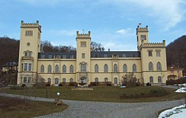
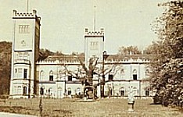
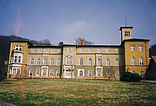

* * *

* * *

* * *

* * *

* * *

* * *

[**MUSE IM FASANENGARTEN e.V.**](http://www.muse-fasanengarten.de)

[Der Kulturverein im Fasanengarten Moritzburg](http://www.muse-fasanengarten.de)

Das Gebäude am Ausgang des Keppgrundes entstand um 1750 als Landsitz
des Grafen Brühl, der ein Jahr zuvor das Hosterwitzer Plantagengut erworben hatte. Ursprünglich lagen hier Weinberge, deren ältester bereits 1586 erstmals
erwähnt wurde. Bereits im 17. Jahrhundert existierte wohl ein Weinberghaus mit Presse, welches als Ursprung des späteren Keppschlosses betrachtet
werden kann. 1774 kaufte Graf Camillo Marcolini über einen Mittelsmann den früheren Brühlschen Besitz und ließ ein neues  Landhaus neben dem bereits
bestehenden Weinbergshäuschen errichten. Um das Gebäude entstand ein romantischer Landschaftspark mit künstlicher Ruine, Lusthaus und einer heute nicht mehr vorhandenen Brunnengrotte. Zu
den Besuchern Marcolinis auf seinem Hosterwitzer Sommersitz gehörte u.a. der spätere Papst Leo XII., weshalb eines der
Nebengebäude im Volksmund den Namen  “Papstschlösschen” trug. Bis zu seinem Tod 1814 konnnte Marcolini seinen
Hosterwitzer Besitz noch um weitere Grundstücke erweitern, den seine Erben jedoch schon bald aufsplitteten und an verschiedene Interessenten verkauften.

Auch die Besitzer des eigentlichen Keppschlosses wechselten mehrfach. Ab 1835
gehörte es mit den angrenzenden Weinbergen der Baronin von Trautvetter, deren Sohn das alte Weinbergspalais 1850 erweitern und umbauen ließ. Aus dieser Zeit
stammt auch der heute geläufige Name “Keppschloss”. Neuer Besitzer war ab 1861 der Bankier Robert Thode. Thode ließ den Bau im neogotischen Tudorstil
umgestalten und zu einem einheitlichen Baukörper zusammenfassen. Außerdem entstanden zwei kleinere Nebengebäude, ein Wirtschaftsgebäude und das Torhaus
mit der Hauptzufahrt. Thode konnte sich an seinem neuen Wohnsitz jedoch nur kurz erfreuen und musste aus finanziellen Gründen das Haus bereits 1865 an den
spanischen Konsul Friedrich Finke verkaufen. Das Bild zeigt das Gebäude nach dem Umbau.

Ab 1872 war das Keppschloß im Besitz der Großherzogin Elisabeth von Mecklenburg-Strelitz, die es bis zu ihrem Tode
1916 bewohnte. 1920 erwarb der rumänische Generalkonsul Dumitrescu das Schloss und bemühte sich erfolglos um eine
wirtschaftliche Nutzung. Nach mehrjährigen Auseinandersetzungen mit der Gemeinde Hosterwitz wurde 1925/26 im Keppschloss ein Kindergenesungsheim eingerichtet, welches jedoch wenige Jahre später ein Opfer der allgemeinen
Wirtschaftskrise wurde. Nach Zwangsversteigerung des Gebäudes 1933 nutzte der Reichsbund Deutscher Beamter das
Schloss einige Monate als Altersheim. Wenig später zogen eine Polizei- und eine Luftschutzschule in die Räumlichkeiten ein.

Nicht nur diese Nutzung sowie die während des Zweiten Weltkrieges erforderliche Unterbringung von Flüchtlingen
schädigten die historische Bausubstanz. Am 13./14. Februar schlug in der Nähe des Gebäudes eine Luftmine ein, die Dach
und Fenster in Mitleidenschaft zog. Nach notdürftiger Wiederherstellung konnte das Schloss jedoch schon bald wieder als Unterkunft für Umsiedler und Ausgebombte sowie als Lagerraum genutzt werden.

Nach Enteignung des letzten Besitzers Prinz Ernst Julius zur Lippe 1947 diente das
Gebäude zwischen 1951 bis 1989 als Schulungseinrichtung der Zivilverteidigung. Dafür wurde in den 1960er Jahren ein Obergeschoss aufgesetzt. Die drei
chrakteristischen Türme fielen späteren Umbauten zum Opfer, wodurch das frühere Aussehen negativ verändert wurde _(Foto 1996)_. Im Park entstanden ein weiteres
Lehrgebäude, ein Bettenhaus, ein Schießstand an Stelle der einstigen Kegelbahn sowie Garagen, welche das ursprüngliche Erscheinungsbild erheblich
beeinträchtigten. 1978 erhielt die zeitweise auch “Kalinin-Schule” genannte Einrichtung den Namen “Bezirksschule für Zivilverteidigung Dr. Kurt Fischer” und
wurde in die vormilitärische Ausbildung von Jugendlichen in der DDR einbezogen. Zwischen Dezember 1989 und Sommer
1990 waren hier zeitweise Bausoldaten untergebracht, die in verschiedenen medizinischen Einrichtungen Dresdens beschäftigt waren.

1990 zog die Sächsische Verwaltungs- und Wirtschaftsakademie in das Keppschloss ein und hatte hier bis 1996 ihr
Domizil. Eine Rekonstruktion des leerstehenden historischen Gebäudes scheiterte zunächst an den hohen Kosten.
Nachdem das Areal 2003 an eine Immobiliengesellschaft verkauft worden war, entstanden Luxus-Eigentumswohnungen im
Haus. In einer dieser Wohnungen lebte zeitweise der frühere sächsische Ministerpräsident Kurt Biedenkopf. Im Zusammenhang mit der Rekonstruktion konnte das Keppschloss äußerlich wieder weitgehend in den Ursprungszustand
versetzt werden. Auch in den Nebengebäuden befinden sich heute Wohnungen.
