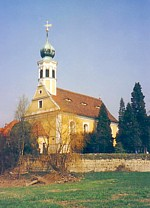
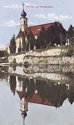

* * *

* * *

* * *

* * *

* * *

* * *

Die Kirche in Hosterwitz wurde1406 erstmals erwähnt, entstand aber als hölzerne Kapelle
vermutlich bereits im 12./13. Jahrhundert. Anlass für ihren Bau war die Bedeutung des Ortes für die Elbschiffer, die Hosterwitz als Rastplatz nutzten und hier bei Niedrigwasser
ihre Kähne umladen mussten. Zwischen 1497 und 1500 ließ Dionysius von Carlowitz einen spätgotischen Neubau errichten, der nach der Gottesmutter und Schutzpatronin der
Schiffer als “Maria am Wasser” geweiht wurde. Bis zur Reformation diente diese Kirche als Wallfahrtsort und wurde dann zur evangelischen Pfarrkirche der Dörfer Hosterwitz,
Nieder- und Oberpoyritz, Rockau, Pillnitz und Söbrigen. Ab 1638 war der Hosterwitzer Pfarrer zugleich Prediger der Pillnitzer Schlosskapelle.

1704 erfolgte
ein Umbau der Kirche in Barockformen. Der Bau verzögerte sich um einige Jahre, da der berüchtigte Räuber Lips Tullian bei einem Einbruch am 26. August 1702 das
für den Kirchbau gesammelte Geld entwendet hatte. Die Bande erbeutete dabei 687 Taler sowie mehrere sakrale
Gegenstände. 1714/15 konnten die Täter schließlich gefasst und hingerichtet werden. Nur mit Hilfe von Spenden und
Darlehen aus der Witwen-Kasse der Priester zu Dresden wurde die Kirche schließlich vollendet und eingeweiht. Weitere Umbauten folgten 1741 und 1774. In diesem Zusammenhang bekam die Kirche ihr charakteristisches
Zwiebeltürmchen und damit ihr heutiges Aussehen _(Foto)_.

Im Inneren der Kirche befinden sich neben einigen historischen Grabplatten Teile eines
Altars von 1644 (von Abraham Conrad Buchau) sowie ein erst 1929 nach Hosterwitz gekommener Taufstein. Der 1786 geschaffene Stein befand sich zuvor in der Kirche von
Lichtenhain (Sächsische Schweiz). 1862/63 wurde eine Kreuzbach-Orgel mit 18 Registern eingebaut. Interessant sind auch einige Hochwassermarken an der Kanzeltreppe
hinter dem Altar. Ein Glasfenster von 1555 stellt die Kreuzigung Jesu dar. Weitere Fenster stammen vom Ende des 19. Jahrhunderts. Bemerkenswert sind auch einige
Bildnisse und Epitaphien früherer Hosterwitzer Pfarrer bzw. böhmischer Exulanten, die nach dem Dreißigjährigen Krieg in Sachsen Zuflucht gefunden hatten.

Beim Luftangriff am 13. Februar 1945 blieb “Maria am Wasser” unbeschädigt, wurde jedoch am 3. März des gleichen Jahres von einer Brandbombe getroffen. Nur dem
Einsatz des Pfarrers ist es zu verdanken, das größerer Schaden verhindert werden konnte. 1972/73 wurde die Kirche komplett restauriert und erhielt dabei ihre originale
Farbgebung zurück. Heute gehört die Hosterwitzer Kirche zu den schönsten Dorfkirchen im Stadtgebiet und ist wegen ihrer romantischen Lage am Elbufer als “Hochzeitskirche” sehr beliebt. Große Schäden richtete das
Elbehochwasser vom August 2002 an, welches den Innenraum der Kirche unter Wasser setzte und auch den Hosterwitzer Friedhof überflutete. Erst ein Jahr später konnte der komplett renovierte Bau wieder geweiht werden.

An der Außenseite der Kirche sind einige historische Grabplatten zu sehen, u.a. der Grabstein des Leipziger
Buchhändlers Johann Friedrich Hartknoch. Dieser war Inhaber der Hartknochschen Buchhandlung in Leipzig und bewohnte ab 1817 das heute als “Einkehr am Palmenhaus” genutzte Gebäude auf der Orangeriestraße 5. Hartknoch
stürzte am 8. September 1819, wohl infolge eines Schlaganfalls, in die Elbe und konnte nur noch tot geborgen werden.

Alter Hosterwitzer Friedhof:

Der erste Hosterwitzer Friedhof entstand schon mit dem Bau der Kirche und befand sich unmittelbar am Gotteshaus.
Nach Anlage des neuen Friedhofs an der Dresdner Straße wurde er 1870 geschlossen, wird jedoch seit 1930 wieder als Begräbnisort genutzt.

Auf dem Kirchhof sind einige historische Grabdenkmale von Mitgliedern des kurfürstlichen Hofes aus Pillnitz zu
sehen. Zu ihnen gehört der Silberpage Christoph Ferdinand von Brandenstein, der 1788 mit nur 18 Jahren in der Elbe
ertrank. Auch die Maler Ludwig von Hoffmann (1861-1945), Ernst Alfred Mühler (1898-1968), Heinrich Klemm (+ 1982) und das Künstlerehepaar Wanda Bibrowicz (+ 1954) und Max Wislicenus (+ 1957) wurden auf dem alten
Hosterwitzer Friedhof beigesetzt. Bemerkenswert ist die Grabstelle des Verlegers Karl Knoch (1768-1819) mit der
Inschrift “der Menschenfreund” und einem Wahlspruch. Ein unscheinbares Grabmal erinnert an den Architekten und TU-Professor Rolf Göpfert (1903-1994), der an mehreren Entwurfsarbeiten für den Wiederaufbau Dresdens nach
1945 beteiligt war. Auch der Dichter und Initiator der Deutschen Schillerstiftung Julius Hamer (1810-1862) fand hier seine letzte Ruhestätte.

Neuer Hosterwitzer Friedhof:

Nachdem der alte Kirchhof zu klein geworden war und eine Erweiterung wegen der Hochwassergefahr nicht möglich
war, entstand 1870 ein neuer Friedhof an der Dresdner Straße. Beim Bau wurde ein frühgeschichtliches Gräberfeld
der Lausitzer Kultur (um 1200 v. Chr.) freigelegt. Auch hier fanden einige bekannte Persönlichkeiten ihre letzte
Ruhestätte, darunter der Kunst- und Porträtmaler Emil von Hartitzsch (+1907), der  Hofgärtner Georg Arlt (+1908),
die Maler Max Pietschmann (1865-1952) und Hans Herzig (+1971) sowie die Glasbläser Leopold (1822-1895) und Rudolph Blaschka (1857-1939). Vater und Sohn Blaschka fertigten in ihrer [Hosterwitzer Werkstatt](../../../nordost/hosterwitz/dresdner_strasse/) ab 1890 über
3000 Glasmodelle von Pflanzen für die Harvard-Universität in Boston/USA an. Echte Erdbeerpflanzen schmücken das Grab des Pflanzenzüchters Prof. Otto Schindler (1876-1936). Schindler wirkte an der [Pillnitzer Gartenbauschule](../../../nordost/pillnitz/institut_fur_gartenbau/)
und züchtete die beliebte Erdbeersorte “Mieze Schindler”, welche er nach seiner 1959 ebenfalls hier beigesetzten Frau Margarethe benannte.

2008 wurde auf dem Friedhof eine Gedenkstätte für die 1945 bei Luftangriffen ums Leben gekommenen Einwohner
der Elbhangorte angelegt. Ein weiteres Denkmal erinnert an die im Deutsch-Französischen Krieg 1870/71 gefallenen Soldaten.

* * *

 \[ [Home](../../../index.html)\] \[ [Nord](../../../nord/)\] \[ [Nordwest](../../../nordwest/)\] \[ [Neustadt](../../../neustadt/)\] \[ [Nordost](../../../nordost/)\] \[ [West](../../../west/)\] \[ [Zentrum](../../../zentrum/)\] \[ [Südwest](../../../sudwest/)\] \[ [Süd](../../../sud/)\] \[ [Südost](../../../sudost/)\] \[ [Ost](../../../ost/)\] \[ [Register](../../../Register/register.html)\] \[ [Kontakt](../../../Kontakt/kontakt.html)\] \[ [Impressum](../../../impressum/)\]
