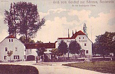
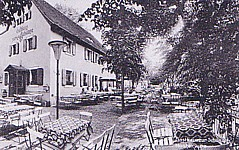
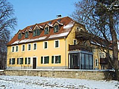

* * *

* * *

* * *

* * *

* * *

* * *

Die Schanzschenke geht auf eine vermutlich um 1700 entstandene kleine
Gastwirtschaft an der [Hosterwitz - Laubegaster Fähre](../../../nordost/hosterwitz/) zurück, welche zunächst “Strohschenke” genannt wurde. Zuvor hatte es in dieser Gegend bereits
während des Dreißigjährigen Krieges eine sogenannte “Schwedenschänke” gegeben. Hauptsächlich wurden diese Wirtschaften von Fuhrleuten besucht, welche hier auf die Überfahrt zum anderen Elbufer zu warteten.

1708 erwarb Anna Constantia von Cosel, Mätresse August des Starken und Besitzerin der Herrschaft Pillnitz, durch Schenkung ein Grundstück und ließ hier
ein festes Haus für den Ausschank und zur Beherbergung von Gästen erbauen. Neben Pillnitzer Bier durften auch Schlachtgerichte sowie Räucher- und Pökelware des Kammergutes
verkauft werden. 1713 pachtete der frühere Knecht Martin Böhme, 1720 Georg Böhme das Gebäude, das nach einer einst an dieser Stelle befindlichen Schanze des
Dreißigjährigen Krieges den Namen “Schanzschenke” erhielt. 1729 entstand unter der Regie des nächsten Pächters ein größerer Steinbau, welcher neben der eigentlichen Schankstube, der Küche und den Vorratsräumen mehrere
Nebenräume sowie einen Pferdestall für bis zu 14 Pferde besaß. Bei einer schweren Eisflut Ende Februar 1784 wurde das Haus völlig zerstört. Nur mit Mühe konnte die Gastwirtsfamilie von den Anwohnern gerettet werden.

Bereits im Folgejahr entschloss man sich
zum Wiederaufbau der Schenke, wobei das Haus im Wesentlichen sein heutiges Aussehen erhielt. Noch immer erinnert ein Schlussstein mit den Initialien J. G. R./St. (= Johann Georg Steigert)
und der Jahreszahl 1785 über der Eingangstür an diese Zeit. Immer wieder wechselten die Pächter das Gasthauses, welche regelmäßig mit den Problemen
von Hochwasser und Eisgang zu tun hatten, so dass sich wiederholt Reparaturen am Haus erforderlich machten. Erwähnenswert ist die Familie Sachse, welche
von 1822 bis 1843 die Schankwirtschaft betrieb. 1873 kam die Schanzschänke in den Besitz des Plantagengutinhabers Julius Friedrich Finke. Unter Leitung des
neuen Pächters Friedrich Wilhelm Preußler entstanden eine Terrasse und ein Gästegarten an der Elbseite, um den
zunehmenden Strom von Ausflüglern bewirten zu können. Für zusätzliche Einnahmen sorgte 1906/08 die Unterbringung von Bauarbeitern, welche mit der Errichtung des Hosterwitzer [Wasserwerkes](../../../nordost/hosterwitz/) beschäftigt waren.

Nachdem das Gasthaus 1910 in den Besitz der Stadt Dresden gekommen war, wechselten erneut die Betreiber. Umbauten und Renovierungen erfolgten in den
Zwanziger und Dreißiger Jahren. Während des Zweiten Weltkrieges waren hier zeitweise französische Zwangsarbeiter untergebracht. Nach Kriegsende begann
jedoch der Niedergang des Lokals. Die geplante Umwandlung in Wohnräume für Angestellte des Wasserwerkes konnte durch die damals noch selbständige Gemeinde
Hosterwitz 1948 verhindert werden. Nach der Eingemeindung erfolgte jedoch um 1950 die Schließung der Gaststätte und der Umbau zum Kindergarten. In diesem
Zusammenhang wurde das Gebäude Ende der 50er Jahre saniert. An der Fassade entstand dabei ein von Studenten der Hochschule für Bildende Künste unter Leitung von Werner Hofmann gestaltetes
Sgraffito mit Darstellung der “fliegenden Fähre” als Erinnerung an die Geschichte des Hauses. Nach Schließung des
Kindergartens 1992 wurde die Schanzschänke denkmalgerecht saniert und dient heute als Wohnhaus. Leider ging beim jüngsten Umbau das Sgraffito verloren.

* * *

 \[ [Home](../../../index.html)\] \[ [Nord](../../../nord/)\] \[ [Nordwest](../../../nordwest/)\] \[ [Neustadt](../../../neustadt/)\] \[ [Nordost](../../../nordost/)\] \[ [West](../../../west/)\] \[ [Zentrum](../../../zentrum/)\] \[ [Südwest](../../../sudwest/)\] \[ [Süd](../../../sud/)\] \[ [Südost](../../../sudost/)\] \[ [Ost](../../../ost/)\] \[ [Register](../../../Register/register.html)\] \[ [Kontakt](../../../Kontakt/kontakt.html)\] \[ [Impressum](../../../impressum/)\]
