* * *

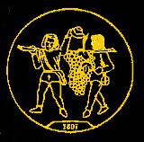

**Gemeindesiegel von Loschwitz**

* * *

**Loschwitzer Stadtteilseiten:**

* * *

**Schulen in Loschwitz:**

[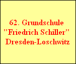](http://www.sn.schule.de/~gs62dd/)

[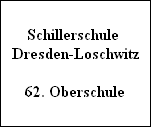](http://www.schiller-schule-dresden.de)

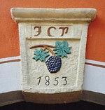Die Gemeinde Loschwitz entwickelte sich aus einem Rundweiler unmittelbar am Elbufer und
ist mit ca. 350 Hektar einer der flächenmäßig größten Stadtteile Dresdens. Neben dem eigentlichen Dorfkern südlich des [Körnerplatzes](../../nordost/loschwitz/strassen_loschwitz/kornerplatz/) gehören auch die Elbhänge bis zur [Bautzner Landstraße](../../nordost/page10246/strassen_weisser_hirsch/bautzner_landstrasse/), der [Loschwitzgrund](../../nordost/loschwitz/strassen_loschwitz/grundstrasse/) bis in Höhe Ulrichstraße und Fluren entlang der [Pillnitzer Landstraße](../../nordost/loschwitz/strassen_loschwitz/pillnitzer_landstrasse/) dazu.  Der Ort wurde 1315 als Loscuicz urkundlich erwähnt, war jedoch bereits
zuvor besiedelt. Neuere Quellen weisen auf eine Ersterwähnung des Dorfes in einer Tauschurkunde des Bischofs von Meißen vom 18. Oktober 1227 hin. An Stelle der späteren Gaststätte [Burgberg](../../nordost/loschwitz/strassen_loschwitz/burgberg/) befand sich im 11./12. Jahrhundert eine slawische Wallanlage, von der
jedoch keine Spuren mehr zu sehen sind. Der Ortsname wurde vermutlich vom Ortsgründer Lozek abgeleitet, könnte aber auch auf das slawische Wort Loziza = Weinstock bzw. Leska = Haselnußstrauch zurückgehen.

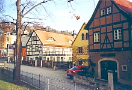Loschwitz bestand früher aus drei Gemeindeteilen, von denen der Dorfkern an der heutigen [Friedrich-Wieck-Straße](../../nordost/loschwitz/strassen_loschwitz/friedrich-wieck-strasse/) der älteste ist _(Foto)_. Neben dieser
Ratsgemeinde, die dem Rat der Stadt Dresden bzw. dem Maternihospital gehörte, existierte noch die dem Justizamt unterstehende Amtsgemeinde entlang der [Grundstraße](../../nordost/loschwitz/strassen_loschwitz/grundstrasse/) sowie die Winzergemeinde, die die verstreuten
Weinbergsgrundstücke an den Elbhängen umfasste. Hinzu kamen sechs weitere Grundstücke, die zum Rittergut Wachwitz gehörten. Die komplizierten Besitzverhältnisse erschwerten die Herausbildung einer einheitlichen
Gemeindeverwaltung, die erst nach dem Zusammenschluss der drei Ortsteile im Zuge der sächsischen Landgemeindeordnung von 1838 erfolgte. Anteile an den Loschwitzer Weinbergen besaßen u. a. das Dresdner
Maternihospital, das Augustinerkloster in der Neustadt und die Pirnaer Stadtkirche. Später kamen die meisten Flächen in den Besitz wohlhabender Dresdner Bürger und Adliger, die hier ihren Sommerwohnsitz nahmen. Zu
diesen gehörten der Kreuzkantor Heinrich Schütz, der Oberlandbaumeister Wolf  Kaspar von Klengel und der
Goldschmied Melchior Dinglinger. 1785 erwarb auch die Familie Körner ein Weinberggrundstück in Loschwitz, in dem zeitweise Friedrich Schiller weilte und hier an seinem “Don Carlos” schreib

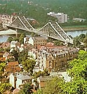Die Bewohner im Dorf lebten hingegen vorrangig von der Elbe und verdienten ihren
Lebensunterhalt als Fischer und Elbschiffer. Der Ackerbau blieb unbedeutend, da Loschwitz nur zwei Bauerngüter besaß. Die übrigen Einwohner des Ortes waren arme
Häusler, die ihre Wohnungen in den Weinbergen bzw. im unteren Teil der Grundstraße hatten. Meist betrieben diese neben Wein- auch etwas Obst- und Gartenbau bzw. führten
kleinere handwerkliche Arbeiten aus. 20 von ihnen waren nebenberuflich als Jagdhelfer des Kurfürsten beschäftigt und wurden deshalb die “Zwanziger” genannt. An sie erinnert
noch die Zwanzigerstraße im Stadtteil Weißer Hirsch. Außerdem existierten in Loschwitz einige Mühlen an der heutigen Grundstraße, die vom Loschwitzer Dorfbach “Trille”
angetrieben wurden. Schwer betroffen war das Dorf durch die häufig auftretenden Elbehochfluten, aber auch durch
kriegerische Ereignisse. Am 25. Juni 1639 brannten schwedische Soldaten fast alle Gebäude nieder. Zerstörungen gab
es aber auch im Siebenjährigen Krieg und durch Napoleons Truppen im Jahr 1813. Hochwasserkatastrophen sind in
den Chroniken u.a. für 1501, 1530, 1655, 1784, 1799, 1845, 1890 und zuletzt 2002 verzeichnet. An letztere erinnert ein Denkmal an der Friedrich-Wieck-Straße.

_“...besonders erbarmungswürdig anzusehen war es, als des Morgens ein Schiff aus der_

_Gegend von Schandau mit zwei darauf befindlichen und um Hülfe flehenden Schiffsleuten in_

_den wüthenden Eisschollen mit ankam... Die Wut des Stromes traf 43 Einwohner. Davon litten 24 mehr_
_oder minder großen Schaden an Gebäuden, 2 Häuser wurden fast völlig ruiniert.”_

**Aus alten Loschwitzer Aufzeichnungen von 1799**

Mit Beginn des 19. Jahrhunderts entwickelte sich das frühere Winzer- und Fischerdorf  zunehmend zum Ausflugsort,
was zur Gründung zahlreicher kleiner Weinschänken und Gastwirtschaften führte. Vor allem Künstler fühlten sich von
der Atmosphäre des Ortes angezogen. So verbrachten u.a. die Maler Gerhard von Kügelgen und Ludwig Richter viele
Sommer ihres Lebens in Loschwitz. Hinzu kamen Tagesbesucher aus der nahen Residenzstadt sowie deren Gäste aus
aller Welt. Gefördert wurde diese Entwicklung durch die Einrichtung einer Schiffsanlegestelle im Jahr 1851 und den Einsatz leistungsstärkerer Dampfboote für die bereits 1556 erstmals erwähnte Elbfähre.

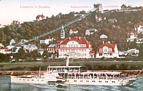

**_Foto:_** _Blick vom Blasewitzer Elbufer auf die Loschwitzer Elbhänge um 1920_

Einhergehend mit dieser Enwicklung und der Bildung der Gemeinde Loschwitz um 1839 veränderte sich auch die Sozialstruktur des Dorfes. Die vorhandenen Weinberge wurden Mitte des 19. Jahrhunderts wegen des Rückgangs der
Erträge zum Großteil parzelliert und mit villenartigen Landhäusern bebaut. Kurz zuvor hatte der Dresdner Rat den im
Besitz des Maternihospitals befindlichen Weinberg in der Nähe der Kirche veräußert. Heute erinnern nur noch Reste
alter Weinbergsmauern, Treppen und Weinspaliere an einigen Häusern an den früher wichtigsten Wirtschaftszweig, der
mit dem Auftreten der Reblaus 1887 endgültig zum Erliegen kam. Dank dem aus Loschwitz stammenden Pionier der Fotografie August Kotzsch sind bis heute viele Aufnahmen aus dieser Zeit erhalten geblieben.

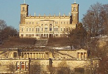Auch im westlichen Ortsteil veränderte sich das Bild. Auf dem früheren Weinberg
des Grafen Findlater entstanden ab 1850 die drei [“Albrechtsschlösser”](../../nordost/loschwitz/albrechtsschlosser/) für den
preußischen Prinzen Albrecht, seinen Kammerherren Baron von Stockhausen und den Großkaufmann Souchay _( **Foto:** Schloss Albrechtsberg)_. Die Gebäude
dominieren bis heute das Panorama dieses Elbeabschnitts und gehören neben dem Blauen Wunder zu den Wahrzeichen von Loschwitz. Am nahegelegenen Schotengrund besaß einst die bekannte Verlegerfamilie Brockhaus ein
Grundstück. Unweit davon befindet sich seit 1870 das Wasserwerk [Saloppe](../../nordost/loschwitz/strassen_loschwitz/saloppe/), benannt nach einer 1945 zerstörten Ausflugsgaststätte am Elbhang.

Der Aufschwung des Ortes führte gegen Ende des 19. Jahrhunderts zu Eingriffen in die überkommene Bausubstanz.  Teile des Dorfkerns mussten 1893 dem Bau der Elbbrücke [“Blaues Wunder”](../../nordost/loschwitz/blaues_wunder/) weichen. Weitere Gebäude fielen der
kompletten Umgestaltung des Körnerplatzes im Stil der Gründerzeit zum Opfer. Für bessere Verkehrsverbindungen
sorgte nicht nur der Bau der Straßenbahnlinie nach Pillnitz, sondern auch die Anlage der beiden Bergbahnen zum [Weißen Hirsch](../../nordost/page10246/standseilbahn/) (1895) und nach [Oberloschwitz](../../nordost/loschwitz/schwebebahn/) (1901). An ihren Kopfstationen entstanden beliebte Gaststätten wie der [Luisenhof](../../nordost/page10246/strassen_weisser_hirsch/luisenhof/) und die heute nicht mehr vorhandene [Loschwitzhöhe](../../nordost/loschwitz/strassen_loschwitz/loschwitzhohe/). Trotz des heftigen Widerstandes der Einwohner wurde
Loschwitz am 1. April 1921 nach Dresden eingemeindet.

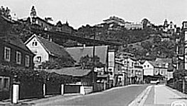

**_Foto:_** _altes und neues Loschwitz um 1930: Blick von der Grundstraße zum Luisenhof_

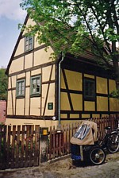Auch dieser Stadtteil blieb nicht von den Zerstörungen des Luftangriffs 1945 verschont. Neben mehreren Wohnhäusern fielen die Körnerschule und die gegenüberliegende [Kirche](../../nordost/loschwitz/loschwitzer_kirche/) den Bomben zum Opfer. Die Sprengung des Blauen Wunders wurde durch mutige Dresdner
in den letzten Kriegstagen verhindert, so dass sich in Loschwitz zeitweise der einzige erhaltene Elbübergang im Stadtgebiet befand. Die Nachkriegszeit führte zu einem Verfall der
erhaltenen Bausubstanz und zur Schließung zahlreicher Loschwitzer Gaststätten. So wurden der 1945 zerstörte Gasthof Burgberg sowie die 1967 wegen Baufälligkeit geschlossene Loschwitzhöhe abgerissen. Auch das [Elbe-Hotel](../../nordost/loschwitz/strassen_loschwitz/friedrich-wieck-strasse/elbe-hotel/) am Dorfplatz musste 1979 baubedingt
schließen und stand seitdem in ruinösem Zustand leer. Derzeit läuft der Ausbau zu Wohnzwecken.

Nach 1990 gelang es, einen Großteil der historischen Gebäude in Loschwitz zu sanieren. So
wurden die Gründerzeithäuser rund um den Körnerplatz restauriert, ebenso wie viele denkmalgeschützte Häuser im alten Dorfkern und am Elbhang _( **Foto:** Veilchenweg 1)_. Moderne Wohnparks
entstanden mit dem Augustuspark und den Loschwitz-Arkaden in der Nähe der [Pillnitzer Landstraße](../../nordost/loschwitz/strassen_loschwitz/pillnitzer_landstrasse/). Dank privater
Initiative und Spenden aus ganz Deutschland konnte 1991-94 die zerstörte Loschwitzer Kirche wiederaufgebaut
werden. Aus dieser Bürgerinitiative ging auch das mittlerweile traditionelle Elbhangfest hervor, welches zu den größten Dresdner Volksfesten gehört und alljährlich im Juni begangen wird.

Rathaus Loschwitz:

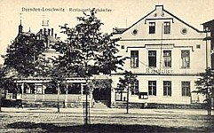Das frühere Loschwitzer Rathaus entstand 1859 als "Bormannscher Weinschank" (ab 1883 Gaststätte “Unterer Burgberg”) an der Einmündung der Grundstraße in den Körnerplatz _(Foto)_. Die Gemeindeverwaltung nutzte zu diesem Zeitpunkt ein Bauernhaus im alten Dorfkern an der Friedrich-Wieck-Straße. Architekt des Neubaus war der ortsansässige Architekt und Bauunternehmer Theodor Lehnert,der sechs Jahre zuvor bereits den “Oberen Burgberg” entworfen hatte. 1883 bezogen die Gemeinderäte die Räume über der Gaststätte, die unter dem Namen “Loschwitzer Ratskeller” noch bis in die 1970er Jahre existierte. Ein weiteres Lokal entstand mit dem “Bräustübel” im vorderen Teil des Grundstücks. Hier befanden sich zuvor die Diensträume der Loschwitzer Ortspolizei mit drei Arrestzellen. Später wurde der kleine Bau u.a. als Zeitungskiosk und “Stadtcafé” genutzt, 1978 jedoch wegen Baufälligkeit geschlossen.

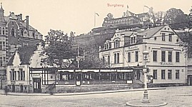Ab 1903 gehörten auch die angrenzenden Grundstücke Grundstraße 1 und 3 zum Rathauskomplex. Hier befanden sich u.a. die Prüfstation und die Rohrmeisterei des Wasserwerkes, die Steuer- und Wasserzinshebestelle, das Loschwitzer Einwohnermeldeamt und die Brückenverwaltung für das “Blaue Wunder”. Weitere kommunale Behörden folgten bis zur Eingemeindung des Ortes 1921. Danach übernahmen städtische Dienststellen wie das Stadtsteueramt, die Kreisstelle des Fürsorgeamtes und die Spar- und Girokasse die Räume. Zeitweise gab es hier auch eine Polizeidienststelle.

Beim Luftangriff auf Dresden wurde das zum Rathaus gehörende Nebengebäude Grundstraße 1 schwer beschädigt. In den 1950er Jahren entstand an seiner Stelle eine Trafostation sowie eine Buswartehalle mit öffentlichen Toiletten und einem Zeitungskiosk. Grundstraße Nr. 3 wurde bis 1989 u.a. von der Wohnbezirksparteiorganisation der SED genutzt. Das frühere Rathaus selbst diente noch bis 1975 als HO-Gaststätte "Ratskeller" und Wohnhaus, danach noch einige Jahre als Lagerraum. Eine geplante Rekonstruktion der Gebäude durch eine Handwerker-PGH scheiterte am Materialmangel in der DDR. Der auf der Terrasse als Interimslösung eingerichtete Kiosk fiel 1977 einem Brand zum Opfer.

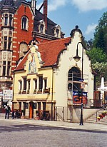Das stark verfallene frühere Rathaus wurde 1994 zugunsten des Ortsamtes Loschwitz
abgetragen. Auch die Häuser Grundstraße 1 und 3 mussten dem Bauvorhaben weichen. Der moderne Neubau nach Plänen des Architektenbüros Hentrich und Partner KG stieß wegen
seiner architektonischen Gestaltung auf heftige Kritik seitens der Bevölkerung. Heute befinden sich hier u.a. Räume für den Ortsbeirat Loschwitz, verschiedene städtische Dienststellen und eine Filiale der Sparkasse. An das alte Rathaus erinnert noch das in den letzten Jahren sanierte und wieder gastronomisch genutzte “Bräustübel” am Körnerplatz unmittelbar neben der Talstation der Standseilbahn _(Foto links)_. An der Fassade befindet sich ein in den Zwanziger Jahren entstandenes Wandbild, welches einen Bier trinkenden Ritter auf seinem Pferd zeigt. Das in der Nachkriegszeit entfernte Gemälde konnte 2004 nach historischen Vorlagen rekonstruiert werden.

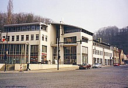

**_Foto:_** _Das Loschwitzer Ortsamt an Stelle des früheren Rathauses_

Schulen in Loschwitz:

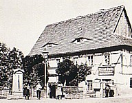Dorfschule: Loschwitz war früher als Schulort für die umliegenden Dörfer von
Bedeutung. Bereits 1668 wurde die hiesige Dorfschule erstmals erwähnt, die zu diesem Zeitpunkt auch von den Kindern aus Wachwitz und vom Weißen Hirsch
besucht wurde. Beide Gemeinden errichteten erst im 19. Jahrhundert eigene Schulhäuser. Der Unterricht in Loschwitz fand zunächst in wechselnden Bauernstuben,
später im alten Pfarrhaus am Dorfplatz statt, welches 1892 dem Bau des Blauen Wunders weichen musste. Bereits 1710 wurde die Schule jedoch in einen Neubau zur
Pillnitzer Landstraße 8 verlegt. Mehrfach erweitert, diente dieses Haus bis 1886 seinem Zweck. Nach erneuter Verlagerung der Klassenräume wurde das Gebäude als
Wohnhaus, öffentliche Bücherei und zwischen 1904 und 1909 von der Höheren Bürgerschule genutzt. Zwischen 1934 und 1948 hatte hier auch das Loschwitzer Ortsmuseum sein Domizil. Heute befinden sich in diesem Gebäude
Wohnungen, die Pfarramtskanzlei und ein Naturkostladen.

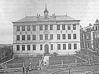
Körnerschule: Trotz der erfolgten Umbauten genügte die alte Schule gegen Ende des 19. Jahrhunderts nicht mehr den Anforderungen. Gegenüber der Kirche erbaute die
Gemeinde Loschwitz deshalb 1886 ein neues Schulgebäude, welches am 18. April 1887 eingeweiht werden konnte. Der dreistöckige Schulbau im Stil der Gründerzeit _(Foto)_
besaß neben den Klassenräumen auch eine eigene Turnhalle und trug seit 1919 den Namen Körnerschule. Das Gebäude brannte beim Luftangriff 1945 aus
und wurde in den 50er Jahren abgerissen. Heute befindet sich an dieser Stelle eine Grünfläche.

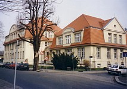Schillerschule: Als viertes Schulhaus des Ortes errichtete die Gemeinde 1909 an der damaligen König-Albert-Allee (Fidelio-F.-Finke-Straße) die Schillerschule _(Foto)_
. Architekt des mit modernen Fachkabinetten, Aula und Bibliothek ausgestatteten Gebäudes war der Loschwitzer Professor Georg Schramm. Zunächst als Höhere Bürgerschule genutzt, wurde diese Schule nach der
Eingemeindung des Ortes 1921 zur 62. Volksschule umgewandelt, behielt jedoch gleichzeitig ihren alten Namen. Die zwischen 1959 und 1992 als 62. POS
“Friedrich Schiller” bezeichnete Schule wird heute als Oberschule weitergeführt. Ende der 1990er Jahre erfolgte eine umfassende Sanierung des Gebäudes. Ein
1913 von Georg Schwenk aus Wachwitz geschaffenes Wandbild in der Aula wurde 1951/52 übermalt, konnte jedoch
2003 restauriert werden. Das Gemälde stellt “Die Erziehung der Jugend im Geiste Schillers” dar. Weitere künstlerische
Details stammen von Professor Brodauf (Reliefs an der Fassade und im Treppenhaus) sowie von Professor Josef Goller
(Glasfenster mit Tierkreiszeichen). Zum Schulgrundstück gehört auch ein Sportplatz, welcher 1979 auf dem Gelände der ehemaligen Gärtnerei Knackfuß angelegt wurde.

Neue Grundschule:
Um den gewachsenen Schülerzahlen im Raum Loschwitz Rechnung zu tragen, entstand ab 2009 auf dem Grundstück der ehemaligen Straßenmeisterei an der Winzerstraße ein Neubau für die 62. Grundschule “Friedrich
Schiller”. Die Grundsteinlegung erfolgte am 24. Juni 2009, die Fertigstellung mit Beginn des Schuljahres 2010/11. Als
erstes Dresdner Schulhaus wurde das Gebäude im Passivhausstandard gebaut und verfügt über ein spezielles Lüft- und
Heizungssystem, welches eine automatische Sauerstoffzufuhr gewährleistet. Insgesamt gibt es acht Klassenräume, einen Werkraum, Mediathek, Gruppenräume für die Ganztagsbetreuung und eine integrierte Sporthalle.

Ortsmuseum Loschwitz:

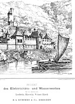Im Jahr 1882 gründeten heimatkundlich interessierte Loschwitzer einen Ortsverein, der sich
der Pflege regionalen Brauchtums und der Bewahrung von Zeugnissen der Ortsgeschichte verschrieb. 1902 rief der Gemeinderat einen Ausschuss für Ortsgeschichte ins Leben,
welcher unter Leitung des Baurates Schramm mit der Sammlung und dem gezielten Ankauf von Exponaten begann. Wenige Jahre später konnte im früheren Schulhaus an der Pillnitzer
Landstraße 8 ein Ortsmuseum eingerichtet werden. Zu den Beständen gehörten u. a. kirchen- und gemeindeamtliche Dokumente, Chroniken und Fotos. Das Bild _(rechts)_ zeigt eine
Entwurfszeichnung für das geplante, jedoch nie realisierte Loschwitzer Elektrizitätswerk durch die Niedersedlitzer [Firma Kummer](../../ost/niedersedlitz/sachsenwerk/).

Zunächst nutzte das Museum einige Räume im Obergeschoss der Schule, zog jedoch 1909 ins Erdgeschoss um. Im Zuge der Eingemeindung gingen die Bestände in den Besitz der
Kirchgemeinde über, welche sich im Gegenzug zum Erhalt des Ortsmuseums verpflichten musste. In den Zwanziger
Jahren war ein Umzug in das geplante, jedoch nie realisierte neue Stadthaus am Körnerplatz vorgesehen. Stattdessen
entschied man sich 1932, die vorhandenen Räume umzubauen und zu erweitern. Die Einweihung des neu gestalteten Museums erfolgte am 17. Juni 1934. Fortan konnten die Besucher neben der ortsgeschichtlichen Sammlung mit
zahlreichen Fotografien von August Kotzsch ein Ludwig- Richter-Gedenkzimmer sowie einen dritten Raum mit Werken örtlicher Künstler besichtigen. Schenkungen und Ankäufe erweiterten und ergänzten die Sammlung.

1948 wurde der Ortsverein Loschwitz per Verfügung aufgelöst. Das vorhandene Vermögen ging dabei in den Besitz der
Stadt Dresden über. Wenig später kündigte die Kirchgemeinde die Räume auf der Pillnitzer Landstraße 8, so dass auch
das Museum schließen musste. Zunächst wurden dessen Bestände in der Nordhalle (heute Militärhistorisches Museum)
deponiert und 1965 ins neue Dresdner Stadtmuseum verbracht. Eine Reihe historischer Archivalien kehrte 1997 in das Pfarrarchiv der Loschwitzer Kirchgemeinde zurück.

Postamt:

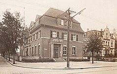Noch bis zur Mitte des 19. Jahrhunderts oblag der gesamte Postverkehr des
Ortes und seiner Nachbargemeinden den Postboten, welche - ohne festen Standort - in den Dörfern zu Fuß unterwegs waren und postalische Dienstleistungen anboten. Erst 1857 erhielt Loschwitz sein erstes eigenes
Postamt, welches sich zunächst in einem heute nicht mehr bestehenden Haus an der Brückenstraße befand. Dieses war auch für die Versorgung von Blasewitz, Bühlau, Quohren, Nieder- und Oberrochwitz, Wachwitz, Pappritz
und des Weißen Hirsch verantwortlich.

Auch das wenig später eingeweihte zweite Postgebäude an der Friedrich-Wieck-Straße 1 ist nicht mehr erhalten. 1885
wurde die Post zur Schillerstraße, wenige Jahre später in die Villa Pillnitzer Landstraße 14 verlegt. Diese Villa, die sich
unmittelbar neben der Körnerschule befand, fiel 1945 den Bomben zum Opfer. Zu diesem Zeitpunkt befand sich das Postamt aber bereits in einem anderen Gebäude, welches für diesen Zweck 1912 an der Pillnitzer Landstraße 30
errichtet worden war _(Foto)_. Hier hatte die auch für die Nachbarorte zuständige Post bis nach 1990 ihren Sitz. im Anschluss übernahm eine private Postagentur deren Aufgaben (Pillnitzer Landstraße 34, ab 2011 34a).

Elbebad:

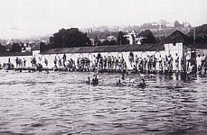
Das Loschwitzer Elbebad entstand wie die meisten Bäder seiner Ende des 19. Jahrhunderts und befand sich im Besitz der Elbfischerfamilie Höhle. Die Familie
gehörte zu den ältesten im Ort und ist bereits vor 1600 in den Urkunden verzeichnet. Da die Fischerei den Lebensunterhalt allein kaum deckte, entschloss man sich um 1880, als Nebenerwerb eine Schwimm- und
Badeanstalt am Elbufer zu errichten. Das Bad besaß ein großes Schwimmbassin sowie 15 kleinere Einzelkabinen und war insgesamt 90 Meter lang. Zu den
Besuchern des stadtbekannten Bades gehörten auch die sächsischen Prinzen, welche hier das Schwimmen erlernten. 1936 wurde das Elbebad an die Stadt
Dresden verkauft. Beim Luftangriff 1945 wurde es im Winterquartier im Loschwitzer Hafen schwer beschädigt und im September 1947 als letztes Elbebad im Stadtgebiet endgültig geschlossen.

Elbfähre:

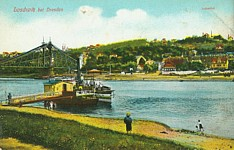
Die Geschichte der Loschwitzer Elbfähren reicht bis ins 15. Jahrhundert zurück. Bereits um 1430 soll es hier eine Fähre gegeben haben, welche 1556 urkundlich genannt wird. Die Fährgerechtigkeit lag auf dem noch heute
erhaltenen [Fährgut](../../nordost/loschwitz/strassen_loschwitz/friedrich-wieck-strasse/) (Friedrich-Wieck-Straße 45) und befand sich
jahrhundertelang im Besitz Loschwitzer Familien. Für dieses Privileg mussten die Fährmeister alljährlich 14 Groschen Erbzins an das Dresdner Maternihospital entrichten. Während der Fährmeister im eigentlichen Fährgut
wohnte, waren die vom städtischen Brückenamt verpflichteten Fährknechte im Fährhaus am Elbufer untergebracht.

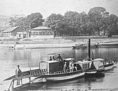Da die Loschwitzer Fähre verkehrstechnisch günstig gelegen war, gehörte sie zu den meistfrequentierten im Dresdner Raum und wurde vor allem von Fuhrleuten gern
genutzt. Im Gegensatz zu diesen durften die Loschwitzer und Blasewitzer Einwohner sowie die Bewohner einiger weiterer Dörfer die Fähre kostenlos benutzen, waren
jedoch zur Zahlung eines jährlichen Betrages an den Fährmeister verpflichtet. 1862 übernahm die Sächsisch-Böhmische Dampfschiffahrtsgesellschaft den Fährbetrieb und setzte hier erstmals eine Dampffähre ein _(Foto)_
. Diese verkehrte bis zur Fertigstellung des Blauen Wunders 1893. Da jedoch auch die Brückenüberquerung in den Anfangsjahren gebührenpflichtig war, konnte der Personenfährbetrieb noch bis
1915 aufrecht erhalten werden. 1927 richtete man an anderer Stelle zwischen Wasserweg und Oehmestraße erneut eine
Personenfähre ein, bevor die Geschichte des Fährbetriebes in Loschwitz am 1. November 1955 endgültig endete.

Zu den tragischen Ereignissen der Ortsgeschichte gehörte das Loschwitzer Fährunglück am 5. Januar 1722. Bei Hochwasser und stürmischem Wetter war das mit 73 Personen völlig überladene Fährboot voll Wasser gelaufen und
gesunken. 19 Menschen kamen dabei ums Leben, die übrigen konnten sich mit einiger Mühe retten. Der Unfall führte zu
einer Überarbeitung der sächsischen Fährordnungen und legte fortan das unbedingte Weisungsrecht des Personals gegenüber den Passagieren fest. Für die Verunglückten wurde am Folgetag in der Loschwitzer Kirche ein
Trauergottesdienst durchgeführt.

Loschwitzer Hafen:

Der kleine Hafen am rechten Elbufer wurde 1865 als Winterhafen der Sächsisch-Böhmischen Dampfschiffahrt angelegt.
Hier fanden die Schiffe, vor allem Raddampfer und Landungsbrücken in den Wintermonaten Schutz vor Eisgang. Nach
einem Ausbau zwischen 1892 und 1893 fanden hier bis zu 20 Dampfschiffe und 50 Brücken untergebracht werden. Der Loschwitzer Hafen unterhalb des Blauen wunders dient bis heute seinem Zweck und wird vor allem von privaten
Sportbooten und Yachten genutzt.

[_Weiterführende Literatur und Quellen_](../../impressum/quellenverzeichnis/)

 \[ [Home](../../index.html)\] \[ [Nord](../../nord/)\] \[ [Nordwest](../../nordwest/)\] \[ [Neustadt](../../neustadt/)\] \[ [Nordost](../../nordost/)\] \[ [West](../../west/)\] \[ [Zentrum](../../zentrum/)\] \[ [Südwest](../../sudwest/)\] \[ [Süd](../../sud/)\]
 \[ [Südost](../../sudost/)\] \[ [Ost](../../ost/)\] \[ [Register](../../Register/register.html)\] \[ [Kontakt](../../Kontakt/kontakt.html)\] \[ [Impressum](../../impressum/)\]
