* * *

Findlaters Weinberg:

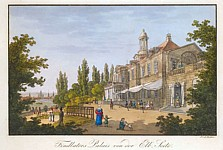Das Gelände am Schotengrund unterhalb der Bautzner Landstraße war bis ins 17. Jahrhundert Teil der Dresdner Heide und ungenutzt. 1660 erwarben die beiden Hofbeamten Jakob Gerhardt und Christoph Bürckner dieses Areal, um hier einen Weinberg anzulegen. Nach mehrfachem Besitzerwechsel kam das Grundstück 1803 in den Besitz des aus Schottland stammenden Lord James Ogilvy, 7. Earl of Findlater (1750-1811). Der wegen homosexueller Neigungen aus seiner Heimat geflüchtete Adlige erwarb über seinen Privatsekretär und Lebenspartner Georg Christian Fischer insgesamt fünf Weinberge in diesem Gebiet. Da der Erwerb von Grundbesitz für Ausländer in Sachsen zu dieser Zeit nicht möglich war, fungierte Fischer als offizieller Eigentümer. Beide ließen ab 1805 das Hanggelände am Elbufer gärtnerisch gestalten und einige Stützmauern, einen kleinen Teich mit einer heute verschwundenen Brücke und weitere Kleinbauten anlegen. Zuvor hatte Lord Findlater bereits den Park des Schlosses Gaußig in der Oberlausitz für die Gräfin von Schall-Riaucour neu gestalten lassen. Als Wohnsitz entstand bis 1811 ein Palais _(Bild)_ nach Plänen von Johann August Giesel.

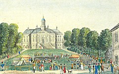Nach Findlaters Tod im gleichen Jahr übernahm dessen Lebensgefährte Fischer die Besitzungen des Earls, zu denen neben dem Weinberg auch das Schloss in [Helfenberg](../../../nordost/schonfeld-weissig/helfenberg/) gehörte. Daraufhin kam es zu einem langjährigen Erbstreit mit der schottischen Familie Findlaters, der erst durch ein Gerichtsurteil zugunsten Fischers entschieden wurde. 1821 verkaufte er seinen Loschwitzer Besitz, der nun dem Dresdner Hotelier Johann Gabriel Krebs gehörte. Krebs, Inhaber des “Hotel de France” und des Rittergutes Medingen, richtete im Palais 1821 eine Ausflugsgaststätte ein, in der u.a. Gerhard von Kügelgen, Jean Paul, E. T. A.
Hoffmann, Richard Wagner und Gottfried Semper zu Gast waren. Das Lokal bestand bis 1850 und wurde dann zugunsten des Schlossneubaus des preußischen Prinzen Albrecht abgerissen. An die früheren Besitzer Findlater und Fischer erinnert noch deren gemeinsames Grab auf dem [Friedhof](../../../nordost/loschwitz/loschwitzer_kirche/loschwitzer_friedhof/) an der Loschwitzer Kirche.

1846 kaufte Wilhelm Graf von Luckner das Findlatersche Palais, welches er durch den mit ihm befreundeten Architekten Carl Alexander Heideloff im byzantinischen Stil umbauen lassen wollte. Obwohl die Planungen weit
fortgeschritten waren und im Februar 1849 bereits mit dem Abbruch nicht mehr verwendbarer Gebäudeteile begonnen wurde, kam das Projekt letztlich nicht zu Stande. Grund waren die politischen Unruhen in Dresden sowie die
dramatische Verschlechterung der finanziellen Lage des Grafen. Hinzu kamen gesundheitliche Probleme Luckners, die ihn schließlich zur Aufgabe seines Vorhabens zwangen. Wenige Jahre später ließ er sich stattdessen das [Schloss Altfranken](../../../sudwest/altfranken/schloss_altfranken/) errichten.

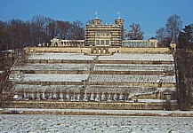Während der größte Teil des Findlaterschen Weinberges nach 1850 mit den drei
“Albrechtsschlössern” überbaut wurde _(Foto)_, gehörte ein kleinerer Teil bis 1945 der bekannten Verlegerfamilie Brockhaus. 1817 hatte der Loschwitzer Fährmeister Friedrich Wilhelm Schaff dieses Grundstück
gekauft. Eine seiner Töchter heiratete später den Schriftsteller und Herausgeber der “Dresdner Abendzeitung” Theodor Winkler, der unter dem Pseudonym Theodor Hell zu den
bedeutenden Persönlichkeiten der Literaturgeschichte des 19. Jahrhunderts gehört. Winkler war mit Heinrich Brockhaus befreundet, der häufig in Loschwitz
weilte und 1847 das Grundstück seines Freundes als Alterswohnsitz erwarb.

Brockhaus ließ das1836 erbaute Wohnhaus zum Gartenhaus umbauen und eine Villa errichten. Das Gelände wurde zu
einer romantischen Parkanlage umgestaltet, die durch Ankäufe bis 1924 noch mehrfach erweitert werden konnte. 1945
musste die Familie ihren Besitz verlassen, der zunächst von der Roten Armee besetzt und schließlich zum Teil dem
Ministerium für Staatssicherheit überlassen wurde. Durch Erweiterungsbauten und Umgestaltung wurde die Parkanlage
stark in Mitleidenschaft gezogen und ist nur noch in Resten erhalten. Villa und Gartenhaus dienen heute Wohnzwecken. Eine schrittweise Wiederherstellung des Parks wird erwogen.

Schloss Albrechtsberg:

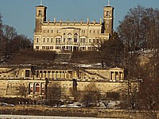
1850 erwarb die Baronin Ernestine von Stockhausen einen großen Teil des früheren Findlaterschen Weinbergs im Auftrag des preußischen Prinzen Friedrich Heinrich Albrecht. D
er jüngste Bruder des späteren Kaisers Wilhelm I.  hatte sich zuvor in eine Hofdame seiner Ehefrau verliebt und musste wegen dieser unstandesgemäßen
Beziehung sein Heimatland verlassen. Albrecht ließ das bereits vorhandene Landhaus zu einem prächtigen Wohnschloss umbauen und die Gartenanlage nach seinen
Vorstellungen umgestalten. Architekten des Schlosses waren der Schinkel-Schüler Karl von Diebitsch und der preußische Landbaumeister Adolph Lohse, die für den
Bau romantisch-byzantinische Formen wählten. Auch die Inneneinrichtung wurde entsprechend gestaltet. Zu den
schönsten Räumen gehören der Festsaal (“Saal der 1000 Kerzen”), das Treppenhaus mit der Ahnengalerie des Prinzen und das orientalisch gestaltete “maurische Bad”.

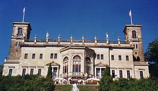Neben dem Hauptgebäude entstanden verschiedene Kleinbauten für Bedienstete sowie
ein Badehaus, welches später als Mausoleum der Gemahlin des Prinzen, Rosalie von Rauch Gräfin von Hohenau diente. Die sterblichen Überreste wurden später zum Bühlauer Friedhof umgebettet.
Außerdem legte der Berliner Gartenbaudirektor Eduard Neide gemeinsam mit dem preußischen Hofgärtner Hermann Sigismund Neumann einen Park mit Wasserspielen, Teichen, Terrassenanlagen und einem römischen Bad
an. Für diese Anlagen mussten Freiberger Bergleute ein kompliziertes Stollensystem in den Hang treiben, um ein Abrutschen des Terrains zu
verhindern. Für den Betrieb der Brunnen entstand eine noch heute genutzte Wasserleitung, welche das Wasser aus dem
Stechgrund zum Schloss bringt. Vom römischem Bad führt eine Fahrstraße vorbei an einer künstlichen Felsenlandschaft
und über ein Viadukt zur oberhalb befindlichen Aussichtsterrasse. Trotz jahrelanger Arbeiten konnte die Gesamtanlage jedoch nicht vollständig fertiggestellt werden.

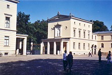Nach dem Tod des Prinzen Albrecht bewohnten seine Nachkommen das
Schloss noch bis 1925. In diesem Jahr erwarb die Stadt Dresden Schloss Albrechtsberg und nutzte es für Repräsentationszwecke, während des Zweiten
Weltkrieges auch zur Unterbringung von Heimkindern bzw. als Unterkunft für Volkssturm-Leute. Nach 1945 diente es kurzzeitig als sowjetische
Kommandantur, anschließend als Intourist-Hotel einer sowjetischen Hotelkette. Dafür erfolgten einige Umbauten, wobei Teile der ursprünglichen Ausstattung
verloren gingen. 1951 übergab die Sowjetunion das Schloss an die im gleichen Jahr entstandene Pionierorganisation, die hier den Pionierpalast “Walter Ulbricht”
einrichtete. Bis 1989 nutzten nun Kinder und Jugendliche das Schloss für kulturelle, sportliche und politische
Veranstaltungen. Nach der politischen Wende in der DDR übernahm die Landesregierung das Gebäude, welches heute
für repräsentative Empfänge, Konzerte und Bälle genutzt wird. Außerdem haben die Jugendkunstschule und die Hotel-
und Gaststättenschule (HOGA) auf dem Grundstück ihren Sitz. Der einstige Pferdestall am Kavaliershaus dient seit 2013 als Weinkellerei.

Lingnerschloss (Villa Stockhausen):

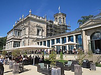
Neben seinem eigenen Wohnsitz ließ Prinz Albrecht 1850-53 für seinen Kammerherrn Baron von Stockhausen und dessen Gattin ein weiteres Gebäude errichten, welches als Villa Stockhausen, später
als Lingnerschloss bezeichnet wurde. Architekt des klassizistischen Baus war der Baumeister Adolf Lohse, der auch die Innenräume gestaltete. Bis zur Fertigstellung des Schlosses Albrechtsberg
wohnte der Prinz selbst in der Villa. Um das Gebäude wurde ein Park mit einem Weinberg am Elbhang angelegt. 1891 erwarb der Dresdner Nähmaschinenfabrikant
Bruno Naumann das Schloss und ließ es umbauen. Naumann hatte seine Firma von einer kleinen Werkstatt zu einem der erfolgreichsten sächsischen Unternehmern aufgebaut [(“Seidel & Naumann”)](../../../west/cotta/strassen_cotta/hamburger_strasse/seidel___naumann/) und gehörte auch der Ersten Ständekammer des sächsischen Landtags an. Am 23.
Januar 1903 verstarb er in seiner Villa am Elbhang.

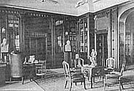1906 kam das Gebäude in den Besitz von Karl August Lingner. Der Erfinder des [ODOL-Mundwassers](../../../zentrum/sudvorstadt/strassen_sudvorstadt/zwickauer_strasse/lingner-werke/) war nicht nur ein erfolgreicher Unternehmer, sondern trat
auch als Initiator der I. Internationalen Hygiene-Ausstellung und verschiedener sozialer Projekte in Erscheinung. Lingner liebte ungewöhnliche, teilweise skurrile
Ideen und gestaltete Schloss und Park in diesem Sinne um. U.a. legte er einen kleinen Zoo an, ließ eine Orgel bauen, deren Töne per Telefon in alle Räume des
Hauses übertragen werden konnten und beauftragte Hans Poelzig mit der Errichtung eines Mausoleums im Park, in dem Lingner nach seinem Tod 1916 beigesetzt wurde. An den Arbeiten war auch der Architekt Wilhelm Kreis
beteiligt; die Reliefplastiken am Mausoleum stammen von Georg Kolbe. Das Foto zeigt Lingners Arbeitszimmer mit seiner Bibliothek und Reliefbüsten bekannter deutscher Dichter (von Max Klinger)

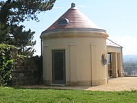Als besondere Attraktion entstand 1908 eine private Standseilbahn vom Schloss ins Elbtal, deren “Bergstation” und Trassenführung noch erhalten sind. Die von der Firma Kühnscherf & Söhne projektierte und nicht für den öffentlichen Verkehr gedachte Bahn war 90 Meter lang und überwand dabei einen Höhenunterschied von 40 Metern. Die einzige Fahrkabine bot Platz für 8 Personen und besaß auch die zur Steuerung der Bahn erforderlichen Schaltknöpfe. Mit Lingners Tod 1916 wurde die Standseilbahn stillgelegt und 1933 abgetragen. Das ehemalige Maschinenhaus _(Foto)_ ist noch erhalten und wurde später als Trafostation bzw. Lagerschuppen einer Winzergemeinschaft genutzt. Eine Sanierung des Gebäudes erfolgte 2014.

_“Der Park ist der gesamten Bevölkerung zugängig zu machen, in dem Hauptgebäude ist thunlichst_

_ein Restaurant oder Café mit billigen Preisen_
_einzurichten... Ich wünsche kein Etablissement für nur reiche Leute. Ich will, daß die gesamte Bevölkerung in die Lage gebracht wird, mit einer Ausgabe von 20 bis 30 Pfennigen die Schönheit_
_dieser herrlichen, in Europa einzigartigen Lage zu genießen._

_Ich würde wünschen, daß sich ein intelligenter Leiter findet, der diese Stätte zu einer allgemeinen Freudenstätte organisiert..._

**Aus dem Testament Karl August Lingners (1916)**

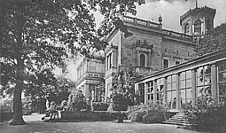
Gemäß testamentarischer Verfügung Lingners ging das Schloss nach seinem Tod in den Besitz der Stadt Dresden über, die es für die Öffentlichkeit zugänglich halten musste. Gelegentlich gab es hier Tagungen, Konzerte und
andere Veranstaltungen. Während des Zweiten Weltkrieges diente es als Reservelazarett.  Nach 1945 wurde das Lingnerschloss einige Jahre als Studentenwohnheim der Arbeiter- und Bauernfakultät genutzt, bevor 1957
der “Dresdner Klub”einzog (ab 1972 Klub der Intelligenz). Dieser Treffpunkt von Künstlern, Wissenschaftlern und anderen Persönlichkeiten wurde von Manfred von Ardenne initiiert und blieb bis 1989 ein zuweilen
kritisches Forum der Dresdner Intelligenz. Leider ging beim Umbau des Gebäudes 1956/57 unter Leitung von Gerhard Guder ein Großteil der historischen Innenausstattung verloren.

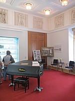Nach Schließung des Klubs 1994 scheiterten
zunächst alle Versuche, das Lingnerschloss an einen Investor zu verkaufen und so einer neuen Nutzung zuzuführen. Pläne sahen u. a. die
Einrichtung einer Spielbank, einer Gaststätte oder einer Internationalen Schule vor. Auch die Gründung eines Zentrums für Bio-Technologie mit einem umstrittenen Neubau in Form einer
DNS-Spirale im Park wurde wieder zu den Akten gelegt.

Ende 2002 gründete sich ein Förderverein, der gemeinsam mit einem Dresdner Unternehmen
das Schloss schrittweise sanierte. Im Zuge des noch nicht abgeschlossenen Umbaus entstanden u.a. Ausstellungsräume **_(Foto:_** _Lingner-Gedenkraum)_ und eine öffentliche
Gaststätte. Zeitweise war hier auch das Büro des Welterbezentrums Dresdner Elbtal untergebracht.

Zur Anlage des Lingnerschlosses gehört das sogenannte “Schweizerhaus”, auch “Weißes Haus” genannt. Das im
Landhausstil errichtete Gebäude entstand zwischen 1855 und 1860 und beherbergte u.a. einige Wohnungen für die
Schlossangestellten und eine Weinpresse. Nach 1945 nutzten verschiedene Institutionen und der “Dresdner Club” das Gebäude. 2007 konnte das Haus komplett saniert an die Firma Ardenne Anlagentechnik GmbH übergeben werden,
welche hier ein Büro- und Weiterbildungszentrum einrichtete.

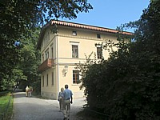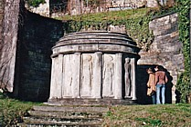

**_Fotos:_** _Schweizerhaus im Park (links) - Lingner-Mausoleum (rechts)_

Schloss Eckberg:

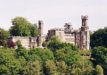Das dritte Schloss wurde 1859/61 nach Plänen Christian Friedrich Arnolds für den aus einer Hugenottenfamilie stammenden Großkaufmann John Daniel Souchay erbaut. Das an Stelle eines bescheideneren Vorgängerbaus im neogotischen Tudorstil errichtete Gebäude wurde deshalb auch als Villa Souchay bezeichnet, bevor sich der von einem Flurnamen abgeleitete Name Schloss Eckberg durchsetzte _(Foto)_. Jean Souchay hatte mit seiner Frau über 40 Jahre in England gelebt und durch Besuche bei der mit ihm verwandten Familie Schunck in Briesnitz Dresden kennengelernt, welches das Paar zum Alterswohnsitz wählte. Nach Souchays Tod 1871 und dem Verkauf des Grundstücks 1883 bezog der Kaufmann und persische Generalkonsul Arthur Bruno Wunderlich das Schloss, welches in den Zwanziger Jahren Wohnsitz des Opernsängers Tino Pattiera und der bekannten Schauspielerin Grete Weiser und ihres Ehemannes war. 1926 verzog das Paar nach Berlin.

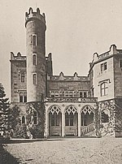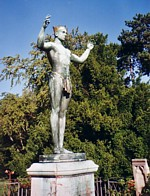Bereits ein Jahr zuvor hatte der Unternehmer Ottomar Heinsius von Mayenburg Schloss Eckberg erworben. Der durch die Herstellung von Zahncreme (“Chlorodont”) zu Wohlstand gekommene Fabrikant war als großer Gartenfreund und Botaniker bekannt und ließ deshalb den Park seines Schlosses in einen prächtigen Blumengarten umgestalten. Die von seinem Bruder, einem Architekten, entworfene Anlage stand in den Sommermonaten auch der Bevölkerung offen und war bis zu Mayenburgs Tod 1932 eine Attraktion in Loschwitz. Zur Gestaltung der Anlagen ließ der Schlossherr die Plastik “Sonnenanbeter” von Sascha Schneider aufstellen _(Foto)_. Teile der Gartenanlagen sind bis heute erhalten geblieben. Dazu gehört auch eine Kopie des Brunnens “Stürmische Wogen” vom Albertplatz, die um 1900 für die Weltausstellung in Paris geschaffen worden war und 1991 nach Schloss Eckberg verbracht wurde. Ein schlichter Gedenkstein mit einem Epigramm des Dichters Friedrich von Logau (1604-1655) kam 1985 hinzu. Neben einer Taube und einer stilisierten Erdkugel trägt dieser Stein die Inschrift:

_“ES MANGELT NIE GELEGENHEIT WAS GUTES ZU VERRICHTEN”_

_“ES MANGELT NIE GELEGENHEIT WAS GUTES ZU VERNICHTEN”_

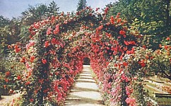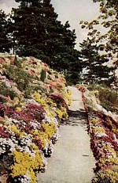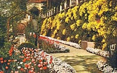

**_Fotos:_** _Im Park von Schloss Eckberg in den 1930er Jahren_

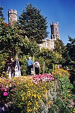Nach Ende des Zweiten Weltkriegs wurde das Schloss von der Sowjetischen Militäradministration als Kommandantur genutzt. Später diente es u. a. der Arbeiter- und Bauern-Fakultät und dem DDR-Gewerkschaftsbund als Bildungsstätte. Zeitweise fanden hier auch Kunstausstellungen statt, bevor in den 1970er Jahren der VEB Robotron die Räume für seine Zwecke mietete. 1985 erfolgte eine komplette Sanierung des Gebäudes, welches im
Anschluss als Jugendtourist-Hotel öffnete. Im Schloss wurden dabei gastronomische Einrichtungen und eine Kellerbar untergebracht, während im Park ein an die historische
Architektur angeglichenes Bettenhaus entstand. Architekt dieses Gebäudes war Horst Witter.

Nach der Wende stellten die Erben des 1952 enteigneten früheren Schlossbesitzers von Mayenburg Antrag auf Restitution und erhielten daraufhin ihr Eigentum zurück. 1994 erwarb die Münchner ARGENTA-Gruppe Schloss Eckberg und wandelte es in ein Fünf-Sterne-Hotel mit 17 exklusiv eingerichteten Zimmern und öffentlicher Gaststätte um. In diesem Zusammenhang erfolgten 1996/97 umfassende Sanierungsarbeiten. Neben dem eigentlichen Schloss wird auch das im Park befindliche Kavaliershaus als Hotel genutzt. Ein früheres Stallgebäude beherbergt Seminar- und Konferenzräume. Die Gaststätte im Schloss ist ebenso wie der Park für Tagesgäste zugänglich.
