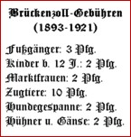
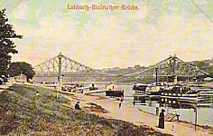
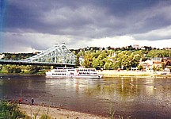
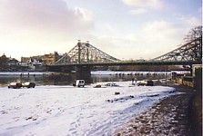
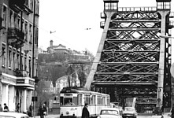
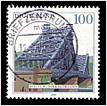

* * *

Bereits im Jahr 1430 wurde in Loschwitz der erste Elbübergang erwähnt, der in
einer Fähre zum gegenüberliegenden Dorf Blasewitz bestand. Der Übergang gehörte zu den wichtigsten im Stadtgebiet und unterstand deshalb ab 1723 dem Amt Dresden. Die Fährgerechtigkeit befand sich im Besitz verschiedener
Loschwitzer Familien, die im heute noch erhaltenen [Fährgut](../../../nordost/loschwitz/strassen_loschwitz/friedrich-wieck-strasse/) an der Friedrich-
Wieck-Straße 45 lebten. Wegen des starken Verkehrs wurde bereits um 1870 der Bau einer Brücke an dieser Stelle erwogen. Eine entsprechende Petition der
Anliegergemeinden unter Führung des Loschwitzer Gemeindevorstandes Moritz Strauß lehnte der sächsische Landtag 1883 jedoch ab.

Erst die Vorlage eigener Baupläne durch wohlhabende Blasewitzer Bürger brachten den Brückenbau wieder ins Gespräch. Man entschied sich für den Bau einer Hängebrücke in Stahlfachwerkkonstruktion zwischen dem Dorfplatz
Blasewitz und dem gegenüberliegenden Loschwitz. Für den Brückenbau, der am 28. April 1891 begann, mussten verschiedene Gebäude auf beiden Elbseiten abgetragen werden. Mit dem [Schillerplatz](../../../ost/blasewitz/strassen_blasewitz/schillerplatz/) und dem [Körnerplatz](../../../nordost/loschwitz/strassen_loschwitz/kornerplatz/) wurden die
Brückenköpfe nach Fertigstellung des Bauwerks völlig neu gestaltet. Die Spannweite zwischen beiden Pfeilern beträgt
141,5 m bei einer Gesamtlänge von 260 Metern. Die Baukosten in Höhe von über 2 Millionen Reichsmark übernahm zu
zwei Dritteln der Staat; den Rest mussten die beiden Anliegergemeinden selbst aufbringen. Angefertigt wurden die
meisten Eisenteile in der Marienhütte Zwickau-Cainsdorf, die mit dem “Blauen Wunder” ihren 1500. Brückenbau realisieren konnte.

Konstrukteure der neuen Elbbrücke waren der Ingenieur Prof. Dr. Claus Köpcke
und Bauinspektor Hans Manfred Krüger, die eine auf zwei Pylonen gelagerte Hängebrücke ohne Strompfeiler errichteten und damit einen der ersten
Brückenbauten dieser Art in Europa schufen. Wegen der kühnen Konstruktion und des blau-grünen Farbanstrichs wurde die neue Elbbrücke im Volksmund bald als “Blaues Wunder” bezeichnet.

Nach einem erfolgreich verlaufenen Belastungstest mit drei Dampfwalzen, drei mit Steinen beladenen Straßenbahnloren und schweren Wassertankwagen konnten die
verantwortlichen Experten das Bauwerk abnehmen. Selbst eine Schützenkompanie der sächsischen Armee ließ man im
Gleichschritt über die Brücke marschieren, um eventuelle Senkungen oder Verschiebungen messen zu können. Offiziell
erhielt die am 15. Juli 1893 dem öffentlichen Verkehr übergebene Brücke den Namen König-Albert-Brücke, der nach
der Eingemeindung beider Orte 1921 in Loschwitzer Brücke verändert wurde. Mit der Fertigstellung des Baus wurde
auch die bereits nach Blasewitz verkehrende elektrische Straßenbahn bis zum Körnerplatz und später bis nach Pillnitz
verlängert. Nicht nur die Straßenbahnfahrgäste, sondern alle Nutzer der Brücke mussten in den ersten Jahren Brückenzoll
errichten, wofür an beiden Enden Zollhäuschen entstanden. Erst 1921 wurde diese Brückengeldpflicht, die zeitweise bis
zu 100.000 Mark im Jahr einbrachte, aufgehoben. Für Fahrzeuge endete sie sogar erst am 1. Juni 1924. Die beiden Zollhäuschen an den Brückenköpfen fielen dem Umbau 1935 zum Opfer.

Obwohl das “Blaue Wunder” durchaus modernen Verkehrserfordernissen entsprechend projektiert worden war, mussten bereits 1935 Veränderungen an der Brücke vorgenommen werden. Zu beiden Seiten wurden Gangbahnen für
Fußgänger angebaut, so dass die Fahrbahn auf 10 Meter verbreitert werden konnte. Diese Maßnahmen verhinderten den
ebenfalls erwogenen kompletten Neubau der Brücke als moderne Eisenbetonbrücke. Für Aufsehen sorgte kurze Zeit später der Kunstflieger Ernst Udet, der bei seinem Besuch des “Dresdner Flugtages” am 7. Juli 1935 mit seiner
Maschine unter der Brücke hindurchflog.

1945 sollte die Loschwitzer Brücke wie alle Dresdner Elbübergänge gesprengt werden, um den Vormarsch der Roten Armee zu stoppen. Die Sprengkörper
waren bereits angebracht und die Kabel verlegt worden. Der mutige Einsatz des Dresdner Telegrafenarbeiters Paul Zickler und des Klempnermeisters Erich
Stöckel, die wenige Stunden vor Kriegsende unabhängig voneinander die Sprengdrähte durchschnitten, retteten das “Blaue Wunder” vor der Zerstörung. An beide erinnert seit dem 4. Mai 1965 eine Gedenktafel am Blasewitzer
Brückenkopf. Weitere Retter der Brücke, wie der aus Rochwitz stammende Max Mühle, der Blasewitzer Handelsvertreter Carl Bouché und der als
Brückenkommandant eingesetzte Hauptmann Wirth, sind heute weniger bekannt, waren aber ebenfalls an der Verhinderung der Sprengung beteiligt.

_Inschrift am Blasewitzer Brückenkopf der Loschwitzer Brücke_

Infolge technischen Verschleißes durch die ständig zunehmende Verkehrsbelastung mussten mehrfach Erneuerungsarbeiten an der Elbbrücke vorgenommen werden.
So wurde 1956/59 der Holzbohlenbelag der Fahrbahn gegen Eisenblech ausgetauscht. 1982/85 erfolgte eine komplette Sanierung der Ankerkammern. Da Messungen eine zu starke Belastung der Brücke durch den Straßenbahnverkehr
feststellten, wurde dieser am 10. April 1985 eingestellt _( **Foto:** Bundesarchiv / Wikipedia)_. Auch die Nutzung des “Blauen Wunders” durch schwere LKW ist
mittlerweile verboten. Regelmäßige Wartungsarbeiten sollen jedoch den Erhalt des Technischen Denkmals sichern. Ende 2011 konnte eine Lichtanstallation zur
nächtlichen Beleuchtung der Brücke in Betrieb genommen werden.

Die Brücke gehört wegen ihres ungewöhnlichen Aussehens zu den Wahrzeichen Dresdens und war deshalb ein beliebtes Motiv für Künstler. Bekannte Darstellungen des “Blauen Wunders”
schufen u. a. der Fotograf August Kotzsch sowie die Maler Max Ackermann (1908), Ernst Hassebrauk (1939) und Bernhard Kretzschmar (1954). 2000 war die Loschwitzer Elbbrücke
Motiv einer Sonderbriefmarke der Deutschen Post _(Bild)_.

* * *

 \[ [Nord](../../../nord/)\] \[ [Nordwest](../../../nordwest/)\] \[ [Neustadt](../../../neustadt/)\] \[ [Nordost](../../../nordost/)\]
 \[ [West](../../../west/)\] \[ [Zentrum](../../../zentrum/)\] \[ [Südwest](../../../sudwest/)\] \[ [Süd](../../../sud/)\] \[ [Südost](../../../sudost/)\] \[ [Ost](../../../ost/)\] \[ [Register](../../../Register/register.html)\] \[ [Kontakt](../../../Kontakt/kontakt.html)\] \[ [Impressum](../../../impressum/)\]
