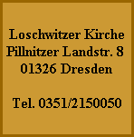
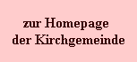
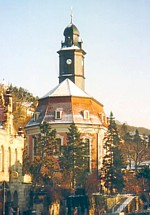
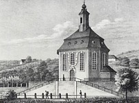
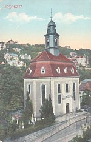
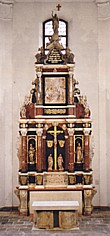

* * *

* * *

* * *

* * *

* * *

* * *

Loschwitz gehörte bis zum Beginn des 18. Jahrhunderts gemeinsam mit 25 weiteren Dörfern
der Dresdner Umgebung zum Kirchspiel der alten Frauenkirche. Wegen des langen und beschwerlichen Weges zum Gottesdienst beantragten die Gemeinde Loschwitz und der
Nachbarort Wachwitz im Jahr 1702 die Auspfarrung der beiden Dörfer, um eine eigene Kirche zu errichten. August der Starke genehmigte diese Abspaltung zwei Jahre später, so
dass nun mit dem Bau begonnen werden konnte. Allerdings behielt sich die Stadt Dresden das Recht vor, Bauplatz und Architekt selbst bestimmen zu dürfen. Der Rat entschied sich für
den damaligen Dresdner Ratszimmermeister George Bähr und seinen Maurermeister Johann Christian Fehre, die am 29. Juni 1705 den Grundstein für das Gotteshaus legten.

Auf  dem hochwasserfreiem Gelände des früheren Materni-Weinbergs entstand ein schlichter barocker
Zentralbau, der trotz einer kurzen Unterbrechung im Nordischen Krieg bereits drei Jahre nach Baubeginn fertiggestellt war _(historischer Kupferstich von 1837)_. Am
Namenstag August des Starken, dem 3. August 1708, wurde die Loschwitzer Kirche geweiht, obwohl der Innenraum erst zwei Jahre später komplett vollendet werden
konnte. Die neue Kirche erhielt 1710 eine Schlaguhr. 1753 erfolgte durch den Silbermann-Schüler Johann Christof Leibner der Einbau einer Orgel, wobei Teile der
alten Frauenkirchorgel Verwendung fanden. Die Weihe des Instruments fand am 18. Sonntag nach Trinitatis statt. An dieser Orgel erhielt der spätere Dresdner Hofkapellmeister Johann Gottlieb Naumann
seinen ersten Orgelunterricht vom damaligen Loschwitzer Schullehrer Christian Gottfried Müller.

Mehrfach mussten an der Kirche Restaurierungsarbeiten vorgenommen werden, bevor gegen Ende des 19. Jahrhunderts eine komplette Renovierung erfolgte. Dabei wurde das Innere
nach Plänen des Blasewitzer Baumeisters Karl Emil Scherz dem Zeitgeschmack entsprechend verändert und die alte Orgel 1898 in eine neue, größere der Firma Jehmlich ausgetauscht. An
Stelle der kleinen Betstübchen entstand ein großzügiger Innenraum mit einem Treppenturm. Der Altarraum erhielt farbige Glasfenster des Künstlers Georg Schwenk. Für den Kanzelaltar
schuf der Bildhauer Robert Ockelmann zwei Plastiken der Apostel Johannes und Paulus. Das mit finanzieller Hilfe vieler Loschwitzer Einwohner umgebaute Gotteshaus konnte nach
Abschluss der Arbeiten am 12. März 1899 wieder geweiht werden.

1897 hatte sich die Gemeinde Weißer Hirsch von der Loschwitzer Kirche abgespaltet, nachdem dort ein eigenes [Gotteshaus](../../../nordost/page10246/kirche_weisser_hirsch/) errichtet worden war. Wenig später forderten auch die
Einwohner von Oberloschwitz den Bau einer eigenen Kirche. Obwohl bereits ein Grundstück am Rißweg ausgewählt war und erste Vorplanungen erfolgten, verhinderten letzlich finanzielle Gründe die Umsetzung des
Vorhabens. 1933 schloss sich der Ortsteil westlich der Grundstraße gegen den Willen vieler Loschwitzer jedoch ebenfalls der Kirchgemeinde Weißer Hirsch an.

1925 konnte die Loschwitzer Kirchgemeinde das zuvor als Kinderbewahranstalt dienende Haus [Grundstraße 36](../../../nordost/loschwitz/strassen_loschwitz/grundstrasse/)
erwerben und nutzte dieses für Veranstaltungen der zahlreichen kirchlichen Vereine. Außerdem fanden dort Bibel- und
Konfirmandenstunden, Gemeindeabende und die Sitzungen des Kirchenvorstandes statt. Noch bis in die Nachkriegszeit existierte im Obergeschoss ein Kindergarten.

Obwohl Loschwitz nicht zum Hauptangriffsziel während des Luftangriffs 1945 gehörte, fiel die Loschwitzer Kirche am
13./14. Februar gemeinsam mit einigen anderen Gebäuden im Ort dem Inferno zum Opfer und brannte völlig aus. Noch
im gleichen Jahr begann die Gemeinde mit der Sicherung der Ruine, um diese für einen Wiederaufbau vorzubereiten.
Materialmangel und der Einspruch staatlicher Stellen verhinderten jedoch alle weiteren Pläne. Auch ein Angebot der
evangelischen Kirche Finnlands, Holz für den neuen Dachstuhl zur Verfügung zu stellen, wurde abgelehnt. Lediglich ein
provisorischer Glockenstuhl durfte 1969 in der Kirchenruine aufgestellt werden. Für diesen erwarb die Gemeinde als
Ersatz für das im Zweiten Weltkrieg verlorene Geläut drei neue Glocken aus Apolda. Die offizielle Glockenweihe
erfolgte am 2. November 1969. Bereits zwei Jahre zuvor hatten Mitglieder der Jungen Gemeinde die Ruine beräumt und von Wildwuchs befreit.

Erst 1984 durfte die Kirchgemeinde einen Ausschuss zum Wiederaufbau bilden und Studien über die künftige Nutzung
der Ruine erarbeiten. Die politischen Veränderungen 1989 ermöglichten schließlich, den Aufbau der Kirche in
originalgetreuer Gestalt vorzunehmen. Durch die Mithilfe eines Münchner Fördervereins und die Initiative einiger prominenter Loschwitzer Künstler konnte am 29. Juni 1991 während des 1. Elbhangfestes der Grundstein zum
Wiederaufbau gelegt werden. Mit Hilfe privater Spenden wurde dieser bis 1993 bis zum Aufsetzen der Wetterfahne vorangetrieben. Der Innenausbau der Kirche begann im Anschluss, so dass die Gemeinde am 2. Oktober 1994 das
fertige Gotteshaus in Besitz nehmen konnte. Am 5. Oktober 1997 wurde eine neue, von der Firma Wegscheider
gebaute Orgel geweiht werden. Seit Oktober 2002 ist der restaurierte Nosseni-Altar der 1945 zerstörten Sophienkirche
in Loschwitz zu sehen. Die wertvolle Bildhauerarbeit überstand die Bombennacht mit einigen Schäden und wurde 1998
restauriert. Lesepult und Taufstein stammen von Peter Makolies. Neben der Kirche ist auch der in Fragmenten erhaltene und in den letzten Jahren rekonstruierte alte [Kirchhof](../../../nordost/loschwitz/loschwitzer_kirche/loschwitzer_friedhof/) mit einer Reihe historischer Grabdenkmale sehenswert.

Nosseni-Altar:

Der seit 2002 in der Loschwitzer Kirche aufgestellte Altar entstand 1606/07 und gehört zu den wichtigsten Zeugnissen der sächsischen Kunst dieser Zeit. Den Entwurf für den im Auftrag der
Kurfürstin Sophia entstandenen Altar lieferte der italienische Architekt Giovanni Maria Nosseni; die Ausführung oblag der Dresdner Bildhauerfamilie Walther. Als Material wählte man einheimisches
Gestein wie Sandstein, Marmor und Zöblitzer Serpentin. 1607 konnte der Altar in der evangelischen Hofkirche (Sophienkirche) eingeweiht werden und verblieb dort bis 1945.

Dank einiger vorsorglicher Sicherungsmaßnahmen wie der Vermauerung des wertvollen Predella- Reliefs mit einer Abendmahl-Darstellung und der Abnahme der Figuren überstand der Nosseni-
Alter die Zerstörung der Sophienkirche. Teile konnten 1946 geborgen werden. Mit dem Beschluss zum Abbruch der Sophienkirche musste der Altar 1963 komplett abgebaut und im Depot des
Institutes für Denkmalpflege eingelagert werden. Einige Fragmente kamen in den Gemeindesaal der  Trinitatiskirche und in den Bestand der Staatlichen Kunstsammlungen. Leider gingen dabei auch
verschiedene Bruchstücke verloren.

Am 1. April 1993 stellte die Kirchgemeinde Loschwitz an das Landeskirchenamt den Antrag, den Nosseni-Altar für die
im Wiederaufbau befindliche Kirche zu übernehmen. 1995 begannen erste Vorplanungen für die Restaurierung des Kunstwerkes, mit welcher 1998 durch den Bildhauer Christian Schulze begonnen wurde. Aus
fast 400 erhaltenen Bruchstücken entstand der Nosseni-Altar in alter Schönheit und wurde am 6. Oktober 2002 in der Loschwitzer Kirche
geweiht. In der Mitte des Kunstwerks ist ein Abendmahlsrelief zu sehen. Weitere Szenen zeigen u.a. die Kreuzigung
und die Beweinung Christi sowie figürliche Darstellungen von Maria und Joseph sowie Petrus und Paulus. Bekrönt wird der Altar vom auferstandenen Heiland auf der Weltkugel.

* * *

 \[ [Home](../../../index.html)\] \[ [Nord](../../../nord/)\] \[ [Nordwest](../../../nordwest/)\] \[ [Neustadt](../../../neustadt/)\] \[ [Nordost](../../../nordost/)\] \[ [West](../../../west/)\] \[ [Zentrum](../../../zentrum/)\] \[ [Südwest](../../../sudwest/)\] \[ [Süd](../../../sud/)\] \[ [Südost](../../../sudost/)\] \[ [Ost](../../../ost/)\] \[ [Register](../../../Register/register.html)\] \[ [Kontakt](../../../Kontakt/kontakt.html)\] \[ [Impressum](../../../impressum/)\]
