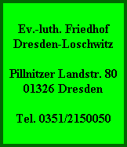
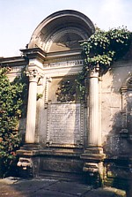
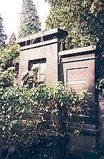

* * *

* * *

Kirchhof Loschwitz:

Der alte Kirchhof entstand 1708 unmittelbar an der neu errichteten [Loschwitzer Kirche](../../../../nordost/loschwitz/loschwitzer_kirche/) und wurde noch bis 1892 als Begräbnisort genutzt. Zuvor mussten die Toten des Dorfes nach Dresden auf den Alten Johanniskirchhof vor dem Pirnaischen Tor verbracht werden. Der Loschwitzer Kirchhof gehört heute zu den wenigen erhaltenen Friedhofsanlagen des 18. Jahrhunderts in Sachsen und steht deshalb seit 1978 unter Denkmalschutz. Pflege- und Restaurierungsarbeiten erfolgten 1968 und 1998.

Bis heute sind noch 35 historische Gräber vorhanden. Einige Grabsteine wurden nach dem Wiederaufbau der Kirche an der Außenmauer angebracht. Neben den barocken Steinen früherer Pfarrer und heute
vergessener Loschwitzer Einwohner sind die Gräber von verschiedenen Persönlichkeiten erhalten, die in der Geschichte des Ortes und darüber hinaus eine Rolle gespielt haben. Dazu gehören Jean Francois Poncet (1714-1804),
ehemals königlicher Hofuhrmacher, die Familie Preißler, frühere Besitzer des [“Weißen Adlers”](../../../../nordost/page10246/strassen_weisser_hirsch/bautzner_landstrasse/weisser_adler/), der
ehemalige Elbfährmeister von Loschwitz Carl Friedrich Modes (1771-1846) und der Loschwitzer Kantor und Ortschronist Friedrich Wilhelm Pohle (1830-1892). Auch eine in Loschwitz verstorbene Tochter des Hofgoldschmiedes
Johann Melchior Dinglinger ruht auf dem Kirchhof.

Bemerkenswert ist die Grabstelle des früheren Loschwitzer Schulmeisters Carl Gottlob Wegerich und seiner Familie in Form eines aufgeschlagenen Buches und eines
gußeisernen Kreuzes unmittelbar neben dem Kirchenportal. Ebenfalls erhalten blieb das Grab des Lords Jacob Graf von Findlater (1747-1811), der den [Findlaterschen Weinberg](../../../../nordost/loschwitz/albrechtsschlosser/) anlegen ließ. In dieser Gruft liegt zugleich Findlaters Privatsekretär und Lebensgefährte Johann Georg Christian Fischer. Ein Gedenkstein an der Kirche erinnert seit 1920 an den 100 Jahre zuvor ermordeten Maler Gerhard von Kügelgen und dessen Sohn Wilhelm, die früher ein Weinbergsgrundstück in Loschwitz besaßen.

Loschwitzer Friedhof:

Der neue Friedhof an der Pillnitzer Landstraße wurde 1806 als gemeinsamer Begräbnisplatz für Loschwitz und Wachwitz angelegt, nachdem der bisherige Kirchhof zu klein geworden
war. Mehrfach wurde dieser Friedhof durch Zukäufe von Feldern erweitert, zuletzt 1918 bzw. 1927. Nach Stillegung des alten Kirchhofs fanden hier alle Beisetzungen der Bewohner von
Loschwitz, Wachwitz und des Weißen Hirschs statt. 1893 wurde nach Plänen von Friedrich Reuter eine Friedhofskapelle errichtet, deren Glasfenster vom Schöpfer des Fürstenzuges
Wilhelm Walther stammen. Die Kreuzigungsgruppe an der Fassade schuf der Leipziger Bildhauer Johannes Hartmann. Seit 1947 läutete im Giebel des Gebäudes eine von der
Glockengießerei Schilling gegossene “Friedensglocke”. Eine nach dem Ersten Weltkrieg angebrachte Gedenktafel für die gefallenen Mitglieder des Loschwitzer Ortsvereins befindet
sich heute im Archiv der Kirchgemeinde. Schöpfer der Tafel war der Architekt des Künstlerhauses Martin Pietzsch.

Der seit 1985 unter Denkmalschutz stehende Friedhof besitzt zahlreiche interessante Grabdenkmale, die von hier
wohnenden Künstlern gestaltet wurden. Außerdem ruhen viele Persönlichkeiten des Dresdner Kunst- und Kulturlebens
auf diesem Gottesacker. 1923/24 entstand das Ehrenmal für die Gefallenen des Ersten Weltkrieges. Schöpfer des Denkmals war in der Loschwitz wohnende Architekt Rudolf Kolbe. An einem auf einem kleinen Erdhügel stehenden
Denkmalblock sind insgesamt 230 Namen gefallener Einwohner zu finden, darunter auch einer Frau, die als Schwester in
einem Feldlazarett ums Leben kam. An der westlichen Friedhofsmauer erinnern seit 1956 drei Holzkreuze an die Toten
des Zweiten Weltkrieges. Gestaltet wurde dieses Ehrenmal von Oskar Menzel. Das Foto zeigt die Familiengrabstätte der Familie von Stockhausen, ehemalige Besitzer des Lingnerschlosses.

**Bedeutende Grabplastiken:**

Grabmal “Trauernder Genius”: von Christian Gottlieb Kühn geschaffen und früher auf dem St.-Pauli-Friedhof aufgestellt,
später nach Loschwitz verbracht. Die wertvolle Plastik befindet sich aus Witterungsgründen heute in der Loschwitzer Kirche.

Familiengrabstätte Modes:
Das Grab erinnert an die weitverzweigte frühere Loschwitzer Fährmeisterfamilie Modes, die ihr Handwerk von Generation zu Generation weitergab. Der Grabstein wird von einem Anker mit Seil und Staken
geschmückt und weist damit auf den Beruf der hier Bestatteten hin.

Grabmal “Der anklopfende Pilger”: Das Grabdenkmal wurde von Robert Henze für den 1905
verstorbenen ”Maler des deutschen Waldes” Eduard Leonhardi geschaffen. Es zeigt die Figur eines an eine Pforte klopfenden Pilgers und soll so die Vollendung des Lebensweges des Künstlers symbolisieren _(Foto)_
. Die Inschrift auf der Grabplatte stammt von Leonhardis Künstlerfreund Ludwig Richter.

Grabmal für Sascha Schneider: Sascha Schneider (1870-1927) gehörte zu den vielseitigsten
Künstlern seiner Zeit und war als Maler und Zeichner, Buchillustrator und Bildhauer tätig. Bekannt wurde er durch seine Illustrationen zu den Werken Karl Mays, mit dem ihn eine enge
Freundschaft verband. Schneider schuf auch die Jünglingsgestalt für die Grabstelle seines Künstlerkollegen Oscar Zwintscher auf dem Loschwitzer Friedhof. Sein eigenes Grab schmückt eine Metallbüste von Paul Peterich.

Grabmal für Hans Unger: Das Grab ziert die Kopie einer antiken Plastik, die den Gott Apoll darstellt und ursprünglich
aus Pompeji stammt. Hans Unger (1872-1936) lebte viele Jahre in Loschwitz und wurde vor allem durch seine
Plakatentwürfe und Glasgestaltungen bekannt. Einige seiner Werke befinden sich in der Gemäldegalerie “Neue Meister”.

Grabmal “Tod mit Bombe”:
Die Plastik wurde 1945 von Friedrich Press für den Uhrmacher Paul Pleißner entworfen und zeigt den Tod, der statt des Stundenglases Bombe und Brandfackel in der Hand hält. Pleißner hatte beim Bombenangriff
1945 seine Werkstatt auf der Schloßstraße verloren. Das Grabdenkmal stellt ein besonderes Mahnmal für die Luftkriegsopfer in Dresden dar.

Grabmal für Walter Arnold:
von diesem selbst geschaffen und 1979 in der Nähe des Durchgangs zum neuen Friedhofsteil aufgestellt. Die Bronzefigur auf dem Grab ist eine Kopie seiner Holzplastik “Es gibt kein fremdes Leid”. Ab 1949 war
Walter Arnold (1909-1979) Leiter der Abteilung Plastik an der Hochschule für Bildende Künste und zwischen 1958-63 Präsident des Verbandes Bildender Künstler der DDR.

Grabmal für Friedrich Press:
von diesem selbst gestaltet und 1990 aufgestellt. Press (1904-1990) hatte zuvor bereits zahlreiche Grabplastiken für Künstlerfreunde geschaffen. Von ihm stammen u.a. die Grabdenkmäler für Hans Theo
Richter (1969) und Hans Jüchser (1977) auf dem Loschwitzer Friedhof. Bekannt wurde Press als Schöpfer sakraler
Kunstwerke für Kirchen in ganz Deutschland und die Skulptur “Ecce Homo” am Eingang der Sixtinischen Kapelle in Rom..

Grabmal für Hermann Glöckner:
Der Grabstein des für seine modernen konstruktivistischen Arbeiten bekannten Künstlers Hermann Glöckner (1889-1987) zeigt lediglich dessen Initialie “G” und wurde von Peter Makolies geschaffen.
Glöckner lebte ab 1945 bis zu seinem Tod 1987 im Loschwitzer Künstlerhaus und war Mitbegründer der Künstlergruppe “der ruf”.

Grabmal “Schlafendes Mädchen”:
Die Plastik stammt von der Bildhauerin Hildegard Jahn, die das Grabmal für ihre 1992 verstorbene Tochter Claudia Konopka schuf.

Grabmal “Der Traum”:
Die aus Zöblitzer Serpentinstein bestehende Skulptur auf einem Sandsteinsockel stammt von Andreas Hegewald und erinnert an die 2001 verstorbene Dresdner Malerin Inge Thiess-Böttner. Das Grabdenkmal
wurde aus Anlass des 84. Geburtstages am 25. November 2008 aufgestellt.

**Gräber bekannter Persönlichkeiten:**

**_Grabstelle\*_**

**_Todesjahr_**

Familiengrab Modes, Fährleute in Loschwitz

1806

Auguste Richter, geb. Freudenberg, erste Ehefrau Ludwig Richters

1854

Eugen Degele, Hofopernsänger

1886

Woldemar Hottenroth, Maler

1894

Eduard Leonhardi, Landschaftsmaler, Stifter des Leonhardi-Museums

1905

Oskar Zwintscher, Maler, Professor an der Kunstakademie

1916

Sascha Schneider, Maler und Bildhauer, Illustrator

1927

Osmar Schindler, Maler

1927

Johann Heinrich Adolf Leiberg, Erster Vorsitzender des Sächsischen Elbgau-Sängerbundes

1928

Martin Engelke, Bildhauer

1932

Heinrich Albert Julius Stürenburg, Rektor der Kreuzkirche

1934

Hans Unger, Maler, Grafiker und Glasgestalter

1936

Siegfried. Möller, Arzt, Besitzer von Möllers Sanatorium

1943

Familiengrab Hennen (Kunstschmiede), Entwurf von Martin Pietzsch

1945

Herbert Conert, Bauingenieur, Stadtbaurat in Dresden

1946

Rudolf Kolbe, Architekt

1947

Prof. Dr. Julius von Finck, Arzt, Leiter des Institutes für Wirbeltuberkulose

1951

Dr. Kurt Beyer, Bauingenieur, Professor an der TH

1952

Prof. Richard Müller, Maler, Rektor der Hochschule für Bildende Künste

1954

Eugen Weidner, Arzt, Besitzer von Weidners Sanatorium (+ 1926, 1956 umgebettet)

1956

Martin Pietzsch, Architekt

1961

Josef Hegenbarth, Maler, Grafiker und Illustrator, Professor an der Kunstakademie

1962

Wilhelm Lachnit, Maler und Grafiker, Mitbegründer der Künstlergruppe ASSO

1962

Hans Theo Richter, Maler, Zeichner und Grafiker

1969

Kurt Schütze, Maler und Restaurator

1971

Otto Griebel, Maler und Grafiker, Puppenspieler, Mitbegründer der Künstlergruppe ASSO

1972

Max Lachnit, Bildhauer und Grafiker

1972

Ernst Hassebrauk, Maler und Zeichner

1974

Otto Westphal, Maler

1975

Hans Jüchser, Maler

1977

Heinz Bongartz, Dirigent, Chefdirigent der Dresdner Philharmonie

1978

Prof. Walter Arnold, Bildhauer, Professor an der Hochschule für Bildende Künste

1979

Anna Zöllner, Gastwirtin, Besitzerin der Studentenkneipe “Mutter Unger”

1981

Anna Elisabeth Angermann, Malerin

1985

Erna Lincke, Malerin

1986

Hermann Glöckner, Maler, Grafiker und Bildhauer

1987

Gottfried Schmiedel, Musikkritiker und Publizist (Grabstein von 1997)

1987

Friedrich Press, Bildhauer, Schöpfer zahlreicher Grabplastiken des Friedhofs

1990

Max Rosenlöcher, Maler und Restaurator

1991

Hilde Rakebrand,  Direktorin der  Porzellansammlung und des Museums für Kunsthandwerk

1991

Jürgen Haufe, Gebrauchsgrafiker und Maler, Professor an der HfBK

1999

Wilhelm Müller, Maler, Grafiker  und  Bildhauer, Schüler Hermann Glöckners

1999

Inge Thiess-Böttner, Malerin (Grabplastik “Der Traum” von Andreas Hegewald)

2001

\\* Ein Faltblatt zur Lage der einzelnen Grabstellen sowie einer Auswahl an biografischen Daten zu den hier beigesetzten Persönlichkeiten
ist in der Pfarramtskanzlei und in der Loschwitzer Kirche erhältlich.

* * *

 \[ [Home](../../../../index.html)\] \[ [Nord](../../../../nord/)\] \[ [Nordwest](../../../../nordwest/)\] \[ [Neustadt](../../../../neustadt/)\] \[ [Nordost](../../../../nordost/)\] \[ [West](../../../../west/)\] \[ [Zentrum](../../../../zentrum/)\] \[ [Südwest](../../../../sudwest/)\] \[ [Süd](../../../../sud/)\] \[ [Südost](../../../../sudost/)\] \[ [Ost](../../../../ost/)\] \[ [Register](../../../../Register/register.html)\] \[ [Kontakt](../../../../Kontakt/kontakt.html)\] \[ [Impressum](../../../../impressum/)\]
