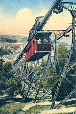
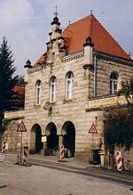
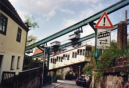
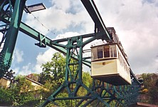
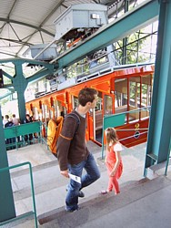
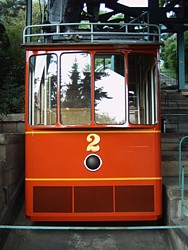

* * *

* * *

* * *

* * *

Die Geschichte der Loschwitzer Bergschwebebahn begann Ende des 19. Jahrhunderts, als sich
infolge der wirtschaftlichen und touristischen Entwicklung der Gemeinden Loschwitz, Rochwitz und Weißer Hirsch eine bessere verkehrstechnische Erschließung des Gebietes erforderlich machte. Mit Eröffnung des [Blauen Wunders](../../../nordost/loschwitz/blaues_wunder/) 1893 und Inbetriebnahme der [Standseilbahn](../../../nordost/page10246/standseilbahn/) zum
Weißen Hirsch forderten auch die Besitzer der Grundstücke in Oberloschwitz eine bequeme und zuverlässige Verbindung zum Ortszentrum am Körnerplatz. Zu den Initiatoren gehörte der
Hofbuchhändler Warnatz, der die Idee für eine Bergbahn auf der anderen Seite des Loschwitzgrundes hatte. Gemeinsam mit der Nürnberger Firma “Conti” (Continentale
Gesellschaft für elektrische Unternehmungen) ersuchte er 1896 die sächsische Regierung um eine Konzession zum Bau einer Schwebebahn vom Elbtal nach Oberloschwitz.

Noch vor Erteilung der offiziellen Genehmigung erfolgte bereits im Herbst 1898 der erster Spatenstich. Nach Übernahme des Projektes durch die neugegründete Dresdner Elektra AG
erteilten die Behörden am 16. Juli 1899 die Konzession für den Bau. Nach einigen Diskussionen über die künftige Streckenführung entschied man sich für eine Verbindung von der Pillnitzer Landstraße bis in die Nähe der
Ausflugsgaststätte “Schöne Aussicht” in Oberloschwitz. Da das ursprünglich als Talstation vorgesehene Grundstück
Pillnitzer Landstraße 3 nicht zur Verfügung stand, musste die Bahn im unteren Teil einen kleinen Bogen machen.
Umstritten war auch der Bau des Maschinenhauses für die dampfbetriebene Antriebsmaschine, welches aus ästhetischen
Gründen in Form eines burgartigen Turmes gestaltet wurde. Am 6. Mai 1901 erfolgte im Beisein von Prinz Friedrich August die offizielle Einweihung der Bahn.

Für den Bau der Schwebebahn fand die kurz zuvor patentierte Technologie des Kölner
Ingenieurs Eugen Langen (1833-1895) Anwendung, an den seit Oktober 2006 eine Gedenktafel an der Talstation _(Foto)_ erinnert. Dessen System einer an Stahlträgern hängenden
Einschienenbahn wurde in Loschwitz erstmals realisiert, so dass die Bahn älteste Bergschwebebahn in der Welt ist. Das Traggerüst und die vier Waggons entstanden in der
Firma MAN (Vereinigte Maschinenbau AG Nürnberg), Antriebsmaschine, Kessel und Zugseil wurden in der Übigauer Schiffswerft angefertigt. Bereits im ersten Jahr beförderte die Bahn
über 385.000 Passagiere. Diesen standen jeweils zwei Hauptwagen zur Verfügung, welche bei Bedarf um zwei Vorsetzwagen verstärkt werden konnten. Ab 1904 kamen diese
Reservewagen jedoch nur noch in Ausnahmefällen zum Einsatz und wurden 1937 verschrottet.

Der Bau der Bahn führte zu einer starken Zunahme der Bebauung im oberen Teil von
Loschwitz. Als besondere Attraktion für die Besucher errichtete die Elektra AG unmittelbar neben der Bergstation die Ausflugsgaststätte [“Loschwitzhöhe”](../../../nordost/loschwitz/strassen_loschwitz/loschwitzhohe/), welche nach 1945 geschlossen und 1977 abgerissen wurde. 1906 erwarb das
Unternehmen die Mehrheit an der benachbarten Standseilbahn, wodurch die Betriebsleitungen zusammengelegt werden
konnten. 1909 erfolgte die Umrüstung der Antriebsmaschinen auf elektrischen Betrieb. 1911 übernahm schließlich die Stadt Dresden beide Bergbahnen und unterstellte sie der Städtischen Straßenbahn.

Trotz moderner Sicherheitsvorkehrungen kam es in der Geschichte der Bahn auch
mehrfach zu Unfällen, meist jedoch ohne größere Schäden. Zu den tragischsten Fällen gehörte der Tod eines Schaffners im Jahr 1902, der beim Abspringen aus
der Bahn tödlich verletzt wurde. Ein Riss des Zugseils am 12. Mai 1908 blieb zum Glück ohne Folgen, ebenso wie Zusammenstöße mit Lkws am Übergang über den Veilchenweg _(Foto)_ 1932, 1998 und 2014.
Kleinere Modernisierungsarbeiten an den Wagen erfolgten 1930 und 1934. Die Bombenangriffe 1945 führten nicht zu größeren Schäden, so dass die Schwebebahn zu den wenigen zu Kriegsende
einsatzbereiten Verkehrsmitteln in der Stadt gehörte.

In der Nachkriegszeit machten sich weitere Reparaturen und Umbauten erforderlich, so der Einbau von Gepäckkörben
und elektrischen Wagenheizungen (1954/55), eine Erneuerung des Antriebsmotors (1964) und eine teilweise Sanierung
des Traggerüstes (1967). Da mit Schließung der Loschwitzhöhe und der zunehmenden Motorisierung der Bevölkerung die Fahrgastzahlen der Bahn zurückgingen, wurde 1972 sogar deren Stilllegung erwogen. Mit Aufnahme der
Schwebebahn in die Denkmalliste 1975 entschied sich der Rat der Stadt Dresden jedoch zu einem Weiterbetrieb. 1981
begann eine Generalreparatur der Bahn. In diesem Zusammenhang erneuerte man die historische Fördermaschine und die
Hochbauten an Berg- und Talstation. Nachdem sich weitere Schäden am Traggerüst gezeigt hatten, musste die Bahn am 18. März 1984 vorerst stillgelegt werden.

In den Folgejahren wurde die Bahn einschließlich der beiden Waggons komplett
demontiert und im Anschluss nach historischem Vorbild wieder aufgebaut. Verschiedene Firmen übernahmen trotz der schwierigen wirtschaftlichen Lage in der DDR die Arbeiten, die
u.a. mehrere Hubschraubereinsätze zur Montage des neuen Traggerüsts und einen kompletten Neubau der Wagen in den Straßenbahnwerkstätten Trachenberge beinhalteten. Bedingt durch Materialmangel
und fehlende Kapazitäten konnte die Rekonstruktion erst 1991 beendet werden. Am 31. Mai 1991 wurde die Loschwitzer Schwebebahn wieder in Betrieb
genommen und ist heute ein beliebtes Ziel für Technikinteressierte und Touristen. Aus Anlass des 110. Geburtstages der Schwebebahn erhielt 2011 einer der beiden Waggons vorübergehend seine
historische rote Farbgebung zurück. In der Bergstation befindet sich seit 2002 eine kleine Ausstellung zur Geschichte der
Bahn. Vom Dach des Gebäudes bietet sich ein schöner Rundblick über das Elbtal und die umliegenden Hänge.

**_Fotos:_** _Der aus Anlass des Bahnjubiläums 2011 umlackierte Wagen Nr. 2_

* * *

 \[ [Nord](../../../nord/)\] \[ [Nordwest](../../../nordwest/)\] \[ [Neustadt](../../../neustadt/)\] \[ [Nordost](../../../nordost/)\]
 \[ [West](../../../west/)\] \[ [Zentrum](../../../zentrum/)\] \[ [Südwest](../../../sudwest/)\] \[ [Süd](../../../sud/)\] \[ [Südost](../../../sudost/)\] \[ [Ost](../../../ost/)\] \[ [Register](../../../Register/register.html)\] \[ [Kontakt](../../../Kontakt/kontakt.html)\] \[ [Impressum](../../../impressum/)\]
