## Albert-Venus-Weg

Der erst zu Beginn der 1930er Jahren angelegte Verbindungsweg zwischen Ludwig-Richter-Straße und Kotzschweg erhielt seinen
Namen am 6. Oktober 1933 in Erinnerung an den Kunstmaler Albert Venus (1842-1871). Albert Venus war ein Schüler Ludwig Richters und schuf vor allem zahlreiche Landschaftsbilder.

## Alexanderstraße

Die Alexanderstraße erhielt ihren Namen vermutlich nach Alexander Wollmer, dessen Schwiegersohn, der Geheime Hofrat Prof. Carl Graff , Ende des 19. Jahrhunderts ein Grundstück an dieser Straße besaß. 1895 ist sie erstmals in Bebauungsplänen verzeichnet und wurde 1897 bis zur Adlerstraße (heute Am Weißen Adler) verlängert.

Da über die Benennung der Alexanderstraße keine Akten existieren, wird der Straßenname verschiedentlich auch mit dem russischen Zaren Alexander oder mit Alexander von Olsufieff in Verbindung gebracht. Zar Alexander hatte sich am 24. April 1813 mit dem preußischen König Friedrich Wilhelm III. an der Bautzner Straße getroffen. Alexander von Olsufieff (1763-1838) war königlich-russischer Generalmajor und ab 1811 Gerichtsherr von Wachwitz. Hier setzte er sich als Wohltäter und Stifter für den Bau einer Blinden- und Taubstummenanstalt ein. Bereits 1854 hatte der Loschwitzer Gemeinderat beschlossen, künftig eine Straße nach Olsufieff zu benennen.

Nr. 2: Die landhausartige Villa entstand 1892 als Sommerwohnung des Architekten Carl Ludwig Theodor Graff (1844-1906). Graff, der zuvor u.a. beim Bau des Wiener Opernhauses und des Kunsthistorischen Museums beteiligt war, kam 1874 nach Dresden und übernahm das Direktorenamt der Kunstgewerbeschule. Sein Grab befindet sich auf dem Waldfriedhof Weißer Hirsch.

## Alpenstraße

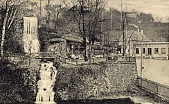Die Alpenstraße im Ortsteil Oberloschwitz verdankt ihren Namen der einst hier befindlichen Ausflugsgaststätte [“Schweizerei”](../../../nordost/loschwitz/strassen_loschwitz/schweizerei/). Das Lokal auf der Ulrichstraße besaß Ende des 19. Jahrhunderts als besondere Attraktion einen künstlich angelegten und nachts bengalisch beleuchteten “Alpenweg” mit künstlichem Wasserfall _(Foto)_. Aus diesem Weg ging 1891 die Alpenstraße hervor. Erbauer war der Inhaber des Lokals Eugen Rosenstiel. Im September 1896 wurde sie von der Gemeinde Loschwitz als Gemeindestraße übernommen. 1908 entstand hier das [Sanatorium](../../../nordost/loschwitz/strassen_loschwitz/mollers_sanatorium/) des früheren Schiffsarztes Möller, welches später als Klinik Oberloschwitz genutzt wurde (Nr. 1). Hinzu kamen einige Villen wie die Häuser Nr. 7 (Villa Alpenruhe) und Nr. 14 (Villa Windhuk).

## Alte Kirschplantage

Die Straße wurde 2006 beim Bau eines neuen Wohnparks zwischen Pillnitzer Landstraße und Elbwiesen angelegt. Zuvor befand sich auf dem Grundstück eine Kirschplantage, woran heute der Straßenname erinnert.

## Amtsstraße

Die Amtsstraße wurde ebenso wie die benachbarte Ratsstraße und die Winzerstraße nach 1900 angelegt und auf Beschluss des
Loschwitzer Gemeinderates vom 6. Dezember 1906 benannt. Die drei Straßen erinnern an die frühere Aufteilung des Ortes in die
Amts-, Rats- und Winzergemeinde. Dabei umfasste die Amtsgemeinde die Häuser im Loschwitzgrund, die Ratsgemeinde die Gebäude
in der Nähe der Elbe. Als Winzergemeinde wurden die Grundstücke in den Weinbergen zusammengefasst. Eine Bebauung der Amtsstraße erfolgte nach 1990 im Zusammenhang mit dem Bau des Wohnparks “Loschwitz-Arkaden”.

## Am Weißen Adler

Die Straße wurde 1891 vom damaligen Inhaber der Gaststätte [“Zum Weißen Adler”](../../../nordost/page10246/strassen_weisser_hirsch/bautzner_landstrasse/weisser_adler/) Wilhelm Richter angelegt und führte zunächst nur bis zur Alexanderstraße. Ursprünglich hieß sie Adlerstraße. 1895 erfolgte die Verlängerung bis zur Preußstraße. Seit dem 1. Juni 1926 wird sie Am Weißen Adler genannt. Sowohl alter als auch neuer Name erinnern an die historische Gastwirtschaft. Das Straßenbild prägen Villen und Ländhäuser aus der Zeit um 1900.

## An der Berglehne

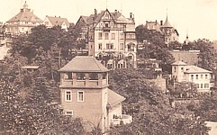Die heutige Straße An der Berglehne wechselte in der Vergangenheit schon mehrfach ihren Namen. Sie entstand 1895 auf Wunsch des Grundstücksbesitzers Ernst Heinrich Metzner. Dieser regte auch die Namensgebung Ferdinandstraße an, wahrscheinlich nach der nahegelegenen Villa Ferdinandshöhe (Nr. 2). Am 1. Juni 1926 erfolgte nach der sächsischen Offiziersfamilie von Kirchbach die Umbenennung in Kirchbachstraße. 1946 erhielt sie nach einer Flurbezeichnung ihren heutigen Namen.

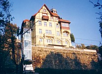Nr. 1: Bemerkenswert ist die um 1897 direkt am Hang errichtete Villa An der Berglehne 1 im Landhausstil _(Foto rechts)_. Dieses Haus wurde nach 1990 saniert und mit einem gläsernen Aufzug an der Hangseite versehen. Neben der Villa führt die “Jahnstiege” hinunter zum Rißweg.

Nr. 2: Die Gebäude Ferdinandstraße 2, 4 und 8 befanden sich ursprünglich im Besitz des Fabrikbesitzers Carl Dittrich (1853-1918), geschäftsführender Gesellschafter der in Schönlinde (heute Krasna Lipa/Nordböhmen) und Zyrardow (Polen) ansässigen Textilfabriken Hielle & Dietrich. Im Zuge einer Straßenumbenennung und dabei erfolgter Umnummerierung wurden diese Häuser der Oskar-Pletsch-Straße (Nr. 1) zugeordnet bzw. erhielten die Nummern An der Berglehne 11 und 7. Nach dem Tod Dittrichs verkauften seine Erben ihren Besitz. Zuletzt wechselte 2010 das Haus Oskar Pletsch-Straße 1 seinen Eigentümer.

Nr. 4: In diesem Haus war zwischen 1928 und 1929 die Reichsparteischule der KPD untergebracht, an der u.a. Hermann Duncker lehrte und die von Ludwig Renn besucht wurde. 1929 verzog die Einrichtung in eine von einer Schweizer Kommunistin zur Verfügung gestellte Villa nach Fichtenau/Schöneiche. Nach Machtantritt der Nazis nutzte die SA das Gebäude als Schulungsheim.

Nr. 18: Unweit davon befindet sich die Villa “Fuchsbau”, welche ihren Namen nach einer im Garten stehenden Plastik erhielt. Das 1892/93 von Heinrich Metzner erbaute Haus diente dem Schriftsteller Uwe Tellkamp als Vorbild für sein “Tausendaugenhaus” im Roman “Der Turm”.

## Anna-Angermann-Straße

Die 1996 beim Bau des “Augustusparkes” angelegte Anna-Angermann-Straße wurde nach der früher in Loschwitz lebenden Malerin
Anna Elisabeth Angermann (1883-1985) benannt. Ihr Grab befindet sich auf dem [Loschwitzer Friedhof](../../../nordost/loschwitz/loschwitzer_kirche/loschwitzer_friedhof/).

## Brockhausstraße

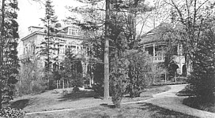
Die Brockhausstraße verbindet die Bautzner Landstraße mit dem am Elbufer entlangführenden Körnerweg. Da sie zugleich den Zugang zum Ausflugslokal und zum am Ende der Straße am Elkbufer gelegenen  [Wasserwerk Saloppe](../../../nordost/loschwitz/strassen_loschwitz/saloppe/) bildete, wurde sie bis
1903 Saloppeweg genannt. Nach der Umbenennung zu Ehren der bekannten Verlegerfamilie Brockhaus überwies diese zum Dank 300 Mark an die Armenkasse der Gemeinde Loschwitz.

Das Gelände am Schotengrund war einst Teil des [Findlaterschen Weinberges](../../../nordost/loschwitz/albrechtsschlosser/) und kam
im 19. Jahrhundert in den Besitz der Verlegerfamilie Brockhaus. 1847 ließ sich Heinrich Brockhaus eine Villa mit einem großen Parkgelände errichten, die bis 1945 im Familienbesitz blieb. Häufig weilte Richard Wagner, ein
Schwager des Verlegers, auf diesem Grundstück. Nach 1945 nutzte bis 1989 das Ministerium für Staatssicherheit Teile des Areals, was
zur teilweisen Zerstörung des Gartens führte. Erhalten blieben die Villa und das bereits 1836 entstandene Gartenhaus. Eine Wiederherstellung des Parks ist geplant. Außerdem sollen hier mehrere Einfamilienhäuser entstehen.

## Brückenstraße

Die heute nicht mehr benannte Brückenstraße entstand 1893 beim Bau des [“Blauen Wunders”](../../../nordost/loschwitz/blaues_wunder/) und verband den Loschwitzer
Brückenkopf mit dem Körnerplatz. In älteren Stadtplänen ist sie auch als Elbbrückenstraße verzeichnet. Nach 1945 wurde die Namensgebung aufgehoben und die wenigen Gebäude dem [Körnerplatz](../../../nordost/loschwitz/strassen_loschwitz/kornerplatz/) zugeordnet.

## [Calberlastraße](../../../nordost/loschwitz/strassen_loschwitz/calberlastrasse/)

## Chopinstraße

Die Chopinstraße geht auf einen alten Fußweg zurück, den der Besitzer der Gastwirtschaft “Weißer Adler” 1877 zur Erschließung seines Grundstückes anlegen ließ. Zwanzig Jahre später erfolgte der Ausbau zur Anliegerstraße. Diese trug ab 1897 zunächst den Namen Thielaustraße nach dem Eigentümer eines hier gelegenen Grundstücks, dem Amtshauptmann und Geheimen Regierungsrat Ernst Florian von Thielau. Ab 1926 wurde sie nach dem früheren Besitzer des Gutes Weißer Hirsch Roosstraße genannt. Am 11. Oktober 1949 erfolgte anläßlich des 100. Todestages des polnischen Komponisten Frederic Chopin (1810-1849) eine erneute Umbenennung in Chopinstraße.

Zu den markantesten Bauten gehörte das frühere [Teuschersche Sanatorium](../../../nordost/page10246/strassen_weisser_hirsch/teuschers_sanatorium/), welches nach 1945 in ein Lehrlingswohnheim bzw. ein Heim der Jugendhilfe umgewandelt wurde. Ein Großteil des Gebäudekomplexes zwischen Chopinstraße und Säugrundweg _(Foto um 1920)_ wurde nach 1990 abgerissen. Auf dem Grundstück Chopinstraße 2-6 entstand ab 2009 eine kleine Wohnsiedlung mit Mehrfamilien- und Doppelhäusern (“Chopins Garten”).

## Dammstraße

Die 1875 erstmals unter dem Namen „Damm“ erwähnte Dammstraße verbindet den Körnerplatz mit dem alten Dorfkern an der Friedrich-Wieck-Straße. Bis zum Abbruch 1893 befanden sich hier kleine Häusleranwesen, die jedoch der Gründerzeitbebauung rund um den Körnerplatz weichen mussten. Erhalten blieb das Gebäude unmittelbar an der Auffahrt zum “Blauen Wunder”, welches heute gewerblich genutzt wird. Die Mietshäuser der gegenüberliegenden Straßenseite entstanden 1898 nach Plänen des Blasewitzer Architekten Karl Emil Scherz.

## Degelestraße

Die Degelestraße erhielt ihren Namen 1897 nach dem Kammersänger Paul Eugen Degele (1834-1886), der Ende des 19. Jahrhunderts als Bariton große Erfolge feierte. Degele besaß ab 1883 das Grundstück Bautzner Landstraße 50 und liegt auf dem Loschwitzer Friedhof begraben. An ihn erinnert auch die Degelequelle im [Waldpark Weißer Hirsch](../../../nordost/page10246/rathauspark/). Die Villa “Oskarshamm", 1897 erbaut und 1913 von Max Herfurt stark verändert, war von 1909 bis zum Ende des Zweiten Weltkriegs im Besitz der Familie von Brandenstein und wurde nach 1945 als Studentenwohnheim der TU genutzt. Heute hat hier eine Immobilienfirma ihren Sitz. Das Nachbarhaus Nr. 3, 1896 nach Plänen des Architektenbüros Schilling & Gräbner erbaut, sollte um 1970 zum Alterswohnsitz Walter Ulbrichts umgebaut werden. Vor dem Zweiten Weltkrieg wurde es als "Haus Waldpark" als Pension und Erholungsheim genutzt. Heute befindet sich hier ein Schule der Telekom.

## Dostojewskistraße

Die ursprünglich als Parkstraße bezeichnete Straße im westlichen Teil der Loschwitzer Flur entstand 1896 auf Privatinitative des Loschwitzer Einwohners Dr. phil. Ehlermann. Ursprünglich sollte sie auf Beschluss des Gemeinderates nach dem Commerzienrat und Unternehmer Bruno Naumann Naumannstraße genannt werden, was Naumann jedoch ablehnte, da er sich zwar geehrt fühlte, jedoch keiner besonderen Verdienste bewusst sei. Ehlermann schlug daraufhin am 9. Juli 1896 die neutrale Bezeichnung Parkstraße vor.

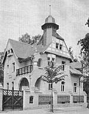Nach der Eingemeindung des Ortes erhielt die Parkstraße zunächst den Namen Hausenstraße. Clemens von Hausen, ein aus der Lausitz stammender Gutsbesitzer, erwarb um 1890 den früheren Güntzschen Weinberg und ließ hier die Villa Rosenhof errichten (heute Schevenstraße 11). Wenig später entstand das “Magdala-Haus” für die Tochter des Bankiers Wilhelm Knoop (Dostojewskistraße 7). Im Haus Nr. 1 befand sich viele Jahre das Café Richter. Die Landhäuser Nr. 8 _(Foto)_ und 10 entstanden um 1900 nach Entwürfen des Architekten Theodor Richter.

Am 1. Juli 1946 erfolgte die Umbenennung der Hausenstraße in Dostojewskistraße. Der bedeutende russische Dichter Fjodor Dostojewski (1821-1881) verbrachte einige Jahre seines Lebens in Dresden und verfasste hier seinen berühmten Roman “Die Dämonen”.

## Elbbrückenstraße

Die Elbbrückenstraße wurde 1893 als Zufahrt zur neuen [Loschwitzer Elbbrücke](../../../nordost/loschwitz/blaues_wunder/) angelegt und zunächst Brückendamm- bzw.
Brückenstraße genannt. Für ihren Bau mussten mehrere Gebäude des alten Dorfkerns weichen. Als einziger Neubau entstand nach der
Fertigstellung das repräsentative Eckhaus “Zum Goldenen Schiff” an der Einmündung des Körnerweges in den Körnerplatz. Bereits 1897 erfolgte die offizielle Namensgebung Elbbrückenstraße.

## Fidelio-F.-Finke-Straße

Die Fidelio-F.-Finke-Straße entstand kurz nach 1900 parallel zur Pillnitzer Landstraße und wurde zunächst als Straße G bezeichnet. Am 3. Oktober 1906 beschloss der Loschwitzer Gemeinderat, diese nach dem 1902 verstorbenen sächsischen Herrscher künftig König-Albert-Allee zu nennen. Da mit Abschaffung der Monarchie alle entsprechenden Straßennamen in Dresden geändert wurden, erfolgte am 15. September 1922 eine Namensänderung in Albertallee. Um 1930 war der Ausbau zu einer neuen Verbindungsstraße nach Pillnitz geplant, der jedoch nie fertiggestellt wurde.

Ihren heutigen Namen erhielt sie am 5. August 1971 anlässlich seines 80. Geburtstages nach dem Komponisten Fidelio F. Finke (1891–1968). Finke war nach 1945 einige Jahre Rektor der Dresdner Akademie für Musik und Theater. Markantestes Gebäude ist die Alte Loschwitzer Feuerwache, die der Architekt Georg Schramm 1908/12 im Jugendstil erbaute (Nr. 4). Hier hatte bis 1945 die Freiwillige Feuerwehr des Ortes ihr Domizil. Später befanden sich im Haus Büroräume und Wohnungen. Seit 1992 wird die Feuerwache vom Kunstverein “Alte Feuerwache e.V.” genutzt. Regelmäßig finden in den Räumen verschiedene Kurse, Workshops, Veranstaltungen und kleinere Ausstellungen statt.An der Feuerwache erinnert eine Gedenktafel an die im Ersten Weltkrieg gefallenen Feuerwehrleute des Ortes. Unweit davon befindet sich die Loschwitzer [Schillerschule](../../../nordost/loschwitz/) (62\. Oberschule).

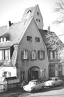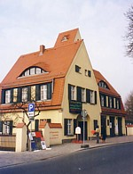

**_Fotos:_** _Alte Feuerwache auf der Fidelio-F.-Finke-Straße (um 1985 und 2012)_

__

Auch das kleine Gartenhaus auf dem Grundstück Fidelio-F.-Finke-Straße 7 dient seit 1991 kulturellen Zwecken. Hier hat heute der
Elbhangfest-Verein sein Büro. Das 1919 errichtete Gebäude entstand ursprünglich als Atelierhaus des Fotografen Franz Gaudernack
und gehörte ab 1930 der Kirchgemeinde, die es als Jugendhaus des “Jungmännervereins” nutzte. Nach Machtübernahme der
Nationalsozialisten wurde es 1934 an die Hitlerjugend und das NS-Winterhilfswerk vermietet. Nach 1945 befanden sich hier u.a. eine
Dienststelle des Gesundheitsamtes, eine Kinder- und Jugendbibliothek und das Büro der Baupflegeabteilung der Landeskirche.

2004
wurde an der Fidelio-F.-Finke-Straße ein moderner Kindergarten eröffnet, der die 1955 eröffnete bisherige Kindertagesstätte
Veilchenweg 7 ersetzt. Das Gebäude entstand als sogenanntes “Passivhaus” in besonders energiesparender Bauweise und wurde vom
Architekturbüro wurm architektur aus Pirna unter Mitarbeit der Loschwitzer Architektin Wieke Felchner-Radig entworfen. Im Garten
befinden sich zwei 1911 von Georg Türke geschaffene Kinderplastiken, die bereits im Garten des alten Kindergartens zu finden waren.

## Fischerstraße

Die Fischerstraße erinnert an den früheren Besitzer des Gasthofs “Weißer Adler”, Gottfried August Fischer (1824–1897). Sie entstand Ende der 1860er Jahre gemeinsam mit der Degelestraße und der Lausitzer Straße. Der Grundstücksbesitzer hatte zuvor für dieses Gebiet einen Bebauungsplan erarbeitet und diesen 1876 nochmals erweitert. Allerdings wurden seine Vorhaben zunächst nur teilweise realisiert. Nach Zwangsversteigerung und Übergabe der Privatstraße an die Gemeinde Loschwitz erfolgte mit Beschluss vom 7. April 1897 die Benennung in Fischerstraße.

## Franz-Curti-Straße

Die Franz-Curti-Straße, eine kurze Nebenstraße der Malerstraße in Oberloschwitz, erhielt ihren Namen 1901 nach dem Komponisten
Franz Curti (1854-1898). Curti betrieb ab 1880 eine Zahnarztpraxis in der Dresdner Innenstadt und widmete sich in seiner Freizeit der
Komposition von Opern und Kantaten. In Oberloschwitz besaß er auf der Malerstraße 13 ein Sommerhaus. Auf Anregung seiner Witwe Eugenie Curti
wurde der an diesem Grundstück vorbeiführende Weg 1901 nach dem Musiker benannt.

## Franziska-Tiburtius-Straße

Die Franziska-Tiburtius-Straße entstand 2012 in Oberloschwitz im Zuge der Neubebauung eines Grundstücks an der Malerstraße. Mit
der Namensgebung wird an die deutsche Ärztin Franziska Tiburtius (1843-1927) erinnert. Als erste Frau der Neuzeit studierte sie in
Zürich Medizin und arbeitete im Anschluss als Ärztin in Leipzig und Berlin. Kurzzeitig war sie Volontärärztin an der Dresdner
Frauenklinik. Als Frauenrechtlerin setzte sie sich zudem für die Zulassung von Frauen zum Medizinstudium ein.

## Friedrich-Press-Straße

Die Friedrich-Press-Straße entstand 1997 beim Bau der Wohnsiedlung “Augustuspark” zwischen Pillnitzer Landstraße und Elbufer.
Benannt wurde sie nach dem Bildhauer Friedrich Press (1904-1990), der viele Jahre in Loschwitz wohnte und vor allem sakrale
Plastiken schuf. Von ihm stammen u.a. die Pieta für die Opfer des 13. Februar 1945 in der Hofkirche sowie die Innenraumgestaltung der [St.-Josefs-Kirche](../../../nordwest/pieschen/st_-josefs-kirche/) in Pieschen. Sein Grab befindet sich auf dem Loschwitzer Friedhof.

## [Friedrich-Wieck-Straße](../../../nordost/loschwitz/strassen_loschwitz/friedrich-wieck-strasse/)

## [Grundstraße](../../../nordost/loschwitz/strassen_loschwitz/grundstrasse/)

## Heilstättenweg

Der Heilstättenweg verbindet den am Elbufer entlangführenden Körnerweg mit der Wunderlichstraße und erhielt seinen Namen nach der 1872 von Marie Simon gegründeten [Heilstätte Loschwitz](../../../nordost/loschwitz/strassen_loschwitz/heilstatte_loschwitz/). Die Einrichtung diente bis 1912 als Erholungsheim für Kriegsversehrte. Die Gebäude sind noch erhalten und werden heute zu Wohnzwecken genutzt.

Sein Verlauf geht auf einen alten Kommunikationsweg zurück, der vom Elbufer entlang des Mordgrundes bis zur Bautzner Landstraße führte. Deshalb wurde er früher umgangssprachlich Mordgrundweg genannt. Nach der Eröffnung der Deutschen Heilstätte bürgerte sich der Name Heilstättenweg ein. Amtlich erfolgte jedoch erst am 1. Januar 1904 die offizielle Benennung. Der obere Teil des Weges war bereits 1886 zur Straße ausgebaut und Wunderlichstraße genannt worden.

## Hermann-Glöckner-Straße

Die Hermann-Glöckner-Straße wurde 2006 auf dem Gelände der früheren Loschwitzer Kirschplantage angelegt. Mit der
Namensgebung soll an den Dresdner Maler und Bildhauer Hermann Glöckner (1889-1987) erinnert werden, der als Wegbereiter der
modernen Kunst gilt und sein Atelier viele Jahre im Loschwitzer Künstlerhaus hatte. Glöckner gehörte ab 1948 der Künstlergruppe “der
ruf” an und schuf vor allem konstruktivistische Metallgestaltungen, u.a. den “Stahlmast mit Faltungen” vor der TU-Mensa am Fritz-Förster-Platz.

## Hermann-Vogel-Straße

Die Hermann-Vogel-Straße in Oberloschwitz entstand 1901. Ihren Namen verdankt sie dem Maler und Zeichner Hermann Vogel (1854-1921), der ab 1887 auf der Plattleite wohnte. Bekannt wurde er vor allem durch seine romantischen Märchen-Bilder im Ludwig-Richter-Stil. Um 1900 hatten die beiden Loschwitzer Architekten Oskar Menzel und Rudolf Kolbe das Areal in Oberloschwitz erworben. Beide ließen hier wenig später mehrere Wohnhäuser errichten. Richard Kolbe selbst besaß im Haus Nr. 4 seine Wohnung
und sein Büro. Er ist Schöpfer zahlreicher Villenbauten und Denkmale in der Dresdner Umgebung.

Nr. 2: In der heutigen Hermann-Vogel-Straße 2 (ehemals Rochwitzer Steg 6) bezog 1864 Ludwig Richter eine Sommerwohnung bei seinem Malerkollegen August Reinhardt. In Erinnerung an Richter wurde 1885 am Giebel ein Reliefbildnis aus Bronze angebracht. Schöpfer dieses Porträtmedaillons war Robert Henze. Heute schmückt eine Kopie das 2003 sanierte Gebäude. Ab 1900 befand sich dieses im Besitz des Malers Richard Müller. Müller war ab 1903 Professor an der Kunstakademie und hatte zwischen 1933 und 1935 das Amt des Rektors der Hochschule inne. 1954 verstarb er in seinem Haus, sein Grab befindet sich auf dem Loschwitzer Friedhof. Seine Frau Lillian Sanderson (1866 -1947) wurde als Konzertsängerin und Gesangspädagogin bekannt.

## Heymelstraße

Die nach dem Ersten Weltkrieg angelegte Heymelstraße erhielt ihren Namen nach dem Konsul und Kaufmann Adolf Heymel (1822-1890). Heymel wohnte ab 1877 in der [Villa Thorwald](../../../nordost/loschwitz/strassen_loschwitz/schillerstrasse/) auf der Schillerstraße 12 und war in Loschwitz auch als Stifter aktiv. Sein
Sohn Alfred gründete 1899 gemeinsam mit zwei Geschäftsfreunden die Zeitschrift “Die Insel”, aus der wenig später der bekannte
Insel-Verlag hervorging. Die Wohnhäuser der Heymelstraße entstanden in den Zwanziger und Dreißiger Jahren.

## Hietzigstraße

Der Name Hietzigstraße geht auf den Loschwitzer Steinbruchbesitzer Karl Adolph Hietzig (1824-1877) zurück, der die Straße als Privatstraße zu seinem Grundstück anlegen ließ. Hier ließ er sich ein burgartiges Landhaus erbauen, welches bereits 1873 wieder abgetragen wurde. Hietzig erwarb sich auch Verdienste um die Entwicklung seines Heimatortes. 1886 wird die kurze Sackgasse als "Hietzigs Privatweg" im Adressbuch genannt. Am 21. Dezember 1907 beschloss der Gemeinderat die offizielle Benennung als Hietzigstraße.

Der zweite Straßenabschnitt zwischen Steglichstraße und Hirschleite wurde 1892 ebenfalls als Privatstraße angelegt. Bauherr war August Hilbert, der diese am 12. April 1893 als Augustus-Straße dem Gemeinderat meldete. Im September des gleichen Jahres bat er den Loschwitzer Gemeinderat um Übernahme durch die Gemeinde, der auch stattgegeben wurde. Als Gegenleistung durfte Hilbert für drei Jahre die von ihm gepflanzten Kirschbäume nutzen. Im Juli 1902 wurde die Kirschallee schließlich gefällt.

Nach der Eingemeindung von Loschwitz wurden beide Straßenabschnitte vereinigt und am 1. Juni 1926 zusammen zur Hietzigstraße. Grund war die Verwechslungsgefahr der Augustusstraße mit einer gleichnamigen Straße im Stadtzentrum

Die Straße Hirschleite, eine bereits auf Loschwitzer Flur gelegene Verlängerung des [Lahmannrings](../../../Nordost/Page10246/Strassen_Weisser_Hirsch/Lahmannring/Lahmannring.html), ist erstmals 1897 erwähnt und trug zunächst den Namen Buttergasse. Grund war, dass hier einst die Loschwitzer Butterhändler wohnten, die ihre Waren auf den Dresdner Märkten verkauften. Zuvor hatte sich die Familie Hietzig für den Ausbau der Straße ausgesprochen. Kommerzienrat Bruno Hietzig setzte sich 1915 auch für eine Umbenennung in Hirschleite ein, die zwei Jahre später am 19. Dezember 1917 vollzogen wurde. Der Name ist von einem alten Flurnamen abgeleitet, der auf die Lage am Hang (= Leite) des Weißen Hirschs Bezug nimmt.

## Josef-Hegenbarth-Weg

Der heute Josef-Hegenbarth-Weg genannte Weg hieß früher Wachwitzer Kirchweg, da er von den Bewohnern des Ortes auf ihrem
Weg zur Loschwitzer Kirche benutzt wurde. 1628 gab es hier einen Weinberg des Oberhofpredigers von Hohenegg. Später besaß die
Familie Poncet an dieser Stelle ein Herrenhaus (Nr. 18). Jean Francois Poncet (1714-1804) war im  18. Jahrhundert als Hofuhrmacher
in Dresden tätig und schuf u.a. die Uhr des Schloßturmes. 1852 kam das Anwesen in den Besitz des Arztes und Kunstsammlers Dr.
Carl August Reichel, der das zugehörige Gartenhaus (“Begerhäuschen”) in den Sommermonaten an Gäste vermietete. Zu diesen gehörte
die Familie von Kügelgen. 1945 wurde das Begerhäuschen durch Bomben zerstört und wenig später abgetragen.

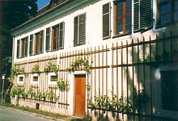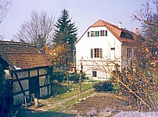

**_Fotos:_** _Das unter Denkmalschutz stehende frühere Poncet´sche Weingut Josef-Hegenbarth-Weg 1_

Seinen heutigen Namen erhielt der Weg Anfang der 60er Jahre. Josef Hegenbarth (1884-1962) studierte als Schüler von Gotthard
Kuehl an der Dresdner Kunstakademie Malerei und Grafik und war später als Professor tätig. Bekannt wurde Hegenbarth vor allem als Buchillustrator. Bis zu seinem Tod wohnte er auf der [Calberlastraße 2](../../../nordost/loschwitz/strassen_loschwitz/calberlastrasse/). Sein Grab befindet sich auf dem Loschwitzer Friedhof.

## Karl-Schmidt-Weg

Der von der Grundstraße nach Oberloschwitz führende Weg erhielt seinen Namen 1933 nach dem Volkskundler und früheren
Vorsitzenden des Vereins Sächsischer Heimatschutz. Karl Schmidt (1853-1922) hatte sich aus Gründen des Umweltschutzes stark für die Schließung der [Tintenfabrik Leonhardi](../../../nordost/loschwitz/strassen_loschwitz/grundstrasse/tintenfabrik_leonhardi/) und für die Umgestaltung des Areals zu einer Parkanlage eingesetzt. Angelegt wurde der
Panoramaweg ursprünglich vom Besitzer der Ausflugsgaststätte “Schweizerei” und deshalb zunächst Alpenweg genannt.

## Klengelstraße

Die Klengelstraße erinnert an den sächsischen Oberlandbaumeister Wolf Caspar von Klengel (1630-1691), der als wichtiger
Wegbereiter der barocken Umgestaltung Dresdens gilt. Auf seinen Entwurf gehen u. a. das strahlenförmige Straßennetz der Inneren
Neustadt und die frühe Bebauung der Friedrichstadt zurück. Klengel besaß in Loschwitz oberhalb des Körnerweges einen Weinberg,
welcher heute weitgehend überbaut ist. Die Wohngebäude an der Klengelstraße entstanden meist in den Jahren nach dem Ersten Weltkrieg.

## Knoopstraße

Die kurze Knoopstraße, eine Seitenstraße der Schevenstraße, wurde 1934 angelegt und mit Wohnhäusern bebaut. Mit der
Namensgebung wird an den Konsul und Stifter Wilhelm Knoop (1836-1913) erinnert. Knoop war Mitinhaber des später in der
Dresdner Bank aufgegangenen Bankhauses Thode & Co. und zugleich Mitglied mehrerer Aufsichtsräte sowie Konsul der USA und
Mexikos. Als Mitglied des Ortsvereins Loschwitz setzte er sich für die Belange des Ortes ein und stiftete Teile seines Vermögens für soziale und kulturelle Zwecke, u.a. den Bau des Körner-Schiller-Denkmals an der Schillerstraße.

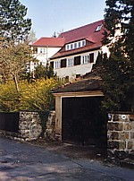

**_Foto:_** _Blick in die Knoopstraße im westlichen Oberloschwitz_

## [Körnerplatz](../../../nordost/loschwitz/strassen_loschwitz/kornerplatz/)

## [Körnerweg](../../../nordost/loschwitz/strassen_loschwitz/kornerweg/)

## Kotzschweg

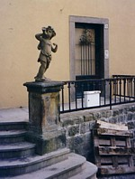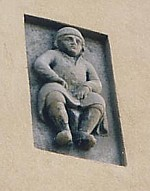Der Kotzschweg, erstmals 1876 so benannt, erinnert an den bekannten
Fotografen August Kotzsch (1836-1910), der einen Großteil seines Lebens in Loschwitz verbrachte. Kotzsch war einer der ersten professionellen Fotografen im Dresdner Raum und schuf zahlreiche Aufnahmen vom Alltagsleben im Ort.
Bereits sein Vater Johann Gottfried Kotzsch hatte Anfang des 19. Jahrhunderts das Weinbergsgrundstück Kotzschweg Nr. 22 erworben, in dem auch Sohn August später lebte. Zeitweise besaß Ludwig Richter in diesem Gebäude ein
Atelier und eine Sommerwohnung.

Die Villa Kotzschweg 1 war einst im Besitz der Familie Arnhold, die als Besitzer des Bankhauses Arnhold und als Mäzene bekannt wurden. Im Haus Nr. 12 _(Fotos)_
lebte ab 1898 der Architekt und Dresdner Stadtbaurat Hermann Klette. Klette war 1909 am Umbau der Augustusbrücke
beteiligt. In Erinnerung an sein wichtigstes Werk ließ er an seinem Wohnhaus eine Kopie der Figur des “Brückenmännchens” anbringen, die heute noch dort zu sehen ist _(Bild rechts)_
. Die Nachbargebäude Nr. 14, 15 und 16 fielen 1945 dem Luftangriff zum Opfer.

## [Krügerstraße](../../../nordost/rochwitz/strassen_rochwitz/krugerstrasse/)

## Kügelgenstraße

Die Kügelgenstraße am Loschwitzer Elbhang erhielt ihren Namen nach dem Maler Gerhard von Kügelgen (1772-1820), der 1819 ein
Weinberghaus in Loschwitz erwarb. Auf dem Weg zu diesem Sommersitz wurde er  am 27. März 1820 Opfer eines Raubmordes. Zu
den markantesten Häusern der Straße gehört die Villa Nr. 12, die 1913 von Oswin Hempel für den Wirt der Bärenschänke Karl Höhne
errichtet wurde. In den Dreißiger Jahren wohnte hier der Dresdner Oberbürgermeister Hans Nieland. Im Inneren sind noch einige von Paul Rößler geschaffene Wandmalereien und Glasfenster erhalten. Rößler war
auch Schöpfer der Innenraumgestaltung des Ratskellers und einiger Dresdner Kirchen. Gegenüber befindet sich das Landhaus Nr. 10, welches 1902 von Max Hans Kühne für den
Königlich-Sächs. Hofphotographen Müller im toskanischen Landhausstil entworfen wurde.

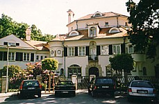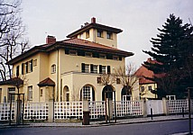

**_Fotos:_** _Die ehemalige Höhne-Villa auf der Kügelgenstraße 12 (links) und das Nachbarhaus Nr. 10 (rechts)_

## Lausitzer Straße

Die ehemalige Hermannstraße wurde 1922 in Lausitzer Straße umbenannt. Grund war die Verwechslungsgefahr mit einer gleichnamigen Straße im Stadtteil Strehlen. Im Wohnhaus Hermannstraße 2 wohnte zeitweise die Malerin und Graphikerin Margarete Donath.

## Leonhardistraße

Die früher Rakenweg genannte Leonhardistraße erinnert an den Loschwitzer Unternehmer und Kunstmaler Eduard Leonhardi
(1828-1905). Leonhardi hatte 1859 von seinem Vater ein Grundstück an dieser Straße übertragen bekommen. 1865 entstand hier eine
von ihm und seiner Familie genutzte Villa mit Ateliergebäude. Eduard Leonhardi ließ 1883 auch die frühere Hentschelmühle an der Grundstraße im romantischen Stil umbauen. Während die Mühle bis heute als [Leonhardi-Museum](../../../nordost/loschwitz/strassen_loschwitz/grundstrasse/leonhardi-museum/) erhalten ist, fiel die Villa 1945 dem Luftangriff zum Opfer.

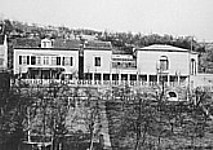Nr. 1:
Das Grundstück Leonhardistraße 1 geht auf einen bereits 1694 vorhandenen Weinberg zurück, den im gleichen Jahr der Dresdner Bürger Licentiat Johannes Dornfeld erwarb. Dornfeld
ließ das Areal, welches sich bis zur Schillerstraße hinabzog, mit einer noch heute vorhandenen Mauer umgeben und ein kleines barockes Herrenhaus errichten. 1747 erwarb Heinrich Roos,
sächsischer Oberlandweinmeister, das Gebäude. Dieses brannte 1857 ab und wurde wenig später durch eine um 1965 aufgestockte Villa ersetzt. Leider ging bei diesem Umbau das historische
Erscheinungsbild weitgehend verloren. Heute dient das Haus als “Thorwald-Residenz” Wohnzwecken. Bereits sechs Jahre zuvor war auf dem Grundstück die repräsentative [Villa Thorwald](../../../nordost/loschwitz/strassen_loschwitz/schillerstrasse/) entstanden. Im Grundstück sind noch einige bauliche Reste der Barockanlage, darunter
eine Herkules-Plastik und alte Wasserspeier erhalten.

Nr. 3: Ursprünglich befand sich auch hier ein Weinberg, welcher 1801 dem Grafen von Einsiedel gehörte. 1819 erwarb Gerhard von
Kügelgen das Grundstück und ließ sich ein Weinbergshaus errichten. Noch vor dessen Fertigstellung fiel der Maler jedoch am 27. März
1820 einem Raubmord zum Opfer. Das Gebäude kam 1847 in den Besitz des Apothekers Ludwig Eduard von Hofmann, der das
vorhandene Haus 1852 abreißen und durch einen palastartigen Neubau ersetzen ließ. Ab 1860 gehörte dieser dem Dresdner
Papierfabrikanten Eduard Thode. Die durch spätere Umbauten teilweise negativ veränderte Villa wurde ab 1996 nach historischem
Vorbild saniert und dient heute als Wohn- und Bürohaus. An der Fassade befinden sich Relieftafeln mit Darstellungen aus dem Winzerleben.

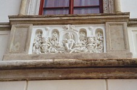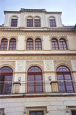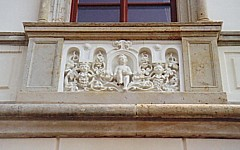

**_Fotos:_** _die mit Reliefs verzierte Fassade der Villa Leonhardistraße 3 kurz nach der Sanierung 2006_

Nr. 16 (Villa Leonhardi):
Das frühere Weinbergsgrundstück befand sich ab 1859 im Besitz des Malers Eduard Leonhardi. Der durch seine 1854 gegründete [Tintenfabrik](../../../nordost/loschwitz/strassen_loschwitz/grundstrasse/tintenfabrik_leonhardi/) zu Wohlstand
gekommene Unternehmer Christian August Leonhardi hatte das Areal kurz zuvor erworben und seinem Sohn zu dessen Hochzeit geschenkt. Eduard Leonhardi ließ das vorhandene Landhaus
1865 zu einer Villa erweitern und nutzte es bis zu seinem Tod als Wohnung und Atelier _(Foto)_. 1945 fiel die Villa einem Bombentreffer zum Opfer und wurde zu DDR-Zeiten durch ein Doppelhaus ersetzt.

## Ludwig-Richter-Straße

Die Ludwig-Richter-Straße wurde 1894 nach dem bekannten Maler und Zeichner Ludwig Richter (1803-1884) benannt, der viele
Jahre seines Lebens in Loschwitz verbrachte. Richter bewohnte in den Sommermonaten 1853-55 das heutige Wohnhaus Nr. 8,
welches sich damals im Besitz des Winzers Sperling befand. An Stelle eines Weinberges, der um 1720 dem Geographen und
Karthographen Adam Friedrich Zürner gehörte, entstanden im 19. Jahrhundert verschiedene Villen und Wohnhäuser. Die Gebäude Ludwig-Richter-Straße 12, 14 und 16 wurden 1945 zerstört.

## [Malerstraße](../../../nordost/loschwitz/strassen_loschwitz/malerstrasse/)

## Marie-Simon-Straße

Die nach dem Ersten Weltkrieg angelegte Marie-Simon-Straße erhielt ihren Namen nach der Gründerin der nahegelegenen [Heilstätte\
Loschwitz](../../../nordost/loschwitz/strassen_loschwitz/heilstatte_loschwitz/), welche von 1872 bis 1912 existierte. Marie Simon (1824-1877) hatte zuvor an den Kriegen von 1866 und 1870/71 als
Krankenschwester teilgenommen und angesichts des erlebten Leids eine Erholungsstätte für Kriegsinvalide und Verwundete gestiftet.
Außerdem setzte sie sich für die fachkundige Ausbildung von Krankenpflegepersonal ein und gründete in Loschwitz eine entsprechende
Lehranstalt. Gemeinsam mit Königin Carola gilt sie als Mitbegründerin des Albertvereins zur Versorgung kranker und alter Menschen.

## Materniweg

Der Straßenname Materniweg ist vom Dresdner Maternihospital abgeleitet, welches zu den ältesten Sozialeinrichtungen der Stadt gehörte. Hier entstand um die Jahrhundertwende eine von Heinrich Lahmann initiierte Radfahrbahn, auf der die Kurpatienten in der “Kunst” des Fahrradfahrens unterwiesen wurden. Das Institut war eine von drei gleichartigen Einrichtungen auf dem Weißen Hirsch und existierte bis 1906. Im Haus Materniweg 3 wohnte in den 1930er Jahren Karl von Appen, Bühnenbildner an der Semperoper. Sein Grab befindet sich auf dem Waldfriedhof Weißer Hirsch.

## Oeserstraße

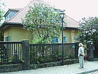Die heutige Oeserstraße in Oberloschwitz geht auf einen alten Weinbergsweg zurück, der
ursprünglich als Barths Privatweg bezeichnet wurde. Nach dem Bau der Schwebebahn und der hier gelegenen Ausflugslokale [“Loschwitzhöhe”](../../../nordost/loschwitz/strassen_loschwitz/loschwitzhohe/) und “Schöne Aussicht” erfolgte 1901 die Umbenennung
in Bergstraße. Um Verwechslungen mit der gleichnamigen Straße in der Südvorstadt zu vermeiden, wurde die Bergstraße 1926 in Oeserstraße umbenannt. Adam Friedrich Oeser (1717-1799) wirkte
zwischen 1739 und 1759 in Dresden als Maler und Kupferstecher und war u.a. Zeichenlehrer Johann Joachim Winckelmanns.

Nr. 5: Die kleine Villa entstand 1927 für den Direktor der Zeiss-Ikon-Werke, Professor Emanuel
Goldberg. Nach der Machtübernahme der Nazis emigrierte die jüdische Familie im Oktober 1933 über Frankreich nach Palästina. Das
Grundstück ging daraufhin in Staatsbesitz über. 1947 bezog der Musiker Heinz Bongartz (1894-1978) das Haus, nachdem er die Stelle
des Chefdirigenten der Dresdner Philharmonie übernommen hatte. Bongartz lebte hier bis zu seinem Tod 1978. Sein Grab befindet sich auf dem [Loschwitzer Friedhof](../../../nordost/loschwitz/loschwitzer_kirche/loschwitzer_friedhof/)
. Am Haus _(Foto)_ erinnert eine Gedenktafel an ihn.

## Oskar-Pletsch-Straße

Die Oskar-Pletsch-Straße erinnert an den Maler und Illustrator Oskar Pletsch (1830-1888), der vor allem mit seinen Illustrationen für Märchen- und Kinderbücher bekannt wurde. Pletsch studierte zwischen 1846 und 1850 an der Dresdner Kunstakademie und lebte ab 1872 in Niederlößnitz (heute Stadtteil von Radebeul). Bis 1946 trug diese Straße den Namen Niddastraße. Namenspatron war der Generalleutnant Krug von Nidda, der einige Jahre dem Generalstab der sächsischen Armee angehörte. Zuvor gehörte der Straßenabschnitt bis 1926 zur Heinrichstraße (heute Sonnenleite).

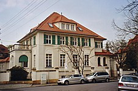Das villenartige Wohnhaus Oskar-Pletsch-Straße 1 _(Foto)_ befand sich einst im Besitz der international tätigen Firma Hielle & Dittrich und weist klassizistische Fassadengestaltungen auf. Architektonisch bemerkenswert ist auch die benachbarte Villa Nr. 3 mit Anklängen an die Formensprache Erlweins. Im Haus Nr. 10, auch als Villa Nizza bezeichnet, wohnte zwischen 1912 und 1918 der schwedische Ernährungsforscher Ragnar Berg (1873-1956), der zeitweise Leiter des chemisch-physiologischen Institutes des Lahmann-Sanatoriums war. Später wirkte Berg als selbstständiger Wissenschaftler und Publizist in der nahegelegenen Villa Stella (Nr. 14), bevor er 1924 als Chemiker an das Städtische Krankenhaus Friedrichstadt wechselte. Die Villa Oskar-Pletsch-Straße 11 war zwischen 1977 und 1998 Wohnhaus des Schriftstellers Uwe Tellkamp, der mit seinem Roman “Der Turm - Geschichte aus einem versunkenen Land” den Stadtteilen Weißer Hirsch und Loschwitz ein literarisches Denkmal setzte.

## [Pillnitzer Landstraße](../../../nordost/loschwitz/strassen_loschwitz/pillnitzer_landstrasse/)

## Preußstraße

Die Preußstraße erinnert an den Schöpfer des Wahlgesetzes der Weimarer Republik, Hugo Preuß (1860-1925). Preuß war zwischen November 1918 und Juni 1919 zunächst Staatssekretär, danach Innenminister des Deutschen Reiches. Bereits in den 1920er Jahren hatte die Preußstraße diesen Namen erhalten, wurde später jedoch zeitweise als Hindenburgstraße und Scheubnerstraße bezeichnet. Nach 1945 bekam sie ihren ursprünglichen Namen zurück.

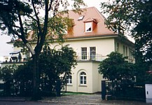Paulus-Villa: Interessantestes Gebäude ist das Haus Preußstraße 10, welches 1910-12 für die Familie Martin errichtet wurde. Ab 1913 befand sich hier das Sanatorium von Dr. Friedrich Kraeger. 1934 erfolgte durch den neuen Besitzer Kurt Kirchbach, Inhaber der Firma Cosid-Kautasit, die großzügige Neugestaltung des parkähnlichen Gartens, welcher zu den schönsten Anlagen auf dem Weißen Hirsch gehörte. 1946 wurde das Haus beschlagnahmt und war bis 1947 Unterkunft für hohe sowjetische Offiziere.

Ab 1948 diente die Villa als Gästehaus der Landesregierung. Hier wohnten zeitweise der sächsische Ministerpräsident Max Seydewitz (später Leiter der Staatlichen Kunstsammlungen) und der Schriftsteller Martin Andersen-Nexö. 1953 bis 1957 lebte Generalfeldmarschall a. D. Friedrich Paulus im Haus, der als Verlierer der Schlacht von Stalingrad in sowjetische Gefangenschaft geraten war. Nach dessen Tod wurde die Villa Gästehaus der DDR-Regierung und der NVA. Im Mai 1968 bereiteten hier Walter Ulbricht und die Staatschefs der befreundeten Staaten in geheimen Gesprächen den Einmarsch in die CSSR zur Niederschlagung des “Prager Frühlings” vor. Die nach 1990 leerstehende Villa wurde 1998 an einen privaten Investor verkauft und dient heute Wohnzwecken.

## Rietschelweg

Der Rietschelweg geht auf einen alten Weinbergspfad zurück und erhielt Ende des 19. Jahrhunderts seinen heutigen Namen. Ernst
Rietschel (1804-1861) gehört zu den Begründern der Dresdner Bildhauerschule und war als Professor an der Kunstakademie tätig.
Von seinen zahlreichen Werken sollen hier nur die Denkmale für König Friedrich August I. am Japanischen Palais und für Gottfried Semper am Theaterplatz erwähnt werden.

## Robert-Diez-Straße

Die Robert-Diez-Straße, früher als 3. Steinweg bezeichnet, erinnert an den bekannten Dresdner Bildhauer Robert Diez (1844-1922),
der u. a. den Gänsediebbrunnen und die Brunnenanlage am Albertplatz schuf und viele Jahre in Loschwitz wohnte. Das Wohnhaus Nr.
2 gehört zu den ältesten Gebäuden des Ortes und war ursprünglich ein Winzerhaus. Wegen seines romantischen Aussehens wurde
dieses Haus mehrfach von Künstlern gezeichnet bzw. von August Kotzsch fotografiert. Im Volksmund erhielt das Gebäude den Spottnamen “Villa Fallnichtein”. 1998 erfolgte eine umfassende Rekonstruktion.

1903 entstand die burgartige Villa Robert-Diez-Straße 10 als Wohnhaus des Architekten Oskar Menzel. Menzel bewohnte das Haus
bis zu seinem Tod 1958 und war Schöpfer zahlreicher Villen in Dresden und Radebeul. Auch an der Gestaltung des Loschwitzer
Friedhofes war er beteiligt. Zeitweise lebten die Maler Oskar Zwintscher und Hanns Hanner in diesem Gebäude. Die Grundstücke Nr.
9 - 13 dienten Ende des 19. Jahrhunderts als Sommerwohnung des Blasewitzer Rentiers Oskar Richter. Richter hatte mit seiner Frau
großen Anteil an der Finanzierung der Blasewitzer Kirche. Sein Sohn Oskar Louis Richter war zwischen 1901 und 1923 Pfarrer der
Frauenkirche. Richters zweiter Sohn Emil ließ sich kurz vor dem Ersten Weltkrieg von Architekt Martin Pietsch das Wohnhaus Robert- Diez-Straße 9 errichten und stiftete 1913 den Loschwitzer Sportplatz am Elbufer..

Weitere Wohngebäude an der Robert-Diez-Straße wurden 1945 zerstört. Darunter befand sich auch das ab 1856 im Besitz des
Papierfabrikanten Theodor Kretzschmer befindliche Gebäude Robert-Diez-Straße 4. Kretzschmer war mit Helene Richter, einer
Tochter Ludwig Richters, verheiratet und versammelte hier regelmäßig den großen Familien- und Freundeskreis der Familie. Die schwer beschädigte Villa konnte nach 1945 verändert wieder aufgebaut werden.

## Säugrundweg

Der Säugrund, einst auch als sumpfiger Grund bezeichnet, verbindet das Waldgebiet der Dresdner Heide mit dem Loschwitzgrund. Wegen der Wildschweine, die diesen Pfad als Suhle und Weg zur Tränke am Loschwitzbach benutzten, erhielt der Grund seinen Namen.

## Schädestraße

Die kurz vor Beginn des Ersten Weltkrieges angelegte Schädestraße in Oberloschwitz verdankt ihren Namen dem in Loschwitz
lebenden Stifter Hermann Schäde (1831-1900), der Geld für verschiedene soziale Projekte zur Verfügung stellte. Die meisten Gebäude
entstanden zwischen 1925 und 1935. Bemerkenswert ist die bereits 1914 vom Architektenbüro Stephan & Möbius entworfene Villa Nr. 5.

## [Schevenstraße](../../../nordost/loschwitz/strassen_loschwitz/schevenstrasse/)

## [Schillerstraße](../../../nordost/loschwitz/strassen_loschwitz/schillerstrasse/)

## Sierksstraße

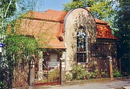Die heutige Sierksstraße in Oberloschwitz geht auf einen alten Weinbergsweg zurück, welcher
noch um 1903 als 1. Steinweg in den Plänen verzeichnet ist. Wenig später erfolgte der Ausbau zur Straße und deren Umbenennung in Metzschstraße nach dem früheren sächsischen
Innenminister Karl Georg Levin von Metzsch. Nach 1945 wurden sowohl die Metzschstraße wie auch der angrenzende Metzschplatz in Sierksstraße bzw. Sierksplatz umbenannt. Hans Ludwig
Sierks (1877-1945) wirkte zwischen 1919 und 1924 als Stadtbaurat in Dresden und engagierte sich als Leiter der “Proletarischen Hundertschaften” Ostsachsens in der Arbeiterbewegung. 1944
wurde er im Zusammenhang mit dem Hitler-Attentat vom 20. Juli festgenommen und 1945 in Berlin hingerichtet. Das Foto zeigt die Villa Sierksstraße 31 mit einem bemerkenswerten farbigen Jugendstilfenster.

Im Wohnhaus Sierksstraße 6 lebte nach 1945 der frühere Kreuzkantor Rudolf Mauersberger. Nach Zerstörung seiner Stadtwohnung
bezog Mauersberger das Haus und verbrachte hier den Rest seines Lebens bis zu seinem Tod 1971. Bemerkenswert ist auch die Villa
Nr. 33, welche 1902 von Hermann Kickelhayn als eigenes Wohnhaus entstand. Kickelhayn arbeitete als Architekt und entwarf u.a. das
heute von der Kreuzschule genutzte ehemalige Freimaurergymnasium in Striesen. Seine Loschwitzer Villa diente ab 1974 bis 2002 als
städtische Jugendherberge und wurde 2005 als Wohnhaus rekonstruiert. Gleichzeitig entstanden auf dem Grundstück zwei moderne Neubauten.

## Sonnenleite

Die Sonnenleite wurde nach 1890 als Zufahrtsstraße zum Grundstück Ferdinandstraße 1 (heute An der Berglehne) angelegt.Wenig später begann die Parzellierung des zuvor als Obstbaumwiese genutzten Areals für den Bau von Villen und Landhäusern. Der Straßenname geht auf einen früheren Flurnamen zurück. Ursprünglich wurde sie als Heinrichstraße, benannt nach dem Privatier Heinrich Metzner, bezeichnet. Nach der Eingemeindung erfolgte eine Teilung der Straße in Niddastraße (heute Oskar-Pletsch-Straße) und Sonnenleite.

Im Haus Nr. 3 besaß der Gründer der Dresdner Bank, Gustav von Klemperer, einst eine Sommerwohnung. Nr. 4 entstand 1868 als eines der ersten Gebäude am Rande des Loschwitzgrundes und befand sich einst im Besitz des Steinbruchbesitzers Karl Adolph Hietzigs. 1893 wurde die Villa vom Architektenbüro Schilling & Gräbner umgebaut und in Haus “Schöneichen” umbenannt. Weitere Villen wurden kurz vor dem Ersten Weltkrieg errichtet, u.a. die Villa “Lotte” (Nr. 8) und das Nachbarhaus Nr. 10. Ab 1927 gab es auf der Sonnenleite 33 die Dampfwaschanstalt Weißer Hirsch. Das von der Familie Wolff betriebene Unternehmen existierte noch bis in die 1960er Jahre, zuletzt als Betriebsteil der städtischen Wäscherei. Heute befinden sich in dem noch erhaltenen Gebäude Wohn- und Büroräume.

In der 1898 von Kurt Diestel im Schweizerstil errichteten Villa “Sonnenschein” (Nr. 31) hatte bis zu ihrem Tod 1912 die Malerin und Kinderbuchautorin Rosa Petzel ihren Wohnsitz. Gemeinsam mit ihren beiden Schwestern hatte sie sich das Haus als Alterswohnsitz gekauft und richtete hier ihr Atelier ein. Rosa Petzel gilt als eine der ersten professionellen Malerinnen in Deutschland und war 1866 Mitbegründerin des Vereins der Künstlerinnen und Kunstfreundinnen. Nach ihrem Tod wurde die Villa 1918 an den Architekten Karl August Klotzsche verkauft und befindet sich bis heute in Familienbesitz.

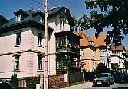

**_Foto:_** _Villen prägen das Straßenbild an der Sonnenleite_

## Steglichstraße

Die Steglichstraße, früher auch als Pferdeweg bezeichnet, erhielt ihren Namen nach dem Kommunalpolitiker Steglich (1858-1920), der als erster Sozialdemokrat in den Loschwitzer Gemeinderat einzog. Der alte Verbindungsweg nach Loschwitz wurde 1924 im Zuge von Notstandsarbeiten ausgebaut. Zwischen 1933 und 1945 hieß die Straße Hechenberger Straße.

## 1. und 2. Steinweg

Sowohl der 1. als auch der 2. Steinweg gehen auf alte Weinbergspfade zurück und erschließen das Gelände des Loschwitzer Elbhangs für Fußgänger. Die beiden
teilweise mit Stufen versehenen steilen Anstiege beginnen am Veilchenweg und führen von dort zur Bergstation der Schwebebahn bzw. zur Krügerstraße.

Die 1935 entstandene Villa 1. Steinweg 19 wurde bis 1989 von der DDR-Staatssicherheit als konspirativer Treffpunkt genutzt. Unter
Leitung des Chefs der DDR-Auslandsspionage Markus Wolf fanden hier Ende 1989 mehrere Treffs zwischen MfS-Mitarbeitern und
Geschäftsleuten statt, um das Vermögen des Geheimdienstes in ausländische Unternehmen zu investieren und so vor dem Zugriff des
Staates zu retten. Ein bereits organisierter Verkauf des Hauses wurde Mitte der 90er Jahre wieder rückgängig gemacht. Seit 2002 gehört das Haus mit seinen Nebengebäuden einem neuen Eigentümer und wird als Wohnhaus genutzt.

## Straußstraße

Die Straußstraße wurde nach dem früheren Loschwitzer Kirchschullehrer Moritz August Strauß (1835-1904) benannt, der zugleich auch Mitglied des Gemeinderates in Loschwitz war.

## Stürenburgstraße

Die in den Dreißiger Jahren angelegte Stürenburgstraße erhielt ihren Namen 1934 nach dem Studienrat Heinrich Albert Julius
Stürenburg (1847-1934), der viele Jahre das Amt des Rektors der Kreuzschule innehatte. Außerdem setzte er sich für Förderung des
Sports ein und war Verfasser von Reiseberichten und pädagogischen Schriften. Bis zum Beginn des Zweiten Weltkrieges entstanden an der Stürenburgstraße Einfamilienhäuser.

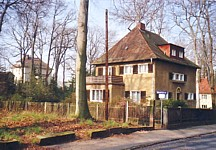

**_Foto:_** _Blick von der Wunderlichstraße in die Stürenburgstraße_

## Tiedgestraße

Die Tiedgestraße in Oberloschwitz erinnert an den deutschen Dichter Christoph August Tiedge (1752-1841), der 1819 gemeinsam mit
seiner Lebensgefährtin Elisa von der Recke nach Dresden übersiedelte. Das Paar bewohnte ein Haus auf der Körnerstraße in der
Inneren Neustadt und machte dieses zu einem Mittelpunkt des literarisch-gesellschaftlichen Lebens in der Stadt. Bis zur Eingemeindung
von Loschwitz trug die Straße nach dem früheren sächsischen Finanzminister Leonce Robert Freiherr von Könneritz (1835-1890) den Namen Könneritzstraße.

## Tolstoistraße

Die in den Zwanziger Jahren in Oberloschwitz angelegte heutige Tolstoistraße wurde vor 1945 Souchaystraße genannt. Namenspatron war der Großkaufmann John Daniel Souchay (+ 1877), der sich 1859 das nahegelegene [Schloss Eckberg](../../../nordost/loschwitz/albrechtsschlosser/) erbauen ließ. Im Juni 1946
wurde die Souchaystraße in Tolstoistraße umbenannt. Mit der Namensgebung wird an den russischen Dichter Lew Tolstoi (1828-1910) erinnert, der durch seine Romane “Anna Karenina” und “Krieg und Frieden” international bekannt wurde.

## Ulrichstraße

Die Ulrichstraße verdankt ihren heutigen Namen der 1916 verstorbenen Schauspielerin Pauline Ulrich, die seit 1859 am Dresdner
Hoftheater engagiert war und dem Ensemble über 50 Jahre angehörte. Pauline Ulrich (\* 1835) verbrachte während ihrer Dresdner Zeit
gern die Sommermonate in Loschwitz und besaß am Körnerweg 12 ein Landhaus. Markantestes Gebäude der Ulrichstraße ist das ehemalige [Sanatorium Möller](../../../nordost/loschwitz/strassen_loschwitz/mollers_sanatorium/), welches zuletzt als Klinik Oberloschwitz genutzt wurde und heute Wohnzwecken dient.

Auf dem Grundstück Nr. 5 befand sich seit Ende des 19. Jahrhunderts die beliebte Ausflugsgaststätte [“Schweizerei”](../../../nordost/loschwitz/strassen_loschwitz/schweizerei/).  Nach diesem
Lokal trug die Ulrichstraße bis 1926 den Namen Schweizer Straße. Eugen Rosenstiel, erster Besitzer der Gaststätte, hatte die Straße
1872 auf eigene Kosten zur Erschließung seines Grundstücks angelegt und später der Gemeinde Loschwitz übertragen. Auch die benachbarte Alpenstraße erinnert noch an diese Gastwirtschaft.

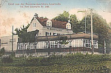Beerenweinschänke: Die ehemalige Gaststätte an der Einmündung Ulrichstraße 39 /
Krügerstraße entstand 1885 in einem 15 Jahre zuvor errichteten Wohnhaus, welches dem Loschwitzer Winzer Adolf Leberecht Looß gehörte. 1895 erwarb der Sohn des bekannten
Fotografen August Kotzsch das Grundstück und setzte die Tradition seines Vorgängers, aus Beeren und Obst Weine und Säfte zu keltern, fort. Für die Gäste ließ Rudolf Franz Kotzsch
bereits ein Jahr später eine hölzerne Veranda anbauen. Die Bewirtschaftung der Gaststätte übernahm Carl Ernst Morgenstern, welcher ab 1903 zugleich neuer Eigentümer der Beerenweinschänke war.

Auch nach dem Ersten Weltkrieg blieb das seit 1920 im Besitz des Gastwirts Adolf Richard Otremba befindliche Lokal geöffnet und
bot neben verschiedenen Obstweinen ein kleines Speisenangebot für die zahlreichen Besucher von Oberloschwitz. Erst mit der
Lebensmittelrationierung nach Beginn des Zweiten Weltkrieges musste der Gaststättenbetrieb eingestellt werden. Nach Beseitigung von
Kriegsschäden konnte die Schänke jedoch 1945 wieder öffnen und bestand noch bis 1949. In diesem Jahr zerstörte ein von der Straße
abgekommener sowjetischer Militärtransporter die hölzerne Veranda, womit der Gaststättenbetrieb endete. Das baufällige
Hauptgebäude fiel 1956 dem Abriss zum Opfer. Heute erinnert nur noch das frühere Gartenhaus (Ulrichstraße 39) an die ehemalige Gastwirtschaft.

## [Veilchenweg](../../../nordost/loschwitz/strassen_loschwitz/veilchenweg/)

## Wasserweg

Als Wasserweg wird ein kleiner, nur Fußgängern vorbehaltener Weg, bezeichnet, der von der Fidelio-F.-Finke-Straße zur Elbe führt.
Ab 1927 befand sich hier die Anlegestelle einer Personenfähre nach dem gegenüberliegenden Blasewitz (Oehmestraße). Am 1. November 1955 wurde der Fährbetrieb eingestellt, womit die jahrhundertelange Geschichte der [Loschwitzer Fähren](../../../nordost/loschwitz/) endete.

## Weinleite

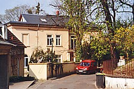Das Areal an der heutigen Weinleite wurde vermutlich bereits im Mittelalter als Weinberg
genutzt. 1694 ist dieses Grundstück an der späteren Plattleite 16 erstmals in den Akten erwähnt und gehörte zu diesem Zeitpunkt der aus dem Meißner Raum stammenden Familie von
Schweißke. In diesem Jahr kaufte der Königlich polnisch-sächsische Kommerzienrat Hilliger den Weinberg. Später wechselten mehrfach die Besitzer, bevor das Grundstück 1864 vom Dresdner
Zigarrenfabrikanten Gustav Adolf Dressler erworben wurde. Dressler ließ sich 1870 von Theodor Lehnert die noch heute erhaltene Villa Weinleite Nr. 2 erbauen _(Foto)_.

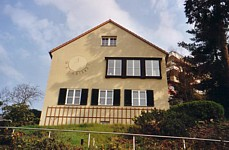1895 musste ein Teil des Grundstücks für den Bau der
Standseilbahn abgegeben werden. Der Weinbau war zu dieser Zeit in Loschwitz bereits weitgehend zum Erliegen gekommen. Nach dem Ersten Weltkrieg erfolgte durch die neue
Besitzerin Lucie Lieberknecht, Ehefrau eines wohlhabenden Maschinenfabrikanten, eine Umgestaltung des Grundstücks zu einer ausgedehnten Gartenanlage mit verschiedenen
Kleinbauten. Diese wurde nach 1930 durch die Familie Dr. Munzinger fortgesetzt. Der Gründer des bekannten Munzinger-Archivs ließ das vorhandene Wohnhaus gründlich erneuern und das
übrige Areal in Baugrundstücke aufteilen. Zwischen 1935 und 1936 entstanden nach Plänen des Architekten Maximilian von Mayenburg mehrere Villen _(Foto)_. Zur Erschließung der neuen
Häuser wurde der bisherige Gartenweg zur öffentlichen Straße ausgebaut und ab 1935 Weinleite genannt.

Munzinger-Archiv:
Das “Munzinger-Archiv” wurde 1913 vom Jornalisten Dr. Ludwig Munzinger als “Archiv für publizistische Arbeit” in
Berlin gegründet. Im Mittelpunkt stand die Sammlung von biografischen Daten zu bedeutenden Persönlichkeiten. 1930 verlegte Ludwig
Munzinger Firmen- und Wohnsitz nach Dresden-Loschwitz auf das Grundstück seiner Schwiegereltern an der Plattleite 16 (heute Weinleite 2).

Trotz politischer Beschränkungen gelang es Munzinger, sein Archiv auch über die Nazizeit hinweg fortzuführen. 1945 verließ er jedoch mit seiner Familie Dresden und verbrachte die Sammlung nach
Ravensburg, wo das Archiv bis heute besteht. Dr. Ludwig Munzinger verstarb 1957. Seine Nachkommen erhielten 1993 das Areal an der Weinleite zurück und leben heute in dem 1996/98 sanierten Haus Weinleite 2.

## Wunderlichstraße

Die von der Schillerstraße in westlicher Richtung abgehende Wunderlichstraße erinnert an den Kaufmann Arthur Bruno Wunderlich, der
zugleich auch das Amt eines persischen Generalkonsuls innehatte. Wunderlich besaß ab 1870 Schloß Eckberg und war zeitweise auch
Eigentümer des früheren Dinglinger-Weinbergs. Bemerkenswertestes Gebäude ist ein um 1776 erbaute frühere Weinberghaus (Nr. 17), welches später als [Heilstätte](../../../nordost/loschwitz/strassen_loschwitz/heilstatte_loschwitz/) für Kriegsinvalide diente. Außerdem stehen einige Villen unter Denkmalschutz.

## Ziegengrundweg

Als Ziegengrund wird ein Seitental des Loschwitzbaches bezeichnet, welches einst als romantischster Teil des Ortes galt. Seinen Namen
erhielt der Grund nach den hier weidenden Ziegen, deren Betreuung dem Gemeindehirten oblag. Das Tal war mehrfach Motiv für
Zeichnungen Ludwig Richters und soll auch Vorbild für sein berühmtes Gemälde “Brautzug im Frühling” gewesen sein. In der Nähe der
Grundstraße befindet sich die Ziegengrundquelle, deren Wasser der Sage nach zu dauernder Jugend und Schönheit verhelfen soll. Nach
1945 entstanden im Ziegengrund Wochenendhäuser und private Gartengrundstücke, die das ursprüngliche Bild stark beeinträchtigen.

## Zwanzigerstraße

Der Name Zwanzigerstraße geht auf die sogenannten “Zwanziger” zurück. So wurden früher die Treiber bei Hofjagden genannt, da diese in Trupps zu je 20 Männern eingesetzt wurden, um das Wild aufzuscheuchen und vor die Flinten der Hofgesellschaft zu treiben. Treffpunkt der Männer aus Loschwitz und Bühlau war der “Weiße Adler”.

[Loschwitz auf OpenStreetMap](https://www.openstreetmap.org/search?query=Dresden+Loschwitz)

* * *

 \[ [Home](../../../index.html)\] \[ [Nord](../../../nord/)\] \[ [Nordwest](../../../nordwest/)\] \[ [Neustadt](../../../neustadt/)\] \[ [Nordost](../../../nordost/)\] \[ [West](../../../west/)\] \[ [Zentrum](../../../zentrum/)\] \[ [Südwest](../../../sudwest/)\] \[ [Süd](../../../sud/)\] \[ [Südost](../../../sudost/)\] \[ [Ost](../../../ost/)\] \[ [Register](../../../Register/register.html)\] \[ [Kontakt](../../../Kontakt/kontakt.html)\] \[ [Impressum](../../../impressum/)\]
