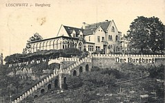
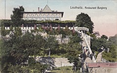
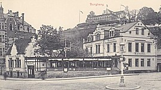

* * *

Die Gaststätte “Burgberg” in Loschwitz verdankt ihren Namen einer ehemaligen slawischen Wallanlage, die vermutlich zwischen dem  7. und 11.  Jahrhundert auf einem Bergsporn über dem Elbtal
entstand und 1296 und 1311 erwähnt wurde. Diese Burg besaß Wall und Graben und verschwand im Laufe der Zeit bis auf geringe Reste. Mitte des 19. Jahrhunderts entstanden innerhalb weniger Jahre zwei Gaststätten, die als
Oberer und Unterer Burgberg zum Besuch einluden.

Der “Obere Burgberg” _(Fotos)_ wurde 1853 von Theodor Lehnert und Friedrich Wilhelm Voigt für den Gastwirt Gottfried Bormann auf dem Gelände der früheren Burg errichtet und war als Hotel und Restaurant beliebtes Ausflugsziel. Treppen ermöglichten den Zugang von der Plattleite bzw. vom heutigen Körnerplatz aus. 1859 ließ der gleiche Besitzer unterhalb dieses Restaurants den “Unteren Burgberg” errichten, der ebenfalls gastronomischen Zwecken diente. Teilweise wurde dieses Lokal auch als "Bormannscher Weinschank" bezeichnet. Dieses Gebäude wurde 1883 von der Gemeinde Loschwitz erworben und fortan als [Rathaus](../../../../nordost/loschwitz/) mit der Gaststätte “Ratskeller” in den unteren Räumen genutzt. Außerdem entstand unmittelbar am Körnerplatz ein kleines Gebäude für das “Bräustübel”. In den ersten Jahren diente dieses Haus der Ortspolizei als Arrestlokal für kleinere Vergehen.

Auch das Bergrestaurant wurde mehrfach erweitert und erhielt mehrere
Terrassen und eine Veranda, von der sich ein herrlicher Blick über das Elbtal bot. 1926/27 wurde der “Obere Burgberg” nochmals modernisiert und umgebaut _(Foto)_
. Bis zum Zweiten Weltkrieg gehörte dieses Lokal neben dem [“Luisenhof”](../../../../nordost/page10246/strassen_weisser_hirsch/luisenhof/) und der [“Loschwitzhöhe”](../../../../nordost/loschwitz/strassen_loschwitz/loschwitzhohe/) zu den beliebtesten Ausflugsgaststätten
in Loschwitz. In den Kriegsjahren wurde im “Oberen Burgberg” ein Lazarett eingerichtet. Der Luftangriff auf Dresden traf am 13. Februar auch das Gebäude des “Oberen Burgberges”, welches völlig ausbrannte.

Die Ruine überstand zunächst die Nachkriegszeit, wurde jedoch 1967 abgerissen. Erhalten sind noch Teile der Stützmauern und die zum Plateau führenden Treppenanlagen. Der “Untere Burgberg” wurde hingegen noch bis
1975 von der HO als “Ratskeller Loschwitz” bewirtschaftet. 1958 entstand zusätzlich das gern von Loschwitzer Künstlern besuchte
“Stadtcafé”. Das nach Schließung der beiden Gaststätten stark verfallene Gebäude musste 1994 dem Neubau des
Ortsamtes weichen. An das Lokal erinnert heute nur noch das nach 1990 rekonstruierte ehemalige “Bräustübel” an der
Talstation der Standseilbahn. Auf dem Gelände des “Oberen Burgbergs” entstand 2006 ein vom Kunstverein “Alte Feuerwache” gestalteter Skulpturenpark.

**_Foto:_** _Unterer und Oberer Burgberg vor 1945, links das “Bräustüb\`l”_

* * *

 \[ [Home](../../../../index.html)\] \[ [Nord](../../../../nord/)\] \[ [Nordwest](../../../../nordwest/)\] \[ [Neustadt](../../../../neustadt/)\] \[ [Nordost](../../../../nordost/)\] \[ [West](../../../../west/)\] \[ [Zentrum](../../../../zentrum/)\] \[ [Südwest](../../../../sudwest/)\] \[ [Süd](../../../../sud/)\] \[ [Südost](../../../../sudost/)\] \[ [Ost](../../../../ost/)\] \[ [Register](../../../../Register/register.html)\] \[ [Kontakt](../../../../Kontakt/kontakt.html)\] \[ [Impressum](../../../../impressum/)\]
