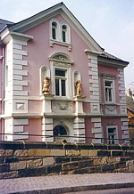
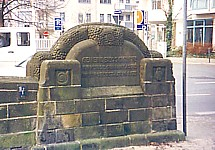
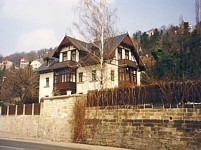
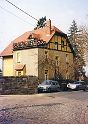
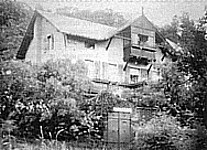

Die Calberlastraße im Ortsteil Oberloschwitz erinnert an den Zuckerfabrikanten Heinrich
Conrad Wilhelm Calberla (1774-1832) und seinen Sohn Gustav Moritz Calberla (1809-1909), der die Straße anlegen ließ und früher im Haus Nr. 5 wohnte. Sie geht auf einen
alten Fußweg zurück, der die Pillnitzer Landstraße mit dem oberhalb des Elbhangs gelegenen Spittelteich verband. Aus diesem Grund wurde der Weg früher Spittelweg bzw. Spittelgasse
genannt. 1874 begann der Ausbau des Weges zur Fahrstraße, wobei Moritz Calberla die Kosten übernahm. Wegen des schwierigen Geländes konnte der Bau erst 1882 beendet
werden, vier Jahre später erfolgte die offizielle Benennung in Calberlastraße.

Am Beginn der Calberlastraße errichtete die Stadt Dresden 1921 eine Mauer mit einem Gedenkstein zur Eingemeindung _(Foto rechts)_. Schöpfer war der
Architekt Martin Pietzsch. Der Schlußstein am Mauerkopf wurde vom Bildhauer Otto Pilz gestaltet und zeigt neben einem Traubengeflecht vier Tierdarstellungen:
Biene, Falter, Schnecke und Eule, welche die Gemeindeteile Loschwitz, Oberloschwitz, Schöne Aussicht und die Siedlung am Gasthaus “Zur Eule”
symbolisieren. Als “Gegenstück” setzten Loschwitzer Eingemeindungsgegner unweit dieser Stelle ein weiteres Denkmal. Dieser Stein zeigt einen Raben mit drei goldenen
Ringen im Schnabel - die von der Stadt Dresden “gestohlenen” Gemeinden Loschwitz, Weißer Hirsch und Blasewitz symbolisierend.

Das Gelände an der Calberlastraße gehörte im 18. Jahrhundert dem Hofrat und kurfürstlichen Leibmedicus Troppaniger,
der hier einen Weinberg besaß. Später entstanden zahlreiche Villen und Wohnhäuser am Elbhang. Zu den bekannten
Bewohnern der Straße gehörten der Schriftsteller Reinhold Schneider (Nr. 1b), der Maler Josef Hegenbarth (Nr. 2) und
der Bildhauer Robert Diez (Nr. 7). Auch die 1902 errichtete Villa Calberlastraße 12 ist mit einem bekannten Namen
verbunden. Sie war bis 1909 im Besitz des Unternehmers Emil Römmler, Inhaber der bekannten Dresdner Kunst- und
Lichtdruckanstalt Römmler & Jonas. Etwas unterhalb liegt das romantische Gebäude Nr. 8, einst als “Villa Eintracht” bekannt und in den letzten Jahren liebevoll saniert _(Foto oben links)_.

Einzelne Gebäude:

Nr. 1b: In diesem Haus lebte Ende der 1920er Jahre der christlich-pazifistische Schriftsteller Reinhold Schneider (1903-
1958). 1921 war er auf Einladung seines älteren Bruders nach Dresden gekommen, absolvierte hier eine kaufmännische
Ausbildung in der Kunstanstalt Stengel & Co. in Striesen und verfasste seine ersten literarischen Werke. 1930 wurde im
Dresdner Hellerau-Verlag Schneiders erstes Buch “Das Leben des Camoes” über den portugiesischen Nationaldichter
herausgebracht. Ab 1932 wohnte Schneider in Potsdam, später in Freiburg und wurde nach 1945 als Autor sozialkritisch- pazifistischer Schriften und Kämpfer gegen die Wiederbewaffnung der Bundesrepublik bekannt.

Josef-Hegenbarth-Archiv (Nr. 2) Das im 19. Jahrhundert errichtete Landhaus _(Foto)_  war ab 1922 Wohnsitz des Malers und Grafikers Josef Hegenbarth (1884-1962).
Hegenbarth wurde vor allem als Buchillustrator bekannt und war von 1946 bis 1949 als Professor an der Hochschule für Werkkunst in Dresden tätig. Das Haus blieb nach
seinem Tod zunächst im Besitz seiner Witwe, die die Wohn- und Arbeitsräume unverändert beließ und das Gebäude 1984 mit allem Inventar den Staatlichen
Kunstsammlungen vermachte. In den original erhaltenen Wohnräumen befindet sich seit 1990 das Josef-Hegenbarth-Archiv mit dem Nachlass des Künstlers. Hier sind neben
persönlichen Gegenständen auch zahlreiche seiner Bilder und Grafiken sowie eine umfassende Bibliothek mit vielen von ihm illustrierten Büchern aufbewahrt.

Nr. 7:
Das Haus war einst Wohnsitz des Bildhauers Robert Diez (1844-1922), der in Dresden vor allem durch seine Brunnenschöpfungen bekannt wurde. Von Diez stammen u. a. die beiden Brunnen “Stilles Wasser” und “Stürmische
Wogen” am Albertplatz sowie der Gänsediebbrunnen in der Weißen Gasse.

Nr. 12: Das frühere Weinbergsgrundstück wurde 1896 von Emil Römmler, Königlich-Sächsischer Hoffotograf und Besitzer der Kunst- und Lichtdruckanstalt [Römmler & Jonas](../../../../zentrum/johannstadt/strassen_johannstadt/blasewitzer_strasse/rommler___jonas/) erworben. Nachdem Römmler hier zunächst lediglich ein kleines Gartenhaus errichtet
hatte, entschied er sich 1902 zum Bau des noch heute erhaltenen Wohnhauses _(Foto)_. 1909 musste er seine Villa jedoch aus gesundheitlichen Gründen wieder verkaufen. Das Gebäude
diente später als Mietshaus und wurde 1997 von Römmlers Nachkommen zurückgekauft und denkmalgerecht saniert. Am Eingang erinnert eine kleine Gedenktafel an den Unternehmer.

Nr. 20:
Das sogenannte “Begerhäuschen” entstand Mitte des 19. Jahrhunderts als Landhaus und war zeitweise Sommersitz der Familie von Kügelgen. Auch der Kunstsammler Eduard
Cichorius soll hier gewohnt haben. Beim Luftangriff auf Loschwitz wurde das Gebäude zerstört und später abgerissen.

**_Foto:_** _Das “Begerhäuschen” Calberlastraße 20 um 1920_

* * *

 \[ [Home](../../../../index.html)\] \[ [Nord](../../../../nord/)\] \[ [Nordwest](../../../../nordwest/)\] \[ [Neustadt](../../../../neustadt/)\] \[ [Nordost](../../../../nordost/)\] \[ [West](../../../../west/)\] \[ [Zentrum](../../../../zentrum/)\] \[ [Südwest](../../../../sudwest/)\] \[ [Süd](../../../../sud/)\] \[ [Südost](../../../../sudost/)\] \[ [Ost](../../../../ost/)\] \[ [Register](../../../../Register/register.html)\] \[ [Kontakt](../../../../Kontakt/kontakt.html)\] \[ [Impressum](../../../../impressum/)\]
