* * *

* * *

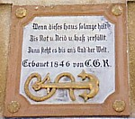

**_Inschrift an einem Loschwitzer Wohnhaus:_**

_Wenn dieses Haus so lange hält_

_Bis Not u. Neid u. Haß zerfällt_

_dann steht es bis an´s_

_End´ der Welt._

_Erbauet 1846 von C. G. R._

* * *

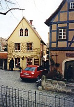Die Friedrich-Wieck-Straße (früher Fährgasse) bildet den alten Kern der früheren Ratsgemeinde von Loschwitz, die dem Materni-Hospitalamt Dresden unterstand. Ursprünglich begann die Bebauung auf einer durch einen Damm geschützten hochwasserfreien Fläche am heutigen Körnerplatz und dehnte sich erst im Laufe der Jahrhunderte bis zum Elbufer aus. Am Ende der Straße stand das Loschwitzer Fährgut, in dem die Fährmeisterfamilie ihren Wohnsitz hatte. Die meisten Gebäude waren kleine Häusleranwesen, da es im alten Loschwitz nur zwei Bauerngüter gab. Schwer betroffen waren die Bewohner von den regelmäßigen Elbehochwassern, die den Dorfplatz mit seinen Bauten unter Wasser setzten. So sind für 1845, 1890, 1920 und 1940 Rekordpegelstände des Flusses verzeichnet. Auch bei der bislang höchsten Elbeflut im August 2002 wurde der untere Teil von Loschwitz völlig überflutet.

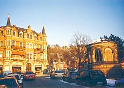Im Zusammenhang mit der Umgestaltung des Körnerplatzes und dem Bau des Blauen Wunders wurden einige Häuser des Dorfkerns Ende des 19. Jahrhunderts abgerissen. An ihrer Stelle entstanden 1895 die Wohnhäuser Nr. 2 und 4 im Stil der Gründerzeit _(Foto)_. Architekt für den gesamten Baublock zwischen Körnerplatz, Damm- und Friedrich-Wieck-Straße war Karl Emil Scherz. Im unteren Teil der Friedrich-Wieck-Straße blieben die alten Wohnhäuser jedoch zum Großteil bis heute erhalten und wurden in den letzten Jahren saniert. Seit 1895 trägt die Straße ihren heutigen Namen nach dem Klavier- und Musikpädagogen Friedrich Wieck (1785-1873), dem Vater von Clara Schumann. 1907 erfolgte ein Ausbau der Straße, wobei auch der zuvor hier noch offen fließende Loschwitzer Bach Trille abgedckt wurde

Einzelne Gebäude:

Alte Pfarre:
Das um 1650 errichtete Gebäude beherbergte einst das Loschwitzer Pfarramt und befand sich ungefähr an der heutigen Einmündung der Friedrich-Wieck-Straße in den Körnerplatz. Bis 1709 wurden hier auch die Kinder des Ortes
unterrichtet, bevor die Gemeinde ein neues [Schulhaus](../../../../nordost/loschwitz/) an der Pillnitzer Landstraße errichtete. Zuletzt diente das 1892 im
Zuge der Neugestaltung des Körnerplatzes abgerissene Haus Wohnzwecken und war zugleich Werkstatt eines Schuhmachers.

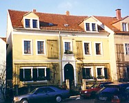Friedrich-Wieck-Straße 1-11:
Die Gebäude stammen im Wesentlichen aus dem 18./19. Jahrhundert. Zu den ältesten Häusern gehören das um 1800 auf den Fundamenten eines 1679 erstmals erwähnten Vorgängerbaus errichtete Wohnhaus Nr. 3 und das
Hintergebäude von Nr. 7 (ältestes Wohnhaus von Loschwitz), in dem sich heute ein Keramikfachgeschäft befindet. Am Wohnhaus Nr. 10, erbaut um 1830, erinnert eine
Gedenktafel an den Vater Clara Schumanns, Friedrich Wieck, der hier von 1840 bis zu seinem Tod 1873 lebte _(Foto)_.

In einigen der kleinen Winzer- und Häusleranwesen befanden sich früher beliebte Gaststätten. Stadtweit bekannt war das winzige Lokal “Mutter Unger” (Nr. 17). Auch das Wohnhaus Friedrich-Wieck-Straße 20 beherbergte bereits vor dem Zweiten Weltkrieg ein Café, dessen Tradition heute vom 2000 eröffneten “Café Klara” fortgesetzt wird. Zu den wenigen Bauerngütern des Ortes gehörte die Nr. 16. Bereits um 1600 erhielt dieses Gut das Schankrecht und war später als “Bauernstübel” Teil des [Elbe-Hotels Demnitz](../../../../nordost/loschwitz/strassen_loschwitz/friedrich-wieck-strasse/elbe-hotel/).

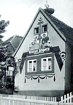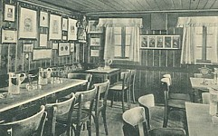“Mutter Unger” (Nr. 17): Das Gebäude entstand um 1730 als Bauerngut und wurde im 19. Jahrhundert vom Böttchermeister Carl Gottlieb Unger als Wohnhaus und Werkstatt genutzt. Da sich die Auftragslage infolge des Rückgangs des Weinbaus immer mehr verschlechterte, richtete seine Frau 1835 eine kleine Schankwirtschaft ein, die zunächst nur im Nebenerwerb bewirtschaftet wurde und auch später in Familienbesitz blieb. Durch die resolute Gastwirtin “Mutter Unger” war das Lokal bereits vor dem Ersten Weltkrieg weithin bekannt und wurde gern von Künstlern und
Studenten besucht. Durch diese entstand auch die originelle Innenausstattung mit zahlreichen Bildern und Kuriositäten. Zu den Gästen der Weinschänke gehörten u.a. der Maler Ludwig Richter, der Fotograf August Kotzsch und der Akademieprofessor Hermann Vogel. 1970 wurde das zuletzt von Anna Zöllner betriebene Lokal “Mutter Unger” geschlossen. Die historische Ausstattung blieb zunächst erhalten, wurde jedoch 2002 beim Elbhochwasser schwer beschädigt und später entfernt.

2010 erfolgte eine weitgehende Abtragung der beiden Gebäude Friedrich-Wieck-Straße 17 und 19, welche im Rahmen einer umfassenden Sanierung im historischen Stil als Wohnhaus wieder aufgebaut wurden. Hinzu kam ein modernes Reihenhaus im Hof des Grundstücks.

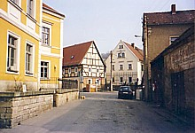Café Klara (Nr. 20):
Das Gebäude Friedrich-Wieck-Straße 20 entstand 1862 an Stelle eines älteren Vorgängerbaus. Dessen Geschichte lässt sich bis 1646 zurückverfolgen, als
der Gutsbesitzer George Reisigk das Haus an seinen Sohn Franz übertrug. Mehrfach wechselten die Besitzer, zu denen auch der spätere Hotelbesitzer Demnitz gehörte.
Um 1860 erwarb die Familie Liebing das Haus und ließ es durch einen größeren Neubau ersetzen. Mit seiner klassizistischen Fassade gehörte es zu den ersten
“städtischen” Häusern in Loschwitz. Im Erdgeschoss entstand eine Bäckerei. 1921 übernahm diese Friedrich August Pietsch und richtete hier ein kleines Café mit
Gästegarten ein. Bedingt durch die Inflation und die Weltwirtschaftskrise musste Pietsch sein Lokal jedoch 1930 wieder aufgeben. Im Rahmen einer Zwangsversteigerung erwarb zwei Jahre später der
Bäckermeister Johannes Winkler, Betreiber des Café Winkler am Körnerplatz, das Haus und ließ die ehemaligen
Gaststättenräume zu Wohnungen umbauen. 1999 wurde das Gebäude umfassend saniert. Seit Mai 2000 befindet sich hier das Weinlokal “Café Klara” _(im Foto ganz links)_.

Nr. 24:
In diesem Gebäude wurde am 31. August 1860 der Architekt Karl Emil Scherz geboren. Nach seinem Studium an
der Dresdner Kunstakademie und der Technischen Hochschule Berlin-Charlottenburg ließ er sich in Blasewitz nieder und
schuf zahlreiche Villen, Wohnhäuser und öffentliche Gebäude für seinen Heimatort. Von Scherz stammen u.a. die Pläne für die [Heilig-Geist-Kirche](../../../../ost/blasewitz/heilig-geist-kirche/), die Leubener [Himmelfahrtskirche](../../../../ost/leuben/himmelfahrtskirche/) und die Wohnbebauung des [Schillerplatzes](../../../../ost/blasewitz/strassen_blasewitz/schillerplatz/).

Nr. 27-35: Die ursprünglich vier Gebäude mussten wegen ihres schlechten Bauzustandes nach dem Hochwasser 2002
abgerissen werden. An ihrer Stelle entstand ab 2010 eine kleine Wohnanlage mit modernen, für den Loschwitzer Dorfkern jedoch unpassenden Neubauten.

Körnergarten (Nr. 26): Die Gaststätte mit großem Biergarten befindet sich unmittelbar am Elbufer und bietet einen schönen Blick auf
das “Blaue Wunder” und den gegenüberliegenden Ort Blasewitz. Bereits 1877 entstand auf dem Grundstück eines früheren Elbfischers die Gastwirtschaft “Zur Dampffähre”. Nach dem Bau der Brücke und der Einstellung des Fährbetriebs erhielt das Lokal den Namen “Körnergarten”. Obwohl dieser Name heute meist mit der in den Sommermonaten in Loschwitz wohnenden Familie Körner in Verbindung gebracht wird, wurde der “Körnergarten” ursprünglich nach dem früheren Besitzer Oskar Körner benannt. Trotz der schweren Schäden beim Elbehochwasser im August 2002 konnte das auch durch die TV-Serie “Polizeiruf 110” bekannt gewordene Ausflugslokal bereits wenige Monate später wieder geöffnet werden.

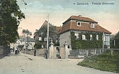Fährgut (Nr. 45): Auf diesem Gut am Ende der heutigen Friedrich-Wieck-Straße lag von alters her die Fährgerechtigkeit. 1556 wurde die erste Fährmannsfamilie Hempel urkundlich erwähnt. Das Haus am Elbufer entstand in seiner heutigen Form um 1697 und gehört zu den ältesten Fachwerkbauten Dresdens. Zum Schutz des Gebäudes vor Hochwasser und Eisgang wurde eine steinerne Mauer errichtet. Die Fähre nach Blasewitz befand sich viele Jahrhunderte lang in Privatbesitz verschiedener Loschwitzer Familien, die ihr Privileg auch vererben bzw. veräußern durften. Erst 1862 verkaufte die Witwe des Fährmanns Modes ihre Rechte an die Sächsisch-Böhmische Dampfschiffahrtsgesellschaft.

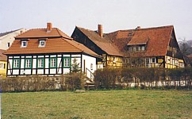Neben der Nutzung zu Wohnzwecken diente das Fährgut ab 1839 auch als Weinpresse der örtlichen Winzer und beherbergte zeitweise eine Schmiede. Im Erdgeschoss befand sich eine kleine Gaststube, in der Fährpassagiere bei einem Glas Wein auf ihre Überfahrt warten konnten. Später lebten bzw. weilten im Haus einige prominente Persönlichkeiten wie die Maler Anton Graff, August Böckstiegel und Conrad Felixmüller, der Eisenbahningenieur Max Maria von Weber und der spätere Direktor des Dresdner Stadtmuseums Matthias Griebel, der sich sehr um die Erforschung der Geschichte seines Heimatortes verdient gemacht hat. An Böckstiegels Aufenthalt erinnern zwei von ihm mit expressionistischen Malereien ausgestaltete Zimmer im Obergeschoss. Neben dem Fährgut ist auch das eigentliche Fährhaus von 1730 bis heute erhalten geblieben _(Bild rechts)_. Hier lebten früher die Fährknechte, bevor das Haus im 19. Jahrhundert für Sommergäste ausgebaut wurde. Im Erdgeschoss wurde bei Hochwasser der Fährkahn untergebracht. Beide Gebäude befinden sich heute in Privatbesitz und wurden in den letzten Jahren saniert. Seit 2006 lädt im Fährgut das italienische Restaurant “Il Camino” (ab 2011 “La Campagnola”) zum Besuch ein.

Joseph-Herrmann-Denkmal:
Das Denkmal auf dem Loschwitzer Dorfplatz wurde 1869 errichtet und erinnert an eine historische Begebenheit von 1799. Am 24. Februar dieses Jahres zog der Bildhauer Joseph Herrmann bei schwerem
Eisgang zwei Fischer aus der Elbe und rettete ihnen so das Leben. Der in Loschwitz lebende Künstler hatte zuvor deren
Notlage erkannt, war auf einem Pferd bis nach Kaditz geritten und hatte die beiden Männer dort mit Hilfe eines Seils aus ihrem beschädigten Kahn gezogen.

Zur Ehrung seines Vaters schuf dessen Sohn Joseph Herrmann d. J.  in Rom ein Marmorrelief, welches die Szene darstellt
und sich im Innenraum des kleinen Pavillons befindet. Das Bauwerk selbst wurde durch die am 1. August 1869 gegründete
“Joseph-Herrmann-Stiftung” finanziert und konnte in den Anfangsjahren gegen eine Gebühr von 10 Pfennigen besichtigt
werden. Wegen seiner Form wird das Haus von den Einheimischen spöttisch “Senfbüchse” genannt. Das seit 1974 unter Schutz stehende Joseph-Herrmann-Denkmal wurde ab 1984 äußerlich, ab 1991 auch im Inneren saniert.

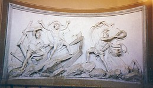

**_Foto:_** _Das Relief Joseph Herrmanns im Innenraum der “Senfbüchse”_

_Unter dem Relief ist folgende Inschrift zu lesen:_

_“Joseph Herrmann, dem edlen Menschenfreunde, welcher mit eigner Lebensgefahr bei der gewaltigen Eisfluth der Elbe am 24. Februar 1799 zweien Schiffsleuten aus Prossen das Leben rettete, widmet sein Sohn Joseph Herrmann_
_dieses nach eigenem Entwurfe ausgeführte und errichtete Denkmal im Jahre 1869.”_

Flutdenkmal:
Das in Form einer steinernen Welle gestaltete Denkmal wurde im Sommer 2006 auf dem Loschwitzer Dorfplatz aufgestellt. Die Inschrift lautet _“GEWIDMET DENEN, DIE MIT DEM FLUSS LEBEN”_ und erinnert an die
enge Verbindung des Ortes mit dem Elbstrom sowie die zahlreichen Hochwasserkatastrophen, die Loschwitz heimsuchten.
Schwere Hochfluten und Unwetter sind u.a. für 1799, 1845, 1890, 1940, 1947, 1988 und 2002 verbürgt. Letztere übertraf
auch in Loschwitz alle bisherigen Rekordmarken und gab Anlass für die Errichtung der Plastik. Schöpfer war der Künstler Klaus-Dieter Köhler.

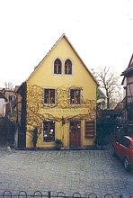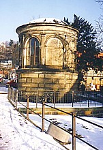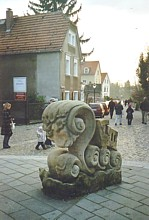

**_Fotos:_** _Impressionen von der Friedrich-Wieck-Straße mit dem ältesten Loschwitzer Wohnhaus (links),_

_der “Senfbüchse” (Mitte) und dem 2006 entstandenen Flutdenkmal (rechts)_

* * *

 \[ [Home](../../../../index.html)\] \[ [Nord](../../../../nord/)\] \[ [Nordwest](../../../../nordwest/)\] \[ [Neustadt](../../../../neustadt/)\] \[ [Nordost](../../../../nordost/)\] \[ [West](../../../../west/)\] \[ [Zentrum](../../../../zentrum/)\] \[ [Südwest](../../../../sudwest/)\] \[ [Süd](../../../../sud/)\] \[ [Südost](../../../../sudost/)\] \[ [Ost](../../../../ost/)\] \[ [Register](../../../../Register/register.html)\] \[ [Kontakt](../../../../Kontakt/kontakt.html)\] \[ [Impressum](../../../../impressum/)\]
