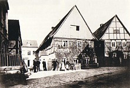
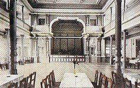
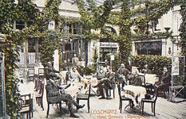
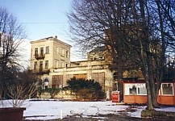

* * *

* * *

* * *

* * *

* * *

* * *

Das spätere Elbe-Hotel ging aus einer bereits 1626 erstmals genannten Loschwitzer
Schankwirtschaft hervor. In diesem Jahr hatte Peter Eger, der Besitzer des Gutes Friedrich-Wieck-Straße 16, das Ausschankrecht für Dresdner Biere erworben.
Andere Quellen lassen die Geschichte des ehemaligen Bauerngutes sogar bis in die Mitte des 16. Jahrhunderts zurückverfolgen. Um 1648 entstand an dieser Stelle ein
Neubau, der später als Erbgerichtsschänke bezeichnet wurde und zuletzt das “Bauernstüb\`l” des Elbe-Hotels beherbergte _(Foto um 1930)_. Nachdem Mitte des
18\. Jahrhunderts zusätzlich die Konzession zum Backen und Schlachten erworben werden konnte, entwickelte sich die Schänke zur Gastwirtschaft mit
Beherbungsmöglichkeiten für Sommergäste. 1851 pachtete Ernst Friedrich Demnitz das Gut und ließ es schrittweise erweitern.

Bis zur Jahrhundertwende entstand ein großzügiger Hotel- und Gaststättenkomplex mit mehreren Gebäuden. 1881 wurde an Stelle des einstigen Saalbaus nach Plänen von Theodor Lehnert der große Hotelneubau mit Saal,
Restaurationsräumen und 16 Fremdenzimmern errichtet. Lediglich das “Bauernstüb\`l” blieb von der alten Bebauung erhalten und wurde im romantisch-bäuerlichen Stil als Bierlokal eingerichtet. Das neue Hotel war unter
dem Namen Elbe-Hotel Demnitz beliebtes Ziel für Ausflügler und Sommergäste. Im Saal des Hauptgebäudes _(Foto)_ fanden regelmäßig Veranstaltungen wie die
berühmt-berüchtigten Loschwitzer “Wäscherinnenbälle” statt. 1893 feierte man hier die Einweihung des “Blauen Wunders”. Im Garten entstand nach der Jahrhundertwende eine Konzertmuschel für
musikalische Veranstaltungen. Zu den Gästen des “Elbe-Hotels” gehörten u. a. Otto Ludwig und Ludwig Richter, der sich
hier regelmäßig zu einer Stammtischrunde traf und das Lokal auch auf einigen seiner Zeichnungen darstellte. 1943 wurde
der Hotelbetrieb zunächst eingestellt und das Gebäude bis zum Kriegsende als Lazarett genutzt. Die hölzerne
Konzertmuschel fiel im Winter 1944/45 einem durch Unachtsamkeit entstandenen Brand zum Opfer, während die übrigen Bauten den Zweiten Weltkrieg weitgehend unbeschadet überstanden.

Nach 1945 wurden die früheren Besitzer enteignet und das Elbe-Hotel 1949 an
die HO übergeben. Zunächst noch als Hotel und für verschiedene Kulturveranstaltungen genutzt, verfiel der Komplex immer mehr. Bereits 1961 mussten Teile der Gebäude baupolizeilich gesperrt werden. 1975 erfolgte die
Einstellung des Hotelbetriebes, bevor das Haus am 1. August 1979 vollständig geschlossen wurde. Die Räume wurden zuletzt noch von der Handwerkskammer
als Lager und Werkstatt sowie vom VEB Gesellschaftsbau zur Einlagerung von technischen Teilen der Innenausstatung der Semperoper genutzt. Pläne zum Umbau als Gästehaus oder für Verwaltungszwecke scheiterten an der
Mangelwirtschaft und fehlenden Finanzen.

Nach 1990 wurde mehrfach versucht, den mittlerweile stark verfallenen Gesamtkomplex zu verkaufen. Pläne sahen eine Nutzung als Wohnanlage,
Schulungszentrum oder für gewerbliche Zwecke vor. 2004 übernahm schließlich ein Stuttgarter Investor das Areal. Im Hauptgebäude sind künftig neben einem
Restaurant außerdem Wohnungen und Büros vorgesehen. In diesem Zusammenhang wurde das Dachgeschoss ausgebaut und teilweise aufgestockt. Außerdem soll das
1995 abgerissene historische “Bräustüb´l” wieder aufgebaut werden. Obwohl mit den Arbeiten bereits begonnen worden war, blieben diese unvollendet, so dass das Gebäude einige Jahre im Rohbau leer stand. Jüngste Planungen sehen eine Fertigstellung bis 2017 vor. Das Foto zeigt die Elbseite des ehemaligen Hotels vor Beginn des Umbaus im Winter 2003.

* * *

 \[ [Home](../../../../../index.html)\] \[ [Nord](../../../../../nord/)\] \[ [Nordwest](../../../../../nordwest/)\] \[ [Neustadt](../../../../../neustadt/)\]
 \[ [Nordost](../../../../../nordost/)\] \[ [West](../../../../../west/)\] \[ [Zentrum](../../../../../zentrum/)\] \[ [Südwest](../../../../../sudwest/)\]
 \[ [Süd](../../../../../sud/)\] \[ [Südost](../../../../../sudost/)\] \[ [Ost](../../../../../ost/)\] \[ [Register](../../../../../Register/register.html)\] \[ [Kontakt](../../../../../Kontakt/kontakt.html)\] \[ [Impressum](../../../../../impressum/)\]
