

* * *

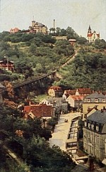Die Grundstraße führt von Loschwitz durch das Tal des auch “Trille” genannten Loschwitzbaches und verbindet den Ort mit den nordöstlichen Stadtteilen Dresdens. Neben [Loschwitz](../../../../nordost/loschwitz/) werden auch die Fluren von [Niederrochwitz](../../../../nordost/rochwitz/) und [Bühlau](../../../../nordost/buhlau/) berührt, bevor die Straße in die [Bautzner Landstraße](../../../../nordost/page10246/strassen_weisser_hirsch/bautzner_landstrasse/) mündet. Im Loschwitzgrund bestanden seit dem Mittelalter mehrere Wassermühlen, die später teilweise in Gewerbebetriebe umgewandelt wurden und heute sämtlich verschwunden sind. Der Bach, der diese Mühlen antrieb, entspringt in der Nähe von Gönnsdorf und mündet unterhalb des alten Loschwitzer Dorfkerns in die Elbe. Durch den Ausbau der wichtigen Verkehrsverbindung 1910 und 1929/36 ist der Bachlauf heute weitgehend kanalisiert und überbaut. In diesem Zusammenhang verschwanden auch zahlreiche ältere Häuser, vor allem im unteren Teil der Straße.

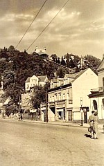Erstmalig wurde der Name Grundstraße 1886 in einem Adressbuch gefunden. Zuvor wurde der entlang des Bachs führende Weg meist Loschwitzgrund bzw. im oberen Teil Bühlauer Grund, zeitweise auch Grundweg genannt. Bis zum Ausbau der Grundstraße zwischen 1920 und 1936 war die Fahrstraße von dem auf dem anderen Ufer der Trille verlaufenden Fußweg getrennt und über mehrere Brücken verbunden. Für diesen hatte sich die Bezeichnung Promenadenweg eingebürgert. Der unterste Abschnitt der Straße zwischen Elbe und Körnerplatz heißt seit 1895 Friedrich-Wieck-Straße. Auf Bühlauer Flur, d. h. ab Einmündung der Neugersdorfer Straße, trug die Straße zwischen 1901 und 1926 amtlich den Namen der Loschwitzer Straße. Im Zusammenhang mit der Eingemeindung Bühlaus wurde die Straßenbezeichnung Grundstraße ab 1. Juni 1926 auch auf die Loschwitzer Straße ausgedehnt.

Bis 1945 befand sich an der Einmündung der Grundstraße in den Körnerplatz eine Rangierstelle der Straßenbahn, die ursprünglich Auftakt für eine geplante Linie bis nach Bühlau sein sollte. 1949 wurde diese durch Dresdens einzige [O-Bus-Linie](../../../../sudwest/lobtau/strassen_lobtau/ebertplatz/o-bus/) ersetzt, die noch bis 1974 zwischen Löbtau und Weißig verkehrte. Ab 1990 bis 2001 wurde die Grundstraße komplett saniert. An der Buswartehalle Steglichstraße _(Foto)_ berichtet ein 1949 von Hermann Glöckner gestaltetes Wandbild mit Inschrift von der Geschichte dieser Straße:

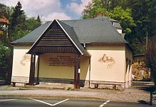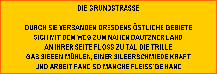

Einzelne Gebäude:

_Loschwitz:_

Die Grundstraße nimmt ihren Anfang am Körnerplatz, wo einst das Loschwitzer [Rathaus](../../../../nordost/loschwitz/) mit dem Ratskeller stand. Es wurde 1994 gemeinsam mit dem Wohnhaus Grundstraße 3 zugunsten des neuen Ortsamtes abgetragen. Erhalten blieben jedoch einige der kleinen Winzerhäuschen in der Nachbarschaft, die früher zum Teil gastronomisch bzw. als Ladengeschäfte genutzt wurden. Bekannte Weinschänken waren das “Sängerheim” (Nr. 17), das Lokal “Zum Kamerad” (Nr. 29) und die Grundschänke (Nr. 37). Auch der heutige Firmensitz der Loschwitzer GmbH Ofenbau Dresden-Ost war einst eine Gaststätte, die den Namen “Zur Amtsschänke” trug (Nr. 58). Zu den kühnen, jedoch nie realisierten Projekten gehörte um 1930 ein Brückenbau über die Grundstraße. Die vom Rochwitzer Architekten Paul Marcus entworfene Brücke sollte als gewaltige Bogenbrücke das Tal des Loschwitzbaches überspannen und so eine Direktverbindung zwischen dem Weißen Hirsch und Oberloschwitz herstellen.

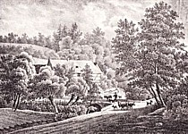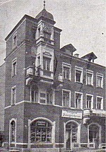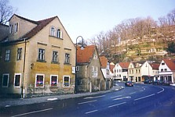

**_Fotos:_** _Die Grundstraße in der Nähe des Körnerplatzes auf historischen Ansichten:_

_Mühlenidyll um 1800 (links), Gaststätte “Sängerheim (Mitte), Blick vom Körnerplatz (2003)_

Kinderbewahranstalt Loschwitz: Die zu den ältesten Dresdner Kindergärten gehörende Einrichtung wurde 1865 in einem heute nicht mehr vorhandenen Gebäude im früheren Dorfkern eingerichtet. Dieser Straßenabschnitt trägt seit 1895 den Namen [Friedrich-Wieck-Straße](../../../../nordost/loschwitz/strassen_loschwitz/friedrich-wieck-strasse/). Gründerin war die Loschwitzerin Adolphine Geyer, die bereits ab 1851 als Mitglied des
Evangelischen Frauenvereins in ihrem Wohnhaus Handarbeitsunterricht für die Kinder des Ortes anbot. Später übernahm ein vom Frauenverein eingesetztes Direktorium die Verwaltung. Aus Platzgründen entstand 1901 ein Neubau auf dem Grundstück Grundstraße 36 (heute Kirchgemeindehaus). Hier bestand der Kindergarten bis 1941, wurde dann als kirchliche Einrichtung aufgelöst und 1946 von der Stadt Dresden übernommen. 1955 verlegte man diese zum Veilchenweg 7. 2004 konnte schließlich ein moderner Neubau an der Fidelio-F.-Finke-Straße bezogen werden.

Nr. 3: Die Geschichte des Hauses Grundstraße 3 begann vermutlich im 18. Jahrhundert, da bereits 1716 ein Gebäude auf diesem Grundstück nachweisbar ist. Dieses diente zunächst als Wohnhaus; im Erdgeschoss befand sich eine Milch- und Butterhandlung. 1903 wurden das Haus von der Gemeinde erworben und beherbergte nun verschiedene kommunale Behörden und Einrichtungen. Auch nach der Eingemeindung von Loschwitz blieb das Gebäude Teil des Rathauses und wurde noch bis 1989 als Wohn- und Bürohaus genutzt. 1994 erfolgte der Abbruch zugunsten des neuen Loschwitzer Ortsamtes.

Nr. 5:  Das aus einem früheren Häusleranwesen hervorgegangene Gebäude mit Kolonialwarenhandlung im Erdgeschoss beherbergte ab 1945 die “Loschwitzer Bücherstube”, eine kleine private Buchhandlung. 1970 wurde der Laden mangels Nachfolger geschlossen. Die Räume nutzt seitdem ein Rundfunkgeschäft.

Nr. 18-20: Diese beiden Wohnhäuser beherbergten in ihren Erdgeschossräumen früher kleine Läden, wie sie für diesen Teil von Loschwitz typisch waren. U.a. gab es hier um 1910 das Puppen- und Spielwarengeschäft des Loschwitzer Ortsrichters Richard Rudolph, während in der Nummer 22 Schuhe gekauft und repariert werden konnten ("Schuhhaus Sommer").

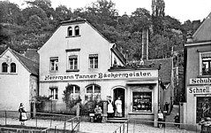Nr. 22: Das bereits 1627 erstmals erwähnte Loschwitzer Anwesen befand sich ab 1886 im Besitz des Bäckermeisters Gottfried Hermann Tanner, welcher hier seine Bäckerei betrieb. Das Geschäft, zu dessen Kunden auch zahlreiche Prominente und die in Wachwitz wohnenden Wettiner gehörten, blieb bis 1947 in Familienbesitz und wurde dann verpachtet. Zuletzt von der Familie Heuschkel betrieben, schloss die Bäckerei 1971 für immer ihre Pforten. 1984 entstand in den früheren Verkaufsräumen eine Garage. Heute dient das Haus Wohnzwecken.

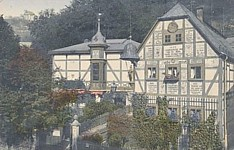Hentschelmühle:  Die Hentschelmühle befand sich unmittelbar am Eingang in den Loschwitzgrund (Grundstraße 26) und existierte bereits im 16. Jahrhundert. Nachdem sie viele Jahre im Besitz der Müllerfamilie Köhler war, erwarb 1785 die Familie Hentschel diese Wassermühle, welche daraufhin als Hentschelmühle bezeichnet wurde. Noch bis nach 1870 wurde hier Mehl gemahlen, bevor modernere Mühlen die Einstellung des Betriebes erforderten. Aus dem früheren Mühlengebäude entstand 1881/84 das auch “Rote Amsel” genannte Fachwerkhaus _(Foto)_, welches heute als [Leonhardi-Museum](../../../../nordost/loschwitz/strassen_loschwitz/grundstrasse/leonhardi-museum/) bekannt ist.

Nr. 28/30: Die einst auf diesem Areal befindlichen vier Gebäude entstanden alten Urkunden zufolge bereits um 1650 und dienten ärmeren Loschwitzer Familien als Wohnung und Arbeitsstelle. Später gab es hier auch einige kleinere Läden. Die baufälligen Häuser wurden um 1970 zugunsten eines geplanten Straßenausbaus abgerissen.

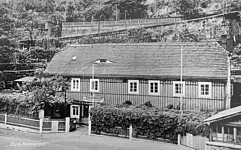Weinschänke “Zum Kamerad” (Nr. 29): Die kleine Gaststätte befand sich seit Ende des 19. Jahrhunderts bis zur Schließung in einem ehemaligen Winzerhaus auf der Grundstraße. Unter Regie des Gastwirts Gerhardt entwickelte sich das 1862 eröffnete Lokal zum Treffpunkt eines Freundeskreises um den Musikpädagogen Friedrich Wieck. Auch der Begründer des Blasewitzer Waldparks, Artur Willibald Königsheim war hier häufig zu Gast. Nicht zuletzt nutzten einige Loschwitzer Vereine das Haus für ihre Versammlungen. Zu den Besitzern gehörte zeitweise Friedrich August Modes, der 1849 geborene älteste Sohn des letzten Loschwitzer Fährmeisters. 1957 verwüstete ein Unwetter die Gasträume und die angeschlossene Kegelbahn. Da eine Reparatur am Materialmangel scheiterte, musste das Haus 1958 geräumt werden und wurde 1965 abgerissen.

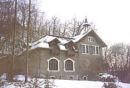Kirchgemeindehaus:
Das Gebäude an der Grundstraße 36 _(Foto)_ wurde 1901 als Kinderbewahranstalt erbaut und befand sich zunächst in kommunalem Besitz. Erst 1922 erwarb die Kirchgemeinde Loschwitz das Grundstück und richtete hier drei
Jahre später ihr Gemeindehaus ein. Im Erdgeschoss entstanden zwei Säle für die Gemeindearbeit, die auch als Treffpunkt verschiedener Loschwitzer Vereine dienten.
Das Obergeschoss beherbergte auch weiterhin einen kirchlichen Kindergarten, welcher jedoch 1941 auf Weisung der NS-Behörden geschlossen werden musste.
1944 beschlagnahmte die Wehrmacht das Haus und richtete hier ein Lazarett ein.

Nach Zerstörung der [Loschwitzer Kirche](../../../../nordost/loschwitz/loschwitzer_kirche/) erhielt die Gemeinde 1945 ihr Eigentum zurück und nutzte dieses wieder für
Gottesdienste und andere kirchliche Veranstaltungen. Das Obergeschoss diente bis 1955 als städtische Kindertagesstätte.
1961/62 erfolgte eine grundlegende Sanierung des Hauses. Aus dieser Zeit stammt auch das in Sgraffito-Technik gestaltete
Wandbild “Seesturm” (“Jesus bedroht Wind und Wellen”) des Künstlers Albert Herold an der Fassade. Heute treffen sich
hier u.a. die Gruppen der Kantorei, außerdem finden gelegentliche Veranstaltungen der Gemeinde statt. Seit 2014 hat im Haus zudem der Ortsverein Loschwitz-Wachwitz sein Domizil.

Grundschänke (Nr. 37): Das kleine Lokal entstand 1895 auf der Grundstraße 37 und wurde vom Besitzer des Hauses, dem Fleischermeister Paul Herrmann, zunächst im Nebenerwerb betrieben. Besucher waren vor allem Fuhrleute sowie die bei Bauarbeiten in der Umgebung beschäftigten Arbeiter. Nach dem Tod Paul Herrmanns 1912 führte seine Witwe die Gastwirtschaft gemeinsam mit ihrem zweiten Ehemann weiter. 1931 übernahm Tochter Johanna das Lokal und bewirtschaftete es trotz aller Schwierigkeiten noch bis in die Nachkriegszeit. 1950 wurde die Grundschänke aus wirtschaftlichen Gründen geschlossen. Später hatte in den Räumen viele Jahre die Glaserei Kappelt ihren Sitz.

Nr. 40: In diesem Gebäude wohnte ab 1913 bis zu seinem Tod 1942 der Fisch- und Reptilienzüchter Georg Gerlach.

In zahlreichen Aquarien und Terrarien hielt er auf seinem Grundstück exotische Fische, Molche, Lurche, Schildkröten und
einen Alligator. Als international anerkannter Fachmann verfasste Gerlach außerdem Berichte für Fachzeitschriften und
arbeitete als Fachberater für Museen und Forschungseinrichtungen. 1911 war er als wissenschaftlicher Mitarbeiter Karl August Lingners an der I. Internationalen Hygieneausstellung beteiligt.

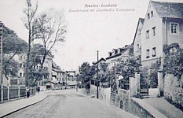Vettermühle: Die ursprünglich als Niedermühle bezeichnete Mehlmühle (Grundstraße 60/62) entstand im 16. Jahrhundert und war bis Mitte des 19. Jahrhunderts in Betrieb. 1842 siedelte sich auf dem Areal eine Glasfabrik mit angeschlossener Gold- und Silberschmelze an. 1854 erwarb der Chemiker Christian August Leonhardi das Grundstück und gründete eine [Tintenfabrik](../../../../nordost/loschwitz/strassen_loschwitz/grundstrasse/tintenfabrik_leonhardi/). Mehrfach erweitert und modernisiert, wurden hier bis 1927 Schreibtinten, Farbbänder und andere Büroartikel produziert. Vor allem die durch den Betrieb ausgehende Umweltbelastung führte zur Verlegung der Produktion nach Trachau und 1934 zum Abbruch der Gebäude _(im Bild ganz links)_.

Nach der Beräumung des Grundstücks plante die Stadt Dresden zunächst, eine kleine Wohnanlage sowie ein öffentliches Gebäude zu errichten, in dem ein Volksbad, das Standesamt, eine Polizeidienststelle und eine öffentliche Bibliothek unterkommen sollten. Letztlich entschied man sich jedoch für eine parkartige Grünanlage. Rund um den “Tintenteich” wurden Bänke aufgestellt, eine Freitreppe angelegt und zwei Figurengruppen des Bildhauers Robert Diez platziert. Leider fiel die Anlage im Zweiten Weltkrieg dem Bau eines Luftschutzbunkers zum Opfer. 1955 entstand an ihrer Stelle ein
Kinderspielplatz, Anfang der 1970er Jahre einige Baracken des benachbarten Ofenbaubetriebs. Heute finden sich nur noch Reste des einstigen Parks.

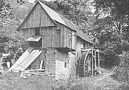Hänselmühle:  Diese Mühle befand sich auf dem Flurstück Grundstraße 80/82 und war einzige Schneidemühle am Loschwitzer Bach. Bereits 1545 wurde sie erstmals erwähnt. 1775 erwarb Johann Gallus Köhlerdie Sägemühle, welche später nach ihrer Besitzerfamilie den Namen Hänselmühle erhielt. Das Holz kam per Floß aus Böhmen über die Elbe und wurde dann von Loschwitz aus zur Sägemühle transportiert. Bereits um 1870 stellte man den früheren Wasserantrieb zugunsten eines Dampfsägewerkes ein. Dieses wurde 1875 bei einem schweren Unwetter völlig zerstört und 1882 als moderner Holzverarbeitungsbetrieb wieder aufgebaut. Das nun als “Dampfsäge- und Hobelwerk Ernst Weigelt” bezeichnete Unternehmen brannte am 6. Mai 1925 durch Blitzschlag nieder, womit die Geschichte dieser Mühle endete.

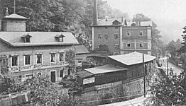Wenige Meter entfernt stand die ebenfalls im Familienbesitz befindliche
Hänsel-Mehlmühle (Grundstraße 76/78). 1549 ist für diese der erste Müller bezeugt. Ebenso wie die anderen Loschwitzer Mühlen stellte auch die Hänselmühle um 1860 ihren Betrieb ein. An gleicher Stelle entstand 1887 ein
Neubau für die Loschwitzer Brauerei. Besitzer war der Bühlauer Dampfbrauereibesitzer Carl Adolf Heydel, als Kompagnon fungierte die Nürnberger Handelsgesellschaft S. Wertheimer. Für den ein Jahr später
aufgenommen Braubetrieb errichtete Baumeister Adalbert Mirius den noch heute erhaltenen markanten Klinkerbau _(im Foto rechts)_.

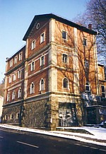1894 meldete Braumeister Heydel sein Gewerbe ab. Sein Nachfolger Moritz Otto Borsdorf
nutzte die Räumlichkeiten nur noch als Abfüllbetrieb für Flaschenbiere anderer Hersteller. 1901 baute man im ehemaligen Kesselhaus eine Schmiede ein. Technische Erweiterungen erfolgten
unter seinem Sohn Otto Reinhold Borsdorf, der 1913 die Mineralwasserherstellung aufnahm. Als weiteres Standbein kamen nach dem Ersten Weltkrieg eine Spedition und eine Autovermietung
hinzu. 1924 stellte Borsdorf den Getränkevertrieb ein und verkaufte vier Jahre später das Areal an die Stadt Dresden, die einen Teil des Grundstücks für die Verbreiterung der Grundstraße in Anspruch nahm.

Das Fabrikgebäude blieb auch nach Einstellung des Betriebes erhalten und wurde bis 1994 teils gewerblich, teilweise zu Wohnzwecken genutzt. U.a. gab es zeitweise eine Wäscherei, eine
Elektrowerkstatt, eine Heizungsbaufirma und eine Werbeagentur. 2013/14 wurde das unter Denkmalschutz stehende Gebäude saniert und zu exklusiven Wohnungen umgebuat. An einem Nebengebäude erinnert ein
Wappenstein mit dem Müllerzeichen an die frühere Hänselmühle.

Dammmühle: Die auch Nudelmühle genannte frühere Mehlmühle war letzte Mühle auf Loschwitzer Flur und wurde durch
ihre Nudelfabrikation bekannt. Zur Mühle gehörten zwei durch einen Damm getrennte Mühlteiche in der Nähe der
Tännichtstraße, die die notwendige Wasserkraft lieferten. Um 1880 wurde der Mahlbetrieb eingestellt und die Gebäude als
Fabrik zur Herstellung von Schmirgelpapier genutzt. Seit 1899 befand sich hier Schramms Eiskellerei, welche in den
Mühlteichen im Winter Eisblöcke gewann, die dann während der Sommermonate als Kühleis verkauft wurden. Das Gebäude der ehemaligen Dammmühle (Nr. 98) wurde 1936 abgerissen.

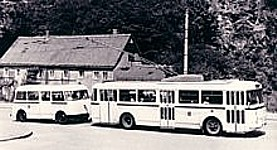

**Foto:** _O-Bus-Linie 61 auf der Grundstraße um 1970_

_Niederrochwitz:_

In der Nähe der Tännichtstraße erreicht die Grundstraße die Gemarkung von Rochwitz. Gegenüber mündet der Säugrund
in den Loschwitzgrund, der früher gern von Wildschweinen auf ihrem Weg zur Tränke genutzt wurde. Der zu Rochwitz
gehörige Ortsteil im Tal (heute Grundstraße 86 bis 118a) entstand Mitte des 16. Jahrhunderts um die historische Gastwirtschaft [“Zur Eule”](../../../../nordost/loschwitz/strassen_loschwitz/grundstrasse/zur_eule/). Einige Gebäude aus der Frühzeit des Ortes (u.a. Grundstraße 104 und 116) stehen unter Denkmalschutz.

Nr. 99: Das Grundstück befand sich seit dem 19. Jahrhundert im Besitz der Loschwitzer Familie Michel, die wie viele
Einwohner des Ortes der Lohnwäscherei nachging. 1920 ließ Max Michel im Hof eine Zapfsäule aufstellen und gründete
gemeinsam mit seinem Schwager ein Fuhrunternehmen mit angeschlossener Shell-Station. Auch zu DDR-Zeiten blieb die
kleine Tankstelle in Familienbesitz und wurde nach 1990 durch eine moderne Station mit Autowaschstraße und Shop ersetzt.

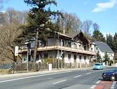Schweizerhaus:
Das ungewöhnliche Gebäude im Schweizerstil (Grundstraße 137) wurde Ende des 19. Jahrhunderts vom Tintenfabrikanten Eduard Leonhardi als Armenhaus gestiftet. Heute dient das Haus Wohnzwecken _(Foto rechts)_
. Hinter dem Schweizerhaus sind noch die Reste eines früheren Glimmergranitsteinbruchs zu sehen.

Bärmühle: Die Bärmühle soll alten Überlieferungen zufolge bereits im 13. Jahrhundert
bestanden haben und wurde in den Hussitenkriegen zerstört. Obwohl die genaue Lage dieser Mühle nicht eindeutig geklärt ist, vermutet man ihren Standort an der Grundstraße
116\. An dieser Stelle befindet sich heute ein Wohnhaus. Der alte Mühlteich diente später viele Jahre als Eisteich.

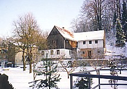

**_Foto:_** _Das Wohnhaus Grundstraße 116, errichtet an Stelle der ehemaligen Bärmühle_

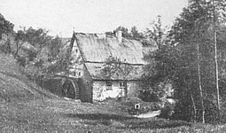Zeibigmühle: Die Mühle an der Grundstraße 149 war bis ins 19. Jahrhundert romantischste Mühle im Loschwitzgrund und wurde von Ludwig Richter als Motiv zur Illustration des alten Volksliedes “In einem kühlen Grunde...” genutzt. Die frühere Mehlmühle musste ihren Betrieb wenig später einstellen. Das eigentliche Mühlengebäude fiel 1936 dem Straßenausbau zum Opfer. Am Berghang sind bis heute noch Reste des früheren Mühlgrabens erhalten geblieben. Der Mühlteich ist heute verfüllt und wurde lange Zeit als Kohlenlagerplatz der Firma Hippe genutzt.

_Bühlau:_

Im oberen Teil erreicht die Grundstraße Bühlauer Flur. Dieser Ortsteil wurde früher auch als Adelig-Bühlau bezeichnet, da
die hiesigen Grundstücke der Grundherrschaft Helfenberg unterstanden. Zu den ältesten Häusern gehört die Nr. 199, welche 1864 in heutiger Form errichtet wurde.

Eis- und Kohlehandlung Hippe:
Das Unternehmen wurde 1880 von Gustav Adolf Hippe gegründet und handelte zunächst mit Kühleis. Für die Eisgewinnung nutzte man einen kleinen Teich auf dem firmeneigenen Grundstück Grundstraße 126, der
später verfüllt wurde und als Lagerplatz diente. Nach dem Ersten Weltkrieg kam ein weiterer Eiskeller in Weißig hinzu. Mit
dem Vordringen elektrischer Kühlschränke verlor der Eishandel jedoch an Bedeutung. Die Firma widmete sich nun
verstärkt dem Verkauf von Kohlen und Holz. Sie blieb auch nach dem Zweiten Weltkrieg in Familienbesitz und wurde in den 1950er Jahren um einen Fuhrbetrieb erweitert. 1984 übernahm die Unternehmerin Christa Müller den
Traditionsbetrieb, der heute vor allem als Recycling-Unternehmen tätig ist. 1999 wurde auf dem Grundstück ein neues Verwaltungsgebäude errichtet.

Gärtnerei Pelz:
Die Gärtnerei wurde 1911 auf der Grundstraße 144 von Wilhelm Pelz gegründet und war eine von insgesamt drei Bühlauer Gärtnereien. Zu den Kunden des auf Gemüse und Schnittblumen spezialisierten Betriebes gehörten
neben verschiedenen Gaststätten auch die Sanatorien Lahmann und Teuscher auf dem Weißen Hirsch. Auch nach 1945
blieb die Gärtnerei in Familienbesitz und wurde 1955 um einen weiteren Betrieb auf der Quohrener Straße ergänzt. 1960 wurde sie mit anderen Gartenbaubetrieben zur GPG Bühlau - Weißer Hirsch zusammengeschlossen.

Bühlauer Schützenhaus: Das Haus an der Grundstraße 148 entstand 1896 als Gaststätte “Zum grünen Tal”. Nachdem in den Zwanziger Jahren der Bühlauer Schützenverein das Gelände oberhalb des Lokals als Schießplatz erworben hatte und das Gebäude als Vereinshaus nutzte, wurde die Gaststätte 1928 in “Bühlauer Schützenhaus” umbenannt. An den 1945 aufgelösten Verein erinnert neben dem noch erhaltenen Gebäude auch der hier auf die Grundstraße treffende Bühlauer Schützensteig.

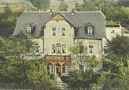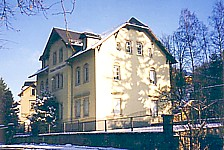

**_Fotos:_** _Die Gastwirtschaft "Zum grünen Tal" um 1900 (links) und das Gebäude des früheren Bühlauer Schützenhauses heute (rechts)_

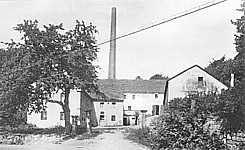Lohmühle: Die Mühle entstand auf Bühlauer Flur zum Mahlen von Eichenrinde aus der Dresdner Heide, die als “Lohe” in der Gerberei benötigt wurde. Neben der Mühle am Loschwitzbach gehörte ein Stapelplatz an der Bautzner Landstraße
dazu, auf dem später die Lohschänke entstand. Diese Gastwirtschaft war Vorläufer des bekannten Tanz- und Vergnügungslokals [“Weißer Adler”](../../../../nordost/page10246/strassen_weisser_hirsch/bautzner_landstrasse/weisser_adler/). Das alte Mühlengebäude wurde 1847 durch einen Brand zerstört und an einem neuen
Standort ca. 100 Meter entfernt wiederaufgebaut. Hier war die frühere Lohmühle _(Foto)_ noch bis 1890 als Mehl- und Ölmühle, Dampfwäscherei und zuletzt bis
1944 als Bäckerei in Betrieb. Aus dem früheren Mühlteich entstand 1931 das [Bühlauer Freibad](../../../../nordost/buhlau/). Das Hauptgebäude Grundstraße 171 ist bis zur Gegenwart als Wohnhaus erhalten.

Nr. 174: Das Eckhaus zur Grundstraße wurde 1886 von der Familie Schäfer erworben, die hier ein Textilwarengeschäft
einrichtete. Der mehrfach erweiterte Laden gehörte zu den wichtigsten Geschäften in Bühlau und wurde später als
Warenhaus Friedrich Schäfer bezeichnet, da man hier neben Haushaltwaren auch Textilien, Schuhe, Kurzwaren und andere
Dinge des täglichen Bedarfs erwerben konnte. 1964 gaben die Besitzer ihren Laden auf. Das Gebäude selbst wurde 1994 zugunsten eines neuen Wohn- und Geschäftshauses abgebrochen.

Nr. 185:
Das Fachwerkhaus entstand 1810 als Wohn- und Stallgebäude einer Bühlauer Kleinbauernfamilie, welche sich im Nebenerwerb in der Lohnwäscherei betätigte. Das unter Denkmalschutz stehende Haus befindet sich bis heute im
Familienbesitz und wurde 2010 saniert.

* * *

 \[ [Home](../../../../index.html)\] \[ [Nord](../../../../nord/)\] \[ [Nordwest](../../../../nordwest/)\] \[ [Neustadt](../../../../neustadt/)\] \[ [Nordost](../../../../nordost/)\] \[ [West](../../../../west/)\] \[ [Zentrum](../../../../zentrum/)\] \[ [Südwest](../../../../sudwest/)\] \[ [Süd](../../../../sud/)\] \[ [Südost](../../../../sudost/)\] \[ [Ost](../../../../ost/)\] \[ [Register](../../../../Register/register.html)\] \[ [Kontakt](../../../../Kontakt/kontakt.html)\] \[ [Impressum](../../../../impressum/)\]
