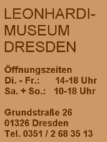
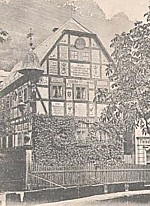
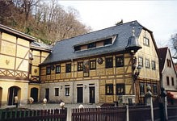
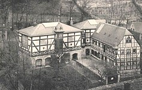
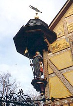

* * *

Das heutige Leonhardi-Museum geht auf die frühere Loschwitzer [Hentschelmühle](../../../../../nordost/loschwitz/strassen_loschwitz/grundstrasse/) zurück, die um 1879 von Emil August Eduard Leonhardi erworben wurde. Bereits 1854 hatte dessen Vater Christian August auf dem Grundstück der benachbarten Vettermühle seine [Tintenfabrik](../../../../../nordost/loschwitz/strassen_loschwitz/grundstrasse/tintenfabrik_leonhardi/) gegründet und war so zu Wohlstand gekommen. Sohn Eduard fühlte sich jedoch eher zur Malerei hingezogen und hatte bis 1845 an der Dresdner Kunstakademie studiert. Nach mehreren Studienreisen ließ er sich 1859 in Dresden nieder, wo er 1864 zum Ehrenmitglied der Kunstakademie ernannt wurde. Bekannt wurde er durch seine romantischen Landschaftsbilder, die ihm den Beinamen “Maler des deutschen Waldes” einbrachten.

1881/83 ließ Eduard Leonhardi das frühere Mühlengebäude im romantischen Stil als Wohn- und Atelierhaus für junge Künstler umbauen, wobei es seine heutige Gestalt erhielt. Die Fachwerkfassade wurde 1884 aus Anlass eines Künstlerfestes von Charles Palmié mit zahlreichen Bildern, Ornamenten und Sinnsprüchen bemalt, die einer Sammlung des Loschwitzer Lehrers Nestler entstammen. Einige dieser Verse verfasste vermutlich der Loschwitzer “Dorfpoet” Moritz Heydrich (1820-1885), der auch als Schöpfer mehrerer historischer Dramen in Erscheinung trat. Nach der an der Ecke des Hauses angebrachten Figur wurde die Mühle nun auch als “Rote Amsel” bezeichnet. Nach dem Auseinanderbrechen der Künstlerkolonie nutzte Leonhardi das 1896 nochmals erweiterte Gebäude vor allem als Ausstellungsraum für seine Gemälde. Ab 1905, dem Todesjahr des Malers, beherbergte es bis zur Schließung 1940 das “Landschaftsmuseum Eduard Leonhardi”.

Nach 1945 kam die “Rote Amsel” in den Besitz der Stadt Dresden, die das Leonhardi-Museum zunächst weiterführte. Bis 1963 wurden dessen Gemälde noch in einigen Räumen gezeigt, bevor dann eine Galerie für moderne Kunst einzog. Wechselnde Ausstellungen stellten nun Werke zeitgenössischer Dresdner Künstler vor. Zwischen 1982 und 1989 beherbergte es zudem die Loschwitzer “Galerie der Volkskunst”. Nach Übernahme des Hauses durch das Kulturamt wurde 1990 auch wieder eine kleine Gedenkstätte für Leonhardi eingerichtet. Eine komplette Sanierung des Museums erfolgte 2002/03. Heute sind hier regelmäßig Ausstellungen Dresdner bildender Künstler der Gegenwart zu sehen. Leonhardis Bilder sind in seinem ehemaligen Atelier ausgestellt.

Im Garten des Hauses erinnert seit 1884 ein von Robert Henze geschaffener Gedenkstein an den mit Leonhardi befreundeten Maler Ludwig Richter. Unter dem Relief finden sich die letzten Worte Richters aus seinem Tagebuch:
_“Groß denken, im Herzen rein, Halte dich gering und klein, Freue dich in Gott allein. L. R.”_ . Eine weitere Plastik “Räumliche Faltung eines Rechtecks”, 1976 von Hermann Glöckner
geschaffen, wurde 2003 aufgestellt. Zuvor befand sich das Kunstwerk in den Anlagen des Zwingers.

* * *

 \[ [Home](../../../../../index.html)\] \[ [Nord](../../../../../nord/)\] \[ [Nordwest](../../../../../nordwest/)\] \[ [Neustadt](../../../../../neustadt/)\]
 \[ [Nordost](../../../../../nordost/)\] \[ [West](../../../../../west/)\] \[ [Zentrum](../../../../../zentrum/)\] \[ [Südwest](../../../../../sudwest/)\]
 \[ [Süd](../../../../../sud/)\] \[ [Südost](../../../../../sudost/)\] \[ [Ost](../../../../../ost/)\] \[ [Register](../../../../../Register/register.html)\] \[ [Kontakt](../../../../../Kontakt/kontakt.html)\] \[ [Impressum](../../../../../impressum/)\]
