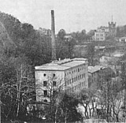

Das Unternehmen auf dem Areal der früheren [Vettermühle](../../../../../nordost/loschwitz/strassen_loschwitz/grundstrasse/) wurde 1854 vom Chemiker Christian August Leonhardi (1806-1865) gegründet. Leonhardi stammte aus Freiberg, wo
er zuvor ein Geschäft zur Herstellung von Parfümen besaß. Die Tintenfabrik in Loschwitz produzierte vorrangig Schreibtinte und wurde dadurch international bekannt. Hinzu kamen
Büroartikel wie Siegellack, Durchschreibpapier und Farbbänder für Schreibmaschinen, die vom Loschwitzer Stammsitz aus in alle Welt gingen. Am 4. Januar 1856 meldete Leonhardi
die von ihm entwickelte wasserfeste Alizarintinte zum Patent an. Außerdem engagierte er sich im Aufsichtsrat der Sächsisch-Böhmischen Dampfschifffahrtsgesellschaft und war zeitweise deren beratender Direktor.

Nach Leonhardis Tod 1865 wurde der Betrieb von seiner Witwe, später von seinem Sohn Eduard weitergeführt. 1870 erfolgten umfangreiche Umbauten und Erweiterungen des Fabrikgeländes _(Foto)_
. Später kamen Zweigwerke in der Dresdner Neustadt und in Tetschen-Bodenbach (Decin) hinzu. Außerdem erwarb Leonhardi 1872 eine Glasfabrik in
Schwepnitz, um dort Flaschen zur Tintenabfüllung herzustellen. Die abgefüllte und verpackte Ware wurde mit Hilfe von
Pferdefuhrwerken über die Grundstraße zur Elbe transportiert und dort mit Lastkähnen nach Hamburg verschifft.
Vertreter der Tintenfabrik waren u.a. in Tiflis, Kairo, Hongkong und Tokio tätig und beförderten den Weltruf der Loschwitzer Firma.

1890 wurde das Fabrikgelände nochmals erweitert, gegen den Einspruch der Gemeinde, die von der Fabrik eine zunehmende Belastung der Verkehrswege und
eine Beeinträchtigung des Landschaftsbildes befürchtete. 1898 folgte der Bau eines 35 Meter hohen Schornsteins für das neue Kesselhaus. Um auch die Angestellten am Erfolg der Firma
teilhaben zu lassen, richtete Eduard Leonhardi 1901 eine Pensions-, Witwen- und Waisenkasse ein.

Wegen der mit der Fabrik verbundenen Umweltbelastung erwarb die Stadt Dresden 1928 das
Gelände und ließ die Gebäude 1934 abreißen. An Stelle des früheren Fabrikgebäudes legte man 1937 einen kleinen Park an, in dem auch zwei Skulpturen von Robert Diez Aufstellung
fanden. Ursprünglich war an dieser Stelle der Bau einer kleinen Wohnanlage sowie eines städtischen Verwaltungsgebäudes mit Bibliothek, Standesamt und Volksbad vorgesehen.
Leider wurde die Grünanlage während des Zweiten Weltkrieges beim Bau eines Luftschutzbunkers beseitigt. 1955 entstand an ihrer Stelle ein kleiner Spielplatz, bevor um
1970 das Areal in das Betriebsgelände einer Ofenbaufirma einbezogen wurde.

Leonhardi hatte bereits 1927 seinen Betrieb nach Trachau verlegt. Wirtschaftliche Zwänge
führten jedoch zu einer Umwandlung in eine Aktiengesellschaft und zum Verkauf von Teilen des Familienbesitzes. Das Dresdner Werk kam dadurch in den Besitz von Günter Wagner,
Inhaber der bekannten Schreibwarenfirma “Pelikan”, firmierte jedoch weiterhin unter dem Namen Aug. Leonhardi A.G.

1946 wurde Wagners Betrieb enteignet und ab 1953 unter dem Namen “Barock”als  Schreibwaren- und Büroartikel-
hersteller weitergeführt. Später gehörte das Werk zum Kombinat “Robotron”, wurde nach 1990 an einen Investor
verkauft und musste 1998 Insolvenz anmelden. Danach befand es sich bis zur erneuten Insolvenz 2011 im Besitz eines
Frankfurter Unternehmers. Nach Übernahme durch den bayrischen Hersteller KPM erfolgte 2012 die Schließung.

* * *

 \[ [Home](../../../../../index.html)\] \[ [Nord](../../../../../nord/)\] \[ [Nordwest](../../../../../nordwest/)\] \[ [Neustadt](../../../../../neustadt/)\]
 \[ [Nordost](../../../../../nordost/)\] \[ [West](../../../../../west/)\] \[ [Zentrum](../../../../../zentrum/)\] \[ [Südwest](../../../../../sudwest/)\]
 \[ [Süd](../../../../../sud/)\] \[ [Südost](../../../../../sudost/)\] \[ [Ost](../../../../../ost/)\] \[ [Register](../../../../../Register/register.html)\] \[ [Kontakt](../../../../../Kontakt/kontakt.html)\] \[ [Impressum](../../../../../impressum/)\]
