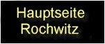
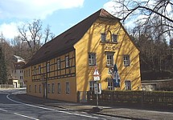
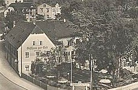
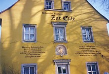
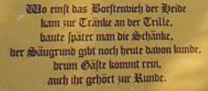

* * *

![inschriften an der fassade:  einst kamen die hussiten hier ins haus geritten. sie nahmen allhier drei tage quartier. und sie hausten und bemausten den wirt ohne scheu um seine barschaft, seine getränke, seine wurst, sein heu.  schwere nöten brachten die schweden 1630 diesem haus drangsal und viel qualen erlitten die armen ohne erbarmen ehe sie starben.  weißen kuchen, da die eulen-wirtin bäckt, allen schmeckt kamen von jeher die haufen aus den drei dörfern gelaufen, um diesen kuchen zu versuchen und nicht zu vergessen, eule-kirmeskuchen zu essen.  wo einst das borstenvieh der heide kam zur tränke an der trille, baute später man die schänke, der säugrund gibt noch heute davon kunde, drum gäste kommt rein, auch ihr gehört zur runde.  aus wasser- und aus feuersnot, oftmals gerettet mit der geschichte, allerzeit vielfach verkettet, steht hier die eule wie eine säule an der grenze von der biele mit luschwitz am eingang zu rochwitz drum gast verweile hast keine eile.](../../../../../nordost/loschwitz/strassen_loschwitz/grundstrasse/zur_eule/a_rectangle_1043.gif)

Das Gasthaus “Zur Eule” entstand vermutlich bereits im 16. Jahrhundert und gehört zu den ältesten noch bestehenden Wirtshäusern in Sachsen. Die ältesten Dokumente zu seiner Existenz stammen aus dem Jahr 1608. Zunächst wohl vor allem von Fuhrleuten, Winzern und Waldarbeitern aufgesucht, kam später der Name “Zur Eule” auf. Dieser wurde vermutlich von aus dem Eulengebirge eingewanderten Bergleuten mitgebracht, die im [Loschwitzgrund](../../../../../nordost/loschwitz/strassen_loschwitz/grundstrasse/) nach Gold suchten. 1710 erhielt der Gasthof das Erbschankrecht und wurde 1827 von seinem damaligen Besitzer Johann Gottfried Nacke in heutiger Form umgebaut. Zu den Stammgästen des Lokals gehörte Ludwig Richter, der sich hier regelmäßig mit befreundeten Künstlerkollegen traf.

Die “Eule” besaß später eine angeschlossene Fleischerei und seit 1912 einen Saal im hinteren Teil des Grundstücks _(Foto rechts)_. Auch nach 1945 blieb der Gasthof zunächst geöffnet, bevor das Besitzerpaar Paul und Isidora Schlage aus Altersgründen ihr Gewerbe aufgeben musste. Nach zeitweiliger Schließung wurde das Gasthaus “Zur Eule” 1982 wieder eröffnet und im Stil einer historischen Ausspanne mit offenem Holzkohlegrill und rustikaler Möblierung neu ausgestattet.

Trotz mehrfacher Besitzerwechsel gehörte die Gaststätte bis in die jüngste Vergangenheit zu den beliebten Speiselokalen im Loschwitz-Rochwitzer Raum. 1993 entstand im zuvor umfassend sanierten Haus zusätzlich das Tanzlokal “Nachteule”. 2006 musste die “Eule” vorerst ihre Pforten schließen und wird seit Mai 2009 als Mietwirtschaft für verschiedene Veranstaltungen genutzt. An der Fassade befinden sich neben dem “Hauszeichen” einer Eule verschiedene Inschriften, die über die Geschichte des Gebäudes informieren.

**_Foto:_** _Giebelfeld des Gasthauses mit Hauszeichen und Inschriften_

* * *

 \[ [Home](../../../../../index.html)\] \[ [Nord](../../../../../nord/)\] \[ [Nordwest](../../../../../nordwest/)\] \[ [Neustadt](../../../../../neustadt/)\]
 \[ [Nordost](../../../../../nordost/)\] \[ [West](../../../../../west/)\] \[ [Zentrum](../../../../../zentrum/)\] \[ [Südwest](../../../../../sudwest/)\]
 \[ [Süd](../../../../../sud/)\] \[ [Südost](../../../../../sudost/)\] \[ [Ost](../../../../../ost/)\] \[ [Register](../../../../../Register/register.html)\] \[ [Kontakt](../../../../../Kontakt/kontakt.html)\] \[ [Impressum](../../../../../impressum/)\]
