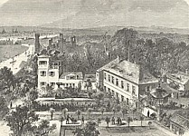
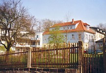

* * *

* * *

* * *

* * *

* * *

* * *

Die Heilstätte Loschwitz entstand 1872 auf einem früheren Weinbergsgrundstück
an der Wunderlichstraße 17. In diesem Jahr erwarb die Krankenpflegerin Marie Simon das Areal mit einem Winzerhaus von 1776 und ließ dieses zu einem Erholungsheim für Kriegsinvaliden umgestalten. Zuvor hatte sie als
Krankenschwester an den Kriegen von 1866 und 1870/71 teilgenommen und angesichts des erlebten Leids der Soldaten den Entschluss zur Gründung einer
solchen Einrichtung gefasst. Am 23. Mai 1872 konnte die Klinik als “Deutsche Heilstätte für Invalide und Kranke” öffnen. Zunächst fanden hier ca. 20-30
Patienten Aufnahme, die sich bei gesunder Kost und Aufenthalt an frischer Luft von ihren Kriegserlebnissen erholen konnten _( **Bild:** Zeichnung von August Reinhardt, 1872)_.

1875 wurde die Einrichtung in eine Stiftung des Roten Kreuzes umgewandelt, deren Schirmherrin die sozial engagierte
Königin Carola wurde. Marie Simon leitete die Heilstätte noch bis zu ihrem Tod im Jahr 1877. Gemäß des im gleichen
Jahr verfassten Statutes oblag der Stiftung die Betreuung von ehemaligen deutschen Soldaten und Kriegsinvaliden sowie die Aufnahme von erkrankten oder verwundeten Militärangehörigen. Außerdem wurde hier fachkundiges
Pflegepersonal ausgebildet, was zu dieser Zeit noch nicht selbstverständlich war. Zivilpersonen stand die Einrichtung nur gegen Zahlung eines entsprechenden Entgelts zur Verfügung.

Auch nach dem Tod der Gründerin bestand die Heilstätte Loschwitz zunächst
weiter und wurde 1894 und 1902 sogar noch erweitert. 1912 musste sie jedoch mangels Auslastung geschlossen werden. Das Grundstück ging daraufhin in den
Besitz der Stadt Dresden über, die es an die Elisabeth-von Pohland-Stiftung weiterveräußerte. Der zwei Jahre später beginnende Erste Weltkrieg änderte die
Situation jedoch grundlegend, so dass hier wieder Soldaten versorgt wurden.  1919 wurde dieses Lazarett endgültig geschlossen und die Gebäude der früheren
Heilstätte zu Wohnhäusern umgebaut. Die erhaltenen Bauten stehen heute unter Denkmalschutz und wurden 2002/03 saniert..

* * *

 \[ [Home](../../../../index.html)\] \[ [Nord](../../../../nord/)\] \[ [Nordwest](../../../../nordwest/)\] \[ [Neustadt](../../../../neustadt/)\] \[ [Nordost](../../../../nordost/)\] \[ [West](../../../../west/)\] \[ [Zentrum](../../../../zentrum/)\] \[ [Südwest](../../../../sudwest/)\] \[ [Süd](../../../../sud/)\] \[ [Südost](../../../../sudost/)\] \[ [Ost](../../../../ost/)\] \[ [Register](../../../../Register/register.html)\] \[ [Kontakt](../../../../Kontakt/kontakt.html)\] \[ [Impressum](../../../../impressum/)\]
