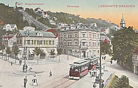
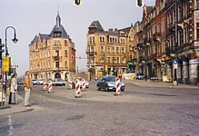
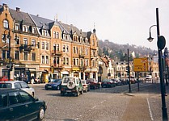
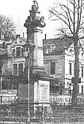

* * *

* * *

Der Körnerplatz wurde in seiner heutigen Form Ende des 19. Jahrhunderts im Nordteil des früheren Loschwitzer Dorfkerns angelegt. Ursprünglich befand sich hier auf hochwasserfreiem Terrain der Gemeindeanger mit dem Dorfbrunnen, um den sich zahlreiche Fachwerkhäuser gruppierten. Mit dem Bau des [“Blauen Wunders”](../../../../nordost/loschwitz/blaues_wunder/) entschlossen sich die Gemeinden Blasewitz und Loschwitz zur Umgestaltung der beiden Brückenköpfe. 1892 begann der Abbruch von insgesamt zwölf Gebäuden zwischen [Grundstraße](../../../../nordost/loschwitz/strassen_loschwitz/grundstrasse/), [Körnerweg](../../../../nordost/loschwitz/strassen_loschwitz/) und [Friedrich-Wieck-Straße](../../../../nordost/loschwitz/strassen_loschwitz/friedrich-wieck-strasse/). An ihrer Stelle entstanden bis zur Jahrhundertwende mehrgeschossige Wohngebäude mit Läden im Erdgeschoss. In diesem Zusammenhang wurde der alte Dorfplatz nach dem Juristen und Schriftsteller Christian Gottfried Körner (1756-1831) benannt, der in Loschwitz einen Weinberg besaß.

Im Eckhaus zur Schillerstraße 1 befand sich früher die Wildbret- und Geflügel- handlung Richard Herfurth, deren dekorative Jugendstil-Hinterglasmalereien noch erhalten sind. Bemerkenswert ist auch das schmale Nachbargebäude an der Auffahrt zur Brücke, “Goldenes Schiff” genannt. Das Eckhaus Friedrich-Wieck-Straße 2, 1895 von Karl Emil Scherz errichtet, zeigt am Giebelfeld eine Reliefdarstellung Bismarcks, die als eines der wenigen Bismarck-Denkmale Dresdens die Bilderstürmerei der Nachkriegszeit überstand. Scherz lieferte auch die Entwürfe für zahlreiche Nachbargebäude rund um den Platz und an den angrenzenden Straßen. Von den zahlreichen traditionsreichen Geschäften sollen an dieser Stelle stellvertretend die Pelzwarenhandlung Hermann Lange, die Buchbinderei Brauer, das Hamburger Cigarrenhaus, Uhrmacher Winkler, die Samenhandlung Görn, die Blumenhandlung Feige (später Trinks) und das Fotohaus Gaudernack erwähnt werden. Zu den älteren Bauwerken gehört das 1857 von Theodor Lehnert erbaute Wohn- und Geschäftshaus Körnerplatz 1 an der Einmündung der Grundstraße.

In den 1960er Jahren war der Körnerplatz Drehort für den bekannten DEFA-Film
“Geliebte weiße Maus” mit Rolf Herricht in der Hauptrolle. Zahlreiche Szenen entstanden im Café Winkler (seit 1996 Wippler) an der Ecke zur Friedrich-Wieck-Straße. Die Bäckerei mit angeschlossenem Café war 1894/95 von Robert Emil Winkler gegründet worden. Angestellte betrieben auch das Kuchenbuffet der [Loschwitzhöhe](../../../../nordost/loschwitz/strassen_loschwitz/loschwitzhohe/) und das [Cafe Hausberg](../../../../nordost/pillnitz/gaststatten_pillnitz/) in Pillnitz.

Nach 1990 wurde der Platz neu gestaltet und die umliegenden Häuser zum Teil saniert. An Stelle des abgerissenen alten [Loschwitzer Rathauses](../../../../nordost/loschwitz/) wurde 1994 ein moderner Neubau für das Ortsamt Loschwitz errichtet. Im Erdgeschoss des Gebäudes Körnerplatz 10 befindet sich seit 1995 die fünf Jahre zuvor gegründete Galerie am Damm, heute ein Treffpunkt für Kunstfreunde weit über die Stadtgrenzen hinaus.

Kriegerdenkmal:
Das am 2. September 1878 feierlich eingeweihte Denkmal wurde vom Bildhauer Nessler geschaffen und erinnerte an vier im Preußisch-österreichischen Krieg 1866 und neun im
Deutsch-französischen Krieg 1870/71 gefallene Loschwitzer Soldaten. Sein Standort befand sich an der Einmündung der Friedrich-Wieck-Straße gegenüber dem “Bräustübel”. Der mit
Namenstafeln und militärischen Insignien versehene Obelisk wurde auf Beschluss des Stadtrates im April 1950 abgerissen. Lediglich der Helmaufsatz des Denkmals blieb erhalten und befindet sich heute im Stadtmuseum.
