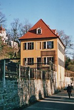
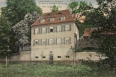
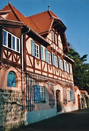
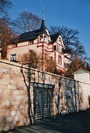
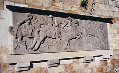
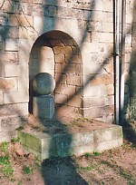

* * *

* * *

Der Körnerweg entstand aus dem alten Treidelpfad am rechten Elbufer, der am Fuße der
Weinberge entlang führte. Anfang des 19. Jahrhundert wurde dieser Weg erstmals gepflastert und 1908 auf die heutige Breite erweitert. Seinen Namen erhielt er 1895 nach der Familie
Körner, die hier 1785 ein Weinberghaus erworben hatte. Das Haus (Nr. 6), erbaut um 1784 _(Fotos rechts)_, blieb bis 1826 im Familienbesitz und war Aufenthaltsort berühmter
Zeitgenossen.  Zu Körners Gästen gehörten u. a. Johann Wolfgang von Goethe, Ludwig Tieck, Elisa von der Recke und Wolfgang Amadeus Mozart. 1785/87 hielt sich Schiller hier auf und
schrieb der Legende nach im Gartenpavillon des Grundstücks seine “Ode an die Freude”. In diesem Häuschen erinnert heute eine kleine [Gedenkstätte](../../../../nordost/loschwitz/strassen_loschwitz/schillerstrasse/) an den Dichter.

Das Körnerhaus gehörte ab 1830 dem Freiherrn von
Gutschmid und kam 1920 in den Familienbesitz derer von der Planitz, die das Gebäude bis zur Enteigung nach dem Zweiten Weltkrieg bewohnten _(Bild links um 1920)_. Mit Übernahme des Hauses durch die Stadt
Dresden wurde das Körnerhaus 1949 unter Denkmalschutz gestellt und 2001 an einen Privatmann verkauft, der das historische Anwesen sanierte. Im Keller befand
sich bis zu diesem Zeitpunkt die letzte erhaltene Weinpresse in Loschwitz. Diese stammte aus der Zeit um 1710 und war noch bis 1890 im Einsatz. Nach erfolgter
Restaurierung wurde sie 2009 unter einem Schutzdach im Garten des Grundstücks aufgestellt. Gelegentlich finden hier auch Lesungen und Konzerte statt. An Theodor Körner und seine Familie erinnert eine
Gedenktafel an der elbseitigen Mauer.

Neben dem Körnerhaus ist auch das Nachbargebäude Nr. 8
_(Foto)_ ein Zeuge der früheren Weinbergstradition im Ort. Das Fachwerkhaus entstand um 1808 und besitzt neben einem interessanten Türschlussstein mit den Initialen “JSR” (= Johann Samuel Roßig) einige
Inschriften an der Fassade. Im Kern geht das heute in Privatbesitz befindliche Gebäude auf ein 1609 entstandenes Weinberghäuschen zurück. Um 1900 erfolgte ein Umbau mit Anklängen an
den Jugendstil. Zeitweise wohnte hier der Glasmaler Bruno Goller, Professor an der Kunstgewerbeschule und Mitglied des Deutschen Werkbundes sowie der Künstlergruppe
“Die Elbier”. Im Wohnhaus Körnerweg 16 hatte der Bildhauer Bruno Fischer seinen Wohnsitz, der den Nymphenbrunnen an der Bürgerwiese schuf. Nr. 26 (Haus Böhme),
benannt nach dem Stifter Ludwig Adolf Böhme, diente ab 1917 bis nach 1990 als Erholungsheim und Ärztewohnhaus des Diakonissen- Krankenhauses. Auf einem von
Bergdirektor Karl Friedrich Engler zur Verfügung gestellten Grundstück (Nr. 24) entstand 1873 das Loschwitzer Wasserwerk.

_Wer sein Geld Verlieren will, und weiss nicht wie,_

_Der baue alte Häuser aus oder spiele Lotterie_

**Inschrift am Haus Körnerweg 8**

Preißlerscher Weinberg: Dieses Areal erstreckte sich ursprünglich zwischen Körnerweg und der heutigen Schevenstraße
und umfasste die Grundstücke Körnerweg 10 - 16 sowie Schevenstraße 3 und 3b. Der beruflich als Gastwirt und
Fleischhauer tätige Johann August Friedrich Preißler hatte den Weinberg 1800 erworben und hier einige neue Gebäude
errichten lassen. Aus einem dieser Winzerhäuser ging Mitte des 19. Jahrhunderts die Villa Körnerweg 12 hervor, welche
zwischen 1876 und 1916 Sommerwohnsitz der Schauspielerin Pauline Ulrich war. An diese erinnert bis heute der Schriftzug “Villa Paula” an der Fassade sowie ihre Initialien am Eingangstor.

Nr. 14:
Das im Schweizerstil gestaltete Gebäude befand sich ab 1865 bis 1945 im Besitz der Familie Mühlberg. Hermann Otto Mühlberg war der Gründer des bekannten Kaufhauses
Mühlberg am Altmarkt und außerdem ein begeisterter Kunstmäzen. Zu seinem Freundeskreis gehörten u.a. die Maler Georg Meckes und Sascha Schneider.

Nr. 20:
Das auch “Villa Jenny” genannte Haus entstand Ende des 19. Jahrhunderts in einem früheren Loschwitzer Weinberg und gehörte ab 1915 Marie Caroline Vieth von Golßenau,
Tante des Schriftstellers Ludwig Renn. Diese erwarb das zuvor seit 1912 als Erholungsheim für Damen und Kinder genutzte Gebäude und nutzte es als Privatpension. Auch nach dem Verkauf
des Hauses an den ehemaligen Schönfelder Pfarrer Kretzschmar blieb diese erhalten und wurde noch bis um 1980 von seinen Kindern als “Fremdenheim Kretzschmar-Mehner”
betrieben. Danach übernahm das Volksgut Borthen das Haus und richtete hier ein Schulungsheim ein. 2002 wurde die historische Villa zugunsten eines modernen Wohnhauses abgerissen.

Klengels Weinberg: Dieser Weinberg oberhalb des Körnerweges gehörte im 17. Jahrhundert Wolf Caspar von Klengel
(1630-1691), der 1656 zum Oberlandbaumeister in Sachsen berufen wurde. Klengel war maßgeblich am Ausbau der
Friedrichstadt und der Inneren Neustadt beteiligt und gilt als erster bedeutender Barockarchitekt Dresdens. Am Eingang
zum Grundstück befindet sich die sogenannte “Klengel-Kugel”, ein 1681 aufgestelltes kleines Denkmal für den
Baumeister. Die lange Zeit verschollene Kugel wurde erst 1927 im Bett des Stechgrundbaches wiederentdeckt und an den heutigen Standort versetzt.

Körnerfries:
In Erinnerung an den Dichter Theodor Körner wurde im Zuge der Umgestaltung des Neustädter Elbufers 1938 eine kleine Gedenkstätte geschaffen. An der elbseitigen Grundstücksmauer brachte man aus Anlass des 125.
Todestages Körners einen vom Bildhauer Reißmann geschaffenen Fries mit Szenen aus den Befreiungskriegen der
Lützower Jäger 1813 an. Die offizielle Einweihung erfolgte am 26. Oktober 1938. Zum Schutz vor Witterungseinflüssen
erhielt das Reliefbild eine überdachte Säulenvorhalle. Da man von dieser einen Einblick in das nach 1945 von der
Staatssicherheit genutzte Grundstück hatte, wurde die Halle 1968 entfernt. 1986 verschwand auch das Denkmal im Depot, kehrte jedoch nach 1990 an seine ursprüngliche Stelle zurück.

**_Fotos:_** _Der Körnerfries (links) und die “Klengel-Kugel” (rechts) am Loschwitzer Körnerweg_

* * *

 \[ [Home](../../../../index.html)\] \[ [Nord](../../../../nord/)\] \[ [Nordwest](../../../../nordwest/)\] \[ [Neustadt](../../../../neustadt/)\] \[ [Nordost](../../../../nordost/)\] \[ [West](../../../../west/)\] \[ [Zentrum](../../../../zentrum/)\] \[ [Südwest](../../../../sudwest/)\] \[ [Süd](../../../../sud/)\] \[ [Südost](../../../../sudost/)\] \[ [Ost](../../../../ost/)\] \[ [Register](../../../../Register/register.html)\] \[ [Kontakt](../../../../Kontakt/kontakt.html)\] \[ [Impressum](../../../../impressum/)\]
