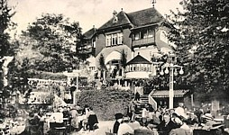
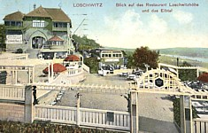
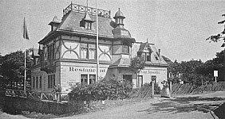
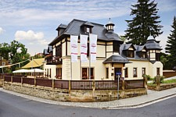

* * *

* * *

* * *

* * *

* * *

* * *

Loschwitzhöhe:

Die markante Höhe über dem Elbtal war bereits im 19. Jahrhundert Standort eines kleinen Aussichtspavillons, welcher als “Winzerturm”
bezeichnet wurde und vermutlich auf ein älteres Weinberghäuschen zurückging. Die erste Gaststätte auf dem Grundstück der späteren Loschwitzhöhe entstand 1892, nachdem zwei Jahre zuvor die Bau- und
Schankkonzession für das frühere Weinbergsgrundstück erteilt worden war. Anfangs bestand das Lokal nur aus einem kleinen Hauptgebäude mit Veranda und einer angebauten Kegelbahn. Im Zusammenhang mit dem Bau der [Bergschwebebahn](../../../../nordost/loschwitz/schwebebahn/) erwarb im September 1900 die Dresdner Elektra
AG das Areal, um hier ein modernes großes Ausflugslokal zu errichten. Die Gesellschaft war zugleich Betreiber der
Schwebebahn und wollte durch das Restaurant zusätzliche Fahrgäste gewinnen. Die Planungen übertrug man dem Loschwitzer Architekten Martin Pietsch, der das Umbauprojekt 1901/02 realisierte. In den Anfangsjahren wurde das
Gebäude auch als “Schwebebahnhotel” bezeichnet.

Das neue Haus besaß zwei Gasträume mit über 100 Plätzen, einen Saal für
170 Personen, eine verglaste Veranda mit Kegelbahn im Untergeschoss und eine große Gartenterrasse mit weiteren 280 Plätzen. Hinzu kamen Lager- und Küchenräume, vier Gästezimmer sowie eine Wohnung für die Wirtsfamilie.
Vor allem wegen des herrlichen Fernblicks über das Elbtal war die “Loschwitzhöhe” beliebtes Ausflugslokal und bildete ein Pendant zum “Luisenhof” auf dem benachbarten Berg. Da sich die Gaststätte schnell großer
Beliebtheit erfreute, planten ihre Besitzer 1909 ein Erweiterung um einen weiteren Saal und einen Ausbau des Dachgeschosses, was jedoch bedingt
durch den Ersten Weltkrieg unterblieb. Lediglich die Gartenterrassen wurden später erweitert und erhielten einen zusätzlichen Zugang von der Schwebebahn.

Auch nach 1945 blieb die “Loschwitzhöhe” zunächst geöffnet und wurde 1953
von der volkseigenen HO übernommen. Da notwendige Reparaturen unterblieben und sich der Zustand des Gebäudes zunehmend verschlechterte, musste 1968 der Gaststättenbetrieb wegen baulicher Mängel aufgegeben
werden. Die Gebäude wurden anschließend noch einige Jahre als Lagerraum genutzt, bevor 1977 der Abriss erfolgte. Nach mehreren erfolglosen Versuchen
ist derzeit der Bau eines neuen Hotels an dieser Stelle geplant, welches zugleich als Ausflugslokal der Bevölkerung offen stehen soll. Vorgesehen ist ein Gaststättenkomplex mit ca. 700 Plätzen und 70 Hotelbetten.

Schöne Aussicht:

Die Geschichte der “Schönen Aussicht” an der Krügerstraße (Nr. 1) reicht bis in die Mitte des 19. Jahrhunderts zurück. 1853 erhielt der
Winzer Friedrich Jork für sein Haus die Schankgenehmigung. Unter seinem Nachfolger Ernst Emil Thomas entwickelte sich die “Schöne Aussicht” zu einem beliebten Restaurant. 1877 erfolgte ein Umbau des
Hauses im altdeutschen Fachwerkstil _(Foto)_.

Zu den Attraktionen des Lokals gehörten neben der Aussichtsterrasse  eine Kegelbahn, ein Billard-Salon und separate Gesellschaftszimmer.
Der zunehmende Gästestrom, vor allem nach Eröffnung der Schwebebahn, machten um 1900 den Anbau einer zusätzlichen Veranda erforderlich. Ein Jahr später erhielt das Haus im wesentlichen sein heutiges Aussehen. 1911 war
noch der Anbau eines Saalgebäudes vorgesehen, welcher jedoch nicht zustande kam.

Nach dem Tod des Gastwirts Thomas wechselten mehrfach die Betreiber. Unter Regie der Gastwirtin Anna Maria Kleine wurden 1936 einige Hotelzimmer
eingerichtet und eine Freitanzdiele angelegt. Die hölzerne Veranda fiel 1945 den Bomben zum Opfer. Das erhalten gebliebene Hauptgebäude blieb noch bis in die
1960er Jahre in Privatbesitz. Ab 1970 wurde die “Schöne Aussicht” als Gästehaus des Otto-Buchwitz-Werkes genutzt. 1991 erfolgte eine umfassende
Renovierung, so dass die “Schöne Aussicht” ein Jahr später als Restaurant und Hotel wieder eröffnet werden konnte. Einen nach Schließung der Gaststätte
2010 von den Eigentümern des Grundstücks geplanten Umbau des Hauses zu Wohnzwecken verhinderte eine Bürgerinitatiative Loschwitzer Einwohner. Stattdessen wurde das Haus unter
Bewahrung des historischen Äußeren 2011/12 komplett umgebaut und im Dezember 2012 wieder eröffnet. Neben den
Gasträumen stehen seitdem auch eine Schauküche, ein Weinkeller, eine große Gartenterrasse und sechs Hotelzimmer im Obergeschoss zur Verfügung.

* * *

 \[ [Home](../../../../index.html)\] \[ [Nord](../../../../nord/)\] \[ [Nordwest](../../../../nordwest/)\] \[ [Neustadt](../../../../neustadt/)\] \[ [Nordost](../../../../nordost/)\] \[ [West](../../../../west/)\] \[ [Zentrum](../../../../zentrum/)\] \[ [Südwest](../../../../sudwest/)\] \[ [Süd](../../../../sud/)\] \[ [Südost](../../../../sudost/)\] \[ [Ost](../../../../ost/)\] \[ [Register](../../../../Register/register.html)\] \[ [Kontakt](../../../../Kontakt/kontakt.html)\] \[ [Impressum](../../../../impressum/)\]
