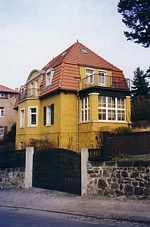
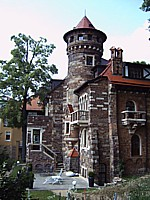

* * *

* * *

Die Malerstraße erhielt ihren Namen nach der einst hier ansässigen “Malerkolonie”. Ende des
19\. Jahrhunderts waren Loschwitz und Wachwitz zu beliebten Wohnorten Dresdner Künstler geworden. Zu den Bewohnern der Malerstraße gehörte neben Ludwig Richter, der im Haus Nr.
4, später in der Nr. 22 seinen Sommerwohnsitz hatte, auch der Ingenieur Alfred Bockemühl. Er entwarf 1929 den ersten deutschen Großraum-Straßenbahnwagen “Großer Hecht” und war in
den Dreißiger Jahren maßgeblich an der Entwicklung moderner Nahverkehrssysteme beteiligt. Bockemühl wohnte bis zu seiner Übersiedlung nach Stuttgart 1949 im Haus Malerstraße 9 _(Foto)_
. Im oberen Teil der Straße entstand 1914, bereits auf Wachwitzer Flur, das [Sanatorium Weidner](../../../../nordost/wachwitz/strassen_wachwitz/weidners_sanatorium/) (Malerstraße 31/32).

Einzelne Gebäude:

Villa “Artushof”: Zu den ungewöhnlichsten Villenbauten in Loschwitz gehört die Villa “Artushof” (Malerstraße 1). Das burgartige Gebäude _(Foto)_
wurde zwischen 1893 und 1895 von Reinhold Schreyer für seinen Bruder Arthur erbaut. Arthur Schreyer war begeisterter Anhänger Richard Wagners und wollte dessen düster-romantische “Klingsor-Burg” aus der Oper “Parsifal”
plastisch umsetzen.  Aus diesem Grund ließ er das Haus mit einem Burggraben umgeben. Im Keller entstand eine Säulenhalle mit einem sie umgebenden Tisch als Symbol der Tafelrunde von
König Artus. Außerdem ließ sich Schreyer ein großzügiges Atelier einrichten, welches vom Erdgeschoss bis in die zweite Etage reichte. Garten und Haus wurden zudem mit einigen Kunstwerken des Besitzers ausgestattet.

Kurz nach Fertigstellung des Gebäudes musste Schreyer seinen Besitz aus finanziellen Gründen wieder verkaufen und
siedelte nach Berlin über, so dass die Gestaltung des Gesamtkomplexes nie vollendet werden konnte. Nach dem Erwerb
durch eine Ärztin des nahegelegenen Weidner-Santoriums nutzte dieses den Garten der Villa für Liegekuren. Ab 1922
befand sich die Villa in Privatbesitz der Familie Stratmann. Geringe Schäden entstanden 1945 beim Luftangriff. Heute befinden sich im nach 1990 rekonstruierten “Artushof” mehrere Wohnungen.

Nr. 4:
In diesem Gebäude verbrachte der Maler Ludwig Richter seine letzten Lebensjahre, nachdem er 1876 in den
Ruhestand getreten war. Richter hatte bereits ab 1852 regelmäßig die Sommermonate in Loschwitz verlebt. Am 19. Juli
1884 verstarb er und wurde auf dem Alten Katholischen Friedhof in der Friedrichstadt beigesetzt. An ihn erinnert eine kleine Gedenktafel am Eingang des Hauses.

Nr. 10:
In diesem Landhaus lebte von 1912 bis 1914 der international bekannte Geiger und Musiklehrer Leopold Auer.
Auer, der eine Stelle am St. Petersburger Konservatorium innehatte, unterrichtete hier im Rahmen seiner “Loschwitzer
Sommerakademie” junge Musiker aus verschiedenen Ländern im Geigenunterricht. Nach Beginn des Ersten Weltkrieges
musste der Musiker Deutschland verlassen, lebte bis Februar 1918 wieder in St. Petersburg und emigrierte dann in die
USA. 1930 kehrte er nochmals nach Dresden zurück und ließ sich im nahe seiner Villa gelegenen Sanatorium Weidner behandeln, wo er am 15. Juli 1930 verstarb.

Nr. 13:
Um 1890 erwarb der Zahnarzt Franz Curti die Villa “Friedau” auf der Malerstraße 13 und nutzte sie bis zu seinem
Tod 1898 als Sommerhaus. Curti widmete sich in seiner Freizeit der Komposition von Opern und Kantaten. Später wohnte seine Witwe in dem Gebäude, welche 1901 auch die Umbenennung des hier vorbeiführenden Weges in [Franz-Curti-Straße](../../../../nordost/loschwitz/strassen_loschwitz/) anregte. Das ehemalige Wohnhaus wurde 1937 umgebaut und 1998 zugunsten eines Neubaus abgerissen.

Nr. 16: Das nach seinem Bauherrn und ersten Besitzer Landhaus Beust genannte Gebäude entstand 1903 in schlichten
Formen mit einer großzügigen Loggia und Balkonen und orientiert sich bereits an einer sachlicheren Architekturauffassung
und den aufkommenden Forderungen nach “Licht, Luft und Natur”. Der Entwurf für diese Villa stammt von Rudolf Kolbe.

Nr. 21:
Auch dieses Haus befand sich ab 1916 im Besitz eines Künstlers, des an der Kunstakademie als Professor tätigen
Hanns Hanner. Hanner war Meisterschüler von Oskar Zwintscher und bewohnte die Villa bis zu seinem Tod 1966. Heute
lebt hier der durch seine Bildhauerarbeiten bekannte Peter Makolies. Makolies war u.a. an der Gestaltung der Brunnen am Neustädter Markt beteiligt und schuf das Böttcher-Denkmal auf der Brühlschen Terrasse.

* * *

 \[ [Home](../../../../index.html)\] \[ [Nord](../../../../nord/)\] \[ [Nordwest](../../../../nordwest/)\] \[ [Neustadt](../../../../neustadt/)\] \[ [Nordost](../../../../nordost/)\] \[ [West](../../../../west/)\] \[ [Zentrum](../../../../zentrum/)\] \[ [Südwest](../../../../sudwest/)\] \[ [Süd](../../../../sud/)\] \[ [Südost](../../../../sudost/)\] \[ [Ost](../../../../ost/)\] \[ [Register](../../../../Register/register.html)\] \[ [Kontakt](../../../../Kontakt/kontakt.html)\] \[ [Impressum](../../../../impressum/)\]
