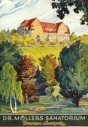
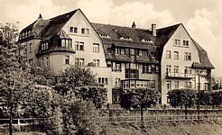
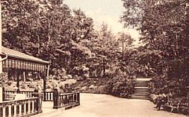

* * *

* * *

* * *

* * *

* * *

* * *

Das Sanatorium Möller in Oberloschwitz geht auf den Arzt Dr. med. Siegfried Möller (1871-1943) zurück, der nach mehrjähriger Tätigkeit als Schiffsarzt 1904 ein kleines Sanatorium an der Malerstraße 4 gründete. Vier Jahre später erwarb er das Grundstück Alpenstraße 1 und ließ sich hier zwischen
Alpenstraße - Tiedgestraße - Sierksstraße und Ulrichstraße vom Architekten Friedrich Wilhelm Hertzsch einen modernen Sanatoriumskomplex errichten. Neben dem Haupthaus an der Alpenstraße _(Foto)_
gehörten die beiden Villen “Birkenhaus” und “Buchenheim” an der Ulrichstraße dazu, die insgesamt über 120 Betten für die Patienten boten. Die eigentlichen Behandlungs- und
Aufenthaltsräume befanden sich im Haupthaus. Neben dem Speisesaal gab es hier auch ein Musikzimmer, Lese- und
Schreibzimmer, Gesellschaftsräume für Damen und Herren und einen Billardsalon. Eine hauseigene Gärtnerei versorgte
das Sanatorium mit frischem Obst und Gemüse. Vorrangig wurden Diätkuren nach der Methode Schroths angeboten und Magen-Darm-Erkrankungen behandelt. Hinzu kamen hydrotherapeutische Anwendungen, Massagen, Sonnenbäder und
Bestrahlungen.

1940 wurde das Sanatorium Möller von der Wehrmacht beschlagnahmt und diente nun bis 1945 als Reservelazarett. Die bei Kriegsende erst 21-jährige
Besitzerin Hanna Möller verpachtete ihr Eigentum später an das Johannstädter Krankenhaus, welches hier eine Tuberkulose-Heilanstalt für Kinder einrichtete.
1956 zog eine Außenstelle des Neustädter Krankenhauses ein. Gemeinsam mit einigen anderen Privatkliniken wurde die Einrichtung zum Krankenhausverband
Oberloschwitz zusammengefasst, 1972 jedoch als IV. Medizinische Klinik erneut dem Neustädter Krankenhaus zugeordnet. Zuletzt wurden die früheren Sanatoriumsgebäude bis 1996 von einer Klinik für Psychiatrie und
Psychotherapie genutzt. Heute dienen sie ebenso wie die beiden Villen und das ehemalige Wohnhaus Möllers Wohnzwecken.

* * *

 \[ [Home](../../../../index.html)\] \[ [Nord](../../../../nord/)\] \[ [Nordwest](../../../../nordwest/)\] \[ [Neustadt](../../../../neustadt/)\] \[ [Nordost](../../../../nordost/)\] \[ [West](../../../../west/)\] \[ [Zentrum](../../../../zentrum/)\] \[ [Südwest](../../../../sudwest/)\] \[ [Süd](../../../../sud/)\] \[ [Südost](../../../../sudost/)\] \[ [Ost](../../../../ost/)\] \[ [Register](../../../../Register/register.html)\] \[ [Kontakt](../../../../Kontakt/kontakt.html)\] \[ [Impressum](../../../../impressum/)\]
