

* * *

Die Pillnitzer Landstraße wurde im 19. Jahrhundert als rechtselbische Verbindungsstraße zwischen Loschwitz und Pillnitz angelegt. Zuvor führte der Weg von der Residenz zum Schloss Pillnitz über Striesen und
Blasewitz zur Pillnitzer Fähre in Kleinzschachwitz. Nach Befestigung dieser Straße zwischen 1885 und 1905 entstanden in den früheren Weinbergen zahlreiche Sommerhäuser und Villen wohlhabender Dresdner Bürger. Auf ihrem
Weg durchquert die Pillnitzer Landstraße die Fluren von Loschwitz, Wachwitz, Niederpoyritz und Hosterwitz. Wegen der romantischen Lage dieser Orte am Elbstrom war das Gebiet bereits im 19. Jahrhundert Anziehungspunkt
für Künstler und Sommergäste. Seit 1991 ist die Pillnitzer Landstraße alljährlich Hauptachse des Ende Juni veranstalteten Elbhangfestes.

Loschwitz:

Die Pillnitzer
Landstraße beginnt am Körnerplatz in Loschwitz und führt von dort zunächst durch Teile des alten Dorfkerns. Hier befand sich einst auch eine hölzerne Brücke über den heute unterirdisch kanalisierten Loschwitzbach. Von
den Gebäuden in diesem Teil wurden 1945 einige zerstört, darunter die [Loschwitzer Kirche](../../../../nordost/loschwitz/loschwitzer_kirche/) (1991/94 wieder aufgebaut) und die frühere Körnerschule. Im Wohnhaus Nr. 11 hatte nach 1945 der Maler Otto Griebel seinen Wohnsitz. Weniger bekannt ist die Schriftstellerin und Lateinamerika-Expertin Maria Schwauß, die im Haus Nr. 15 wohnte und ein Wörterbuch der regionalen Umgangssprachen Lateinamerikas verfasste. Bemerkenswert ist auch das 1897/98 entstandene [Künstlerhaus](../../../../nordost/loschwitz/strassen_loschwitz/pillnitzer_landstrasse/kunstlerhaus/) und der gegenüberliegende neue [Loschwitzer Friedhof](../../../../nordost/loschwitz/loschwitzer_kirche/loschwitzer_friedhof/).

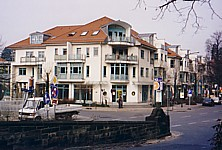Nach 1990 entstanden zwischen Pillnitzer Landstraße und Fidelio-F.-Finke-Straße
einige neue Wohn- und Gewerbebauten, darunter der villenartige Wohnpark “Augustuspark” (1996/97) und das Einkaufszentrum “Loschwitz-Arkaden” _(Foto)_.
Die Gebäude wurden vom Berliner Künstler Gerd Neuhaus teilweise im neoklassizistischen Stil  bemalt und mit Kopien antiken Statuen geschmückt. Auf
dem Grundstück der früheren Straßenmeisterei an der Ecke Pillnitzer / Winzerstraße begann 2009 der Bau einer neuen [Grundschule](../../../../nordost/loschwitz/). Nach einem Entwurf
des Architektenbüros “Raum und Bau” entstand dort ein modernes dreigeschossiges Schulgebäude mit Turnhalle und Freiflächen.

Nr. 4:
Die beiden Wohnhäuser am Beginn der Pillnitzer Landstraße wurde 1881 nach Plänen von Theodor Lehnert errichtet. Lehnert hatte bereits zuvor für seinen Geschäftspartner und Freund Friedrich Wilhelm Voigt dessen Wohnhaus
auf der Pillnitzer Landstraße 12 entworfen. Als Mitglied des Gemeinderates und Kommandant der Loschwitzer Feuerwehr gehörte er zu den einflussreichsten Bewohnern der Gemeinde. Auf seine Planungen gehen auch die früheren
Gaststätten Oberer und Unterer Burgberg und das Elbe-Hotel Demnitz zurück.

Nr. 8: Das Gebäude entstand um 1700 am Rande des alten Dorfkerns und beherbergte ab 1710 die Dorfschule des
Ortes. Mehrfach erweitert, diente die “Alte Schule” noch bis 1886 ihrem Zweck. Nach deren Schließung wurde das
Haus zu Wohnzwecken umgebaut, zeitweise aber auch als öffentliche Bücherei und zwischen 1904 und 1909 von der
Höheren Bürgerschule genutzt. Später zog hier das Pfarramt mit Verwaltungsräumen und einem Gemeindesaal ein. In einigen Räumen im Erdgeschoss hatte zwischen 1934 und 1948 das [Loschwitzer Ortsmuseum](../../../../nordost/loschwitz/) sein Domizil. Heute befinden sich hier Wohnungen, die Pfarramts- und Friedhofskanzlei und ein Naturkostladen.

Nr. 9:
Auch dieses Haus gehört zum Besitz der Loschwitzer Kirchgemeinde, die das Grundstück 1836 für 400 Taler von
einem  Dresdner Stadtrat erworben hatte. Hier wohnten einst die Loschwitzer Pfarrer mit ihren Familien. Im Erdgeschoss befand sich bis 1955 die Pfarramts- und Friedhofskanzlei.

Loschwitzer Apotheke (Nr. 10): Die Apotheke wurde 1864 durch Gottlob Schwarz gegründet und gehört zu den ältesten
noch bestehenden Apotheken Dresdens. Schwarz ließ an der Pillnitzer Landstraße 10 ein Wohn- und Geschäftshaus
errichten, in dessen Erdgeschoss die Verkaufs- und Produktionsräume untergebracht waren. Im Keller gab es zeitweise
eine kleine Badeanstalt. Nach seinem Tod übernahm 1871 Paul Friedrich Mündel die Regie. Hier erlernte auch der
Apotheker Alexander Tschirch seinen Beruf, der später als Universitätsprofessor in Bern zu den Wegbereitern der modernen Pharmazie gehörte und als Vertreter der Deutschen Apothekervereinigung tätig war. Nach mehrfachem
Besitzerwechsel wurde die Loschwitzer Apotheke 1955 verstaatlicht und 1990 privatisiert. Heute befindet sich “Neue Loschwitzer Apotheke” im Einkaufszentrum “Loschwitz-Arkaden”.

Nr. 11:
In diesem Gebäude wohnte nach 1945 der Maler Otto Griebel. Griebel hatte zuvor beim Luftangriff auf Dresden
sowohl seine Wohnung auf der Nicolaistraße 30 in der Johannstadt als auch sein Atelier an der Ostbahnstraße 16 hinter
dem Hauptbahnhof verloren. Der von den Nationalsozialisten als “entartet” mit Malverbot belegte Künstler gehörte ab
1947 der Vereinigung “Das Ufer - Gruppe 1947” an und arbeitete als Kunstpädagoge an verschiedenen Schulen.

Nr. 24 (Gärtnerei Rosig):
Die Gärtnerei wurde Ende des 19. Jahrhunderts von Ernst Julius Rosig gegründet. Rosig entstammte einer alten Loschwitzer Winzerfamilie und hatte zuvor den Beruf eines Landschaftsgärtners erlernt. Ab 1912
war er zugleich Totenbettmeister des Loschwitzer Friedhofs. Die Familie bewohnte die Villa “Saxonia” und nutzte das
zugehörige Gartenhaus an der Pillnitzer Landstraße als Verkaufsraum. Nach dem Tod Ernst Julius Rosigs 1916 übernahm
dessen Sohn Rudolf die Gärtnerei und führte sie bis zu seinem Tod 1989 weiter. In den 90er Jahren entstanden auf dem Grundstück die modernen Wohnhäuser der Ratsstraße.

Nr. 63:
Diese Villa befand sich ursprünglich im Besitz der Familie Grahl, welche auf dem gegenüberliegenden Grundstück
Pillnitzer Landstraße 82 eine Gärtnerei betrieb. Um 1895 kam diese in den Besitz des Gärtnermeisters Arthur Gruhl, der
sie bis zu seinem Tod 1942 bewirtschaftete. Die Villa selbst diente als Wohnhaus verschiedener Familien und war nach 1945 zeitweise Domizil einer kleinen katholischen Kapelle.

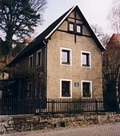Nr. 83:
In diesem kleinen Häuschen an der Pillnitzer Landstraße _(Foto)_ wurde 1893 der Dichter Max Barthel (1893-1975) geboren, an den seit einigen Jahren eine Gedenktafel
erinnert. Max Barthel stand zunächst der kommunistischen Arbeiterbewegung nahe, schloss sich jedoch 1923 der SPD an und war einer der bekanntesten Arbeiterdichter dieser Zeit.
Einige der von ihm verfassten Romane und Gedichte weisen regionalen Bezug zu Dresden- Loschwitz auf. Zeitweise arbeitete er auch als Lektor der “Büchergilde Gutenberg”.

Nr. 85:
Das als Mietshaus konzipierte Gebäude entstand um 1910 nach Plänen von Oskar Menzel. Architektonisch orientiert sich die Villa an spätbarocken Vorbildern.

Nr. 87:
Auf diesem Grundstück befand sich im 18. Jahrhundert der Weinberg des kurfürstlichen Obersteuerkassierers
Pfeiffer, der sich hier auch ein Sommerhaus errichten ließ. Das repräsentative Fachwerkgebäude musste um 1900 einem Villenneubau weichen, der noch heute erhalten ist.

Templerhaus:
Die Villa entstand im 19. Jahrhundert im klassizistischen Stil. Seit 1997 befindet sich hier ein Konvent des Templerordens. An der Fassade weist eine Marienfigur auf die religiöse Nutzung des Hauses hin.

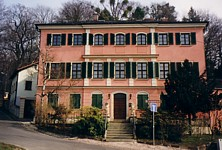

**_Foto:_** _Templerhaus an der Pillnitzer Landstraße_

Wachwitz:

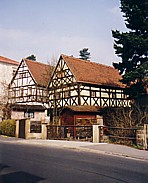
Nach Verlassen der Loschwitzer Fluren erreicht die Straße schon bald den Dorfkern von Wachwitz _(Foto)_. Hier befand sich ursprünglich die schmalste Stelle des Verbindungsweges,
der deshalb “die Gasse” genannt wurde. 1885/86 wurde der Neubauabschnitt zwischen Loschwitz und Niederpoyritz fertiggestellt. Die Straßenbreite erweiterte man dabei von ca. drei auf insgesamt neun Meter Breite.
Dafür mußten auch einige Häuser im Wachwitzer [Dorfkern](../../../../nordost/wachwitz/strassen_wachwitz/altwachwitz/)
abgerissen werden. Weitere Gebäude verschwanden zum Teil hinter hohen Aufschüttungen, um das starke Gefälle in einigen Abschnitten auszugleichen. Erhalten blieb zunächst die prächtige
Maulbeerallee zwischen Wachwitz und Niederpoyritz, welche jedoch beim Bau der Straßenbahn durch eine Hecke zur Elbseite ersetzt wurde. Um die Ruhe des Ortes nicht zu
gefährden, galt noch bis 1929 ein Sonntagsfahrverbot auf dieser Straße.

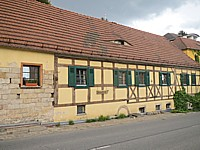Erstes Gebäude auf Wachwitzer Flur ist das frühere Winzerhaus des “Schlosserberges”
(Nr. 93 - _Foto_). Deutlich ist hier noch der alte, beim Straßenbau teilweise verschüttete Eingang zu erkennen. Auch das Gebäude Nr. 123 stammt noch aus der Zeit des
Wachwitzer Weinbaus und gehört zu den ältesten Häusern des Ortes. Hier befand sich einst eine Weinpresse. Weitere Gebäude mußten um 1900 Landhäusern und Villen
weichen. Erwähnt werden sollen die Häuser Nr. 111 mit Dachreiter (“Hildes Heim”), Nr. 115 (Villa “Johanna”), Nr. 141 (1913 von Emil Wägner), Nr. 147 (Villa “Frieda”),
Nr. 155 (Villa “Gebler”) und Nr. 165. Letzte Bauten auf Wachwitzer Flur sind die Jugendstilvilla “Elbfrieden” (Nr. 175) und die ehemalige Gaststätte “Zum Wachwitzkeller” (Nr. 177).

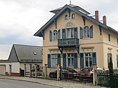
Auch auf der Elbseite erinnern eine Reihe von Villen an die tiefgreifenden Veränderungen, die Wachwitz nach dem Ausbau der Pillnitzer Landstraße erlebte.
Noch um 1870 war das gesamte Gelände zwischen dem Wohnhaus Nr. 122 bis zum Dorfkern unbebaut. 1886 entstand die Villa “Quisisana” mit ihrem Treppenturm (Nr. 132), der
bald weitere Gebäude folgten. In der um 1910 im Jugendstil errichten Villa “Charlotte” (Nr. 134) hatte seit 1918 das Wachwitzer Postamt seinen Sitz. Für
Aufsehen sorgte 1856 der Bau der Villa “Alice”, die wegen ihrer ortsuntypischen Größe auffiel und durch ihre häufigen Besitzerwechsel von den Einwohnern spöttisch
“Villa Wechselbalg” genannt wurde. Zeitweise wohnte hier der Wachwitzer Ortschronist Friedrich Rabovsky. Auch dieses Haus wurde, wie die meisten Villen, nach 1990 liebevoll saniert (Pillnitzer Landstraße Nr. 158 - _Foto_).

Sportcasino Wachwitz (Nr. 94): Das auch der Öffentlichkeit zur Verfügung stehende Lokal wurde 1928 als Vereinsheim
von Arbeitersportlern der Dresdner Straßenbahn eingerichtet und für Vereinsfeiern und Versammlungen genutzt. Neben dem 1986 und nach 1990 renovierten Gastraum steht auch ein kleiner Biergarten zur Verfügung.

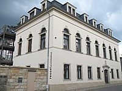
Gasthof “Königs Weinberg”: Das Gebäude Pillnitzer Landstraße 105 entstand 1740 und war ursprünglich Sitz des Wachwitzer Rittergutes. Noch heute erinnert der
Schlussstein mit Doppelwappen an diese Zeit. Bereits 1561 soll sich hier eine Schankstätte namens “Hofepresse” befunden haben. Der Gasthof, der seinen Namen
um 1880 nach dem angrenzenden königlichen Weinberg erhielt, besaß seit dem 19. Jahrhundert unbeschränktes Ausschankrecht sowie das Recht zum Beherbergen von
Gästen. Hier fanden auch die Wahlen zum Gemeinderat sowie gelegentliche Gerichtsverhandlungen statt. Im Nebengebäude (Nr. 107) befand sich eine Ausspanne
für die Pferde der Reisenden. Um 1880 wurde ein Saal mit kleiner Bühne angebaut, wodurch das Gebäude sein heutiges Aussehen erhielt. Gegenüber lag die nur im Sommer bewirtschaftete
“Wiesenschänke” mit drei Terrassen zur Elbe.

Die nach 1945 in Gasthof  “Zum Weinberg” umbenannte Gastwirtschaft bestand bis 1966 und diente anschließend als
Filmstudio, Fotoatelier und Wohnhaus. Das Gebäude mit seinem Barockportal von 1740 wurde 1992/93 saniert. Die
ungewöhnliche lila-violette Farbgebung der Fenstergewände brachte dem Haus dabei den Spottnamen “Milka-Haus” ein.
Auf Druck der Denkmalpflege musste die Farbgebung später wieder verändert werden. Eine erneute Sanierung erfolgte 2010/11. Der frühere Ballsaal wurde dabei unter Bewahrung seiner Grundstruktur zu Wohnzwecken ausgebaut.

Nr. 111: Das villenartige Gebäude entstand Ende des 19. Jahrhunderts und befand sich ab 1899 im Besitz des
Rechtsanwaltes Otto Kohlemann. Dieser ließ das noch heute vorhandene Türmchen aufsetzen und nannte das Haus “Hildes Heim”. Während sich im Obergeschoss die Wohnräume befanden, diente das Erdgeschoss gewerblichen
Zwecken. Heute weist ein Pferdekopf auf einen hier existierenden Reiterhof hin.

Nr. 113:
In diesem Haus wohnte von 1924 bis 1957 der Schriftsteller Rudolf Heubner (1867-1967). Heubner arbeitete
bis 1926 als Oberlandesgerichtsrat in Dresden und ließ sich dann als freischaffender Schriftsteller nieder. Hauptsächlich verfasste er Novellen, Biografien und Historienromane.

Nr. 123:
Das zu den ältesten erhaltenen Winzerhäusern des Ortes gehörende Gebäude entstand im 17. Jahrhundert und diente einst als Weinbergshaus und Weinpresse. Später wurde es zu Wohnzwecken umgebaut und beherbergte während
des Ersten Weltkriegs ein Asyl für Kinder. Später gab es hier verschiedene Ladengeschäfte und Werkstätten.

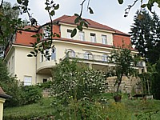Nr. 141:
Das Grundstück oberhalb der Einmündung des Oberwachwitzer Wegs gehörte ursprünglich zu einem Weinberg, der sich im Besitz des Wachwitzer Fischers Christian Heinrich Ludwig befand. 1888 kaufte Johann Alfred von Zahn,
Oberkonsistorialrat und späterer Präsident des Evangelisch-Lutherischen Landeskonsistoriums das Areal und nutzte das 1878 erbaute Gebäude als
Sommerhaus. 1913 wurde es durch einen Villenneubau des Architekten Emil Wägner ersetzt _(Foto)_. In den 1920er Jahren wohnte hier die Schauspielerin Alice Verden und die Regisseurin Hermine Körner.

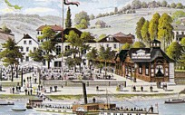Ehlichs Dampfschiffrestaurant (“Gare de la Lune” - Nr. 148):
Die Geschichte dieser Gastwirtschaft geht auf den auch in Wachwitz früher üblichen Reiheschank zurück, den 1844 der Maurermeister Johann Gottlieb Ehlich erworben hatte. Dessen Sohn
durfte schließlich mit Billigung des Gemeinderates ab 1862 einen kleinen Ausschank von Wein, Kaffee, Milch und Lagerbier betreiben. 1872 wurde das frühere Gut komplett umgebaut und zum regulären Gasthof mit Saal gemacht
_(Foto)_. Wegen seiner günstigen Lage an der Dampferanlegestelle entwickelte sich “Ehlichs Dampfschiffrestaurant” bald zum beliebten Ausflugslokal, obwohl die Genehmigung
zur Ausrichtung von Bällen immer wieder verweigert wurde.

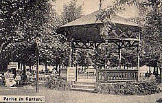In den Zwanziger Jahren war das Lokal durch seine Vereins-, Schul- und Gartenfeste mit Karussells und Vogelschießen ein Zentrum der Wachwitzer
Geselligkeit. Kriegsbedingt musste die Gaststätte jedoch 1941 schließen. Im Saal wurden nun ukrainische Zwangsarbeiter untergebracht. Nach Kriegsende
zog hier die Firma “Roland” zur Herstellung von Schreibgeräten ein (später “Markant”). Erst anläßlich des Elbhangfestes 1994 fand wieder eine öffentliche
Veranstaltung in dem traditionsreichen Gebäude statt. In Erinnerung an die Aufführung des Carl-Orff-Stückes “Der Mond” beim Elbhangfest 1994 erhielt
der komplett sanierte Gasthof bei seiner Eröffnung am Silvestertag 1995 den Namen “Gare de la Lune” (“Bahnhof des Mondes”). Heute wird das Haus wieder als Veranstaltungsort für Partys,
Konzerte und ähnliches genutzt und ist vor allem für seine Tango-Abende bekannt.

Heinrichs Gaststätte:
Das Lokal an der Pillnitzer Landstraße 154 erhielt 1877 die Konzession zum Weinausschank. Später wurde die Schänke zum Restaurant erweitert, welches 1893 Oswald Heinrich erwarb. Nach diesem Besitzer hieß
sie nun “Heinrichs Gaststätte”, ein Name, der auch von den nachfolgenden Gastwirten übernommen wurde. Noch bis
1982 hatte die gemütliche Gastwirtschaft geöffnet, musste dann jedoch wegen des schlechten Bauzustandes des Hauses schließen. 1993 wurde das Gebäude abgerissen und durch einen modernen Neubau ersetzt.

Nr. 156: Das Anwesen bestand ursprünglich aus einem Wohnhaus, einem Nebengebäude und einem Stall. Die ältesten
Teile dieses Gutes entstanden bereits um 1684. Ab 1761 befand es sich im Besitz der Familie Patzig, danach seit 1864
der Familie Neumann. Bis 1928 nutzten es die Besitzer noch für landwirtschaftliche Zwecke, bevor hier die Baufirma Reinhold Gierth einzog. Das frühere Stallgebäude dient heute als Vereinshaus des Segelclubs Wachwitz.

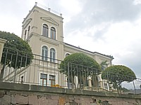Gasthaus “Wachwitzhöhe”: Das Lokal entstand um 1870 am Wachwitzer Elbhang
(Pillnitzer Landstraße 159) und war von einem weitläufigen Park umgeben. Der Turm diente einst als Aussichtspunkt für die Gäste. Außerdem bestand eine Reitertreppe, die
zu einer kleinen Grotte führte. Besitzer war der Dresdner Gastronom Carl August Schüttel, weshalb der Volksmund die Restauration auch “Schüttelhöhe”nannte. Ihm
folgten mehrere Pächter, denen jedoch kein Erfolg beschieden war. Bereits 1888 mußte die Wachwitzhöhe wieder schließen und diente fortan als Wohnhaus..

Mehrfach wechselten nun die Besitzer, zu denen u.a. der königliche Kammerherr Otto Ferdinand von Tschirsky und Bögendorff und der Sebnitzer Kunstblumenfabrikant Richard Vollmann gehörte. Zwischen
1934 und 1940 hatte hier das belgische Konsulat seinen Sitz. Nach Kriegsende nutzte die Wachwitzer Schule diese Villa
als Außenstelle, zuletzt als Schulhort und Kindergarten. Seit seiner Sanierung dient das Haus nur noch Wohnzwecken.

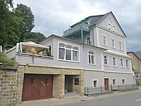Restaurant “ZumWachwitzkeller” (Nr. 177):
Das Gebäude der ehemaligen Gaststätte ist letztes Haus auf Wachwitzer Flur vor der Ortsgrenze zu Niederpoyritz. 1897 erwarb der Niederpoyritzer Ortsvorstand Friedrich Clemens Jeremias das ehemalige
Weinberghaus und richtete hier Räume für seinen Weinhandel sowie einen Weinschank im Keller ein. Drei Jahre später erhielt er die Konzession für den Verkauf von Kaffee.
Unter dem Namen “Zum Wachwitzkeller” bestand das Lokal bis 1912. Noch bis ca. 1970 erinnerte am Haupteingang ein Barockportal mit Sandsteinrelief und der
lateinischen Inschrift “Soli deo gloria - ora et labora” an die Baugeschichte des Hauses, welches in seinen Grundzügen um 1755 vom Oberältesten der Dresdner
Gold- und Silberarbeiter Samuel Gaudig errichtet worden war. Leider verlor das Gebäude beim letzten Umbau viel von seinem ursprünglichen Reiz.

Niederpoyritz:

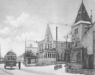
Zu den Elbdörfern an der Pillnitzer Landstraße (bis 1953 Pillnitzer Straße) gehört der 1378 erstmals erwähnte Ort Niederpoyritz, dessen Kern sich zu beiden Seiten der
Straße erstreckt. Auch hier dominierte einst der Weinbau. Die Presse befand sich im Grundstück Pillnitzer Landstraße 221, welches zugleich größter Weinberg im Ort war.
Der noch  im 19. Jahrhundert als Loschwitz - Lohmener bzw. Loschwitz - Pillnitzer Straße bezeichnete Verbindungsweg wurde 1886/87 auf Niederpoyritzer Flur
verbreitert, ausgebaut und mit Stützmauern befestigt. In diesem Zusammenhang erfolgte eine Höherlegung des Straßenplateaus um bis zu 3 Meter, was sich noch heute an einigen
älteren Gebäuden (z.B. Pillnitzer Landstraße 212)  gut erkennen lässt. 1903 erhielt Niederpoyritz Anschluss an die Straßenbahn, die später bis Pillnitz verlängert wurde und bis 1985 verkehrte.

Bemerkenswert sind die beiden historischen Umgebindehäuser Pillnitzer Landstraße 224 und 226 sowie einige um 1900
entstandene Villen und Landhäuser. An der Flurgrenze zu Hosterwitz befindet sich das 1878 als Altersheim eröffnete [Gustavheim](../../../../nordost/niederpoyritz/gustavheim/). Außerdem gab und gibt es in Niederpoyritz einige Gaststätten, u.a. das frühere [Erbgericht](../../../../nordost/niederpoyritz/erbgericht/), den Oberen Gasthof und die einst beliebte Ausflugsgaststätte [“Staffelstein”](../../../../nordost/niederpoyritz/strassen_niederpoyritz/)

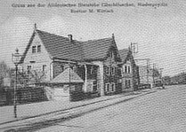Elbschlößchen: Das kleine Lokal _(Foto)_
entstand Ende des 19. Jahrhundert zwischen Elbufer und Pillnitzer Landstraße (Nr. 176) und entwickelte sich schnell zu einer beliebten Ausflugsgaststätte. Erste Besitzerin war die Gastwirtin Becker, welche das
Haus mehrfach erweitern ließ. An der Elbseite besaß die Schankwirtschaft einen großen Biergarten. 1962  wurde die Gaststätte geschlossen und das Gebäude im
Anschluss als Lager der BHG der Wachszieher genutzt. Nach jahrelangem Leerstand und Verfall musste das völlig verwahrloste und einsturzgefährdete Haus 1992
abgerissen werden. An gleicher Stelle befindet sich heute ein Wohnhaus.

Nr. 180: Auf dem zuvor unbebauten Gelände befand sich ab 1925 die Bootswerft von Fritz Gerlach, welche jedoch nur
bis Mitte der Dreißiger Jahre existierte. Später wurde das Grundstück von einer Autowerkstatt genutzt, zu der zeitweise auch eine öffentliche Tankstelle gehörte.

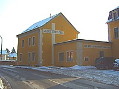Nr. 188:
Das Grundstück wurde 1587 erstmals erwähnt und diente als Wohnhaus Niederpoyritzer Winzerfamilien. Ende des 19. Jahrhunderts entstand das heutige
Gebäude, welches fortan als Café und Weinschänke genutzt wurde. Unter dem Namen Café Rieger (später Gröger) entwickelte es sich zu einer beliebten Gaststätte
mit Freiterrasse und einem kleinen Kaffeegarten. Während der NS-Zeit übernahm die NSDAP die Gasträume und nutzte diese für Schulungen und politische Veranstaltungen. Nach 1945 folgte das sogenannte “Liebknechthaus” mit
Versammlungsräumen der SED-Ortsgruppe sowie dem Büro des Abschnittsbevollmächtigten der Volkspolizei. Im flachen Nebengebäude befand sich
bis zur Fertigstellung der Turnhalle 1981 ein Schulsportraum. Im Jahr 2000 wurde das Haus renoviert und wird seitdem von einer freikirchlichen Brüdergemeinde genutzt.

Nr. 191:
Das Gebäude entstand ursprünglich als Wein- und Bauerngut und wurde 1754 für den Winzer Peter Zeibig errichtet. Ab 1874 befand es sich im Besitz der Familie Große, welche hier eine Weinpresse einrichtete. Außerdem gab
es in dem mehrfach umgebauten Komplex ab 1895 bis kurz vor dem Zweiten Weltkrieg die Weinschänke von Auguste Große (“Mutter Großes historische Weinstube”). Heute dient das nach 1990 sanierte Haus Wohnzwecken.

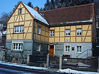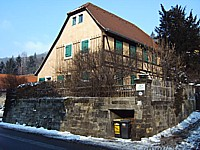

**_Fotos:_** _Historische Wohnhäuser in Niederpoyritz - links Nr. 191, rechts Nr. 205_

Nr. 205:
Das Gebäude wurde erstmals im Jahr 1595 erwähnt und ist heute trotz mehrfacher Umbauten ältestes in seinen Grundzügen erhaltene Wohnhaus von Niederpoyritz. Erste namentlich bekannte Eigentümerin war die Witwe Christoff
Köhlers. Später befand es sich viele Jahre im Besitz der Familie Zeibig. 1885 erfolgte die Parzellierung des Grundstücks und die Bebauung mit weiteren Wohnhäusern.

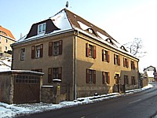Nr. 221:
Dieses Grundstück war einst Standort eines 1674 errichteten Weinpresshauses, welches zur “Königlichen Weinbergsdomäne” gehörte und deshalb
fiskalischer Weinberg genannt wurde. Noch bis Ende des 19. Jahrhunderts kelterte man hier den vor Ort angebauten Wein. Nach Einstellung des Weinbaus im Raum
Loschwitz - Pillnitz nutzte man die Räumlichkeiten als Kelterei für verschiedene Fruchtweine und -säfte. Ab 1908 befanden sich hier bis um 1970 Arztpraxen. Seine heutige Gestalt erhielt das Haus bei einem Umbau 1937 _(Foto)_.

Das zum Grundstück gehörende Weinbergsgrundstück wurde 1921 parzelliert und zur Bebauung freigegeben. Bis 1939
entstanden hier mehrere Doppelhäuser für die Siedlergemeinschaft Niederpoyritz. In diesem Zusammenhang baute man
auch die beiden Wohnhäuser Pillnitzer Landstraße 223 und 225 sowie 1936 das neue Feuerwehrhaus. Außerdem wurde am Hang zur Erschließung der Grundstücke die seit 1930 so benannte [Siedlungsstraße](../../../../nordost/niederpoyritz/strassen_niederpoyritz/) angelegt.

Nr. 235:
Zu den erst Ende des 19. Jahrhunderts errichteten Wohnhäusern gehören die sogenannten “Kessler-Häuser”
Pillnitzer Landstraße 235 und Pappritzer Weg 2. Bauherr war Emil Kessler, der das an der Straße stehende Gebäude als
Geschäftshaus für seinen “Barbier-, Frisier- & Haarschneide-Salon” nutzte. Nach seiner Pensionierung übernahm Sohn
Walter den Salon, welcher nach dem Zweiten Weltkrieg von verschiedenen Pächtern bis 1990 bewirtschaftet wurde.

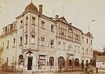Oberer Gasthof Niederpoyritz:
Die Gastwirtschaft an der Pillnitzer Landstraße 239 entstand im 19. Jahrhundert und war einer von zwei Dorfgasthöfen des Ortes. Während der Untere Gasthof bereits kurze Zeit später geschlossen wurde, existiert
der Obere Gasthof bis heute. Das Gebäude wurde 1898 komplett neu gebaut und besaß neben Restaurations- und Gesellschaftsräumen auch mehrere Fremdenzimmer und einen Biergarten _(Foto um 1900)_
. Im früheren Saal des Gasthofes befand sich bis 1993 der kleine Dorfkonsum des Ortes. Das Gebäude wurde nach 1990 saniert und danach bis vor kurzem als Spezialitätengaststätte für ungarische und
österreichische Küche genutzt.

Nr. 242: Dieses Mitte des 19. Jahrhunderts errichtete Wohnhaus war einst Domizil der von Ernst Wünsche gegründeten
Drogerie “Zum Roten Kreuz”. Im Nebenerwerb betrieb sein Nachfolger Max Beyer einen kleinen Postkartenverlag, in
welchem zahlreiche Ansichtskarten mit Ansichten des Ortes und seiner Umgebung erschienen. Nach 1920 wechselte der
Name der Drogerie in “Zum weißen Kreuz”, bevor nach 1945 eine Konsum-Verkaufsstelle Einzug hielt. Heute dienen die Räume als Fachgeschäft für Modellbahnbedarf.

Nr. 243:
Das Gebäude an der Einmündung der Staffelsteinstraße entstand in der ersten Hälfte des 19. Jahrhunderts an
Stelle eines abgebrannten Vorgängerbaus und steht unter Denkmalschutz. Eine nur schwer lesbare Schrifttafel erinnert an diese Zusammenhänge:

_“Dieses Heim ist durch eine Frevlers Hand in Feuer zerstört und durch Gottes Wille und gutem herrlichen Heiland in demselben Jahre wieder erbauet von F. J. Paul. 1838”_

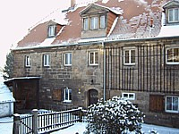Nr. 254:
Die Geschichte dieses früheren Weingutes reicht bis zum Jahr 1583 zurück. Mehrfach wechselten die Besitzer des Dreiseithofes, zu welchem einst ein oberhalb des
Areals liegender Weinberg mit einem heute nicht mehr vorhandenen Weinbergshäuschen gehörte. Nach seinem Besitzer wurde das Areal Gierthscher
Weinberg genannt. Leider verfiel das  kleine Fachwerkgebäude in der Nachkriegszeit und stürzte 1975 ein. In einem Seitengebäude des Hauptgebäudes an der Pillnitzer
Landstraße blieb jedoch bis heute eine historische Wäschemangel erhalten.

Nr. 256 (Postamt): Das Haus entstand 1897 als [Postamt](../../../../nordost/niederpoyritz/) der Gemeinde Niederpoyritz und befand sich im Besitz von
Ferdinand Emil Reißig. Zuvor hatte es bereits ab September 1877 eine Poststelle im Ort gegeben (Pillnitzer Landstraße
216). Im Zuge der Eingemeindung von Niederpoyritz wurde das Amt als Dresden N 56 in das postalische Netz der Stadt
eingegliedert und hatte noch bis um 1980 geöffnet. Seit Schließung des Postamtes dient das Gebäude nur noch
Wohnzwecken. An die frühere Nutzung erinnert die Inschrift “Kaiserliches Postamt” an der Fassade, welche bei der letzten Rekonstruktion wieder hergestellt wurde.

Hosterwitz:

Nach Verlassen von Niederpoyritz durchschneidet die Pillnitzer Landstraße die Fluren des Ortes Hosterwitz, welcher etwas abseits der Straße an der Elbe liegt. Das
Areal des ehemaligen Plantagengutes wurde um 1904 zum Teil von der Stadt Dresden erworben, die hier das [Hosterwitzer Wasserwerk](../../../../nordost/hosterwitz/) anlegen ließ. Zum Schutz des Grundwassers blieb dieser
Bereich von der Bebauung ausgeschlossen und wurde stattdessen mit Obstplantagen bepflanzt. Zwischen 1906 und 1986 verkehrte neben der Straße auf separtem Gleiskörper die Straßenbahnlinie nach Pillnitz.

Straßenbahnlinie Loschwitz - Niederpoyritz - Pillnitz:

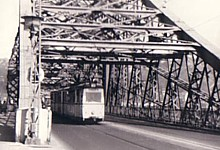Nachdem mit Eröffnung des “Blauen Wunders” 1893 die Straßenbahnlinie vom Schillerplatz bis Loschwitz verlängert worden war, bemühten sich auch die Nachbargemeinden um einen Anschluss an diese Bahn. Dafür bildete sich 1895 unter Beteiligung der Elbdörfer und des Staates ein “Überland-Zweckverband”, der mit dem Bau einer schmalspurigen Straßenbahn von Loschwitz nach Pirna begann. Bis 1902 konnte jedoch unter Regie der Niedersedlitzer Firma Kummer nur der Abschnitt bis Niederpoyritz vollendet werden. Noch vor Eröffnung dieser Bahn ging die Gesellschaft in Konkurs. Die Gemeinden gründeten deshalb einen Gemeindeverband, der die vorhandenen Gleisanlagen in Stadtspur umbauen ließ. Am 18. Juni 1903 konnte die erste Straßenbahn bis zum Gustavheim in Niederpoyritz verkehren, die offizielle Eröffnung folgte am 11. Juli. 1906 wurde die Linie bis Pillnitz verlängert.

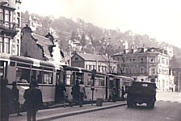Die Straßenbahnstrecke wurde noch bis nach dem Ersten Weltkrieg vom Gemeindeverband betrieben. 1922 übernahm die “Straßenbahn Pillnitz - Loschwitz GmbH” die Betriebsführung, die wenige Jahre später mit der “Dresdner Überland-Verkehr GmbH” vereinigt wurde. Erst nach 1945 kam die Bahn als Linie 18 zu den Dresdner Verkehrsbetrieben. Um 1920 und nochmals 1960 war die Verlegung der Strecke an das Elbufer geplant, wofür die Fidelio- F.- Finke-Straße verlängert werden sollte. Da die Pläne nie realisiert wurden, blieb es bis zur Stillegung der Bahn 1985 bei der eingleisigen Streckenführung mit mehreren Ausweichstellen. Lediglich die Endstelle in Pillnitz wurde 1969 durch den Bau einer Gleisschleife ersetzt. Da das “Blaue Wunder” den Belastungen des Straßenbahnbetriebs nicht mehr gewachsen war, wurde die Linie 4 zwischen Blasewitz und Pillnitz am 9. April 1985 durch Busse ersetzt.

**_Fotos:_** _Die Straßenbahnlinie 4 an einem ihrer letzten Betriebstage am Blauen Wunder und am Körnerplatz_

* * *

 \[ [Home](../../../../index.html)\] \[ [Nord](../../../../nord/)\] \[ [Nordwest](../../../../nordwest/)\] \[ [Neustadt](../../../../neustadt/)\] \[ [Nordost](../../../../nordost/)\] \[ [West](../../../../west/)\] \[ [Zentrum](../../../../zentrum/)\] \[ [Südwest](../../../../sudwest/)\] \[ [Süd](../../../../sud/)\] \[ [Südost](../../../../sudost/)\] \[ [Ost](../../../../ost/)\] \[ [Register](../../../../Register/register.html)\] \[ [Kontakt](../../../../Kontakt/kontakt.html)\] \[ [Impressum](../../../../impressum/)\]
