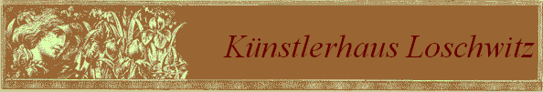
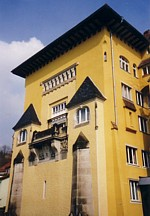
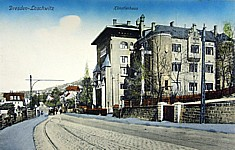

* * *

* * *

* * *

* * *

* * *

* * *

Das Loschwitzer Künstlerhaus entstand 1897/98 nach Plänen von Martin Pietzsch als Wohn-
und Atelierhaus für bildende Künstler. Für den Bau hatte der junge Architekt zuvor das elterliche Grundstück seines Ateliernachbarn Hans Unger erworben. Pietzsch errichtete das
Gebäude an der Pillnitzer Landstraße 59 im Stil einer Ritterburg mit sparsamen Jugendstilelementen und besaß bis 1944 auch selbst ein Büro im Haus. Bei der künstlerischen
Gestaltung ließ er sich von einer kurz zuvor beendeten Italienreise inspirieren. Die Innenraumgestaltung mit abgetrennten Wohnungen und Ateliers geht auf Anregungen des
Dresdner Akademieprofessors Hermann Prell zurück. Einst waren diese durch Klappen und Türen miteinander verbunden, um die Gemeinsamkeit der hier lebenden Künstler zu fördern.
Außerdem gab es eine Dachterrasse für gemeinsame Feste. Gegenüber des Künstlerhauses entstand Martin Pietzschs Wohnhaus (Pillnitzer Landstraße 57). Bekannt wurde er vor allem
durch seine wegweisenden Kinobauten (u. a. UFA-Palast auf der Waisenhausstraße - 1945 zerstört, Schauburg).

Das Künstlerhaus besitzt insgesamt 17 Ateliers und 13 zugehörige Wohnungen
und wird auch heute noch von Dresdner Künstlern genutzt. Bis 1973 befand sich das Gebäude im Privatbesitz der Familie des Erbauers, die 1993 ihr Eigentum
zurückerhielt. 1977/87 und 1996/97 erfolgten Renovierungsarbeiten, bei denen auch die Schäden eines Brandes 1996 behoben wurden. Zu den bekannten
Dresdner Künstlern, die einst ihre Ateliers im Haus hatten, gehören u. a. Hans Unger, Georg Schwenk, Sascha Schneider, Herbert Volwahsen, Josef Hegenbarth, Hans Jüchser, Max Lachnit, Hermann Glöckner und Konrad Maaß.

* * *

 \[ [Home](../../../../../index.html)\] \[ [Nord](../../../../../nord/)\] \[ [Nordwest](../../../../../nordwest/)\] \[ [Neustadt](../../../../../neustadt/)\]
 \[ [Nordost](../../../../../nordost/)\] \[ [West](../../../../../west/)\] \[ [Zentrum](../../../../../zentrum/)\] \[ [Südwest](../../../../../sudwest/)\]
 \[ [Süd](../../../../../sud/)\] \[ [Südost](../../../../../sudost/)\] \[ [Ost](../../../../../ost/)\] \[ [Register](../../../../../Register/register.html)\] \[ [Kontakt](../../../../../Kontakt/kontakt.html)\] \[ [Impressum](../../../../../impressum/)\]
