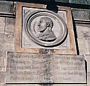
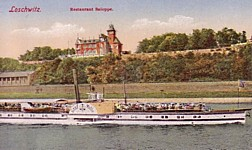
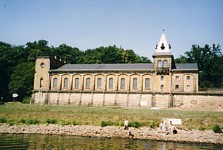
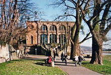
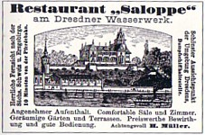
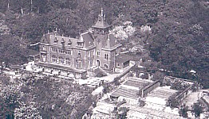

* * *

* * *

* * *

* * *

* * *

* * *

**_Foto:_** _Gedenktafel für Bernhard Salbach am Wasserwerk Saloppe_

* * *

Die Gaststätte “Saloppe” geht auf die Zeit des Siebenjährigen Krieges zurück,
als in der Nähe einer Elbfährstelle eine kleine Schankstätte entstand, die von Marketenderinnen bewirtschaftet wurde. Auch nach Kriegsende bestand diese
einfache Raststätte am Ausgang des Schotengrundes weiter. Als 1813 russische Soldaten Dresden erreichten, kehrten diese gern hier ein. Diese sollen dem
Lokal auch den Namen “Wutki Chalupka” (“Schnapsbude”) gegeben haben, der später in Saloppe verballhornt wurde. Das Gebäude gehörte zunächst einer
Witwe Reißig, die ihren Besitz 1821 an Johann Gottlieb Portmann, ihren Sohn aus erster Ehe verkaufte. 1822 entstand ein größerer Neubau, der bis Mitte des
19\. Jahrhunderts beliebte Gastwirtschaft für Sommergäste auf dem Weg nach Loschwitz blieb. 1847 erhielt Portmann neben
dem Schankrecht auch die Erlaubnis zur Bewirtung mit warmen Speisen, was die Popularität der Schänke förderte. 1864
erwarb die Stadt Dresden das Areal und ließ die Gebäude einige Jahre danach für das neue Wasserwerk abreißen.

1870 errichtete der Ingenieur Bernhard Salbach am Körnerweg auf diesem Standort
ein modernes Wasserwerk zur Versorgung der Stadt. Das in neoromanischen Formen gestaltete Gebäude _(Fotos)_ wurde von Theodor Friedrich entworfen und am
11\. März 1875 in Betrieb genommen. Die zu diesem Zeitpunkt erste große Wasserversorgungs- anlage Dresdens sicherte viele Jahrzehnte lang einen Großteil
des Trinkwasserbedarfs der wachsenden Großstadt. Das benötigte Wasser wurde aus dem Uferfiltrat der Elbe gewonnen und mit Hilfe von sechs Dampfmaschinen in
einen Hochbehälter mit einem Fassungsvermögen von 20.000 m³ gepumpt. 1923/25 erfolgte eine Modernisierung der Technik des Wasserwerkes sowie der Einbau von Filtern, 1932 dessen Umstellung auf elektrischen Betrieb.

Als Ersatz für die abgerissene “Schnapsbude” der Anfangszeit errichtete Theodor Friedrich 1876 oberhalb des Wasserwerkes einen großzügigen Gaststättenkomplex mit mehreren
Restaurationsräumen, Veranda, Gartenterrassen und einem Aussichtsturm. Auch bei diesem Bau kamen neoromanische Architekturformen zur Verwendung. Die neue Saloppe besaß eine eigene Schiffsanlegestelle der
Dampfschiffahrt und entwickelte sich schnell zu einer der größten und beliebtesten Dresdener Ausflugsgaststätten. Ab 1930 gehörte sie der Dresdner Gas-, Wasser-
und Elektrizitätswerke AG (DREWAG), die den Betrieb an einen Pächter übertrug. Noch bis 1945 konnten die Besucher hier einkehren.

Sowohl Wasserwerk Saloppe wie auch die benachbarte Gastwirtschaft wurden 1945 ein Opfer des Luftangriffs. Während
die Ruinen der Gaststätte später abgetragen wurden, konnte das Wasserwerk notdürftig wiederhergestellt werden und seinen Betrieb 1949 wieder aufnehmen. Infolge der Verschlechterung der Wasserqualität und der ausgebauten
Trinkwasserversorgung per Fernleitung von den Talsperren des Erzgebirges ging die Saloppe 1993 vom Netz. Zuletzt wurde hier Brauchwasser für das Siemens-Werk (Infineon) in Klotzsche gewonnen. Künftig ist der Umbau des
denkmalgeschützten Maschinenhauses zu Wohnzwecken geplant.

**_Foto:_** _Die Ausflugsgaststätte Saloppe vor der Zerstörung 1945_

An Stelle der früheren Ausflugsgaststätte wurde in der Nachkriegszeit wieder eine kleine Wirtschaft eingerichtet. Das
provisorische Gebäude war bis 1989 vor allem als Wohngebietsgaststätte von Bedeutung, bevor im Mai 1990 ein privater
Betreiber den Ausschank übernahm. In den letzten Jahren fanden hier auch verschiedene Veranstaltungen und Sommerfeste statt, so dass die Tradition des beliebten Lokals bis heute fortgeführt wird.

Zur Beförderung der zahlreichen Ausflügler entstand um 1840 an der Saloppe eine Fährstelle. Diese befand sich im Besitz
der Dresdner Fischerinnung und erfreute sich vor allem in den Sommermonaten großer Beliebtheit. Da auf dem gegenüber liegenden Elbufer das Areal der [Vogelwiese](../../../../zentrum/johannstadt/vogelwiese/) lag, setzten vor dem Zweiten Weltkrieg bis zu 30.000 Personen während der
Festwoche hier über. Kriegsbedingt musste der Betrieb 1941 vorerst eingestellt werden, wurde jedoch 1945 noch einmal
reaktiviert. Betreiber war ab 1947 die eigens gegründete “Fährgemeinschaft AntonŽs & Saloppe”. Die Auflösung der
Fischerinnung und der Fährgemeinschaft am 1. April 1953 führten schließlich zur Einstellung des Betriebs.

* * *

 \[ [Home](../../../../index.html)\] \[ [Nord](../../../../nord/)\] \[ [Nordwest](../../../../nordwest/)\] \[ [Neustadt](../../../../neustadt/)\] \[ [Nordost](../../../../nordost/)\] \[ [West](../../../../west/)\] \[ [Zentrum](../../../../zentrum/)\] \[ [Südwest](../../../../sudwest/)\] \[ [Süd](../../../../sud/)\] \[ [Südost](../../../../sudost/)\] \[ [Ost](../../../../ost/)\] \[ [Register](../../../../Register/register.html)\] \[ [Kontakt](../../../../Kontakt/kontakt.html)\] \[ [Impressum](../../../../impressum/)\]
