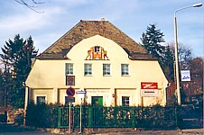
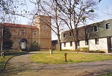
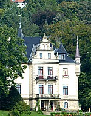
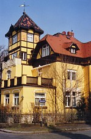
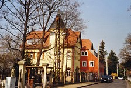
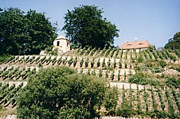

* * *

In ihrem Ursprung geht die Schevenstraße auf einen alten Höhenweg nach
Dresden zurück und wurde deshalb ab 1708 Stadtweg genannt. Da die Loschwitzer diesen Weg bis zum Bau ihrer eigenen Kirche als Fußweg zum Gottesdienst in der Frauenkirche nutzten, war umgangssprachlich auch die
Bezeichnung Kirchgasse bzw. Kirchweg üblich.

Im 19. Jahrhundert wechselte die Namensgebung zu Ehren der sächsischen Königin Carola, Gemahlin König Alberts, in Carolastraße. Nach der
Eingemeindung wurde sie 1926 nach Katharina Scheven (1861-1922) benannt, die 1901 den Dresdner Zweigverein der Internationalen Abolitionistischen Förderation zur Bekämpfung der Prostitution
gründete. Zugleich war sie nach 1918 eine der ersten weiblichen Stadtverordneten Dresdens. Auch ihr Mann Dr. Paul
Scheven (1852-1929) war zeitweise Mitglied des Stadtrates und setzte sich vor allem für die Interessen von Mietern und soziale Interessen der ärmeren Bevölkerung ein.

Zu den Bewohnern der Schevenstraße gehörten die Verleger- und Buchhändlerfamilie Güntz (Nr.11) und der Maler Ernst
Hassebrauk (Nr. 29). 1990 bezog der sächsische Ministerpräsident Kurt Biedenkopf ein ehemaliges MfS-Gästehaus auf
der Schevenstraße 1 als Dienstwohnsitz. Bemerkenswert ist auch die neobarocke Villa Schevenstraße 17, die bis 2002
Sitz des Dresdner Zentrums für zeitgenössische Musik war. An der Einmündung zur Schillerstraße erinnert das Gebäude der früheren Loschwitzer Weinpresse an die jahrhundertelange Weinbautradition des Ortes _(Foto)_.

Einzelne Gebäude:

Nr. 1: Die Villa in exponierter Lage am Elbhang wurde in ihren Grundzügen um 1870 errichtet und befand sich bis in die 1980er Jahre im Privatbesitz. Danach übernahm das Ministerium für Staatssicherheit das Areal und errichtete hier 1988/89 mehrere Neubauten, welche als Gästehaus und Schulungszentrum dienen sollten. Ab 1990 nutzte der Freistaat Sachsen die Gebäude als Gästehaus. Bis 2001 wohnten hier der sächsische Ministerpräsident Kurt Biedenkopf sowie mehrere seiner Minister. Nach dem Auszug der Politiker wurde das Gebäude verkauft und zu einer Wohnanlage umgebaut.

Nr. 6b: Das um 1900 errichtete Gebäude gehört zu den Beispielen der modernen Villenarchitektur nach der Jahrhundertwende. Architekt war der in Loschwitz auf der Robert-Diez-Straße wohnende Oskar Menzel, der sich bei dem auch “Haus des Schulmeisters” genannten Wohnhaus bereits an reformerischen Ideen orientierte.

Villa Rosenhof (Nr. 11): Das Weinbergsgrundstück (Schevenstraße 11) befand sich ursprünglich im Besitz des Rittmeisters von Schönberg, der es 1627 an den wohlhabenden Dresdner Schuhhändler Lukas Albrecht verkaufte. Später wechselten mehrfach die Eigentümer, zu denen Anfang des 19. Jahrhunderts auch die Buchhändler- und Verlegerfamilie Güntz gehörte. Später ließen die Besitzer das bescheidene Weinberghäuschen zur Villa “Solitüde” erweitern, welche in den Sommermonaten als Wohnsitz diente. Der Überlieferung nach soll Napoleon von diesem Weinberg aus am 26. August 1813 die Schlacht bei Dresden beobachtet haben, bevor er mit seinen Truppen weiter nach Leipzig zog. An diesen Besuch erinnert eine um 1880 im Garten des Grundstücks aufgestellte Sandsteinstele. 2013 wurde eine neue Gedenktafel angebracht, welche über das Ereignis informiert.

Mit Einstellung des Weinbaus wurde der Güntzsche Weinberg parzelliert und als Bauland verkauft. Erwerber war der sächsische Offizier Clemens von Hausen, der die Villa 1884 abbrechen und durch ein repräsentatives Wohnhaus ersetzen ließ. Die vom Baumeister Oscar Kaiser im Neorenaissancestil gestaltete Villa “Rosenhof” wurde 1946 von der Roten Armee beschlagnahmt und zeitweise als Offizierswohnung genutzt. Später richtete die Stadt Mietwohnungen ein. Nach 1990 erhielten von Hausens Nachkommen das Haus zurück und ließen es denkmalgerecht sanieren. Neben einigen Weinbergsterrassen erinnern auch ein noch vorhandener 41 Meter tiefer Brunnen und das kleine Winzerhäuschen am Körnerweg an die Geschichte des Areals. Das Fachwerkgebäude gehört zu den wenigen erhaltenen Weinbergshäuschen in Loschwitz und wure 2012 restauriert.

Haus Roßkothen (Nr. 15/17): Das Gebäude entstand kurz vor dem Ersten Weltkrieg durch Umbau eines älteren Hauses durch die Architekten Lossow & Kühne. Dabei erhielt es durch vorgelagerte Treppen, Laubengänge und Terrassen zur Elbseite hin sowie einen kupfergedeckten Dachreiter den Charakter eines schlossartigen Herrensitzes. Gleichzeitig wurde die ausgedehnte Gartenanlage neu gestaltet und das Haus um zwei Nebengebäude (Pförtnerhaus und Garage) ergänzt. Besitzer war 1944 der Unternehmer Ernst Müller, Inhaber der Aurelia Zigarettenfabrik.

Nr. 17: Die um die Jahrhundertwende gebaute Villa war bis 2002 Sitz des Dresdner Zentrums für Zeitgenössische Musik. Heute wird sie als Wohnhaus genutzt.

Villa “Grüß Gott”: Das Gebäude (Nr. 22) entstand um 1900 im Landhausstil _(Foto)_ und wurde vom Bauherrn, dem Architekten Alwin Wenzel, selbst entworfen. Später wechselten mehrfach die Besitzer, bevor das Künstlerehepaar Seidel in den 60er Jahren die Villa übernahm. Beide waren am Wiederaufbau der Loschwitzer Kirche beteiligt und schufen die Paramente für das Gotteshaus.

Nr. 27: Das ehemalige Weinbergsgrundstück gehörte einst dem sächsischen Hofkürschner Saxe. In der Hoffnung auf ein Ende des Siebenjährigen Krieges (1756-1763) stiftete dieser 1762 seiner Heimatgemeinde ein alljährliches Lob- und Dankfest, welches alljährlich am Sonntag nach Abschluss der Weinlese begangen wurde.

Nr. 29: In diesem Wohnhaus lebte ab 1949 der Maler und Zeichner Ernst Hassebrauk (1905-1974), der zwischen 1946 und 1949 als Professor an der Hochschule für Grafik und Buchkunst in Leipzig tätig war. Nach seiner Rückkehr nach Dresden bezog Hassebrauk sein Loschwitzer Haus und wohnte hier bis zu seinem Tod. Sein Grab befindet sich auf dem Loschwitzer Friedhof. Heute hat im Haus das den Nachlass des Künstlers verwaltende Hassebrauk-Archiv sein Domizil.

Diakonie-Pflegeheim “Pniel” (Nr. 35):
Das frühere Weinbergsgrundstück wurde Ende des 19. Jahrhunderts vom Stadtverein der Inneren Mission und dem Magdalenen- Hilfsverein erworben, um hier eine Anstalt für gefährdete junge
Mädchen einzurichten. Das nach einem biblischen Ort “Pniel” benannte Heim bot Platz für junge Frauen, die hier wohnen und arbeiten durften und zu Hausangestellten ausgebildet wurden. Die Finanzierung der Einrichtung
übernahmen zwei Stiftungen.

Das bereits bei der Gründung vorhandene Weinberghaus wurde um 1900 um zwei
Seitenflügel erweitert, die eine Kapazitätserweiterung der Einrichtung ermöglichten. Nach 1945 waren hier vorwiegend
geistig Behinderte untergebracht. Infolge fehlender Mittel unterblieben jedoch notwendige Reparaturen am Haus, so dass die Diakonie das Heim “Pniel” 1990 bzw. 1992 in zwei Villen zur Schillerstraße verlegen musste.
Dort existierte es noch bis 2002.

Nr. 45: Das moderne Einfamilienhaus am Rande des Dinglingerschen Weinbergs entstand 2008 nach Plänen des
Architekten Kai von Döring. Mit seiner Natursteinverkleidung und den großen bodentiefen Glasfenstern setzt das Gebäude einen modernen Akzent in der historischen Bebauung des Loschwitzer Elbhanges.

Dinglingers Weinberg (Nr. 59): Das ca. 2,4 Hektar große Gelände befand sich vermutlich ab 1700 im Besitz des
Goldschmiedes Johann Melchior Dinglinger, der das um 1620 erstmals erwähnte Weinberghaus als Sommerwohnsitz
nutzte. Dinglinger ließ um 1710 das Haus um einen Festsaal erweitern und im Inneren mit Bildern der 12 Tierkreiszeichen
und Allegorien der vier Jahreszeiten gestalten. An der Decke befindet sich eine mit einer Wetterfahne auf dem Dach
verbundene Wetteruhr, die das Ablesen der Windrichtung ermöglicht. Dieses von Hofmechanicus Andreas Gärtner
entworfene Kunstwerk begeisterte 1711 sogar Zar Peter den Großen, als dieser im Haus des Hofjuweliers zu Gast war.

Neben dem Wohnhaus legte Dinglinger einen Barockgarten mit einem kleinen
Pavillon und einer überdachten Kegelbahn an. Die Gartenanlage ist ebenso wie die Inneneinrichtung des Hauses weitgehend erhalten geblieben und gehört zu den
bedeutendsten Schöpfungen des ländlichen Barocks in Dresden. 1859 erwarb der Kaufmann Jean Souchay das nach einem früheren Besitzer auch Bassengenscher
Weinberg genannte Grundstück. Um 1880 kam das Haus in den Besitz des Konsuls Bruno Wunderlich, dessen Erben es später an die Familie von Watzdorf
veräußerten. Ab 1955 lebte hier bis zu seinem Tod 2005 der Denkmalpfleger und Dresdner Ehrenbürger Hans Nadler.

Das auch zu DDR-Zeiten nicht enteignete Grundstück wurde 1990 an die Erbengemeinschaft Wunderlich zurück gegeben, welche wenig später die GbR “Dinglingers Weinberg” ins Leben rief und das Grundstück verkaufte. Nach
einem längeren Rechtsstreit um Eigentums- und Nutzungsrechte begann 2002 die denkmalgerechte Sanierung. Neben
dem Haus und der teilweise erhaltenen Inneneinrichtung wurde auch die Gartenanlage nach historischem Vorbild wiederhergestellt und der zugehörige Weinberg aufgerebt. Dabei konnten auch die Reste der Kegelbahn einbezogen
werden, die älteste erhaltene Bahn ihrer Art in Sachsen ist und bis 1904 überdacht war. Seit 2014 steht am Eingang des
Hauses ein historischer Sandsteinbrunnen vom Beginn des 18. Jahrhunderts. Diesen Brunnen erwarben die Eigentümer zur Komplettierung des Ensembles und ließen ihn aus Niedersachsen nach Dresden umsetzen.

* * *

 \[ [Home](../../../../index.html)\] \[ [Nord](../../../../nord/)\] \[ [Nordwest](../../../../nordwest/)\] \[ [Neustadt](../../../../neustadt/)\] \[ [Nordost](../../../../nordost/)\] \[ [West](../../../../west/)\] \[ [Zentrum](../../../../zentrum/)\] \[ [Südwest](../../../../sudwest/)\] \[ [Süd](../../../../sud/)\] \[ [Südost](../../../../sudost/)\] \[ [Ost](../../../../ost/)\] \[ [Register](../../../../Register/register.html)\] \[ [Kontakt](../../../../Kontakt/kontakt.html)\] \[ [Impressum](../../../../impressum/)\]
