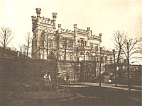
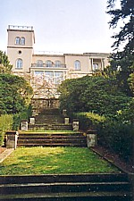
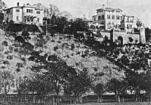
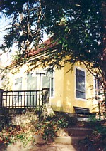
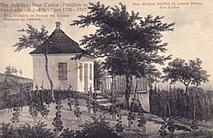
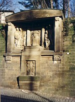
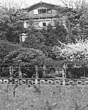
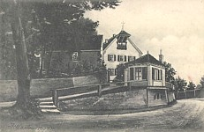

Schillerhäuschen  schillerstraße 19 01326 dresden  tel. 0351/498660 (stadtmuseum dresden)

* * *

Die Schillerstraße verbindet den [Körnerplatz](../../../../nordost/loschwitz/strassen_loschwitz/kornerplatz/) mit der [Bautzner Landstraße](../../../../nordost/page10246/strassen_weisser_hirsch/bautzner_landstrasse/) und führt zum Teil durch die ehemaligen Weinberge oberhalb des Ortes Loschwitz. Nach Aufgabe des Weinbaus entstanden hier prächtige Villenbauten. 1895 erhielt die zuvor als Stadtweg bezeichnete Straße ihren Namen nach dem deutschen Dichter Friedrich Schiller, der in den Jahren 1785/87 die Sommermonate in Loschwitz verbrachte. Im unteren Teil der Schillerstraße wurden einige Gebäude 1945 beim Bombenangriff zerstört, wobei mehrere Menschen ums Leben kamen.

Einzelne Gebäude:

Villa Montana:
Die Villa wurde 1908 von Heino Otto entworfen und weist unterschiedlichste Architekturelemente verschiedener Stilrichtungen auf.

Villa Orlando:
Das Gebäude (Schillerstraße 4) entstand 1848/53 nach einem Entwurf von Hugo Erhardt im gotisch- byzantinischen Stil und gehört zu den beeindruckendsten
Villenbauten am Elbhang. Architektonisches Vorbild für die kastellartige Villa war Schloss Miramar, welches dem Bruder des österreichischen Kaisers gehörte. Ihren
Namen verdankt sie ihrem ersten Besitzer, dem  italienischen Grafen Orlando.  Nach dem Tod Orlandos wechselten mehrfach die Eigentümer, meist wohlhabende
Gutsbesitzer und Fabrikanten. In den Dreißiger Jahren war auf dem Grundstück der Bau einer größeren Wohnsiedlung geplant, welcher jedoch aus stadtplanerischen
Gründen verhindert wurde. Nach 1945 befand sich in der Villa Orlando ein Internat für Kinder griechischer Partisanen. Später nutzte die Konzert- und Gastspieldirektion das Haus. Heute dienen die Räume
als Atelierwohnungen.

Villa Thorwald: Diese Villa (Nr. 12) wurde 1851/52 von Theodor Lehnert für Joseph Herrmann errichtet, der sie nach seinem Lehrmeister, dem dänischen Bildhauer Bertel
Thorwaldsen, benannte. Zuvor befand sich hier der Weinberg des Oberlandweinmeisters Heinrich Roos, dessen Überreste in Form einiger Weinbergsmauern und einer Sandsteinplastik
am Haupteingang der Villa noch zu sehen sind. Das Gebäude erhielt eine klassizistische Fassadengestaltung und besitzt eine wertvolle Innenausstattung, u.a. mit einer Gipskopie von
Thorwaldsens Alexanderfries und einem “persischen Salon” in orientalischem Stil. 1877 ließ der neue Besitzer Heymel das Haus um einen Anbau erweitern. Heymels Sohn Alfred gründete
1899 gemeinsam mit zwei Geschäftsfreunden die Zeitschrift “Die Insel”, aus der drei Jahre später der bekannte Insel-Verlag hervorging.

Zwischen 1926 und 1935 lebte der Architekt Wilhelm Kreis (1873-1955) in diesem Haus, der als Professor an der Dresdner Kunstgewerbeschule und an der Kunstakademie wirkte. Kreis
entwarf u.a. den Neubau der Augustusbrücke, die [Bismarcksäule](../../../../sud/racknitz/bismarcksaule/) in Räcknitz und ist Schöpfer des [Hygienemuseums](../../../../Zentrum/Pirnaische_Vorstadt/Strassen_Pirnaische_Vorstadt/Hygienemuseum/hygienemuseum.html).
1945 wurde die Villa Thorwald enteignet und  bis 1992 als Studentenwohnheim der Technischen Universität genutzt. 1999 erfolgte eine umfassende Sanierung des Gebäudes und der zugehörigen Parkanlage.

Nr. 12 b: Deutlich jüngeren Datums ist diese Villa auf dem gleichen Grundstück, welche 1934/35 für einen
Tabakfabrikanten gebaut wurde. Das Haus orientiert sich architektonisch an der Reformbaukunst, weist jedoch auch
Elemente des klassischen Villenstils der Gründerzeit auf. Nach 1945 diente das Gebäude zeitweise als Gästehaus des
Transformatoren- und Röntgenwerkes, später ebenfalls als Studentenwohnheim der TU Dresden. In den 1980er Jahren
war es Sitz des Ardenne-Zentrums für Sauerstoff-Mehrschritt-Therapie. Bis 2006 erfolgte der Umbau zum Wohnhaus, wobei die vorhandene Bausubstanz durch moderne Anbauten behutsam ergänzt wurde.

Nr. 13: Die Villa war in den Zwanziger Jahren Wohnsitz des Unternehmers Georg Heuer, Leiter der [Karosseriebaufirma Heinrich Gläser](../../../../zentrum/johannstadt/strassen_johannstadt/karosseriebaufabrik_glaser/). Der als Hersteller von Luxuskarossen bekannte Betrieb hatte seinen Sitz auf der Arnoldstraße in der
Johannstadt. 1932 nahm sich Heuer aus finanziellen Gründen das Leben. Der Betrieb wurde daraufhin von seinen
Brüdern Erich und Edmund fortgeführt. Erich Heuer wohnte zunächst auf der Pillnitzer Landstraße, später bis 1945 in der Villa Leionhardistraße 18.

Nr. 15:
Die Villa entstand 1859/60 als privates Wohnhaus des Architekten und Bauunternehmers Theodor Lehnert, welcher drei Jahre zuvor das Grundstück
erworben hatte. Lehnert schuf zahlreiche Villen in Loschwitz und seiner Umgebung und war auch Architekt der Begerburg in Dölzschen sowie der 1945 zerstörten
Gaststätte “Oberer Burgberg”. Außerdem gründete er 1872 das nach seiner Tochter benannte “Frida-Bad” am Weißen Hirsch, Vorläufer des Lahmann-
Sanatoriums. 1878 wurde die Villa an der Schillerstraße nach seinen Plänen noch einmal umgebaut und dabei deutlich erweitert _(im Foto rechts)_.

Nr. 17:
Auch diese Villa stammt von Theodor Lehnert und orientiert sich wie viele seine Bauten am Neorenaissancestil der Semper-Nicolai-Schule. Bauherr war die Familie von Ehrenstein.

Schillerhäuschen:
Das Gebäude (Nr. 19) gehörte als Gartenpavillon zum Gelände des Weinbergs der Familie Körner. Christian Gottfried Körner hatte das Grundstück 1785 als
Sommerwohnsitz erworben. Auf dessen Einladung besuchte Friedrich Schiller vom 11. September 1785 bis zum 20. Juli 1787 Dresden und verbrachte einen Teil der Sommermonate
in Loschwitz. Während dieser Zeit nutzte er das Sommerhaus Körners als Arbeitsort und schrieb hier an seinem “Don Carlos”. Im Gartenpavillon soll Schillers berühmte “Ode an die
Freude” entstanden sein, auch wenn Belege darüber fehlen und das Gedicht vermutlich eher in Körners Stadtwohnung in der Neustadt verfasst wurde. Sein letzter Aufenthalt in Loschwitz ist
für 1801 verbürgt. Im August 1790 weilte auch sein Dichterfreund Goethe auf dem Grundstück.

Der während der Napoleonzeit beschädigte Pavillon entstand, wohl um 1820, in heutiger Form
neu. Bereits 1855 richteten Freunde des Dichters in diesem Gartenhaus eine kleine Gedenkstätte ein und brachten eine
Erinnerungstafel an. In der 2005 neu gestalteten Ausstellung sind Erinnerungen an Schiller und dessen Dresdner Zeit zu sehen.

**_Foto:_** _Das Loschwitzer Schillerhäuschen zu Zeiten Friedrich Schillers (historische Postkarte)_

Schillerdenkmal:
Gegenüber dem Grundstück wurde 1911 an der bereits 20 Jahre zuvor gebauten Stützmauer ein Relief in Erinnerung an Schiller angebracht. Für diesen Zweck hatte
sich 1907 eine Initiative Loschwitzer Bürger gebildet, die den Architekten Martin Pietzsch mit dem Entwurf, den Bildhauer Oskar Rassau mit der Ausführung der plastischen Arbeiten
beauftragte. Vorausgegangen waren erfolglose Bemühungen des Gemeinderates, den Kunstfonds der Akademie der bildenden Künste zur Finanzierung eines
Körner-Schiller-Denkmals zu bewegen. Erst aus Anlass des 150. Geburtstages des Dichters 1909 wurden die Pläne wieder aufgegriffen und mit Hilfe von Spenden zwei Jahre später
realisiert. Die offizielle Einweihung des Brunnendenkmals erfolgte am 18. Mai 1911 im Beisein des sächsischen Königs.

Das Denkmal besteht aus einem tempelartigen Aufbau mit figürlichen Darstellungen. Die beiden
Reliefszenen stellen den Empfang des Dichters im Körnerschen Haus 1801 sowie die Verabschiedung Theodor Körners
von seiner Familie 1813 dar. Im Mittelteil befindet sich ein Brunnen in Form eines Blumenkorbes, darunter ein von Putten
getragenes zweites Wasserbecken. Die beiden Figuren tragen eine Weintraube und symbolisieren sowohl den einst bedeutenden Weinbau als auch das Loschwitzer Ortswappen. Nach dem Zweiten Weltkrieg wurde der Brunnen
mehrfach restauriert, zuletzt 2007.

Gasthaus “Zum Grünen Baum”: Das kleine Lokal entstand Mitte des 19. Jahrhunderts auf der Schillerstraße 20 und war
eine von zahlreichen Weinschänken in Loschwitz. Während viele dieser kleinen Gaststätten später aufgaben bzw. von
repäsentativen Neubauten verdrängt wurden, blieb der “Grüne Baum” noch bis nach dem Zweiten Weltkrieg bestehen und schloss erst 1959 seine Pforten.

Nr. 24:
Dieses frühere Weinbergsgrundstück wurde 1855 vom Leipziger Bankier und Weinhändler Julius Erckel erworben, welcher sich zwei Jahre später ein Sommerhaus im
Schweizerstil errichten ließ. Das ursprünglich von der Mordgrundbrücke bis zum Lahmannring reichende Grundstück wurde später geteilt und an verschiedene Bauherren veräußert. Zu den
markantesten Gebäuden gehört die 1905 erbaute [“Villa Tiberius”](../../../../nordost/page10246/strassen_weisser_hirsch/) an der Hermann-Prell-Straße.
Im Schweizerhaus wohnten später Erckels Nachkommen mit ihren Familien, darunter der Schriftsteller und Philologe Dr. Kurt Martens. Martens gehörte zum engen Freundeskreis
Thomas Manns und verstarb nur zwei Tage nach der Zerstörung seines Wohnhauses am 13. februar 1945 in einem Bühlauer Altenheim. Die Ruine der Villa wurde in der Nachkriegszeit
beseitigt und 2011 durch einen Neubau ersetzt.

Nr. 25: Das Grundstück geht auf einen früheren Weinberg zurück und war einst Standort einer Weinpresse. Im 19.
Jahrhundert gehörte es dem Freiherren von Salmuth, der es 1883 an Friedrich Wilhelm Karl Schmidt verkaufte. Dieser
ließ das vorhandene Gebäude erweitern und 1895 um ein Nebengebäude erweitern, um dort Lagermöglichkeiten für
seine Produktenhandlung zu schaffen. Sein heutiges Aussehen erhielt das Haus 1913/14 durch einen vom Architekten Theodor Richter geleiteten Ausbau des Dachgeschosses.

Haus Bethanien (Nr. 26):
Das Mitte des 19. Jahrhunderts errichtete Gebäude _(Foto)_ wurde 1880 von der Diakonissenanstalt erworben und zum Schwesternwohnheim umgebaut. Später diente es als Alterswohnsitz für
pensionierte Diakonissen, seit den 1970er Jahren als Wohnhaus der im Diakonissenkrankenhaus beschäftigten Ärzte. Nach der Privatisierung um 1990 entstanden im Haus Wohnungen.

Nr. 27:
Die Villa am Elbhang war ab 1897 Wohnsitz und Atelier des Historienmalers Hermann Prell (1854-1922). Prell schuf in Dresden u.a. die
Innenraumgestaltungen des Albertinums und des 1945 zerstörten Festsaales des Rathauses. Bis zu seiner Pensionierung 1914 arbeitete er als Professor für Historienmalerei an der Dresdner Kunstakademie.

Villa Bimini (Nr. 31): Das Gebäude entstand im Kern bereits 1866 und wurde 1876 vom Bankier und Konsul Wilhelm
Knoop als Sommersitz erworben. Später erweiterte er seinen Besitz um einige Nachbargrundstücke und ließ das Haus
1897 zur Villa umbauen. Außerdem entstanden mehrere Nebengebäude sowie ein Tennisplatz. 1934 wurden Teile des Areals mit den Wohnhäusern der Knoopstraße überbaut.

Villa Hohenlinden (Nr. 39):
Die Villa entstand 1884 für den Verlagsbuchhändler Erich Ehlermann nach einem Entwurf des Architekten Georg Heinsius von Mayenburg. 1892 erwarb Ehlermann auch das Nachbargrundstück zur
Wunderlichstraße und ließ hier einige Erweiterungsbauten errichten. Nach dem Verkauf des Anwesens an den Offizier G.
Hetzer 1905 folgten weitere Umbauten, wobei u.a. die noch heute erhaltene Terrassenanlage mit Brunnen und ein kleiner
Park mit Teich und einem Tennisplatz entstanden. Im Inneren des Hauses ließ Hetzer aufwendige Intarsienarbeiten anbringen.

Das Haus diente nach 1945 zeitweise als Flüchtlingsunterkunft, später als Klinik der Volkspolizei und bis 1990 als Sitz der Bezirksverwaltung der SG Dynamo. Zwischen 1990 und 2002 befand sich in den Räumen das von der
Schevenstraße 35 verlegte Pflegeheim “Pniel” der Stadtmission. 2005 wurde das historische Gebäude umfassend saniert und wird seitdem wieder als Wohnhaus genutzt.

* * *

 \[ [Home](../../../../index.html)\] \[ [Nord](../../../../nord/)\] \[ [Nordwest](../../../../nordwest/)\] \[ [Neustadt](../../../../neustadt/)\] \[ [Nordost](../../../../nordost/)\] \[ [West](../../../../west/)\] \[ [Zentrum](../../../../zentrum/)\] \[ [Südwest](../../../../sudwest/)\] \[ [Süd](../../../../sud/)\] \[ [Südost](../../../../sudost/)\] \[ [Ost](../../../../ost/)\] \[ [Register](../../../../Register/register.html)\] \[ [Kontakt](../../../../Kontakt/kontakt.html)\] \[ [Impressum](../../../../impressum/)\]
