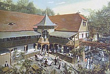
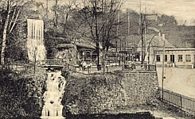

* * *

Die Gaststätte “Schweizerei” wurde 1872 im ehemaligen “Naakeschen
Wirtschaftshof” eröffnet, nachdem der Berliner Kaufmann Eugen Rosenstiel das Anwesen erworben hatte. Zur Erschließung ließ er auf eigene Kosten die Schweizer Straße (seit 1921 [Ulrichstraße](../../../../nordost/loschwitz/strassen_loschwitz/)) anlegen. Das zunächst als Sommerwirtschaft von verschiedenen Pächtern betriebene Lokal erfreute sich
schon bald wachsender Beliebtheit. 1885 übernahm Rosenstiel die Gaststätte in eigene Regie und schuf hier als Attraktion für seine Gäste eine künstliche “Alpenlandschaft”.

Neben dem Ausbau des Restaurantionsgebäudes und des Gästegartens entstanden auf seine Initiative im angrenzenden
Grund neue Wege und Brücken, Treppenaufstiege, mehrere Wasserläufe und ein 1887 in Betrieb genommer künstlicher Wasserfall _(Foto rechts)_
. Dieser konnte zu bestimmten Anlässen mit Hilfe von Karbidlampen sogar “bengalisch beleuchtet” werden, um so die perfekte Illusion einer romantischen Alpenlandschaft zu schaffen. Der am Eingang zum
Naakegrund gelegene Felsenteich diente der Fischzucht, deren Erträge gleich vor Ort fangfrisch angeboten wurden. Außerdem
gab es in der “Schweizerei” regelmäßig Kinderfeste, Platzkonzerte und andere Volksbelustigungen.

Am 1. Mai 1890 fand in der Ausflugsgaststätte im Beisein August Bebels die
erste Maifeier Dresdner Arbeiter statt. Zuvor waren verschiedene Gruppen von Anhängern der verbotenen Sozialdemokratie nach Loschwitz gepilgert, um hier eine Kundgebung zur Einführung des Achtstundentages durchzuführen.
An das Ereignis erinnert noch heute eine Gedenktafel. Auch in den Folgejahren wurde die Tradition der Maifeiern in der “Schweizerei” fortgesetzt, zu denen 1903 noch einmal August Bebel in der Gaststätte weilte,
um hier die Gründung des Zentralverbandes der Konsumvereine zu begleiten.

Bereits 1890 hatte der Besitzer des Lokals die Gaststätte verkauft, behielt jedoch seinen Wohnsitz in der oberhalb des
Grundstücks gelegenen Villa. Neuer Eigentümer war Fritz Krüger, der am 1. April 1895 neben dem Wasserfall ein heute
nicht mehr vorhandenes Bismarck-Denkmal aufstellen ließ. Später wechselten mehrfach die Pächter der Gastwirtschaft.
Im Dezember 1907 brannte ein Teil des Gebäudekomplexes nieder. Besitzer der Schweizerei war nun bis 1920 die Großbauchlitzer Brauerei. Zunehmend blieben jedoch die Gäste aus, was zu wirtschaftlichen Problemen und 1942
schließlich zur Aufgabe des Gaststättenbetriebes führte.

Nach dem Zweiten Weltkrieg diente das Gebäude als Wohnhaus und Flüchtlingsunterkunft, zeitweise auch als Firmensitz
eines Kalenderherstellers und einer Baufirma. 2005 wurde das Grundstück verkauft und denkmalgerecht saniert. In dem
heute zu Wohnzwecken dienenden Gebäudekomplex sind noch Reste des einstigen Gaststättenbetriebes erkennbar.
