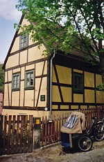
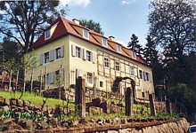
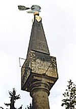
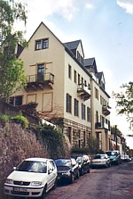
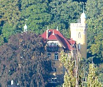

* * *

* * *

Der Veilchenweg verbindet den Dorfkern von Loschwitz mit dem Ortsteil Oberloschwitz auf der Höhe. Der aus einem alten Weinbergssteig hervorgegangene Weg wechselte mehrfach seinen Namen. Um 1850 wurde er
Blauveilchengasse genannt, später Bergstraße und dann bis 1920 nach einem Ausflugslokal Victoriastraße. Nach der Eingemeindung entstand der heutige Name Veilchenweg. Bis zur Gegenwart sind am Veilchenweg einige alte
Winzerhäuser erhalten geblieben, die an die Weinbautradition des Ortes erinnern. Später siedelten sich auch hier wohlhabende Bürger und Künstler an. Erwähnt werden sollen nur Ludwig Richter (Nr. 1), Emanuel Hegenbarth
(Nr. 25) und der frühere Direktor des Staatsarchivs, Geheimrat von Weber (Nr. 24).

Einzelne Gebäude:

Nr. 1:
Das vermutlich um 1750 errichtete kleine Fachwerkhaus _(Foto)_ war 1852/53 erster Sommerwohnsitz des Malers Ludwig Richter, der im nahegelegenen Weinbergshaus der
Familie Kotzsch ein kleines Atelier gemietet hatte. Später wohnte der Künstler in verschiedenen Loschwitzer Häusern, u.a. auf der heutigen [Ludwig-Richter-Straße](../../../../nordost/loschwitz/strassen_loschwitz/) 8, der Hermann-Vogel- Straße 2 und der [Malerstraße](../../../../nordost/loschwitz/strassen_loschwitz/malerstrasse/) 4\. Bis zu seinem Tod 1884 war Richter
regelmäßig Sommergast in Loschwitz und schuf hier auch einige seiner berühmtesten Bilder.

Nr. 4: 1847 gründete der aus dem Vogtland stammende Tischlermeister Johann Christian
Süß in Loschwitz seine Werkstatt, die sich zunächst auf dem Grundstück des heutigen Körnergartens befand. Später zog das Unternehmen zur Viktoriastraße (heute Veilchenweg)
um, wo es 1889 von Sohn Johann Theodor Süß übernommen wurde. Der zunächst auf die Anfertigung von Särgen spezialisierte Betrieb stellte später auch Möbel her und befand sich
ab 1924 im Besitz von Oskar Lissau. Noch bis 1978 wurde die Tischlerei von dessen Sohn fortgeführt, dann vorübergehend stillgelegt und erst 1990 von Tischlermeister Peter Szittariu übernommen. Der Betrieb
gehört heute zu den ältesten Handwerksbetrieben seiner Branche in Dresden und verfügt noch über einen zum Teil historischen Maschinenpark.

Nr. 6b:
In diesem Haus wohnte bis zu seinem Tod 1982 der Maler und Grafiker Georg Nerlich (1882-1982). Der aus
Schlesien stammende Künstler lebte seit 1946 in Dresden und war hier bis zu seiner Emeritierung 1967 als Professor an
der Architektur-Fakultät der Technischen Universität tätig. Nerlich schuf zahlreiche Bilder mit Motiven der Dresdner Umgebung, die sich mit dem größten Teil seines Nachlasses heute im Bestand der TU-Sammlungen befinden.

Nr. 7: Das Haus entstand Anfang des 20. Jahrhunderts und diente ab 1955 als Kindergarten. Da das Gebäude nach
1990 nicht mehr den Anforderungen entsprach, wurde die Einrichtung 2004 in einen Neubau an der Fidelio-F.-Finke-
Straße verlegt. Dort fanden auch zwei 1911 von Georg Türke geschaffene Sandsteinplastiken ihren neuen Platz.

Nr. 9:
Das ehemalige Winzerhaus entstand 1661 und ist heute eines der ältesten erhaltenen Gebäude von Loschwitz. Um 1920 wohnte hier der Studienrat und Rektor der Kreuzschule Heinrich Stürenburg, an den heute noch die
Stürenburgstraße erinnert. Im Garten befindet sich die 1674 geschaffene Winzersäule. Am Kopf des ca. 8 Meter hohen
Sandsteinobelisken sind drei Sonnenuhren angebracht, die Spitze ziert eine vergoldete Wetterfahne. Die Säule gehört zu
den wichtigsten Sachzeugen des bereits 1555 erwähnten Loschwitzer Weinbaus und wurde mehrfach saniert.

**_Foto:_** _Das älteste Loschwitzer Winzerhaus am Veilchenweg 9 mit der Winzersäule_

Nr. 16:
Das kleine Weinberghaus wurde 1800 für den Loschwitzer Johann Traugott Zeibig errichtet und diente fortan als Wohnhaus. Ab 1900 gehörte es der Familie Schramm. Im Gegensatz zu einigen Nachbargebäuden blieb es auch
beim Bau der Schwebebahn 1901 erhalten, welche seitdem unmittelbar an der Grundstücksgrenze den Veilchenweg überquert. Wegen seines schlechten Bauzustandes wurde das Gebäude 2011 abgerissen und durch einen Neubau
ersetzt.

Nr. 17: An Stelle des heutigen Wohnhauses befand sich bis Ende des 19. Jahrhunderts die Loschwitzer Weinpresse.

Nr. 18:
Das Gebäude entstand 1843 als Sommerhaus auf einem früheren Weinbergsgrundstück und befand sich ab 1860 im Besitz der Familie von Seydewitz. 1880 wurde es zum noch heute vorhandene Wohnhaus erweitert. Eine
umfassende Sanierung erfolgte 2003.

Victoriahöhe (Nr. 19): Das Gebäude wurde Ende des 19. Jahrhunderts als Hotel und Ausflugsgaststätte auf einem früheren Weinbergsgrundstück errichtet. Bereits 1630 ist an
dieser Stelle ein Weinberg nachgewiesen, der sich im Besitz hoher sächsischer Hofbeamter befand. 1882 wurde das Haus durch einen Neubau im Schweizerstil nach Entwürfen des
Baumeisters Bruno Seitler ersetzt. Die neuen Besitzer ließen das Grundstück parkartig umgestalten und legten einen Teich mit romantischer Grotte an. Ab 1886 wurde die
Victoriahöhe für einige Jahre auch als Sanatorium genutzt. Im Saal des Gebäudes trat gelegentlich die Schwester Clara Wiecks als Pianistin auf.

Nachdem das Sanatorium aus wirtschaftlichen Gründen wenig später aufgegeben werden musste, teilte man das Grundstück in mehrere Parzellen auf und bebaute diese mit
Wohnhäusern. Lediglich das Hauptgebäude wurde weiterhin als Hotel genutzt, schloss aber bereits vor dem Ersten Weltkrieg seine Pforten. 1919 erfolgte ein Umbau zum Wohnhaus _(Foto)_
. Bei einer erneuten Sanierung um 1960 ging das charakteristische Äußere des Hauses mit Türmchen und Ornamenten zum Großteil verloren. Eine erneute Rekonstruktion folgte 1997. Dabei wurden auch Malereien aus dem
ehemaligen Festsaal entdeckt, die in die Neugestaltung einbezogen wurden.

Villa Stolzenfels: Die Villa am Veilchenweg 25 wurde 1901 von Paul Schenke als eigenes Wohnhaus nach dem Vorbild der gleichnamigen Burg Stolzenfels am Rhein
errichtet. Im ersten Stock lebte der Maler Emanuel Hegenbarth (1868-1923), der als Professor für Tiermalerei an der Dresdner Kunstakademie tätig war. Zwischen 1905
und 1908 erhielt sein Vetter Josef Hegenbarth hier Privatunterricht, bevor er in die Malklasse der Akademie aufgenommen wurde. Hegenbarth war später als Graphiker
und Buchillustrator bekannt und wohnte bis zu seinem Tod 1962 in Loschwitz. Heute ist die Villa Sitz eines Ingenieurbüros _( **Foto:** Wikipedia / Brücke - Osteuropa)_.

* * *

 \[ [Home](../../../../index.html)\] \[ [Nord](../../../../nord/)\] \[ [Nordwest](../../../../nordwest/)\] \[ [Neustadt](../../../../neustadt/)\] \[ [Nordost](../../../../nordost/)\] \[ [West](../../../../west/)\] \[ [Zentrum](../../../../zentrum/)\] \[ [Südwest](../../../../sudwest/)\] \[ [Süd](../../../../sud/)\] \[ [Südost](../../../../sudost/)\] \[ [Ost](../../../../ost/)\] \[ [Register](../../../../Register/register.html)\] \[ [Kontakt](../../../../Kontakt/kontakt.html)\] \[ [Impressum](../../../../impressum/)\]
