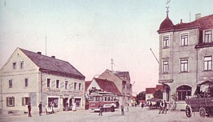
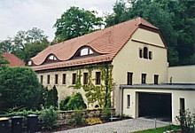
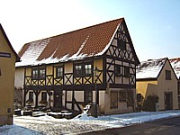
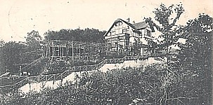
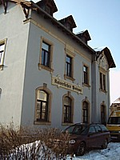
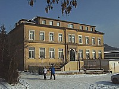
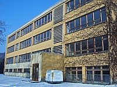
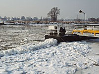

* * *

**Gemeindesiegel von Niederpoyritz**

Niederpoyritz wurde vermutlich im 12. Jahrhundert von slawischen
Siedlern am Ausgang des [Helfenberger Grundes](../../nordost/schonfeld-weissig/helfenberg/helfenberger_grund/) gegründet und 1378
erstmals als “Padegricz” urkundlich erwähnt. Der Name bedeutet übersetzt “Ort unter der Burg” und nimmt Bezug auf die nahegelegene Burg Helfenberg, der Niederpoyritz einst unterstand. 1414 und 1476 ist
das Dorf als “wüst” in den Unterlagen verzeichnet, konnte jedoch schon bald wieder besiedelt werden. 1580 erscheint erstmals der Namenszusatz “Kratza”, welcher mehrfach genannt ist, Ende des 18. Jahrhunderts
jedoch wieder verschwand. Wie und warum diese Bezeichnung entstand und weshalb es zu diesem Namenswechsel kam, ist nicht belegt.

Ab 1569 gehörte Niederpoyritz zur Grundherrschaft Pillnitz und war im Besitz der Herren von Loß. 1674 wurden diese von der Familie von Körbitz, um 1700
von der Familie von Minkwitz abgelöst, denen ab 1738 bürgerliche Besitzer folgten. Gemeinsam mit dem Nachbarort Wachwitz bildete das Dorf ab 1735 ein
selbständiges neuschriftsässiges Rittergut. 1827 kaufte Friedrich August von Sachsen dieses Gut, auf dessen Wachwitzer Fluren er [“Königs Weinberg”](../../nordost/wachwitz/wachwitzer_weinberg/) mit
einem Schlösschen anlegen ließ. Das frühere Herrenhaus Niederpoyritz, diente später Wohnzwecken und wurde 1984 abgerissen. In den Nebengebäuden befand sich die 1661 gegründete [Gutsbrauerei](../../nordost/niederpoyritz/strassen_niederpoyritz/schlossbrauerei/) (später “Dresdner Lagerkeller”).
Zuletzt vom VEB Purotex bzw. dem VEB  “Zierkerze” genutzt, wurde hier 2001 eine Pension _(Foto)_ eingerichtet. Weitere Gebäude dienen heute als Wohnhäuser.

Die Bewohner des Ortes lebten traditionell von der Elbfischerei und vom Weinbau, welcher jedoch im 19. Jahrhundert
immer mehr von Obstplantagen zurückgedrängt wurde. 1635 ist erstmals eine Schiffsmühle an der Elbe erwähnt. Ab 1808 war Niederpoyritz mit Tolkewitz durch eine Elbfähre verbunden. Kirchlich unterstand
der Ort zunächst der Dohnaer Petrikirche, seit 1539 der Hosterwitzer Kirche. Im romantischen Helfenberger Grund richtete der Fabrikant Eugen Dietrich 1869 in einer ehemaligen Mühle eine [Chemisch-pharmazeutische Fabrik](../../nordost/schonfeld-weissig/helfenberg/helfenberger_grund/) ein, die bis nach
1945 bestand. Das Unternehmen blieb jedoch einziger größerer Produktionsbetrieb im Ort.

Bedeutender war der Tourismus, der sich vor allem nach dem Anschluss an die Straßenbahn nach Loschwitz 1903
entwickelte. An die einst beliebte Ausflugsgaststätte “Staffelstein”, kurz nach 1900 von Bruno Naumann gegründet, erinnert noch die 1914 angelegte [Staffelsteinstraße](../../nordost/niederpoyritz/strassen_niederpoyritz/). Weitere Gaststätten existierten an der [Pillnitzer Landstraße](../../nordost/loschwitz/strassen_loschwitz/pillnitzer_landstrasse/) und im Helfenberger Grund. Das frühere Lokal [“Zur Schanze”](../../nordost/hosterwitz/schanzschenke/) am Elbufer verdankte seinen Namen einer militärischen
Befestigung zur Sicherung des Elbübergangs und gehört heute zu einer Wohnanlage. Ab 1890 wurden die ehemaligen Weinberge am Elbhang zunehmend mit Villen und Landhäusern bebaut und das frühere Winzerdorf zum Wohnvorort.
Bereit 1929 gab es deshalb erste Verhandlungen über eine Eingemeindung zu Dresden. Der erarbeitete Vertrag wurde
jedoch von den gewählten Gemeindevertretern am 2. Januar 1930 mehrheitlich abgelehnt. Erst nach 1945 griff man
dieses Vorhaben wieder auf und gliederte Niederpoyritz gemeinsam mit einigen Nachbargemeinden am 1. Juli 1950 als Ortsteil nach Dresden ein.

**_Foto:_** _Die ehemalige Ausflugsgaststätte “Staffelstein” um 1900_

Von größeren Kriegsschäden blieb der Ort weitgehend verschont. Vollständig zerstört wurde lediglich die am Elbhang
stehende Villa der Gräfin zu Stollberg-Wernigerode, welche als einziges Niederpoyritzer Gebäude nach 1945 nicht
wieder aufgebaut wurde. Einige Häuser aus der früheren Dorfgeschichte fielen zu DDR-Zeiten wegen ihres schlechten Bauzustandes dem Abbruch zum Opfer, wurden jedoch inzwischen meist durch Neubauten ersetzt. Heute ist
Niederpoyritz ein ruhiger Wohnvorort und zugleich wegen seiner landschaftlich reizvollen Lage beliebtes Ausflugsziel.

[_Sage: Der Spielmann vom Niederpoyritzer Damm_](../../nordost/niederpoyritz/niederpoyritzer_sagen/)

Gemeindeamt:

Das bis zur Eingemeindung von Niederpoyritz genutzte Gemeindeamt befand sich im Gebäude Pillnitzer Landstraße
197\. Neben den Diensträumen der Verwaltung gab es hier ab 1908 auch eine gemeindeeigene Volksbibliothek, welche noch bis 1955 existierte. Heute dient das Gebäude als Wohnhaus.

Postwesen:

Die erste Niederpoyritzer Postdienststelle öffnete im September 1877 auf der Pillnitzer Landstraße 216. Da die Räumlichkeiten sich jedoch schon bald als zu klein erwiesen,
entschied sich der Grundstücksbesitzer Friedrich Emil Reißig 1897 zum Neubau eines Wohn- und Geschäftshauses. Fortan betrieben die Kaiserliche Reichspost sowie deren
spätere Nachfolger in diesem Gebäude ein Postamt. Die Beförderung der Briefe erfolgte ab 1903 mit der Straßenbahn zum Dresdner Hauptpostamt. Eine Zweigstelle befand sich im
Gelände der Chemischen Fabrik Helfenberg. 1980 wurde das Postamt geschlossen. Seit einigen Jahren gibt es jedoch wieder einePostagentur in einem privaten Geschäft. Das
frühere Postgebäude selbst wurde nach 1990 saniert und zum Wohnhaus ausgebaut. Noch heute erinnert die Aufschrift “Kaiserliches Postamt” an seine frühere Nutzung.

Freiwillige Feuerwehr:

Die Geschichte der Feuerwehr Niederpoyritz reicht bis zum Jahr 1789 zurück, als auf dem heutigen Grundstück
Pillnitzer Landstraße 231 das erste Spritzenhaus errichtet wurde. Die Brandbekämpfung oblag zu diesem Zeitpunkt
allen dazu einsetzbaren Einwohnern des Dorfes. 1884 verabschiedete Niederpoyritz eine Feuerlöschordnung, welche Regeln zum Brandschutz und zur Brandbekämpfung enthielt. Zwei Jahre später musste das alte Spritzenhaus dem
Ausbau der Pillnitzer Landstraße weichen und wurde durch einen Neubau (Nr. 196) ersetzt.

In diesem bis heute erhaltenen und jetzt als Garage genutzten Gebäude war die Handdruckspritze untergebracht,
welche im Einsatzfall mit Pferden bespannt wurde. Außerdem gab es im Haus eine Arrestzelle für leichtere Vergehen. Am 1. Februar 1907 wurde schließlich eine Freiwillige Feuerwehr gegründet,
der zahlreiche Männer des Ortes angehörten. 1927 ließ diese einen Steigerturm errichten, welcher sowohl für Abseilübungen als auch zum Trocknen der
Schläuche genutzt wurde. 1936 folgte ein modernes Feuerwehrdepot für den kurz zuvor angeschafften Motorwagen.
Dieses konnte 1972 aufgestockt und modernisiert werden und war bis zur Auflösung der Feuerwehr 2007 in Nutzung.

Schulen in Niederpoyritz:

Da Niederpoyritz seit 1539 zur [Hosterwitzer Kirche](../../nordost/hosterwitz/maria_am_wasser/) gehörte, mussten die Kinder des Ortes auch die dortige Schule besuchen. Erst 1894 wurde am Plantagenweg ein eigenes Schulhaus errichtet und am 13. April 1896 feierlich eingeweiht _(Foto links)_. Die Bauplanung oblag dem Hosterwitzer Baumeister Beger, die Ausführung der Laubegaster Firma Frauenlob. 1921 schloss sich der Ort mit dem benachbarten
Wachwitz zu einem Schulverband zusammen, der noch im gleichen Jahr das Wachwitzer Schulgebäude erweitern ließ. 1930 wurde die Niederpoyritzer Schule
nach der Eingemeindung von Wachwitz nach Dresden zur Außenstelle dieser Schule.

Ab 1945 bildete Niederpoyritz, nun mit Rockau und Pappritz, erneut einen
Schulverband. Im Zuge der Eingemeindung wurde die örtliche Schule 1950 als 87. Grundschule in das Dresdner Schulnetz einbezogen. Allerdings genügte der Platz
im alten Schulhaus längst nicht mehr für alle Kinder. Der Unterricht erfolgte deshalb auch  in mehreren Außenstellen. Um diesen schwierigen Bedingungen abzuhelfen,
entstand 1978 ein moderner Neubau, der als 87. POS Dresden-Niederpoyritz bis 1990 bestand _(Foto rechts)_. Drei Jahre später folgte eine Turnhalle.

Mit der politischen Wende kam es erneut zu Veränderungen im Schulsystem. Die neue Struktur sah nun ab 1992 die Bildung einer Grundschule im alten und einer Außenstelle des Joseph-Haydn-Gymnasiums im neuen Schulhaus vor.
Die vom Stadtrat beschlossene Schließung der Grundschule am Plantagenweg führte im Jahr 2001 zur Besetzung der Schule durch Eltern und Schüler, was weit über Dresden hinaus
für Schlagzeilen sorgte. Nachdem die Übernahme durch einen freien Träger scheiterte, wird der Altbau seit September
2003 als Kulturzentrum “Elbhangtreffpunkt Alte Schule” genutzt. Der Schulneubau steht hingegen leer, ist jedoch als Schulstandort derzeit wieder im Gespräch.

Fähre Niederpoyritz - Tolkewitz:

Die Fährstelle zwischen Niederpoyritz und Tolkewitz wurde 1808 als vorrangig
dem lokalen Personenverkehr dienende Elbquerung eingerichtet, jedoch erst 1835 offiziell konzessioniert. Betreiber war die aus den Grundbesitzern des Ortes
bestehende Fährgemeinde, welche aus ihrer Mitte einen fachlich geeigneten Schiffer auswählte. Als Aufenthaltsraum der Fährleute diente ab 1810 zunächst das frühere
Gemeindearmenhaus (Pillnitzer Landstraße 170), ab 1864 ein an gleicher Stelle errichteter und bis heute vorhandener Neubau. 1869 wurde von der Königlichen
Wasserbaukommission eine “Schaluppen-Fährordnung” bestätigt, welche die rechtlichen Grundlagen der Fährüberfahrt regelte. 1885 entstand auf Laubegaster
Seite ein zur Anlegestelle führender Fahrweg, für dessen Genehmigung die Gemeinde Niederpoyritz alljährlich eine Gebühr von 4 Mark an die Gemeinde Laubegast zahlen musste.

1935 musste sich die Fährgemeinde auf Druck der Nazis auflösen, da unabhängige Vereine dieser Art nicht mehr erwünscht waren. Den Fährbetrieb übernahm nun der bereits zuvor hier tätige Fährmann Ernst Schmidt in eigener
Verantwortung. 1953 verpachtete Schmidt seine Fähre an die Dresdner Verkehrsbetriebe, blieb jedoch bis zu seiner Pensionierung im Dienst.

Nach Einstellung der Fährverbindungen in Laubegast (1992) und Wachwitz (1957) ist die Niederpoyritzer Fähre heute
einzige Überfahrt zwischen Pillnitz und dem “Blauen Wunder” und wird vor allem von Ausflüglern gern genutzt. Zum
Einsatz kommt hier das 1927 gebaute und 1962/63 modernisierte Fährschiff “Erna”, älteste noch in Betrieb befindliche
Personenfähre der Dresdner Verkehrsbetriebe. In den Zwanziger Jahren war an dieser Stelle der Bau einer neuen Elbbrücke geplant. Nach 1990 wurden diese Pläne noch einmal aufgegriffen, letztlich jedoch nicht realisiert.

[_Weiterführende Literatur und Quellen_](../../impressum/quellenverzeichnis/)
