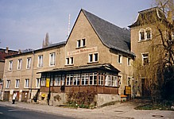
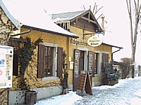

* * *

* * *

* * *

* * *

* * *

* * *

Das Erbgericht Niederpoyritz entstand als Schänke des Niederpoyritzer Rittergutes
und erhielt im 18. Jahrhundert die Schankgerechtigkeit. Hier wurde das im Ort gebraute Braunbier ausgeschenkt, welches auch in die benachbarten Dörfer
geliefert wurde. Nach Einrichtung einer Dampferanlegestelle und dem Bau der Straßenbahn entwickelte sich der Gasthof zum beliebten Tanz- und Ausflugslokal
mit großem Ballsaal und einigen Fremdenzimmern. 1946 wurde im Saal des Erbgerichts eine Filmvorführanlage eingebaut und dieser fortan bis 1971 als Kino genutzt. Wenig später schloss auch die zugehörige Gaststätte.

Das Gebäude sollte daraufhin zum Klubhaus der ungarischen Werktätigen umgebaut werden, was jedoch scheiterte. Nach mehrjährigem Leerstand erfolgte 1977 der Ausbau des “Erbgerichts” zu einem Wohnheim für Studenten der
Ingenieurschule für Holztechnik. Der frühere Gastraum wurde dabei in einzelne Zimmer aufgeteilt, im Keller entstand ein
Partyraum. Der charakteristische Turm mit seiner Spitzhaube wurde aus baustatischen Gründen gekürzt. Gelegentlich
fanden auch weiterhin Veranstaltungen im früheren Ballsaal statt. Seit Auflösung des Wohnheims 1991 steht das Haus leer und soll künftig zu einzelnen Wohnungen umgebaut werden.

Gegenüber befindet sich die 1870 entstandene Erbgerichtsklause, im Volksmund
spöttisch “Erbse” genannt. Ursprünglich gehörte diese als Gartenwirtschaft zum Erbgericht, was zur Folge hatte, dass das Gaststättenpersonal zur Bedienung der
Gäste die Pillnitzer Landstraße überqueren musste. Nach der Schließung des Erbgerichts blieb die zeitweise auch “Steh- Bier-Halle” genannte “Erbgerichtsklause”
als eigenständige Gaststätte bestehen und wurde nach 1990 saniert _(Foto rechts)_.

* * *

 \[ [Home](../../../index.html)\] \[ [Nord](../../../nord/)\] \[ [Nordwest](../../../nordwest/)\] \[ [Neustadt](../../../neustadt/)\] \[ [Nordost](../../../nordost/)\] \[ [West](../../../west/)\] \[ [Zentrum](../../../zentrum/)\] \[ [Südwest](../../../sudwest/)\] \[ [Süd](../../../sud/)\] \[ [Südost](../../../sudost/)\] \[ [Ost](../../../ost/)\] \[ [Register](../../../Register/register.html)\] \[ [Kontakt](../../../Kontakt/kontakt.html)\] \[ [Impressum](../../../impressum/)\]
