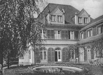
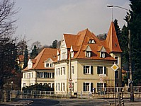

* * *

* * *

* * *

* * *

* * *

Das Gebäude entstand 1873 als Sommervilla des Dresdner Malers Leonhardt
Johannes Sturm, welcher vor allem als Porträtmaler tätig war und gemeinsam mit seinem Bruder Ludwig eine Kunsthandlung auf der Prager Straße betrieb. Da Sturm
das Haus nur gelegentlich für sich und seine Familie nutzte, vermietete er die Villa ab 1876 als Sommerfrische an wohlhabende Dresdner. 1885 erwarb König Albert das
Gebäude und nutzte es als Jagdhaus des Reviers Helfenberg. Zehn Jahre nach dem Tod des Vaters seiner Gemahlin Carola, dem schwedischen Prinzen Gustav Wasa,
wurde im Haus ein Asyl für hilfebedürftige alte Menschen eingerichtet, welches den  Namen Gustavheim erhielt. Die am 4. August 1887, dem 10. Todestag des
schwedischen Prinzen, eröffnete Einrichtung diente fortan als Wohn- und Pflegeheim für Gebrechliche und Kranke. Die
Verwaltung des Hauses oblag dem Pfarrer von Hosterwitz, die Haushaltführung einer Diakonissin der Dresdner
Diakonissenanstalt. Zum Gedenken an die Stifterin des Gustavheimes und ihres Vaters wurden am 5. August 1907 zwei Büsten Gustav Wasas und Königin Carolas im Garten des Hauses aufgestellt, welche 1994 durch Diebstahl
verschwanden.

Im Zuge der Fürstenabfindung nach dem Ersten Weltkrieg kam das Gustavheim in
staatlichen Besitz. 1924 übernahm die Stadt Dresden das Haus und nutzte es bis 1991 als Altersheim. In diesem Zusammenhang entstand 1928 ein zweites Gebäude,
welches durch einen Verbindungstrakt mit dem älteren Haus verbunden ist. In diesem Neubau wurden ein Speisesaal, ein Aufenthaltsraum, Personalzimmer und 13
zusätzliche Wohnungen eingerichtet. Auch der angrenzende Park erfuhr eine Neugestaltung. 1996 übernahm das Pillnitzer Institut für Floristik das Gebäude und
nutzte es einige Jahre für seine Zwecke. Seit 2004 dient das Gustavheim als Wohnheim für russische Aussiedler.

* * *

 \[ [Home](../../../index.html)\] \[ [Nord](../../../nord/)\] \[ [Nordwest](../../../nordwest/)\] \[ [Neustadt](../../../neustadt/)\] \[ [Nordost](../../../nordost/)\] \[ [West](../../../west/)\] \[ [Zentrum](../../../zentrum/)\] \[ [Südwest](../../../sudwest/)\] \[ [Süd](../../../sud/)\] \[ [Südost](../../../sudost/)\] \[ [Ost](../../../ost/)\] \[ [Register](../../../Register/register.html)\] \[ [Kontakt](../../../Kontakt/kontakt.html)\] \[ [Impressum](../../../impressum/)\]
