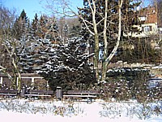
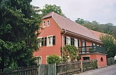
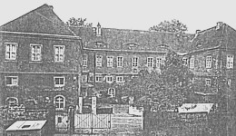
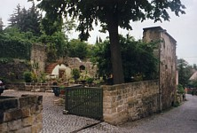
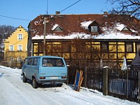
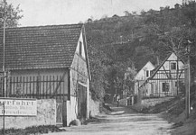
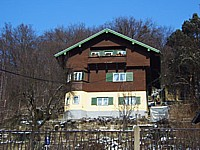
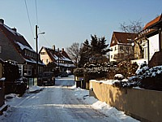
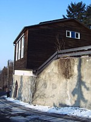
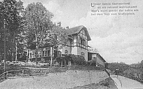

Die Straße Am Friedenshang entstand 1934 im Zuge der Erschließung eines geplanten
neuen Wohngebietes zwischen Niederpoyritz und Wachwitz, welches jedoch kriegsbedingt nur teilweise realisiert wurde. Ursprünglich trug sie den Namen Wohnstraße F. Das hier
gelegene Grundstück befand sich bis nach dem Zweiten Weltkrieg im Besitz der Gräfin von Stolberg-Wernigerode. Nach Enteigung des Areals begann 1946 der Ausbau des Weges,
welcher 1949 auf Wunsch der Anwohner den Namen “Am Friedenshang” erhielt. Am Anfang der Straße befindet sich eine kleine Grünanlage, von welcher sich ein wunderschöner Blick über das Elbtal bietet _(Foto)_
. Die vom städtischen Grünflächenamt angelegte und mit Ruhebänken versehene Fläche diente zuvor als Schutthalde des Ortes.

Villa Stolberg-Wernigerode:
Die im Landhausstil gestaltete Villa entstand Ende des 19. Jahrhunderts am Elbhang und  war ursprünglich nur über einen Treppenaufgang von der Pillnitzer Landstraße 197 erreichbar. Bis Mitte der Dreißiger Jahre diente
sie als Sommersitz der Gräfin von Stolberg-Wernigerode. Danach wurden die Räume an mehrere Familien vermietet und
während des Zweiten Weltkriegs als Flüchtlingsquartier genutzt. Am 13. Febuar 1945 zerstörte eine Luftmine die Villa, wobei
sieben Menschen ums Leben kamen. Das großzügige Grundstück fiel 1946 unter die Bestimmungen der Bodenreform, wurde daraufhin parzelliert und an Kleingärtner verteilt.

Die Eugen-Dietrich-Straße hat ihren Ausgangspunkt am Dorfplatz und führt von dort
zum Helfenberger Grund und weiter nach Helfenberg. Im Zusammenhang mit ihrem Ausbau 1909 erhielt sie ihren Namen nach dem Unternehmer Eugen Dieterich (1840-1904). Dieterich war Gründer der [Chemischen Fabrik Helfenberg](../../../nordost/schonfeld-weissig/helfenberg/helfenberger_grund/), deren bereits auf Helfenberger Flur gelegene Produktionsgebäude noch erhalten sind.

Zu den bemerkenswertesten Gebäude der Eugen-Dieterich-Straße gehören die Anlagen des früheren Rittergutes, welche heute Wohnzwecken bzw. als Pension “Zur
königlichen Ausspanne” dienen. Weitere Gebäude entstanden im 18./19. Jahrhundert als einfache Handwerker- und Häuslerwohnungen. Im Garten eines dieser Grundstücke erinnert eine kleine Sternwarte an den
früheren Besitzer, einen Mitarbeiter von Carl Zeiss Jena.

Herrenhaus: Das Herrenhaus Niederpoyritz, später auch als Schlossvilla bezeichnet, entstand 1735 als Sitz eines neu gebildeten Rittergutes, zu welchem
Flächen in Niederpoyritz und im benachbarten Wachwitz gehörten. Wirtschaftliches Rückgrat war neben dem Weinbau vor allem die zugehörige [Schlossbrauerei](../../../nordost/niederpoyritz/strassen_niederpoyritz/schlossbrauerei/). Das eigentliche Herrenhaus bestand aus einem schlichten dreiflügligen Gebäude _(Foto)_
mit Bedienstenzimmern im Zwischengeschoss sowie den Wohn- und Arbeitsräumen der Besitzer im Obergeschoss.

Mehrfach wechselten die Eigentümer des Gutes, zu denen sächsische Militärs wie
der kurfürstlich-sächsische Premier-Leutnant Johann Ernst Stiefel (1792-98) und kurfürstliche Beamte wie der Konferenzminister und Geheime Rat Carl Wilhelm von Carlowitz (1803/04) gehörten. 1810 erwarb Elisabeth Maria
Magdalena von Olsusieff gemeinsam mit ihrem Mann das Rittergut. 1827 verkauften sie ihren Besitz an Kronprinz Friedrich
August (später König Friedrich August II.). Unter seiner Regie erfolgten zahlreiche Erweiterungen und Neubauten. Verschiedene Wappentafeln und Schlusssteine an den erhaltenen Nebengebäuden der Schlossvilla erinnern noch an diese
Zeit.

Mit dem Tod des Königs wurde das Niederpoyritzer Rittergut 1854 mit allen
zugehörigen Liegenschaften verkauft. Die Schlossvilla diente fortan als Wohnhaus. Ab 1929 gab es hier die Landweinschänke “Schloß Poyritz”, welche jedoch wenige Jahre
später mangels Zuspruchs wieder geschlossen wurde. 1985 wurde das zuletzt als Wohnhaus genutzte baufällige Gebäude weitgehend abgerissen. Heute erinnern nur noch zwei erhaltene Außenwände an die einstige Villa _(Foto)_
. 1997 entstand auf dem Areal ein Neubau.

Ursprünglich gehörte zum Herrenhaus auch ein nur noch in Fragmenten erhaltener Park.
In einem der dort errichteten Gebäude befand sich einst die Kunstglaserei Schramm. Nach 1945 wurde außerdem eine Baracke errichtet, welche lange Zeit einen Kindergarten beherbergte.

Der im Volksmund nach seinem Verlauf zur Gaststätte [“Zur Schanze”](../../../nordost/hosterwitz/schanzschenke/) zunächst Schanzweg genannte Verbindungsweg erhielt um 1904 offiziell den Namen Laubegaster Straße. Diese
verläuft sowohl über Niederpoyritzer als auch Hosterwitzer Flur und verbindet beide Orte miteinander. Während die Gebäude mit den Nummern 1 bis 30 zu Hosterwitz gehören,
besitzen die auf Niederpoyritzer Territorium gelegenen Grundstücke, einer früheren Nummerierung folgend, die Hausnummern 42, 43, 44 und 45. Die meisten Gebäude
entstanden im 19. Jahrhundert und dienten früher teilweise auch gewerblichen Zwecken. Einige stehen unter Denkmalschutz.

Die Moosleite, früher auch als Moosleitenweg bzw. Communaler Fußweg nach Pappritz bezeichnet, verbindet die Pillnitzer
Landstraße mit dem oberhalb des Elbhangs gelegenen Ort Pappritz und ist gleichzeitig wichtiger Verbindungsweg vom
Hochland zur Elbfähre. Ihren Namen erhielt sie nach einem hier zu Tal fließenden kleinen Bach. Der nur wenige hundert Meter
lange Bach entspringt am Südrand von Pappritz und mündet unmittelbar unterhalb der Pillnitzer Landstraße in die Elbe.

Der im 19. Jahrhundert als Steinweg bzw. Staffelweg bezeichnete Verbindungsweg nach Pappritz erhielt 1902 offiziell seinen
heutigen Namen Pappritzer Weg. Mit dem Bau der Staffelsteinstraße 1902 wurde er jedoch teilweise überbaut und im oberen
Abschnitt als Treppe ausgeführt. Im unteren Teil sind noch mehrere historische Gebäude aus der Vergangenheit des Dorfes Niederpoyritz erhalten.

**_Foto:_** _Wohnhäuser am Pappritzer Weg um 1910_

Der gegenüber dem Oberen Gasthof in Richtung Elbe führende Weg trug ursprünglich den Namen Schulstraße, da sich hier
das 1896 eröffnete Niederpoyritzer Schulhaus befand. Um Verwechslungen mit einer gleichnamigen Straße in Coschütz zu
vermeiden, erfolgte 1950 die Umbenennung in Plantagenweg. Zu den erhaltenen Wohngebäuden der Straße gehört auch das einstige Gemeindearmenhaus (Nr. 2).

Die heutige Rockauer Straße geht auf einen alten Verbindungsweg zurück, welcher vom Elbtal hinauf zur Rockauer Höhe führte. Der zu Beginn des 20. Jahrhunderts zur Straße
ausgebaute Abschnitt wurde ab 1916 Hans-Dieterich-Straße genannt. Mit dieser Namensgebung sollte an den Sohn Eugen Dieterichs, den langjährigen kaufmännischen
Direktor der Chemischen Fabrik Helfenberg Hans Dieterich erinnert werden, der auch selbst an dieser Straße wohnte. Da es jedoch immer wieder zu Verwechslungen mit der
benachbarten Eugen-Dieterich-Straße gab, entschloss sich der Gemeinderat 1930 zur Rückbenennung in Rockauer Straße.

Nach 1900 wurden die an der Rockauer Straße gelegenen Grundstücke mit villenartigen Wohnhäusern bebaut.
Eigentümer waren u.a. der Brauereibesitzer Clausnitzer (Schlossbrauerei Niederpoyritz) und der Kunstmaler Max Pietzschmann
(1865-1952). Pietzschmann war Professor an der Kunstakademie und gehörte zum “Goppelner Kreis”, einer Vereinigung
von Landschaftsmalern. 1929 entstand an der Rockauer Straße ein von der Nieskyer Firma Christoph & Unmack gebautes Holzhaus. Weitere Wohnhäuser folgten in den Dreißiger Jahren.

Die Siedlungsstraße entstand Anfang der Zwanziger Jahre im Zuge der Erschließung des
Gebietes für die Wohnbebauung. Zuvor gehörte das Areal oberhalb der Pillnitzer Landstraße 221 zur fiskalischen Weinbergsdomäne. Zunächst wurde sie als Wohnstraße
D bezeichnet und bis 1926 im Rahmen von “Notstandsarbeiten” schrittweise ausgebaut. 1927 erfolgte die inoffizielle, im März 1930 die amtliche Benennung in Siedlungsstraße.

Die Gebäude der Siedlungsstraße
wurden ab 1924 für die “Siedlergemeinschaft Niederpoyritz” errichtet. Die Planungen oblagen dem Architekten Kurt Bärbig, der für das Grundstück mehrere der Hanglage angepasste Doppelhäuser entwarf. Ursprünglich war
neben den Wohnhäusern auch ein gemeindeeigenes Verwaltungsgebäude vorgesehen. An dessen Stelle entstand wenig später das neue Feuerwehrhaus. Erst 1939 konnte das Bauvorhaben abgeschlossen werden.

Noch bis zum Ersten Weltkrieg gab es an Stelle der heutigen Staffelsteinstraße lediglich einen schmalen und schwer
befahrbaren Weg, welcher vom Elbtal nach Pappritz führte. Wegen seines schlechten Bauzustandes entschied sich die Gemeinde Niederpoyritz nach längerer Diskussion zum Ausbau zur Straße. Nach dem Ankauf der benötigten Grundstücke
wurde Anfang 1914 mit den Arbeiten begonnen. Dafür musste auf einer Länge von ca. 700 Metern das Straßenfundament neu angelegt und befestigt werden. Hinzu kamen Stützmauern und wegen des komplizierten Geländeprofils notwendige
Befestigungen. Die Fertigstellung der neuen Straße erfolgte noch im August des gleichen Jahres. Zunächst wurde sie Bergstraße, ab 1930 nach dem hier befindlichen Gasthaus “Staffelstein” Staffelsteinstraße genannt.

_Wohl eine der schlechtesten Verbindungen von den Berghöhen nach dem Elbtal hat_

_das Dorf Pappritz, das von Niederpoyritz aus entweder über den Helfenberger Grund_
_oder den Staffelsteinweg zu erreichen ist._

_Der ist sehr steil und schmal und ist öfters Schauplatz von Unglücksfällen gewesen._

_Er windet sich direkt in einem tiefen Einschnitt den Berg hinan, hat zu beiden_

_Seiten hohe Mauern und ist kaum 2 Meter breit._

_**Aus dem Niederpoyritzer Amtsblatt (1906)**_

1945 richteten Bombenabwürfe Schäden an der Straßenbefestigung und den Stützmauern an.
Mehrfach kam es auch zu Unwetterschäden, u.a. 1932, 1967 und 1995. Diese waren Anlass zur Kanalisierung des Bachbettes und zur Anlage eines Hochwasserrückhaltebeckens an der Flurgrenze
zwischen Niederpoyritz und Helfenberg. Ein von der Stadtverwaltung 2002 geplanter Ausbau der Staffelsteinstraße wurde von einer Bürgerinitiative erfolgreich verhindert.

Ältestes Gebäude
ist das frühere Gasthaus “Staffelstein”, welches wegen seiner herrlichen Fernsicht einst beliebtes Ausflugsziel war, heute jedoch nur noch als Wohngebäude dient. Weitere
Wohnhäuser entstanden nach dem Ersten Weltkrieg. Bemerkenswert sind drei in den Dreißiger Jahren errichtete Holzhäuser der bayrischen Firma Isartaler Holzhaus- Bau G.m.b.H. Initiiert
wurden diese von deren Generalvertreter für Sachsen Würffel, der mit seiner Familie selbst eines der Gebäude bewohnte. Am früheren Atelierhaus des Malers Hanns Herzing (1890-1971) erinnert eine Gedenktafel an den Künstler _(Foto)_.

Gasthaus Staffelstein:
Die Ausflugsgaststätte wurde Ende des 19. Jahrhunderts auf einem früheren Weinbergsgrundstück errichtet und war wegen ihrer reizvollen Lage und der guten Fernsicht weit über die Ortsgrenzen hinaus bekannt. Bis zur
Fertigstellung der Staffelsteinstraße konnte der Aufstieg nur über einen schmalen Fußweg und mehrere Treppen erfolgen. Regelmäßig kehrten hier auch Künstler und
die Mitglieder von Gesangsvereinen ein, was zur Entstehung zahlreicher Gedichte und Lieder über das Lokal führte und zu dessen Popularität beitrug:

_“Unser schönes Sachsenland ist als reizend weltbekannt._

_WerŽs nicht glaubt, der kehre ein bei dem Veit vom Staffelstein”_

Die Gaststätte blieb auch nach 1945 zunächst geöffnet und existierte bis um 1975. Danach wurde das Gebäude zu einer Pension umgebaut. Heute dient es als Wohnhaus.

Nr. 10:
Das Wohnhaus entstand kurz nach der Jahrhundertwende und gehörte dem Senftenberger Braunkohlefabrikanten Lindemann. Ebenso wie einige weitere Gebäude in der Nachbarschaft wurde die Villa beim Luftangriff am 13./14. Februar
1945 schwer beschädigt und brannte aus. In der Nachkriegszeit erfolgte der Wiederaufbau in vereinfachter Form.

Der Wohnweg wurde 1928 durch die Gemeinde Niederpoyritz als Wohnstraße E projektiert und sollte ab 1937 zur Straße
ausgebaut werden, was jedoch nie erfolgte. Die offizielle Namensgebung stammt aus der Zeit um 1950. In seinem Verlauf
geht er auf einen alten Botenweg durch die Weinberge zurück, welcher im 18. Jahrhundert die Besitzungen der Wettiner in Pillnitz und Moritzburg verband.

Am Wohnweg sind noch einige Reste einstiger Weinbergsmauern zu finden. Bemerkenswert war ein um 1800 errichtetes Weinberghäuschen mit Fachwerk, welches leider nach 1945 verfiel und um 1975 dem Abbruch verfiel. Ursprünglich gehörte
es zum Gierthschen Weinberg, dessen Stammhaus das Grundstück Pillnitzer Landstraße 254 war.

[Niederpoyritz auf OpenStreetMap](https://www.openstreetmap.org/search?query=Dresden+Niederpoyritz)

* * *

 \[ [Home](../../../index.html)\] \[ [Nord](../../../nord/)\] \[ [Nordwest](../../../nordwest/)\] \[ [Neustadt](../../../neustadt/)\] \[ [Nordost](../../../nordost/)\] \[ [West](../../../west/)\] \[ [Zentrum](../../../zentrum/)\] \[ [Südwest](../../../sudwest/)\] \[ [Süd](../../../sud/)\] \[ [Südost](../../../sudost/)\] \[ [Ost](../../../ost/)\] \[ [Register](../../../Register/register.html)\] \[ [Kontakt](../../../Kontakt/kontakt.html)\] \[ [Impressum](../../../impressum/)\]
