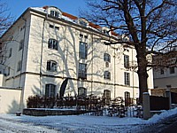
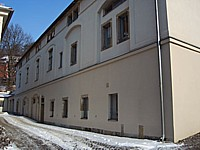
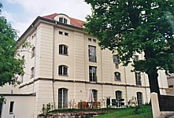

* * *

* * *

Die Geschichte der früheren Niederpoyritzer Schloßbrauerei reicht bis ins Jahr 1659
zurück, als der Rittergutsbesitzer Caspar Haubold von Körbitz die Genehmigung des Kurfürsten erhielt, hier ein Brauhaus einzurichten. Wenig später wurde mit dem Bau
begonnen. Danach übernahmen wechselnde Pächter den Betrieb der Rittergutsbrauerei, welche wegen der hohen Qualität des hier hergestellten Bieres weit über die Ortsgrenzen hinaus bekannt wurde.

1810 erwarb Elisabeth Maria Magdalena von Olsusieff gemeinsam mit ihrem Mann das Rittergut und damit auch die Brauerei. 1827 verkauften sie ihren Besitz an die Wettiner. König
Friedrich August I. ließ drei Jahre später die nicht mehr den Anforderungen entsprechenden Gebäude abbrechen und bis 1840 durch moderne Neubauten ersetzen. Fortan nahm die deutlich vergrößerte Brauerei die heutigen
Grundstücke Eugen-Dietrich-Straße 5-9 ein. Neben dem eigentlichen Brauereigebäude (Nr. 7 - _Foto oben links_) gehörten auch Remisen, Ställe und Lagergebäude (Nr. 5) und eine Mälzerei (Nr. 9 - _Foto unten rechts)_ zum Gesamtkomplex. Relieftafeln mit dem sächsischen Wappen und den Initialien des Besitzers erinnern noch an diese Zeit.

1853 erwarb Carl Gottlob Clausnitzer die Brauerei und leitete diese bis 1863. Danach übernahmen zunächst seine Frau Juliane Christiane, später Sohn Max Albert den
Betrieb. Ihm folgte zwischen 1905 und 1909 die Familie Deutschmann aus Dresden. Am 15. April 1911 wurde schließlich die “Erste Genossenschaftsbrauerei e.G.m.b.H.
Dresden- Niederpoyritz” gegründet. Mehrere Dresdner Gastwirte hatten sich darin zusammengeschlossen, um künftig in gemeinsamer Verantwortung Bier herzustellen.
Das Unternehmen war erstes seiner Art in Dresden und erhielt bereits im Folgejahr für die hohe Qualität des gebrauten Bieres die Goldene Medaille mit dem Ehrenpreis des
sächsischen Gastwirtsverbandes. Zur besseren Vermarktung wurde das Bier unter dem Namen “Schlossbrauerei Niederpoyritz” verkauft.

Zum 30. Juni 1920 stellte die Schlossbrauerei Niederpoyritz ihren Betrieb ein und verlegte die Produktion nach Dresden- Plauen auf die Chemnitzer Straße 52, wo sie fortan unter dem Namen [“Plauenscher Lagerkeller”](../../../../sud/plauen/strassen_plauen/chemnitzer_strasse/falkenbrauerei/) fortbestand. Die nicht
mehr benötigten Gebäude in Niederpoyritz wurden ab 1922 von der Liebig Kakao- und Schokoladenfabrik G.m.b.H.
genutzt, ab 1924 von der Schokoladenfabrik Alfred Kaiser. Im Zuge einer Zwangsversteigerung übernahm 1928 das
Schokolade & Kakao-Werk SKUA GmbH das Areal, konnte sich jedoch ebenfalls nicht am Markt behaupten. In der
ehemaligen Mälzerei befand sich zunächst ein Handwerksbetrieb zur Herstellung kunstgewerblicher Textilwaren, später eine Tischlerei, welche erst 1992 aufgegeben wurde.

1932 übernahm Robert Paul Wunderwald einen Teil der leer stehenden Gebäude, um hier eine Pilzzucht sowie eine Schweinemast einzurichten. Nach heftigen Anwohnerprotesten wegen der damit einhergehenden Geruchsbelästigung
widmete er sich später der Herstellung und dem Großhandel von Seife und anderen chemisch-technischen Erzeugnissen.
1952 setzte sich der Unternehmer zur Ruhe und verpachtete die früheren Produktionsräume an den Wachsziehermeister
Hubert Mücke. Dieser begann 1959 mit dem Aufbau einer Kerzenfabrik. Drei Jahre später wurde die Firma in eine PGH
umgewandelt und 1972 als VEB Zierkerze Dresden verstaatlicht und dem Kombinat Wittol angeschlossen. Bis 1990
stellte man hier verschiedene Zierkerzen, u.a. eine Großkerze mit einer Darstellung des Dresdner Fürstenzuges her.

Als zweiter Betrieb auf dem Areal der früheren Brauerei existierte seit den Dreißiger Jahren die Firma Nacke & Wolke. Zunächst fertigte diese Bohrwerke zur
Herstellung von Drehteilen an, widmete sich jedoch nach 1945 der Produktion von Seife und Haushaltchemikalien sowie der Wäscherei. Auch dieses Unternehmen
wurde 1972 in Volkseigentum überführt und bis 1990 als VEB Wäscherei Dresden-Niederpoyritz (ab 1976 Betriebsteil des VEB Purotex) weitergeführt.
Sowohl die Seifenfabrikation als auch die Kerzenherstellung machten Um- und Anbauten an den bestehenden Gebäuden erforderlich. Neben Lagern, Schuppen
und Baracken entstanden in den ausgebauten Dachgeschossen der ehemaligen Brauerei mehrere Wohnungen.

1991 stellten alle Betriebe auf dem Gelände der einstigen Schlossbrauerei ihre Produktion ein. Nach jahrelangem Verfall erfolgte ab 2001 der Umbau der Gebäude zu einer Wohnanlage _(Foto)_
. Außerdem ist in einem der Häuser (Eugen- Dieterich-Straße 5) die Pension “Zur Königlichen Ausspanne” untergebracht.

* * *

 \[ [Home](../../../../index.html)\] \[ [Nord](../../../../nord/)\] \[ [Nordwest](../../../../nordwest/)\] \[ [Neustadt](../../../../neustadt/)\] \[ [Nordost](../../../../nordost/)\] \[ [West](../../../../west/)\] \[ [Zentrum](../../../../zentrum/)\] \[ [Südwest](../../../../sudwest/)\] \[ [Süd](../../../../sud/)\] \[ [Südost](../../../../sudost/)\] \[ [Ost](../../../../ost/)\] \[ [Register](../../../../Register/register.html)\] \[ [Kontakt](../../../../Kontakt/kontakt.html)\] \[ [Impressum](../../../../impressum/)\]
