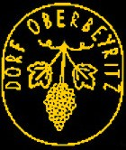
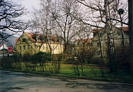
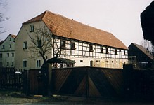
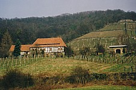

* * *

**Gemeindesiegel von Oberpoyritz**

Die Fluren am Graupaer Bach waren bereits in frühgeschichtlicher Zeit besiedelt.
1900 konnten bei Bauarbeiten Reste einer größeren bronzezeitlichen Siedlung freigelegt werden. U.a. entdeckten die Archäologen zahlreiche Vorratsgefäße,
Keramik- und Tongegenstände und mehrere Herdstellen, was auf die Bedeutung dieses Platzes hinweist. Der am Fuße des Borsberges gelegene Ort Oberpoyritz
wurde jedoch erst 1378 als Padegritz erstmalig erwähnt. Der Ortsname nimmt, wie auch der von Niederpoyritz, Bezug auf die Lage in der Nähe einer mittelalterlichen
Wehranlage. Oberpoyritz entstand aus einem slawischen Rundweiler, dessen Grundform im alten Dorfkern bis heute erhalten geblieben ist _(Fotos)_. Bis 1402
gehörte der Ort zur Burggrafschaft Dohna und unterstand danach den verschiedenen adligen Besitzern des Pillnitzer
Rittergutes. 1410 besaß die in Wehlen ansässige Familie Köckritz das Dorf, 1463 Bodo von Carlowitz und 1535
Kaspar Ziegler. Ab 1569 war die Familie von Loß Lehnsherr in Oberpoyritz. Unter deren Herrschaft wurden Teile der
bäuerlichen Fluren zugunsten des Rittergutes Pillnitz von Oberpoyritz abgetrennt. Die Bedeutung des Ackerbaus sank
daraufhin und wurde immer stärker vom Obst- und Weinbau verdrängt. Außerdem waren einige Bewohner als Zeidler (Bienenzüchter) tätig. Kirchlich gehörte der Ort ab 1539 zur [Hosterwitzer Kirche](../../nordost/hosterwitz/maria_am_wasser/).

Mit dem Bau des [Lustschlosses Pillnitz](../../nordost/pillnitz/schloss_pillnitz/) veränderte sich auch die Wirtschaftsstruktur
in Oberpoyritz. Kurfürst August der Starke erwarb 1721 den Weinberg der Familie Ryssel, um diesen zur Versorgung seines Sommersitzes in Pillnitz zu nutzen.
Oberpoyritzer Einwohner waren außerdem zum Wachdienst in Pillnitz verpflichtet, bevor dort 1765 eine feste Schlosswache eingerichtet wurde. Deren Mitglieder
waren später zeitweise in Häusern des Ortes (u.a. in Nr. 5) einquartiert. 1786 wurde die Kastanienallee zwischen Pillnitz und Oberpoyritz bis zum Pillnitzer Tännicht verlängert.

Im 19. Jahrhundert entstanden am Fuße der Weinberge großzügige Obstplantagen, die den traditionellen Weinbau immer
mehr verdrängten. 1854 wurde der bisherige Reiheschank an die “Schmiedeschänke” übertragen. Außerdem legte man
um 1890 neue Siedlungen an der Lohmener Straße und der Viehbotsche an. Der bis heute ländlich geprägte Ort gehört
seit dem 10. August 1950 als Ortsteil zu Dresden und erhielt acht Jahre später erstmals Anschluss an das Dresdner
Busnetz. Im Dorfkern sind noch einige historische Gehöfte und Fachwerkhäuser erhalten geblieben. Der frühere Dorfteich
wurde vor einigen Jahren verfüllt. Die umliegenden Felder werden heute meist als Obstplantagen und für den Gartenbau genutzt.

Ortsfeuerwehr:

Die Geschichte des Feuerlöschwesens in Oberpoyritz begann im Jahr 1846, als erstmals eine Ortsfeuerwehr erwähnt ist.
Zwischen 1878 und 1911 gehörte der Ort dem Feuerwehrverband Pillnitz an, löste sich jedoch dann daraus und gründete eine eigene Feuerwehr. Für diese entstand am Dorfplatz das noch heute genutzte Spritzenhaus.
Nachdem Oberpoyritz kriegsbedingt ab 1940 sogar eine Pflichtfeuerwehr besaß, gründete man 1946 erneut eine Freiwillige
Feuerwehr, die bis heute besteht. Zur gegenwärtigen technischen Ausstattung gehören ein Tanklöschfahrzeug und verschiedene Kleingeräte.

Rysselkuppe:

Die Rysselkuppe liegt zwischen dem Dorf Borsberg und Oberpoyritz und
verdankt ihren Namen einer Winzerfamilie, die dieses Grundstück einst besaß. 1721 erwarb Kurfürst August der Starke den Weinberg, um diesen zur
Versorgung seines Sommersitzes in Pillnitz zu nutzen. Im Anschluss überließ er ihn dem Franzosen Pierre Coste als Experimentierfeld, da dieser zugesagt hatte,
Pillnitzer Weine nach französischem Qualitätsvorbild herstellen zu können. Mit der Flucht Costes aus Sachsen 1727 endete dieses Kapitel ohne Erfolg. Neben dem
Weinbau am Südhang waren die bewaldeten Flächen der Rysselkuppe einst auch für die Holzgewinnung von Bedeutung, da man hier die Pfähle für die Rebstöcke
gewann. Außerdem nutzten die Anwohner einige Freiflächen als Schafsweide.

Im 19. Jahrhundert wurden große Flächen früheren Weinbaus aufgeforstet bzw. mit Obstbäumen besetzt. Seit 1961 steht
ein ca. 107 Hektar großer Teil dieses Gebietes unter Naturschutz. Bemerkenswert ist das aus dem 17. Jahrhundert
stammende Weingut am Fuße der Rysselkuppe, welches unter Denkmalschutz steht und in den letzten Jahren liebevoll saniert wurde.
