* * *

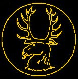

**Gemeindesiegel von Weißer Hirsch**

* * *

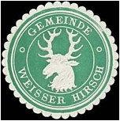

**Historische Siegelmarke**

* * *

****Stadtteilseiten****

****Weißer Hirsch:****

**[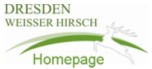](http://www.dresden-weisser-hirsch.de)**

****

*** * ***

****Schulen am****

****Weißen Hirsch:****

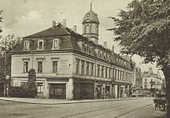Das Gebiet des heutigen Stadtteils Weißer Hirsch war bis ins 16. Jahrhundert weitgehend unbesiedelt und wurde vom Waldgebiet der Dresdner Heide eingenommen. Lediglich die Elbhänge dienten schon frühzeitig dem Weinbau, der meist von begüterten Dresdner Bürgern und Adligen betrieben wurde. Zu diesen gehörte auch der kurfürstliche Oberküchenmeister Georg Ernst von Dölau, der 1664 einen Bauplatz zum Bau einer Schänke erworben hatte. Da das Schankrecht zunächst verweigert wurde, verkauften seine Erben das Grundstück 1685 an den kurfürstlichen Kapellmeister Christoph Bernhardi, einem Schüler von Heinrich Schütz. Dieser ließ ein Jahr später am Rande seines Weinbergsgrundstückes eine Schänke erbauen, die 1688 die Konzession zum Backen, Branntwein brennen und Schlachten erhielt und [“Zum Weißen Hirsch”](../../nordost/page10246/strassen_weisser_hirsch/bautzner_landstrasse/gutshaus_weisser_hirsch/) genannt wurde. Diese bildete den Ausgangspunkt der späteren Gutsgemeinde. Parallel dazu war ab 1685 um die Lohschänke, dem späteren [“Weißen Adler”](../../nordost/page10246/strassen_weisser_hirsch/bautzner_landstrasse/weisser_adler/), eine weitere kleine Siedlung entstanden.

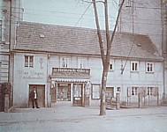Um die im wechselnden Besitz befindliche Wirtschaft entwickelte sich eine kleine Häuslersiedlung, deren Bewohner meist auf dem Gut arbeiteten bzw. vom Weinbau lebten. Wichtigste Einnahmequelle des Gutsherren war jedoch der Gasthof an der Landstraße, der gern von durchreisenden Fuhrleuten aufgesucht wurde. 1710 wurde dieser Quarantänestation für alle nach Dresden Reisenden, da in Polen die Pest ausgebrochen war. Im Jahr 1723 erwarb die Gräfin von Manteuffel das gesamte Anwesen und ließ es durch Ankäufe angrenzender Weinberge erweitern. Am 18. Februar 1726 erhielt das Gut Weißer Hirsch die Schriftsässigkeit verliehen und bildete nun bis 1894 eine weitgehend unabhängige Gutsherrschaft mit eigener Gerichtsbarkeit.

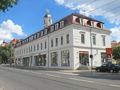Nach dem Konkurs der Manteuffelschen Gutswirtschaft kam der Weiße Hirsch 1754 in den Besitz des sächsischen Oberlandweinmeisters Heinrich Roos. Roos ließ weitere Gebäude an der Bautzner Landstraße errichten, darunter den als Herrenhaus gestalteten neuen "Weißen Hirsch" unmittelbar an der Straße _(Foto)_. Das Gebäude (heute Bautzner Landstraße Nr. 6) erhielt über dem Haupteingang eine Hirschplastik und ist bis heute erhalten geblieben. Außerdem entstanden eine Wasserleitung, eine Holländerwindmühle und weitere Einrichtungen zur Erhöhung der Attraktivität des Ortes. Weitere Verbesserungen brachte der Ausbau der [Bautzner Landstraße](../../nordost/page10246/strassen_weisser_hirsch/bautzner_landstrasse/) 1784/85. 1796 bestand die kleine Gemeinde aus insgesamt 23 Wohngebäuden und zählte nur 75 Einwohner.

1809 trat der Fleischer Carl August Preißler sein Amt als Pächter des Gutes Weißer Hirsch an. Preißler konnte dank kluger Wirtschaftsführung das Gut zu neuer Blüte führen und 1829 sogar durch seinen Sohn aufkaufen lassen. Er meisterte auch die Wirren der Napoleonischen Kriege, in denen der Ort immer wieder Durchzugsstation des Militärs war. Am 23. April 1813 übernachtete der preußische König Friedrich Wilhelm III. im Herrenhaus, in dem später auch Offiziere einquartiert wurden. Im September des gleichen Jahres inspizierte Napoleon eine von seinen Soldaten angelegte [Schanze](../../nordost/dresdner_heide/) am Hirschberg.

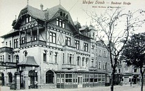Um 1840 begann die Entdeckung des Weißen Hirschs als Sommerfrische. Immer mehr Gäste besuchten den 1839 in eine selbstständige Landgemeinde umgewandelten Ort. Für diese richteten die Bewohner in ihren Häusern Fremdenzimmer ein _(Foto links: Altes Kurhaus)_. Später wurde auch eine Gebühr erhoben, Vorläufer der 1891 eingeführten Kurtaxe. Zur Betreuuung der Gäste entstand 1863 ein neuer Gasthof, aus dem 1914 das [Parkhotel](../../nordost/page10246/strassen_weisser_hirsch/bautzner_landstrasse/parkhotel/) hervorging. Auch der alte Gasthof "Weißer Hirsch" wurde erweitert und erhielt Vergnügungsstätten wie ein Hippodrom, einen Festplatz und Fontänen. 1867 öffnete das [Fridabad](../../nordost/page10246/strassen_weisser_hirsch/lahmann-sanatorium/), womit der Grundstein zur Entwicklung zum Kurort gelegt war. Bauherr war der Architekt Theodor Lehnert, der dieses Bad nach seiner Tochter benannte. Die erhoffte Heilwirkung des Quellwassers erwies sich jedoch als zu schwach, so dass der Badebetrieb wieder eingestellt werden musste.

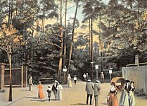1872 erwarb der Seifenfabrikant Ludwig Küntzelmann das Gut Weißer Hirsch und ließ dieses in einzelne Parzellen aufteilen. Nach einer neuen Bauordnung, die gewerbliche Anlagen verbot, entstanden zahlreiche Villen, Fremdenheime und Pensionen. Das alte Herrenhaus von 1756 wurde zum Kurhaus umgebaut und der Ort nun offiziell "Weißer Hirsch - klimatischer Kurort" genannt. 1875 setzte der Unternehmer beim Innenministerium durch, das der Ort offiziell zum "heilklimatischen Kurort" erklärt und in die Statistik der sächsischen Bäder aufgenommen wurde. Küntzelmanns Initiative verdankt der Weiße Hirsch auch den [Kurpark](../../nordost/page10246/rathauspark/) _(Foto: Eingang um 1900)_ und seine erste eigene Schule. Durch den wirtschaftlichen Aufschwung wuchs die Einwohnerzahl bis 1883 auf 644 an, die ihren Lebensunterhalt meist mit Dienstleistungen für die zahlreichen Gäste verdienten. Außerdem war für die Einwohner die Lohnwäscherei von wirtschaftlicher Bedeutung. Mit Hilfe von Leiterwagen, später sogar durch eine "Wäschestraßenbahn" brachten wohlhabende Dresdner Bürgersfrauen ihre Wäsche zur Reinigung auf den Weißen Hirsch.

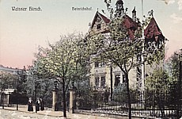Obwohl sich der Ort durchaus positiv entwickelte, musste das Fridabad 1883 Konkurs anmelden. 1887 übernahm der junge Arzt Dr. Heinrich Lahmann das Bad, um hier seine neuen medizinischen Konzepte in die Praxis umzusetzen. Seine Behandlung setzte vorrangig auf gesunde Ernährung in Verbindung mit Bewegung und regelmäßigen Luftbädern. Am 1. Januar 1888 ging das Bad offiziell in Lahmanns Besitz über und wurde schrittweise erweitert.

_Foto: Lahmanns Villa Heinrichshof um 1910_.

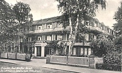Mit dem [Lahmann-Sanatorium](../../nordost/page10246/strassen_weisser_hirsch/lahmann-sanatorium/) erwarb sich der Weiße Hirsch endgültig seinen Namen als Luftkurort von internationaler Bedeutung. Um die zahlreichen Besucher aus dem In- und Ausland unterzubringen, entstanden bis zum Ersten Weltkrieg 15 neue Villengebäude, die dem Sanatorium angeschlossen waren _(Foto rechs: Villa Urvasi)_. Lahmann war bis zu seinem Tod 1905 auch als Gemeindeältester tätig. Anschließend übernahmen seine Erben das Kurbad. Zur Blütezeit des Ortes 1906 weilten insgesamt 6.946 Kurgäste aus über 30 Ländern auf dem Weißen Hirsch. Bereits 1897 war der Weiße Hirsch eigenständige Kirchgemeinde geworden, für die bereits 1889 eine [evangelische Kirche](../../nordost/page10246/kirche_weisser_hirsch/) erbaut worden war. Eine [katholische Kirche](../../nordost/page10246/hubertuskirche/) folgte 1936. Einen eigenen [Friedhof](../../nordost/page10246/waldfriedhof_weisser_hirsch/) gab es ab 1898.

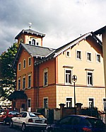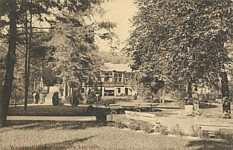Um die Jahrhundertwende entstanden rund um den Kurbezirk verschiedene gesellschaftliche und kulturelle Einrichtungen, um die Gäste noch besser unterhalten und betreuen zu können. 1903 richtete der Ort auf der Luboldtstraße 24 ein Rathaus mit Standesamt ein. Bereits zuvor besaß der Weiße Hirsch drei Radfahrlehrinstitute, die diesen neuen Sport popularisieren halfen. Außerdem wurde der Kurpark _(Foto links)_ erweitert und 1908 Tennisplätze angelegt, die sich im Winter in Eisbahnen verwandelten. Schon 1898 war eine Sparkasse eingerichtet worden, viele neue Geschäfte siedelten sich an, Cafés und Gaststätten entstanden. Bekannte Lokale waren die [Felsenburg](../../nordost/page10246/strassen_weisser_hirsch/rissweg/) am Rißweg _(Foto rechts)_ und der noch beliebtere [Luisenhof](../../nordost/page10246/strassen_weisser_hirsch/luisenhof/). Für verbesserte Verkehrsverhältnisse sorgten die 1899 eröffnete elektrische Straßenbahn sowie die vier Jahre zuvor fertiggestellte [Standseilbahn](../../nordost/page10246/standseilbahn/) zwischen Luisenhof und Körnerplatz. Im gleichen Jahr erhielt der Weiße Hirsch Anschluss an das Elektrizitätswerk Bühlau. 1903 übernahm die Gemeinde das private Wasserwerk, welches 1907 einen neuen Wasserturm erhielt.

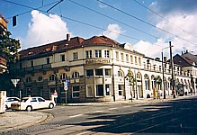Obwohl noch kurz vor Beginn des Ersten Weltkrieges der Neubau des "Parkhotels" _(Foto)_ fertiggestellt werden konnte, ging es mit dem Kurbetrieb in den Kriegsjahren schnell bergab. Ein Erlass vom 11. August 1914 verbot die Aufnahme ausländischer Kurgäste im Ort. Die leerstehenden Kureinrichtungen dienten nun als Lazarette und Genesungsheime für verwundete Soldaten. Der Rückgang betraf nicht nur das renommierte Lahmann-Sanatorium sondern auch die von früheren Kurärzten gegründeten Sanatorien [Weidner](../../nordost/wachwitz/strassen_wachwitz/weidners_sanatorium/) (Oberloschwitz), [Teuscher](../../nordost/page10246/strassen_weisser_hirsch/teuschers_sanatorium/) (Chopinstraße), [Steinkühler](../../nordost/page10246/strassen_weisser_hirsch/steinkuhlers_sanatorium/) (Küntzelmannstraße) und [Möller](../../nordost/loschwitz/strassen_loschwitz/mollers_sanatorium/) (Oberloschwitz).

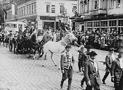Am 1. April 1921 erfolgte gegen den Willen der Mehrheit der Einwohner die Zwangseingemeindung der Gemeinde Weißer Hirsch nach Dresden. Allerdings erwirkten die Bewohner einen gewissen Sonderstatus der Ortes, der das Recht auf innere Selbstverwaltung beinhaltete. Ab 7. Januar 1921 wurde die Gemeinde offiziell als "Kurort Weißer Hirsch - Dresden" bezeichnet und unter Einbeziehung von Oberloschwitz und Neubühlau zu einem großen Kurbezirk erweitert.

_**Foto rechts:** Festumzug aus Anlass des 5. Jahrestages der Eingemeindung 1926 (SLUB / Fotothek)_.

1932 veränderte man den Namen zu "Dresden - Bad Weißer Hirsch". Auch die Gemarkungsgrenzen, die sich bis zur Eingemeindung im wesentlichen auf den einstigen Gutsbezirk beschränkten, wurden erweitert. So kamen u.a. die Flächen des Waldparks, das Friedhofsgrundstück und weitere Flächen in Richtung Bühlau und bis zum Mordgrundbach hinzu. Heute werden auch die Grundstücke um den "Weißen Adler", die Häuser an der Ostseite des Risswegs und der Luisenhof meist zum Weißen Hirsch gerechnet, obwohl sie eigentlich auf Loschwitzer Flur liegen.

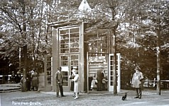Mehrfach wechselten in den 1920er Jahren die Besitzer der Gastwirtschaften und Pensionen, da die Betreibergesellschaften in wirtschaftliche Schwierigkeiten geraten waren. Nur mühsam gelang es, wieder an den guten Ruf des Kurortes aus der Vorkriegszeit anzuknüpfen. Neben massiver Werbung im In- und Ausland wurden zur Unterhaltung der Gäste Feste und Konzerte organisiert und das Kino "Parklichtspiele" im Kurhaus eingerichtet. 1926 entstand sogar eine heute nicht mehr vorhandene Sprungschanze im Stechgrund. Im gleichen Jahr wurde die Moor- und Kurbad AG Weißer Hirsch gegründet, die den Kurort durch Probebohrungen zum Heilbad machen wollte. Einziger Erfolg der 1931 in Konkurs gegangenen Gesellschaft war jedoch die um 1930 im Kurpark angelegte Paradiesquelle _(Foto)_. Auch Baupläne für ein neues Kurbad konnten durch Inflation und Weltwirtschaftskrise nicht realisiert werden. Als einzige Neubauten entstanden in den 1920er Jahren einige Siedlungshäuser am Mönchsholz. 1932 konnte am Rande der Dresdner Heide ein Golfplatz eingeweiht werden (heute [Bühlauer Waldgärten](../../nordost/buhlau/)). Der Anfang der 1930er Jahre angestrebte Bau einer Umgehungsstraße durch die Dresdner Heide, die von der Radeberger zur Ullersdorfer Straße führen sollte, scheiterte an Naturschutz- und Kostengründen.

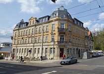Mit Machtübernahme der Nazis endeten alle Versuche, wieder an den internationalen Standard der Vergangenheit anzuknüpfen. Juden waren nun in den Kurhäusern und Pensionen unerwünscht. Schilder verboten die Benutzung der Lesehalle, des Luftbades und der Bänke im Kurpark. Mit Ausbruch des Zweiten Weltkrieges endeten auch die Besuche ausländischer Gäste auf dem Weißen Hirsch. Das Lahmann-Sanatorium wurde 1940 zum Lazarett und Genesungsheim. Obwohl der Weiße Hirsch von direkten Kriegsschäden verschont blieb, mussten die Pensionen und Hotels nach dem 13. Februar 1945 in Notunterkünfte für ausgebombte Dresdner umgewandelt werden. 1945 beschlagnahmte die Sowjetarmee das Lahmann-Sanatorium, welches bis 1990 als Militärlazarett in Nutzung der sowjetischen Streitkräfte blieb _(Foto rechts)_. Die Geschichte des Kurortes wurde mit der offiziellen Einstellung des Kurbetriebes per 9. März 1946 endgültig beendet.

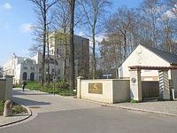Stattdessen entwickelte sich der Weiße Hirsch zum beliebten Wohnvorort für prominente Dresdner. U. a. hatten hier nach 1945 der ehemalige Generalfeldmarschall Friedrich Paulus, die Schriftsteller Martin Andersen-Nexö und Ludwig Renn und der sächsische Ministerpräsident Max Seydewitz ihren Wohnsitz. 1955 ließ sich der renommierte Wissenschaftler Manfred von Ardenne nieder, der an der Plattleite sein weltbekanntes [Forschungsinstitut](../../Nordost/Page10246/Strassen_Weisser_Hirsch/Plattleite/Ardenne-Institut/ardenne.html) ansiedelte. Frühere Pensionen und Fremdenheime dienten nun als Wohnheime bzw. Kindereinrichtungen. Nicht zuletzt dank privater Initiative gelang es, den Verfall der historischen Bausubstanz zu verzögern. Grundlegende Sanierungen vieler Villen erfolgten jedoch erst nach 1990. Heute dienen viele dieser Gebäude als Büro- und Praxisräume. Als neues Stadtteilzentrum wurde 1998 am früheren Kurhaus eine Passage mit Gaststätten und Geschäften eingerichtet. Das stark verfallene Lahmann-Sanatorium wird seit 2012 schrittweise saniert und zu einer Wohnanlage umgestaltet _(Foto links)_.

Rathaus Weißer Hirsch:

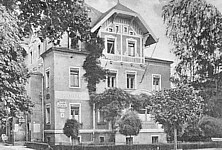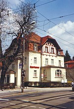Nachdem sich der Gemeinderat jahrzehntelang in privaten Räumen, zuletzt im Haus des russischen Staatsrates Nicolaus Stange getroffen hatte, entschied man sich Ende des 19. Jahrhunderts zum Bau eines eigenen Rathauses an der Bautzner Landstraße 17 _(Fotos)_. Zunächst bezog die Gemeindeverwaltung jedoch ein provisorisches Domizil auf der Schulstraße 2b (heute Luboldtstraße 24). Hier war neben den Diensträumen des Gemeindevorstands auch die gemeindeeigene Sparkasse untergebracht.

1904 begann der Bau des neuen Rathauses, welches 1907 schließlich offiziell eingeweiht werden konnte. Im Inneren befanden sich die Büros der Gemeindeverwaltung, das örtliche Standesamt und die Sparkasse. Außerdem gab es zwei Wohnungen für den Gemeindevorstand und den Nachtwächter im Haus. Mit der Eingemeindung des Ortes übernahm die Stadt Dresden das frühere Rathaus und richtete hier Büros für die Kurverwaltung und den 19. Stadtbezirk ein. Zu diesem gehörten neben Bad Weißer Hirsch auch die Stadtteile Bühlau, Rochwitz und Wachwitz. Die bisherige Sparkasse blieb als Zweigstelle der Dresdner Stadtsparkasse erhalten und verließ erst 2008 das ehemalige Rathaus, welches 2011/12 zum Ärztehaus umgebaut wurde. In der Nachkriegszeit waren hier zeitweise auch provisorische Klassenräume der 59. Oberschule untergebracht.

Postwesen am Weißen Hirsch:

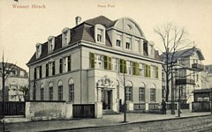 Die erste Postniederlassung am Weißen Hirsch wurde am 1. Mai 1879 im Schulhaus auf der Luboldtstraße eingerichtet, um in den Sommermonaten die Post der Kurgäste befördern zu können. Als Postagent fungierte der Lehrer Pöthig, der von einem Briefträger unterstützt wurde. 1888 wandelte man diese in eine ständige Postagentur als Außenstelle des Loschwitzer Postamtes um. Erst zehn Jahre später erhielt der aufstrebende Kurort seine volle postalische Selbstständigkeit. Zunächst hatte die Poststelle ihren Sitz auf der heutigen Collenbuschstraße 32, von 1900 bis 1903 im "Bürgergarten" an der Plattleite. Nach Fertigstellung der Bebauung gegenüber dem Kurhaus bezog das Postamt 1904 neue Räume im Erdgeschoss eines Wohnhauses (heute Bautzner Landstraße 15). 1914 entstand schließlich ein eigenes Gebäude der Kaiserlichen Reichspost in der Nähe des Rathauses (Bautzner Landstraße 23 - _Foto_). 1994 zog die Post zeitweise in ein Nebengebäude des Parkhotels, später als Postagentur in private Ladenräume.

Schulen am Weißen Hirsch:

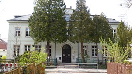Die erste Schule des Ortes entstand 1876 auf Anregung Ludwig Küntzelmanns. Zuvor mussten die Kinder des Ortes die Schule in Loschwitz besuchen. Küntzelmann verkaufte der Gemeinde dafür zu günstigen Konditionen ein Grundstück an der heutigen Luboldtstraße 15. Die Grundsteinlegung erfolgte am 17. August 1875, die Einweihung am 1. Mai 1876. Das Gebäude besaß zunächst nur zwei Klassenräume und eine Lehrerwohnung für den aus Loschwitz übernommenen Hermann Pöthig, der später auch Postagent und Direktor wurde. Zusammen mit der Volksschule richtete man eine Schul- und Volksbibliothek sowie eine Fortbildungsschule ein, in der gegen ein geringes Entgelt Unterricht in Deutsch, Rechnen, Realien und Bürgerkunde gegeben wurde. Ab 1887 gab es vier Klassen und eine zweite Lehrerstelle. Ab 1907 hatte die Schule den Status einer "mittleren Volksschule" und ging nach der Eingemeindung in das Dresdner Schulnetz über.

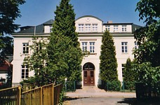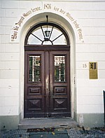

**_Foto:_** _Das alte Schulhaus an der Luboldtstraße._

_Über dem Haupteingang steht die Inschrift: “Was die Jugend Gutes lernte, ist des Alters frohe Ernte”_

Ab 1945 wurde auch das Hinterhaus für schulische Zwecke genutzt, um der gewachsenen Kinderzahl Rechnung zu tragen. In die ehemalige Lehrerwohnung zogen die Schulbibliothek und eine Arztstelle ein. Später besuchten zahlreiche Kinder des Stadtteils die [60\. Grundschule](../../nordost/buhlau/) im benachbarten Bühlau, die deshalb ebenfalls erweitert werden musste. Die Schule an der Luboldtstraße wurde 1959 zur allgemeinbildenden polytechnischen Oberschule (59. POS). Nachdem auch das nicht mehr ausreichte, mussten weitere Räume im früheren Ratskeller und im Sparkassengebäude an der Bautzner Landstraße angemietet werden.

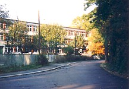1972 entstand an der Kurparkstraße 12 ein Schulneubau für beide Stadtteile, der den Namen 59. POS "Max Zimmering" erhielt. Max Zimmering (1909-1973) war Schriftsteller, Abgeordneter des sächsischen Landtags und Vorsitzender des Schriftstellerverbandes im Bezirk Dresden. Sein Grab befindet sich auf dem Heidefriedhof. Dieses Schulhaus wird nach Aufhebung der 59. Mittelschule im Sommer 2000 heute von der 59. Grundschule genutzt. Am 17. Oktober 2012 erhielt diese den Namen des Schweizer Pädagogen Jürgen Reichen (1939-2009), Erfinder der Lehrmethode "Lesen durch Schreiben", die seit vielen Jahren an dieser Schule praktiziert wird. Die alte Schule an der Luboldtstraße diente von 1973 bis 2014 als Hilfs- und Förderschule "Pestalozzi" für lernbehinderte Kinder. Danach wurde sie als Ausweichstandort während der Sanierung anderer Schulen genutzt. Seit August 2019 nutzt die private kultur.werkschule das historische Gebäude.

Wasserwerk Weißer Hirsch:

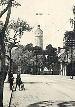Ursprünglich erfolgte die Wasserversorgung des Weißen Hirschs mit Hilfe einer hölzernen Röhrfahrt, die ab 1773 die Gutswirtschaft mit einer bereits im Mittelalter erwähnten Quelle in der Nähe der Stechgrundbrücke verband. Noch bis 1890 war das Brunnenbecken am heutigen Rathauspark vorhanden. Diese Wasserleitung versorgte später auch das Fridabad sowie das Lahmann-Sanatorium und wurde mehrfach erneuert.

Um dem wachsenden Wasserbedarf des Kurortes zu begegnen entschloss sich die Gemeinde 1907 zum Bau eines Wasserturmes am Heideflügel _(Foto)_. Gemeinsam mit dem Nachbarort Bühlau hatte man bereits zehn Jahre zuvor das vorhandene Leitungsnetz und einige nach 1870 erschlossene Quellen aus Privatbesitz übernommen. Das Wasserwerk war bis zur Eingemeindung 1921 in Betrieb. Wenig später, nach dem Anschluss an das Dresdner Trinkwassernetz, wurde der Wasserturm abgetragen und sein Material zur Wegebefestigung genutzt.

Luftbad Weißer Hirsch:

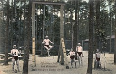 Das Luftbad entstand 1904 auf einem Grundstück am Eichigtweg und sollte die Attraktivität des Kurortes weiter erhöhen. Nach dem Zahlen des Eintritts am Kassenhäuschen im Waldpark standen den Besuchern - getrennt nach Männern und Frauen - mehrere Liegehallen, Freiplätze und Duschen zur Verfügung. 1921 übernahm die Stadt Dresden die Einrichtung als “Städtisches Öffentliches Luftbad” in eigene Regie. 1925 wurde das Bad verpachtet und blieb bis zur kriegsbedingten Schließung 1940 in den Sommermonaten in Betrieb. Sämtliche hölzerne Bauten wurden 1946/47 abgebrochen und als Brennholz verkauft, so dass heute kaum noch Spuren auffindbar sind.

## [Straßen am Weißen Hirsch](../../nordost/page10246/strassen_weisser_hirsch/)

[_Weiterführende Literatur und Quellen_](../../impressum/quellenverzeichnis/)

 \[ [Home](../../index.html)\] \[ [Nord](../../nord/)\] \[ [Nordwest](../../nordwest/)\] \[ [Neustadt](../../neustadt/)\] \[ [Nordost](../../nordost/)\] \[ [West](../../west/)\] \[ [Zentrum](../../zentrum/)\] \[ [Südwest](../../sudwest/)\] \[ [Süd](../../sud/)\]
 \[ [Südost](../../sudost/)\] \[ [Ost](../../ost/)\] \[ [Register](../../Register/register.html)\] \[ [Kontakt](../../Kontakt/kontakt.html)\] \[ [Impressum](../../impressum/)\]
