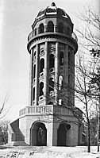

* * *

* * *

* * *

Als Albertpark wird ein ca. 118 Hektar großes Waldstück der Dresdner Heide zwischen Fischhaus- und Bautzner Landstraße bezeichnet. Das Areal wurde 1899 aus Mitteln der König-Albert-Stiftung von der Stadt
Dresden erworben und als Naturschutzpark gestaltet. Am Moritzburg-Pillnitzer Weg entstand in diesem Zusammenhang ein Obelisk mit einem Porträtmedaillon König Alberts. Mit dem Kauf des Waldstücks konnten zugleich
Planungen verhindert werden, an dieser Stelle eine neue technische Hochschule bzw. Neubauten der Staatlichen Frauenklinik zu errichten.

Eine weitere Plastik oberhalb der Mordgrundbrücke wurde 1902 aufgestellt. Sie
zeigt einen Zentaur, eine Gestalt aus der griechischen Mythologie, und wurde vom Bildhauer Otto Petrenz geschaffen. Die Figur des weisen Zentauren Cheiron, welcher von Apollon die Heilkunst erlernte und später Asklepios
zum Arzt ausbildete, soll das nahegelegene Lahmann- Sanatorium symbolisieren. Für sein Kunstwerk hatte Otto Petrenz, der zeitweise im Loschwitzer Künstlerhaus wohnte, 1901 einen Kunstpreis gewonnen.

Wolfshügel:

Der Wolfshügel auf dem Gelände des Albertparkes wurde bereits im 16. Jahrhundert erstmals erwähnt und verdankt seinen Namen einem früher hier befindlichen ”Wolfsgarten” für
die kurfürstlichen Jagden. Schon um 1570 sind an dieser Stelle Wolfsgruben erwähnt, welche noch bis in die Zeit nach dem Dreißigjährigen Krieg existierten. Die Besiedlungsgeschichte des 211 Meter hohen Hügels reicht
jedoch bis in die Bronzezeit zurück, wie mehrere 1934 entdeckte Hügelgräber der Bronzezeit beweisen. 1476 wurde unterhalb des Berges eine Röhrwasserleitung angelegt, älteste belegbare Wasserleitung im Dresdner
Stadtgebiet.

Mitte des 19.  Jahrhundert machte man die Erhebung für die Öffentlichkeit zugänglich. 1886 wurde
auf dem 211 Meter hohen Berg auf Initiative der Ortsgruppe Dresden des Gebirgsvereins für die Sächsische Schweiz ein hölzernes Aussichtsgerüst errichtet. 1912 ersetzte man dieses Gerüst durch
einen steinernen Aussichtsturm. Die Initiative für den Bau ging vom damaligen Verwalter des König-Albert-Parks, dem Dresdner Stadtrat Kammsetzer, aus. Der Turm entstand nach Plänen
von Stadtbaurat Hans Erlwein und war 25 Meter hoch. Über einem als Lagerraum genutzten Unterbau erhob sich der eigentliche Turm mit zwölf Säulen, welche die Bogenfenster einfassten. Im
Inneren führten zwei ineinander liegende spiralförmige Treppen zum Aussichtsrondell unter der kupfergedeckten Turmhaube. Die Bauausführung oblag dem Baumeister Herkomer, die Kosten
von ca. 120.000 Mark übernahm die Stadt. Zu Ehren des Initiators war an der Außenwand ein Bronzebildnis Kammsetzers angebracht.

Bis 1945 blieb der Wolfshügelturm beliebtes Ausflugsziel, wurde jedoch noch in den letzten Kriegstagen von der Wehrmacht als “strategischer Punkt” gesprengt. Die Fundamente und Trümmer des Turmes sind bis heute erhalten
geblieben. Ein geplanter Wiederaufbau scheiterte bislang an den hohen. Kosten.

Heidepark und Volksheim:

Die Idee zur Anlage eines Waldparkes am Nordrand der ständig wachsenden Großstadt stammte vom sächsischen Geheimrat Viktor Böhmert (1829-1918), der 1888 die Genossenschaft “Volkswohl” gründete. Ziel dieses Vereins war
die Schaffung von Bildungs- und Erholungsmöglichkeiten für Arbeiter, speziell für deren Kinder. Bereits ein Jahr später
konnte ein Teilstück der Dresdner Heide an der Fischhausstraße gepachtet werden, welches nach Plänen von Böhmerts
Sohn Karl zu einem Waldspielplatz mit Blockhütten, Spielgeräten und Sanitäreinrichtungen umgestaltet wurde. Dresdner
Kinder hatten nun fortan die Möglichkeit, per Straßenbahn, ab 1899 auch per Dampfer zum Waldpark zu fahren, wo sie
von Turnlehrern und Spielleiterinnen beaufsichtigt und zu aktiver Betätigung in der Natur angeregt wurden.

1893 folgte der Bau der Parkgaststätte “Volksheim”, in der für wenig Geld einfache Mahlzeiten für die ärmere städtische
Bevölkerung angeboten wurden. Neben den eigentlichen Gasträumen gehörten auch ein Sommergarten und ein von
Jugendlichen geschaffenes Naturtheater zu diesem Komplex. In Erinnerung an die Verdienste Böhmerts wurde 1899 ein
Gedenkstein aufgestellt, der sich heute auf dem Gelände der Körperbehindertenschule an der Fischhausstraße befindet.

Im gleichen Jahr hatte die Stadt Dresden einen Teil des Heidewaldes vom sächsischen Staat erworben, um hierauf den
Albertpark anzulegen. Zu diesem Areal gehörten auch die gepachteten Flächen des Vereins “Volkswohl”. Bis zum Zweiten Weltkrieg blieb der Heidepark mit dem “Volksheim” eine der beliebtesten Erholungsstätten seiner Art in
Dresden. Nicht nur Schulkinder, sondern auch Heidewanderer nutzten gern die preiswerte Gaststätte und die zugehörigen
Sport- und Spieleinrichtungen. Ab 1923 besuchten auch Schulklassen die hier eingerichtete “Waldschule”, um natur- und
praxisnahen Unterricht zu erhalten. Während des Zweiten Weltkrieges fanden Kinder aus bombenzerstörten deutschen Großstädten im Volksheim Ruhe und Erholung.

Nach 1945 kam es zu massiven Eingriffen in das Gelände des früheren Heideparks. Zunächst diente das Areal noch
wenige Jahre als Erholungsheim der Kinderlandbewegung, ab 1946 zeitweise auch als Lungenheilstätte. Die bislang
öffentliche Gaststätte wurde damit geschlossen, Schutzhütten und Spielflächen verschwanden und wurden um 1960 mit einem Garagenkomplex überbaut. Lediglich ein kleiner Teil konnte 1968 als Sportplatz neu gestaltet werden.

Erst 1991 knüpfte man wieder an die Tradition der Einrichtung an. Zwischen Fischhausweg und Schotengrund entstand
ein neuer Waldspielplatz nach Planungen von Klaus Bräuning, der 1998 noch um ein Spielgelände speziell für Behinderte
ergänzt wurde. U.a. errichtete man neue Holzhäuser und Sanitäreinrichtungen, legte einen Lehrpfad zum Wildgehege an
und gründete 1997 Sachsens ersten “Waldkindergarten”. Das Gelände steht allen Interessierten offen, außerdem finden an
den Wochenenden und in den Schulferien verschiedene Veranstaltungen statt. Lediglich die unter Denkmalschutz stehenden Gebäude des früheren “Volksheims” warten noch auf eine neue Nutzung.

* * *

 \[ [Nord](../../../nord/)\] \[ [Nordwest](../../../nordwest/)\] \[ [Neustadt](../../../neustadt/)\] \[ [Nordost](../../../nordost/)\]
 \[ [West](../../../west/)\] \[ [Zentrum](../../../zentrum/)\] \[ [Südwest](../../../sudwest/)\] \[ [Süd](../../../sud/)\] \[ [Südost](../../../sudost/)\] \[ [Ost](../../../ost/)\] \[ [Register](../../../Register/register.html)\] \[ [Kontakt](../../../Kontakt/kontakt.html)\] \[ [Impressum](../../../impressum/)\]
