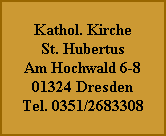
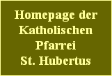
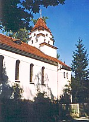
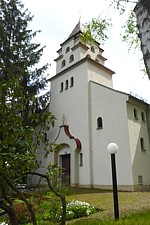

* * *

* * *

* * *

* * *

* * *

* * *

Die katholische Kirche St. Hubertus entstand 1936 für die Betreuung der katholischen Kurgäste und Bewohner des Ortes. Zuvor hatten gelegentliche Gottesdienste im Saal des Gasthofes “Weißer Adler” bzw. im Bühlauer Rathaus stattgefunden. 1928 erwarb Vikariatsrat Karl Rothe das Grundstück Am Hochwald 6-8, um hier ein Gotteshaus zu errichten. Für den Bau wählte man einen Entwurf des Architekten Robert Witte, welcher jedoch aus Kostengründen mehrfach überarbeitet wurde. Die Grundsteinlegung erfolgte am 20. September 1936. Nach knapp fünfmonatiger Bauzeit konnte die zunächst als Kapelle Weißer Hirsch bezeichnete Kirche am 31. Januar 1937 eingeweiht werden. Gestühl, Kanzel und eine Pieta wurden aus dem kurz zuvor von den Nazis geschlossenen St.-Benno-Gymnasium übernommen.

Wegen des Zuzugs vertriebener Katholiken aus dem Osten wuchs die kleine Gemeinde nach 1945 deutlich an. Deshalb entschied man sich 1954, die bisherige Außenstelle der Neustädter St.-Franziskus-Xaverius-Gemeinde zur Pfarrvikarie zu erheben. Kurz darauf entstand auf dem Grundstück eine kleine Baracke, die viele Jahre für den Religionsunterricht genutzt wurde. Unweit davon steht das 1956 bezogene Gemeindehaus (Am Hochwald 2). Ein Jahr später erfolgte die Umwandlung in eine selbständige Pfarrei.

Im Inneren der Kirche befinden sich drei Deckengemälde von Bruno Seener, die Szenen aus dem Leben der Heiligen Hubertus und Lambertus zeigen. Diese Bilder entstanden erst nach 1945. Weitere Plastiken und Gemälde befassen sich mit der gleichen Thematik. Der Legende nach soll Hubertus an einem Karfreitag auf der Jagd ein Hirsch mit einem leuchtenden Kreuz im Geweih erschienen sein, weshalb er bis heute als Schutzpatron der Jäger verehrt wird. Der Innenraum der Hubertuskirche wurde zwischen 1975 und 1979 von Lothar Gonschor neu gestaltet und erhielt dabei ein Altarkreuz des Dresdner Künstlers Peter Makolies.

Eine erneute Sanierung erfolgte 2008 durch das Architektenbüro Harmel + Löser. Die neue Altargestaltung bezieht zwei Reliquien der heiligen Donata und des heiligen Innozenz mit ein, welche aus der Kapelle des alten St.-Benno-Gymnasiums stammen. Im Turm läuten seit Weihnachten 1956 drei Glocken der Apoldaer Glockengießerei Schilling & Lattmann. Zugleich erwarb die Gemeinde damals eine Orgel der Firma Jehmlich, die bis heute in Gebrauch ist. 2012 kaufte die Gemeinde einen aus 14 Bildern bestehenden Kreuzweg des russischen Ikonenmalers Alexander Stoljarov.

* * *

 \[ [Home](../../../index.html)\] \[ [Nord](../../../nord/)\] \[ [Nordwest](../../../nordwest/)\] \[ [Neustadt](../../../neustadt/)\] \[ [Nordost](../../../nordost/)\] \[ [West](../../../west/)\] \[ [Zentrum](../../../zentrum/)\] \[ [Südwest](../../../sudwest/)\] \[ [Süd](../../../sud/)\] \[ [Südost](../../../sudost/)\] \[ [Ost](../../../ost/)\] \[ [Register](../../../Register/register.html)\] \[ [Kontakt](../../../Kontakt/kontakt.html)\] \[ [Impressum](../../../impressum/)\]
