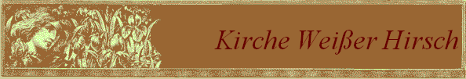
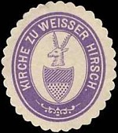
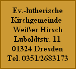
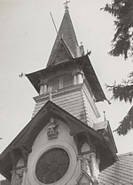
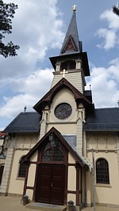
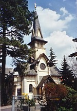
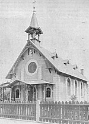
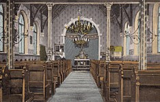
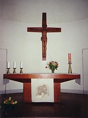

* * *

* * *

* * *

* * *

* * *

* * *

* * *

_Der Kirchturm um 1930 und 2021_

Ursprünglich gehörte das Gebiet um den Weißen Hirsch zur Frauenkirche, ab 1704 zur [Loschwitzer Kirche](../../../nordost/loschwitz/loschwitzer_kirche/). Als Ende des 19. Jahrhunderts immer mehr Gäste den Ort besuchten, entstand der Wunsch nach einem eigenen Gotteshaus. Zu den Förderern des Kirchenbaus gehörte der kaiserlich-russische Staats- und Kommerzienrat Nikolaus Stange, der für den Bau eine größere Geldsumme stiftete. Gemeinsam mit dem Rittergutsbesitzer Ludwig Küntzelmann, Schuldirektor Erich Kaden, Gemeindevorstand Karl August Adam und dem Vorsitzenden des Schulvorstands Richard Schaeffer gründete er am 3. April 1877 eine freie Vereinigung für einen Kirchenbau auf dem Weißen Hirsch .

Auf Initiative dieser Vereinigung fanden ab 1877 erstmals Gottesdienste in einem Schulzimmer auf der Luboldtstraße statt, deren Leitung der Loschwitzer Pfarrer übernahm. 1888 gründete sich unter Vorsitz des herzoglich-braunschweigschen Majors und Kammerherren von Unger ein "Verein für kirchliche Angelegenheiten in Weißer Hirsch". Im gleichen Jahr stellte Nikolaus Stange bei der Kreishauptmannschaft einen Antrag zur Errichtung eines Betsaales an der Mittelstraße (heute Stangestraße). Das benötigte Grundstück wurde von den Erben Küntzelmanns kostenlos zur Verfügung gestellt. Am 24. November 1888 wurde der Grundstein für das evangelische Gotteshaus gelegt.

Das ca. 200 Personen fassende Gebäude wurde teilweise aus Holz errichtet, wobei der Legende nach die berühmte Kirche Wang im Riesengebirge Pate stand. Jüngere Forschungen können das jedoch nicht bestätigen, da erhebliche konstruktive Unterschiede zwischen beiden Bauten bestehen. Architekt der neuen Kirche war der Baumeister Franz Richard Schaeffer. Die Kirche Weißer Hirsch wurde am 14. Juli 1889 eingeweiht und blieb zunächst Filialkirche von Loschwitz. Erst am 1. April 1897 wurde der Weiße Hirsch eine eigenständige Kirchgemeinde. Im gleichen Jahr erwarb die junge Gemeinde ein Stück Heidewald, um hier einen eigenen [Friedhof](../../../nordost/page10246/waldfriedhof_weisser_hirsch/) anzulegen. Eine katholische Kapelle folgte mit der heutigen [Hubertuskirche](../../../nordost/page10246/hubertuskirche/) im Jahr 1937.

Ursprünglich bestand die kleine Kirche aus einem rechteckigen Bau mit drei Fensterachsen und einer kleinen Apsis an der Nordseite _(Foto rechts)_. Der Eingang war durch einen hölzernen Vorbau vor Witterungseinflüssen geschützt. Darüber befand sich ein rundes Glasfenster, über diesem in einer Nische eine Büste
Martin Luthers. Statt eines Glockenturmes besaß sie zunächst nur einen kleinen Dachreiter. Das Innere war mit verschiedenen Ornamentmalereien verziert. Die Ausstattung bestand aus einem schlichten Altartisch mit Kruzifix und einer Kanzel in der rechten vorderen Ecke. Interessant ist die bis heute erhaltene, sichtbare Deckenkonstruktion im Kirchsaal mit ihren freiliegenden Holzbalken.

Bereits zu dieser Zeit entsprach die neue Kirche jedoch nicht den Vorstellungen ihrer Erbauer, weshalb schon 1890 eine erste Erweiterung in Auftrag gegeben wurde. Dabei erhielt sie auch ihren ebenfalls von Nikolaus Stange finanzierten 25 Meter hohen Kirchturm. Leiter des Umbaus war der Direktor der Dresdner Baugewerkeschule Professor Carl Bruno Seitler. 1908 erfolgte durch den Dresdner Baurat Richard Schleinitz mit dem Anbau des Querschiffes und dem Einbau einer Empore eine nochmalige Erweiterung des Gebäudes. In diesem Zusammenhang wurde auch der Altarbereich neu gestaltet. Den zentralen Mittelpunkt bildete ein Gemälde des Malers Victor von Schubert mit Darstellung der Kreuzigungsszene. Schubert hatte zuvor den Weißen Hirsch mehrfach als Kurgast besucht und stiftete das Werk der Kirchgemeinde. Begrenzt wurde der Altarraum durch zwei vergoldete Ziergitter. Hinzu kamen einige neue Glasfenster als Geschenk eines Dresdner Zahnarztes. Außerdem ließ Architekt Schleinitz die Kirchendecke farblich neu gestalten.

1917 musste die große Glocke aus dem Kirchturm abgegeben werden, konnte jedoch bereits 1919 durch eine Stahlglocke der Firma Schilling & Lattermann ersetzt werden. 1922 folgte eine Erweiterung der Jehmlich-Orgel um sechs zusätzliche Stimmen. Kleinere Baumaßnahmen gab es in den 1930er Jahren, u.a. durch den Anbau einer Sakristei im Jahr 1935.

1960 kam es zu einer grundlegenden Umgestaltung des Innenraumes. Die Planungen dafür stammten von Fritz Steudtner, der sich für eine Entfernung der Jugendstildekoration zugunsten einer schlichten Ausstattung nach dem Ideal des Deutschen Werkbundes entschied. Der vorhandene Altar mit Altarbild und Kanzel wurde beseitigt und durch ein einfaches Holzkreuz mit Christusfigur ersetzt _(Foto rechts)_. Das Bild kam in die Sakristei, während Rahmen, Altartisch und Kanzel in Verkennung ihres künstlerischen Wertes zerstört wurden. Die farbige Ausmalung verschwand hinter einem graubeigefarbigen Anstrich. Auch die intakten Glasfenster wurden in diesem Zusammenhang durch neue ersetzt. Mit diesem Radikalumbau verlor die Kirche viel von ihrem ursprünglichen Reiz. Auch jüngste Restaurierungen von 1988 bis 1992 konnten diese Fehler bislang nicht korrigieren. 1966 wurde die 1901 von der Firma Jehmlich geschaffene Orgel durch einen Neubau ersetzt. Dieser besitzt 16 Register mit 1.078 Pfeifen.

2013 begann eine umfangreiche Sanierung von Außen- und Innenraum, wobei das Äußere im Stil von 1908, das Innere entsprechend den heutigen Anforderungen neu gestaltet wurde. In diesem Zusammenhang erhielt der Innenraum ein komplett neues Aussehen. U.a. wurden unter der Empore größere Seitenfenster eingebaut und eine moderne Beleuchtung installiert. An der Rückwand des Altarraums ist seit 2014 ein drei Meter hoher Wandfries “Die Gemeinschaft der Gläubigen” von Gerda Lepke zu sehen. Das moderne Edelstahlkreuz, Taufstein, Altar und Kanzel stammen von Hans-Volker-Mixsa.

* * *

 \[ [Home](../../../index.html)\] \[ [Nord](../../../nord/)\] \[ [Nordwest](../../../nordwest/)\] \[ [Neustadt](../../../neustadt/)\] \[ [Nordost](../../../nordost/)\] \[ [West](../../../west/)\] \[ [Zentrum](../../../zentrum/)\] \[ [Südwest](../../../sudwest/)\] \[ [Süd](../../../sud/)\] \[ [Südost](../../../sudost/)\] \[ [Ost](../../../ost/)\] \[ [Register](../../../Register/register.html)\] \[ [Kontakt](../../../Kontakt/kontakt.html)\] \[ [Impressum](../../../impressum/)\]
