* * *

* * *

* * *

* * *

* * *

Impressionen aus dem Waldpark

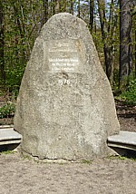

_Gedenkstein am Parkeingang_

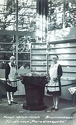

_Brunnenhaus der Paradiesquelle_

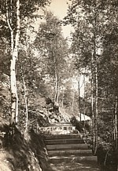

_Paul-Kunze-Stiege_

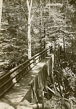

_Holde-Frauen-Brücke_

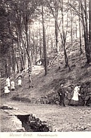

_An der Schwesternquelle_

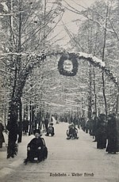

_Rodelbahn_

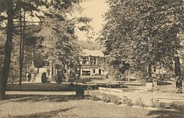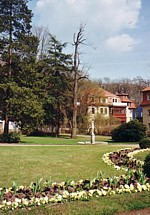Der Kur- bzw. Rathauspark geht auf Initiative des Seifenfabrikanten Ludwig Küntzelmann und des 1876 gegründeten Verschönerungsvereins Weißer Hirsch und Oberloschwitz zurück, der für den aufstrebenden Kurort Weißer Hirsch einen 28 Hektar großen Teil des Heidegebietes für Erholungszwecke reservieren und parkartig gestalten ließ. Nach Abschluss eines Vertrages mit der Forstverwaltung und mit finanzieller Unterstützung der Vereinsmitglieder und vieler ortsansässiger Kaufleute und Künstler wurden zwischen Stechgrund und Kurparkstraße ab 1877 Bäume gepflanzt, Wege angelegt und Bänke aufgestellt. 1882 erließ der Ort eine Parkordnung, die von einem fest angestellten Parkwächter durchgesetzt wurde. Darin war u.a. festgelegt, dass die Bänke nicht von Dienstboten genutzt werden durften und das Reiten im Waldpark veboten war. Zur Finanzierung wurde zudem eine Kurtaxe eingeführt. Auf einem vom Obstbauexperten und Vorstandsmitglied Arthur Pekrun zur Verfügung gestellten Grundstück informierte eine Schautafel über die Arbeit des Vereins. Einige der angelegten Wege erhielten die Namen besonders engagierter Vereinsmitglieder. So gibt es die Arthur-Pekrun-Stiege, den Forstmeister-Vogel-Weg und den nach Amtsstraßenmeister Friedrich Lamm benannten Friedrich-Lamm-Weg.

Zu den Brunnenanlagen des Parks gehören die 1884 in Stein gefasste und nach einem Opernsänger benannte Degelequelle und die benachbarte Schwesternquelle. Letztere soll der Überlieferung nach gegen Sommersprossen helfen und wurde früher auch zur Gewinnung von "Osterwasser" genutzt. Ein Granitfindling am Eingang zum Park erinnert an die Gründung des Verschönerungsvereins 1876.

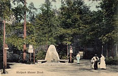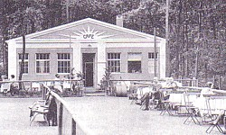

**_Fotos:_** _Ruheplatz mit Obelisk im Rathauspark (historische Postkarte von 1913)_

_und das Café des Tennisplatzes kurz vor dem Zweiten Weltkrieg (rechts)_

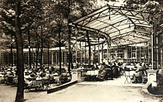Um die Jahrhundertwende wurde der Kurpark, offiziell auch als König-Friedrich-August-Park bezeichnet, erweitert und erhielt eine Reihe von Sport- und Erholungseinrichtungen. So entstand 1904 eine Wandelhalle mit Café, vor der sich ein Konzertplatz für die Kurkonzerte befand _(Foto)_. Den Bau übernahm die bekannte Niedersedlitzer Eisengießerei [Kelle & Hildebrandt](../../../Sudost/Grossluga/Kelle & Hildebrandt/kelle_hildebrandt.html). Im gleichen Jahr wurde am Rand der Dresdner Heide ein Luftbad mit Duschen und Turngeräten angelegt. 1907 richtete man eine Lesehalle ein, die sich ab 1912 im "chinesischen Pavillon" befand. Als neue Sportanlagen wurden 1908 Tennisplätze gebaut, die im Winter in Eisbahnen verwandelt werden konnten. Ein Jahr später entstanden zwei Turmgerüste als Ablaufberg für die Rodelbahnen. Der Kurpark war zu dieser Zeit Schauplatz für verschiedenartige Veranstaltungen, die der Unterhaltung der Kurgäste dienten. Für diesen Zweck war am 1. Mai 1926 ein neuer Musikpavillon am Konzertplatz eingeweiht worden. Zwei Jahre später eröffnete in unmittelbarer Nähe die sogenannte "Paradiesquelle", in der den Gästen Heilwasser für Trinkkuren angeboten wurde. Da man dem Wasser jedoch keine Heilwirkung nachweisen konnte, hatte das Unternehmen keinen großen Erfolg.

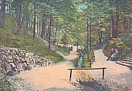Auch nach Ende des Kurbetriebs 1940 blieb der Park als Erholungsfläche erhalten. Allerdings verschwanden in der Nachkriegszeit die meisten hölzernen Bauten zur Brennholzgewinnung. Mitte der 1950er Jahre erfolgte im Rahmen des "Nationalen Aufbauwerkes" eine Neugestaltung des Geländes. U.a. wurde ein neues Wirtschaftsgebäude errichtet und die Konzertmuschel für Freilicht-Kinoveranstaltungen nutzbar gemacht. Die erste Vorstellung fand am Ostermontag 1957 mit ca. 1000 Zuschauern statt.

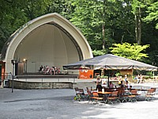 Leider verfiel diese Anlage nach 1989, blieb jahrelang ungenutzt und konnte nur schrittweise wieder erneuert werden. Vor allem der 1993 neu gegründete Verschönerungsverein Weißer Hirsch e.V. engagierte sich für eine Erneuerung bzw. Wiederherstellung der Wege, Treppen und Brücken. 2003 entstand auf Initiative des Vereins nach historischem Vorbild eine neue Pergola am Parkeingang. Auch die drei Quellen wurden instandgesetzt und die Holde-Frauen-Brücke nach historischem Vorbild wiederhergestellt. Seit 2009 ist der Konzertplatz wieder bewirtschaftet und häufig Schauplatz für verschiedene Veranstaltungen. Auch die frühere Lesehalle ist inzwischen mit Hilfe eines eigens gegründeten Fördervereins saniert. Der davor gelegene Teil des Kurparks wird oft als Rathauspark bezeichnet, da sich am Eingang (Bautzner Landstraße 17) das frühere Rathaus der Gemeinde befindet (bis 2008 Sparkasse).

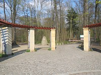Eingang: Der Haupteingang zum Waldpark befindet sich am Ende der Stechgrundstraße zwischen Parkhotel und Lahmann-Sanatorium. Hier wurde Ende des 19. Jahrhunderts durch den Verschönerungsverein ein Monolith mit zwei steinernen Bänken aufgestellt, der an die Gründung des Vereins 1876 erinnert. Daneben informierte früher eine Informationstafel über das Wegenetz des Parks. Später kam noch eine hölzerne Pergola hinzu, die 2003 nach historischem Vorbild wiedererrichtet werden konnte _(Foto)_.

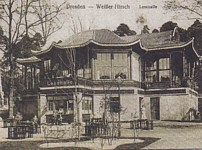Lesehalle (Chinesischer Pavillon): Die ehemalige Trink- und Lesehalle des Kurbades wurde von chinesischen Handwerkern ursprünglich als Staatspavillon Chinas für die [I. Internationale Hygieneausstellung](../../../zentrum/pirnaische_vorstadt/ausstellungsgelande/) 1911 geschaffen. Nach Ende der Schau erwarb die Gemeinde Weißer Hirsch den im Stil einer chinesischen Villa gestalteten Pavillon und ließ ihn in den Rathauspark umsetzen. Ab 1. August 1912, dem Tag der offiziellen Einweihung, nutzte man das Gebäude als Trinkkurhalle und Café. Außerdem zog die Lesehalle ein, eine speziell für die Kurgäste eingerichtete Bibliothek, in der man neben in- und ausländischen Zeitungen und Zeitschriften auch Brettspiele ausleihen konnte _(Foto)_. Im Erdgeschoss befand sich eine Niederlassung von Pfunds Molkerei mit Milchausschank.

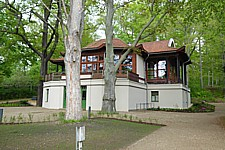Während des Ersten Weltkrieges musste auch die Lesehalle zeitweise geschlossen werden und kehrte nach provisorischer Unterbringung in den Räumen der Konditorei Wachendorf und im Kurbad Weißer Hirsch erst 1919 in den chinesischen Pavillon zurück. Während der Nazizeit war jüdischen Kurgästen das Betreten der Lesehalle verboten. Auch das Angebot an ausländischen Zeitungen wurde drastisch eingeschränkt. 1943 schloss die Einrichtung schließlich ihre Pforten und stand viele Jahre leer. Danach diente der Pavillon ab 1961 als Lesecafé "Zeit im Bild". Hier konnten die Besucher die Zeitschriften des Verlags lesen und sich in Schauvitrinen über verschiedene Themen informieren. Später befand sich hier bis 1990 die HO-Gaststätte "Waldcafé", zuletzt seit 1992 das chinesisches Restaurant "Jasmin". In der Nacht vom 27. zum 28. August 1997 brannte der Pavillon unter ungeklärten Umständen teilweise aus und stand fortan leer _(Foto)_. 2005 bildete sich auf Initiative des Rechtsanwalts Malte von Bargen ein Förderverein, der sich für eine Rekonstruktion und künftige Nutzung als deutsch-chinesische Begegnungsstätte einsetzte und 2007 mit der Umsetzung des Vorhabens begann. Am 1. Oktober 2015 wurde der Chinesische Pavillon offiziell wiedereröffnet und dient heute für verschiedene kleinere Veranstaltungen.

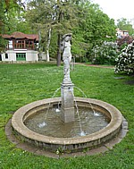Hygieia-Brunnen: Der Brunnen wurde vom Bildhauer Gustav Reißmann geschaffen und 1935 eingeweiht. Die Figur stellt Hygieia, die griechische Göttin der Gesundheit, dar. Aufgrund von Kriegsschäden entfernte man diese Plastik jedoch um 1950; sie gilt seitdem als verschollen. 1956 wurde an ihrer Stelle ein kleiner Bär aufgestellt, der jedoch bereits wenige Jahre später wieder verschwand. 1996 konnte die gesamte Brunnenanlage restauriert und drei Jahre später mit einer Kopie der ursprünglichen Hygieia-Figur vervollständigt werden. Schöpfer dieser Plastik war der Bildhauer Friedemann Klos.

**_Foto:_** _Der Brunnen mit neugeschaffenen “Hygieia” 2021_

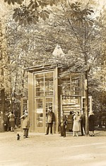Paradiesquelle: 1927 gründete sich auf dem Weißen Hirsch die "Kur- und Moorbad AG", um hier Probebohrungen nach mineralhaltigem Wasser vorzunehmen. Dabei erfolgten auch im Kurpark Untersuchungen, allerdings ohne Erfolg. Als Resultat entstand im Jahr 1928 lediglich ein Quellhäuschen für die sogenannte Paradiesquelle _( **Foto:** SLUB / Fotothek)_. Im Inneren befand sich eine steinerne Vase mit Glasglocke, aus der das Brunnenwasser austrat. Entgegen den labortechnischen Untersuchungen wurde das Wasser zunächst als Heilwasser für Trinkkuren verkauft. Erst nach Beschwerden von Kurgästen und einer Konkurrenzfirma in Norddeutschland änderte man die Bezeichnung in "Weißer-Hirsch-Quelle" und nutzte das Wasser zur Herstellung von Tafelwasser und Limonade. Dafür wurde die Brunnenanlage am 25. August 1933 an die [“Briesnitzer Stahlquelle”](../../../west/cotta/strassen_cotta/meissner_landstrasse/) verpachtet, welche das Wasser an Dresdner Hotels und Gaststätten lieferte.

Mit Beginn des Zweiten Weltkrieges stellte man die Flaschenabfüllung ein und legte die Brunnenanlage still. Das Quellhäuschen wurde in der Nachkriegszeit zur Brennholzgewinnung abgetragen. Auch die beiden 1929 entstandenen Abfüll- und Lagergebäude verschwanden wenige Jahre später. Die Brunnenanlage selbst wurde 1951 aus Sicherheitsgründen verschlossen. 1972 ließ der städtische Veranstaltungsbetrieb die Paradiesquelle sanieren und als Trinkbrunnen wieder in Betrieb nehmen. Weitere Erneuerungs- und Reparaturarbeiten erfolgten 1982 und 1991. Noch bis 1960 fand sich das schlichte Brunnenbecken in der Nähe des Musikpavillons, wurde dann jedoch durch Vandalismus zerstört.

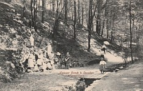Schwestern- und Degelequelle: Im naturnahen Teil des Waldparks befinden sich im Stechgrund zwei Quellen, die Schwestern- und die Degelequelle. Beide wurden 1884 durch den Verschönerungsverein gefasst. Die Finanzierung übernahm zum Teil der Opernsänger Eugen Degele (1834-1886), nachdem letztere bis heute ihren Namen trägt. Die Schwesternquelle _(Foto)_ wurde früher auch zur Gewinnung von "Osterwasser" genutzt. Eine dritte Quelle wurde 1926 beim Bau einer heute nicht mehr vorhandenen Skisprungschanze entdeckt und danach als "Teichgrundquelle" in Form eines kleinen Quellteiches gefasst.

Wintersportanlagen: Um den Kurgästen und Einwohnern auch im Winter Sport- und Erholungsmöglichkeiten zu schaffen, ließ die Gemeinde 1910 im Waldpark zwei Rodelbahnen anlegen. Dafür wurden spezielle Turmgerüste errichtet, die als Ablaufberg dienten. Beide sind heute ebenso wenig erhalten wie eine im Februar 1926 eröffnete hölzernen Sprungschanze. Diese wurde mit einem Wettbewerb sächsischer Skispringer, an dem u.a. Sportler aus dem Osterzgebirge und Soldaten der Infanterieschule Dresden teilnahmen, eröffnet, existierte jedoch nur wenige Jahre.

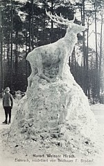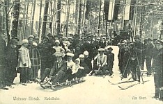

**_Fotos:_** _Eisplastik von Professor Brodauf am Tennisplatz und Rodelbahn am Weißen Hirsch_

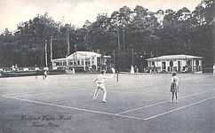Tennisplatz Weißer Hirsch: Der Tennisplatz im Waldpark wurde 1908 eröffnet und diente bis zum Zweiten Weltkrieg vorrangig den Kurgästen des Lahmann-Sanatoriums. Im Winter dienten die Flächen als Eisbahn. Außerdem fanden hier viele Jahre künstlerisch gestaltete Eisfiguren Aufstellung. Schöpfer der vergänglichen Kunstwerke war der am Weißen Hirsch wohnhafte Bildhauer Prof. Friedrich Brodauf.

1949 übernahm die BSG Einheit Dresden Süd die Anlage und nutzte diese fortan zusammen mit der Tennissektion der BSG Lok Dresden-Mitte für den Vereinssport. Ab 1953 nannten sich beide Vereine SG Bühlau bzw. BSG Verkehrsbetriebe. 1960/61 kam die die Tennissektion der SG Bühlau zur Hochschulsportgemeinschaft der TU Dresden. Dabei erfolgte eine Erweiterung der Kapazität auf 10 Plätze.

Im Zuge der Neugestaltung des Dresdner Sportlebens nach 1990 gründete sich 1991 die TC Bad Weißer Hirsch Dresden als eigenständiger Tennisverein, wobei die ca. 300 Mitglieder der beiden Vorgängervereine übernommen wurden. Aus Anlass des 100. Jubiläums der Tennisanlage fanden hier 2008 die ersten Sächsischen Mixed-Meisterschaften statt. Seit 2013 ist die TC Bad Weißer Hirsch Eigentümer der zuvor gepachteten Anlage.

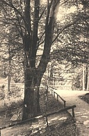Präsidentenbuche: Als "Präsidentenbuche" war bis 1927 ein mächtiger Baum im Waldpark bekannt, der am HG-Weg in der Nähe der steinernen Brücke über den Stechgrundbach stand. Der Name ging auf die 1831 gegründete "Vollmondgesellschaft zum Weißen Hirsch" zurück, die sich der geselligen Zusammenkunft ihrer Mitglieder verschrieben hatte. Ihr gehörten zeitweise ca. 70 Mitglieder an, die alljährlich aus ihrer Mitte einen Vereinspräsidenten wählte. Als Ort der Wahl hatte man sich den Platz unter der Buche ausgesucht, die daraufhin ihren Namen bekam. Andere Quellen nehmen Bezug auf den evangelischen Oberhofprediger Christoph Friedrich von Ammon (1766-1850), der zugleich Präsident des Landeskonsistoriums der Evangelischen Kirche war. Am 5. April 1927 fiel die Präsidentenbuche einem Sturm zum Opfer.

* * *

 \[ [Nord](../../../nord/)\] \[ [Nordwest](../../../nordwest/)\] \[ [Neustadt](../../../neustadt/)\] \[ [Nordost](../../../nordost/)\]
 \[ [West](../../../west/)\] \[ [Zentrum](../../../zentrum/)\] \[ [Südwest](../../../sudwest/)\] \[ [Süd](../../../sud/)\] \[ [Südost](../../../sudost/)\] \[ [Ost](../../../ost/)\] \[ [Register](../../../Register/register.html)\] \[ [Kontakt](../../../Kontakt/kontakt.html)\] \[ [Impressum](../../../impressum/)\]
