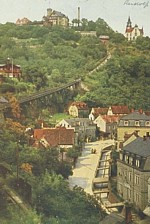
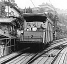
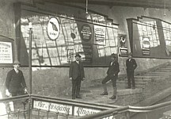
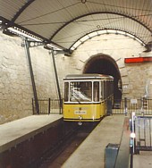
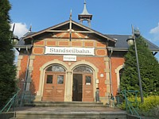
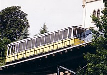

* * *

* * *

* * *

_Blick von der Grundstraße_

_zum Luisenhof mit_

_Trasse der Standseilbahn_

Erste Planungen zum Bau einer Bergbahn nach dem Weißen Hirsch kamen bereits 1873 auf, um dem gewachsenen Verkehrsbedürfnis im Kurort Rechnung zu tragen und eine zusätzliche Attraktion für die Besucher zu schaffen. Vor allem der Fabrikant Ludwig Küntzelmann setzte sich für das Projekt ein. Um 1890 bemühten sich Ferdinand Dörfinger und Alfred Stössel erneut um eine Konzession, welche jedoch wegen der Planungen für eine Eisenbahnstrecke zwischen dem Weißen Hirsch und Bühlau/Weißig zunächst verweigert wurde. Erst nach langwierigen Verhandlungen mit den Behörden und den Besitzern der für den Bau benötigten Grundstücke konnte 1893 die Baugenehmigung erteilt werden. Wenig später, am 26. November 1894, wurde mit den Arbeiten begonnen, die nach elfmonatiger Bauzeit beendet waren. Die Ausführung übernahm die Vereinigte Eisenbahnbau- und Betriebsgesellschaft Berlin. Die beiden Dampfmaschinen lieferte die [Maschinenfabrik Übigau](../../../nordwest/ubigau/schloss_ubigau/schiffswerft_ubigau/), die Waggons die Maschinenfabrik Augsburg-Nürnberg (MAN). Am 26. Oktober 1895 wurde die Standseilbahn _(historisches Foto)_ offiziell in Betrieb genommen. Wenige Tage zuvor war auch die Ausflugsgaststätte [“Luisenhof”](../../../nordost/page10246/strassen_weisser_hirsch/luisenhof/) an der oberen Station eröffnet worden.

Ausgangspunkt der Standseilbahn ist der Körnerplatz _(Foto rechts)_. Nach Durchqueren eines Tunnels führte die Bahn in leicht geschwungener Streckenführung den Elbhang hinauf, überquert eine Brücke und erreicht wenig später die Bergstation im Stadtteil Weißer Hirsch _(Foto links)_. Ursprünglich standen neben den beiden Hauptwagen jeweils zwei “Vorsatzwagen” zur Verfügung, die je nach Bedarf für die Personen-, aber auch für die Güterbeförderung genutzt werden konnten. Noch vor Übernahme der ab 1906 von der privaten Elektra AG betriebenen Bahn durch die Stadt Dresden im Jahr 1912 endete der Güterverkehr, der nie große Bedeutung besaß.

Bereits drei Jahre zuvor waren die Dampfmaschinen stillgelegt und durch elektrischen Antrieb ersetzt worden. 1932 entschloss man sich zum Umbau der Bahn, die in diesem Zusammenhang Oberleitungen zur Stromzufuhr, elektrische Beleuchtung und Heizung sowie zwei modernisierte Waggons der Firma Christoph & Unmack erhielt. Für den Touristenverkehr kamen ab 1934 zwei Zusatzwagen zum Einsatz, welche jedoch seit dem Zweiten Weltkrieg nicht mehr genutzt und deshalb 1949 verschrottet wurden. Die Luftangriffe 1945 beschädigten die untere Station, so dass die Standseilbahn einige Tage pausieren musste.

Eine erneute Modernisierung der Bahn erfolgte ab 1960. In der Straßenbahnwerkstatt Trachenberge wurden zwei neue Wagen gebaut, die statt der bis dahin offenen Plattformen ein geschlossenes Gepäckabteil besaßen. Diese waren bis zur jüngsten Erneuerung 1994 im Einsatz und gehören heute zum Bestand des Verkehrsmuseums. Um die Betriebssicherheit zu erhalten, fanden 1978/79 größere Reparaturarbeiten statt, wobei u.a. die Fördermaschine und die stählerne Brücke erneuert wurden. Seit 1984 steht die Bergbahn als technisches Denkmal unter Schutz.

Eine erneute Rekonstruktion 1993/94 brachte neben der Erneuerung der beiden Waggons auch umfangreiche Arbeiten an Berg- und Talstation sowie an den technischen Anlagen mit sich. Während das Äußere der Bahn sowie noch nutzbare Teile der Technik weitgehend im Originalzustand erhalten blieben, bekam die Standseilbahn moderne Steuerungstechnik, die einen führerlosen Betrieb ermöglichen. Seit dem 22. Oktober 1994 verkehrt die Bahn wieder regelmäßig zwischen Loschwitz und dem Weißen Hirsch. Lohnenswert ist die Fahrt nicht zuletzt wegen des Fernblicks über die Stadt vom Balkon der Gaststätte Luisenhof unmittelbar an der oberen Station.

* * *

 \[ [Nord](../../../nord/)\] \[ [Nordwest](../../../nordwest/)\] \[ [Neustadt](../../../neustadt/)\] \[ [Nordost](../../../nordost/)\]
 \[ [West](../../../west/)\] \[ [Zentrum](../../../zentrum/)\] \[ [Südwest](../../../sudwest/)\] \[ [Süd](../../../sud/)\] \[ [Südost](../../../sudost/)\] \[ [Ost](../../../ost/)\] \[ [Register](../../../Register/register.html)\] \[ [Kontakt](../../../Kontakt/kontakt.html)\] \[ [Impressum](../../../impressum/)\]
