Die bereits nach dem Ersten Weltkrieg angelegte Alojs-Andricki-Straße blieb lange ohne Namen. Auf Anregung des katholischen Pfarrers der St. Hubertus-Kirche wurde sie am 3. Februar 1987 nach dem früheren sorbischen Kaplan der Hofkirche benannt. Alojs Andricki (1914-1943) übernahm nach seiner Priesterweihe 1939 das Amt des Kaplans der Hofkirche und wurde als Gegner des NS-Regimes 1941 inhaftiert. 1943 starb er im KZ Dachau an Typhus. Seine Seligsprechung erfolgte 2011. Im Zuge der Neubenennung Weges wurde auch ein kurzes Straßenstück des Straße Am Hochwald der Alojs-Andricki-Straße zugeschlagen.

Die 1903 erstmals im Adressbuch verzeichnete Straße hieß ursprünglich Adlerweg, wobei eine alte Flurbezeichnung Pate stand. Nach der Eingemeindung der Gemeinde Weißer Hirsch erfolgte 1921 die Umbenennung in Am Waldfriedhof, da sich hier seit 1898 der [Friedhof](../../../nordost/page10246/waldfriedhof_weisser_hirsch/) des Ortes befindet. Diese Bezeichnung war jedoch nur von kurzer Dauer. Seit dem 1. Juni 1926 ist die Straße nach der angrenzenden Dresdner Heide Am Heiderand benannt. In der Nähe stand einst das [Wasserwerk Weißer Hirsch](../../../nordost/page10246/) mit Hochbehälter und einem heute nicht mehr vorhandenem Wasserturm.

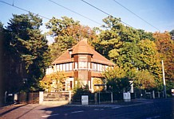

_**Foto:** Haus "Heideröschen" an der Bautzner Landstraße 57/Ecke Am Heiderand_

Die Straße Am Hochwald wurde um 1900 mit Beginn der Bebauung in diesem Gebiet angelegt und ab 1903 Prinz-Friedrich-August-Straße genannt. 1912 wechselte die Benennung in König-Friedrich-August-Straße, 1924 in Friedrich-August-Straße. Namensgeber war der letzte sächsische König Friedrich August III. Nach der Eingemeindung erhielt sie am 1. Juni 1926 den Namen Am Hochwald. Ein Teilstück wurde 1987 im Zuge der Benennung der Alojs-Andritzki-Straße zugeordnet.

ie ersten Villen entstanden nach 1900. 1937 wurde hier die katholische [Kirche St. Hubertus](../../../nordost/page10246/hubertuskirche/) eingeweiht. Das 1910/11 errichtete Gebäude Am Hochwald 2 dient heute als Pfarrhaus der Gemeinde.

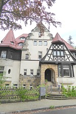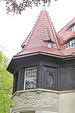Nr. 1 (Villa Waldhaus): Das im historisierenden Landhausstil gestaltete Gebäude _(Fotos)_ wurde 1911 von Max Herfurt entworfen und war im Besitz des Zigarettenfabrikanten Hugo Zietz [(“Yenidze”)](../../../zentrum/friedrichstadt/strassen_friedrichstadt/weisseritzstrasse/yenidze/), der es jedoch nur als Sommerwohnsitz nutzte. Während des Ersten Weltkrieges befand sich in den Räumen ein Genesungsheim für verwundete Soldaten. 1928 siedelte die Witwe des mittlerweile verstorbenen Unternehmers in die Schweiz über und vermietete die Villa als Wohnhaus. 1945 nutzte zeitweise die russische Kommandantur das Gebäude. Zwei Jahre später bezog der Stadtbezirksbürgermeister Schönlebe in der Villa seine Wohnung. Im Erdgeschoss befand sich ab 1950 die Firma Schaefer & Nobis Nachfolger zur Herstellung von Damenhüten.

Nach Übersiedlung der Firmeninhaber in die Bundesrepublik übernahm die Stadt Dresden das Haus und richtete hier 1962 den Kindergarten “Am Hochwald” ein. Bis 2002 wurde die Villa entsprechend genutzt. Danach bezog die Kindertagesstätte einen modernen Neubau am Nachtflügelweg. Heute dient das Gebäude wieder Wohnzwecken.

An den früheren Besitzer erinnern einige von Josef Goller gestaltete Glasfenster, die den Weg des Tabaks vom Orient bis zum Speicherhaus zeigen. Außerdem finden sich an der Fassade verschiedene künstlerische Darstellungen, darunter Seepferdchen und Eidechsen als Wasserspeier sowie die Reliefdarstellung einer mittelalterlichen Sauhatz. Bemerkenswert sind auch die architektonisch angeglichenen Nebengebäude, die einst Hausmeisterwohnung und Remise beherbergten.

Der Eichhörnchenweg wurde in den 1920er Jahren direkt am Rand der Dresdner Heide als vom Heideflügel abgehende Stichstraße angelegt. Ursprünglich sollten hier Villen für hohe Offiziere errichtet werden. 1953/55 entstand auf dem Gelände die erste Dresdner Eigenheimsiedlung der Nachkriegszeit. Architekt war R. Coste, der die Häuser zwischen Eichhörnchen- und Eichigtweg geschickt in den vorhandenen Baumbestand eingliederte. Am 8. Februar 1956 erhielt die Straße in Bezug auf den nahen Heidewald ihren Namen Eichhörnchenweg.

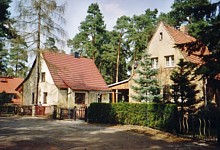

**_Foto:_** _Wohnsiedlung am Eichhörnchenweg_

Auch der benachbarte Eichigtweg entstand bereits in den Zwanziger Jahren und war ursprünglich für die Bebauung mit Villen des Lahmann-Sanatoriums vorgesehen. 1926 plante zudem die neu gegründete Moor- und Kurbad AG Weißer Hirsch, hier ein achtstöckiges Luxushotel mit Kurpark, Badehaus und einer Abfüllanlage für heilkräftiges Mineralwasser zu bauen. Da das im Kurpark erbohrte Wasser der Paradiesquelle jedoch keineswegs Heilwirkung aufwies und zudem finanzielle Probleme der Gesellschaft zum Konkurs 1931 führten, blieben alle Planungen unrealisiert. Lediglich die offizielle Namensgebung der bisherigen Planstraße 3 erfolgte am 22. Dezember 1937. Die heutige Bebauung mit Siedlungshäusern stammt aus den 1950er Jahren.

Luftbad Weißer Hirsch: Zwischen 1904 und 1940 befand sich auf dem Areal das [Luftbad Weißer Hirsch](../../../nordost/page10246/) mit Liegehallen und Brausebad. Die ursprünglich private Einrichtung ging 1921 in den Besitz der Stadt Dresden über und blieb bis 1940 geöffnet. Die hölzernen Baulichkeiten wurden 1946/47 zur Brennholzgewinnung beseitigt.

Die Namensgebung Hainweg wurde von einem alten Flurnamen abgeleitet. Erstmals ist diese Straße, noch als Hainstraße, 1883 nachweisbar. Zehn Jahre später findet sich in den Gemeindeakten der Hinweis auf den Erwerb eines Straßenschildes "Hainweg", was auf einen Namenswechsel zu dieser Zeit hindeutet. Die meisten Gebäude entstanden kurz vor dem Ersten Weltkrieg, so die Villa "Heiderose" (Nr. 1) von 1911, die um 1885 errichtete Villa "Waldhaus" (Nr. 3) und der "Margarethenhof" (ehem. Nr. 4, heute Nr. 7), der 1910 von Max Herfurt entworfen wurde. Im Haus Hainweg 2 lebte vor 1945 die Witwe Georg Arnholds, Stifter des Arnoldbades.

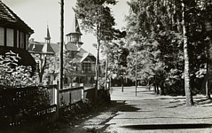Die in der Nähe des "Weißen Adlers" von der Bautzner Landstraße abzweigende Straße ist Teil des Wegenetzes der Dresdner Heide und nur im unteren Abschnitt bebaut _( **Foto:** Walter Hahn - SLUB / Fotothek)_. Seit dem 15. Januar 1931 trägt sie offiziell den Namen Heideflügel. Ihre Fortsetzung im Heidegebiet ist als Flügel A in den Karten verzeichnet. Die Gebäude entstanden in den Jahren nach dem Ersten Weltkrieg. Bemerkenswert ist ein 1930 errichtetes Holzhaus (Nr. 3), welches von der renommierten Fertighausfirma Christoph & Unmack aus Niesky gebaut wurde. Chefarchitekt Konrad Wachsmann gehörte zu den führenden Holzhausspezialisten Deutschlands und entwarf u.a. das Sommerhaus Albert Einsteins am Caputher See.

Die Heinrich-Cotta-Straße erinnert an den bekannten Forstwissenschaftler Heinrich Cotta (1763-1844), der Gründer der Forstlehranstalt in Tharandt war. Ursprünglich war sie Teil eines in alten Stadtplänen als Schneise 15 ausgewiesenen Forstweges. Hier befand sich auch das Eingangstor zum früheren Waldpark (heute Bühlauer Waldgärten). Am 13. Oktober 1936 erhielt sie offiziell ihren Namen. 1953-55 entstand an der Heinrich-Cotta-Straße eine der ersten Eigenheimsiedlungen der Nachkriegszeit in Dresden.

Nr. 8: Das Gebäude wurde 1955/56 vom Architekten Helmut Köckeritz als eigenes Wohnhaus entworfen. Köckeritz war vor allem im industrie- und Gesellschaftsbau tätig und gestaltete u.a. das Sanatorium "Raupennest" im Erzgebirge sowie den Wiederaufbau des alten Centrum-Warenhauses an der Wilsdruffer Straße.

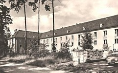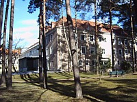Klinikum Weißer Hirsch: Das Gebäude wurde 1953/54 durch die SAG Wismut als Erholungsstätte für Bergleute des Uranbergbaureviers Freital/Gittersee erbaut. Das Nachtsanatorium verfügte über 200 Betten, die von den Arbeitern zwischen den Schichten genutzt werden konnten, sowie Räume für verschiedene Veranstaltungen. 1961 übernahm die Stadt Dresden das Objekt und richtete hier im März 1963 ein Krankenhaus ein. Der Gebäudekomplex wurde dafür nach Plänen von E. Kubin erweitert und erhielt u. a. einen Kultursaal, der auch von den Bewohnern des Stadtteils genutzt werden konnte. Zunächst befand sich hier ein Teil der Inneren Klinik des Sanatoriums Alpenstraße, ab 1967 auch eine Psychomatische Station mit 30 Betten.

Ab 1972 war das Klinikum Außenstelle des [Krankenhauses Dresden-Neustadt](../../../nordwest/trachau/guntzheim/). In Zusammenarbeit mit dem Ardenne-Institut wurden hier auch neue Behandlungsmethoden angewandt, die international für Aufsehen sorgten. Nach Modernisierung wird das Krankenhaus heute als Klinikum Bad Weißer Hirsch bezeichnet. Neben der in einem modernen Ergänzungshaus untergebrachten Inneren Station befindet sich im ehemaligen Nachtsanatorium die Klinik für Psychiatrie und Psychotherapie des Neustädter Krankenhauses.

Die Hermann-Hesse-Straße erschließt das Gelände des früheren [Lahmann-Sanatoriums](../../../nordost/page10246/strassen_weisser_hirsch/lahmann-sanatorium/) und die dort entstandenen Wohngebäude. Die ringförmige Straße, die ursprünglich Hermann-Hesse-Ring genannt werden sollte, erhielt ihren Namen 2014 auf Beschluss des Stadtrates. Benannt wurde sie nach dem Dichter Hermann Hesse (1877-1962), der selbst als Kurgast auf dem Weißen Hirsch weilte.

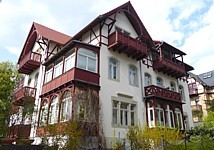Die frühere Ludwigstraße wurde 1883 nach dem Seifenfabrikanten Maximilian Ludwig Küntzelmann (1826-1881) benannt. Küntzelmann war Besitzer des Gutes Weißer Hirsch und gilt als Gründer des Kur- und Villenvorortes. An ihn erinnert ein [Gedenkstein](../../../nordost/page10246/strassen_weisser_hirsch/bautzner_landstrasse/) an der Bautzner Landstraße. Um Verwechslungen mit der Ludwigstraße in der Leipziger Vorstadt zu vermeiden, erfolgte am 1. Juni 1926 die Umbenennung in Küntzelmannstraße.

Ende des 19. Jahrhunderts entstanden auch hier zahlreiche Villen und Landhäuser. In der im Schweizerstil errichteten Villa Bismarck (Nr. 7) hatte zwischen 1914 und 1934 das [Sanatorium Dr. Steinkühler](../../../nordost/page10246/strassen_weisser_hirsch/steinkuhlers_sanatorium/) seinen Sitz. Heute wird die Villa als Büro- und Wohnhaus genutzt. Weitere Gebäude, so die Villen "Alke" (Nr. 11) und "Therese" (Nr. 11b) dienten der Unterbringung von Patienten des Lahmann-Sanatoriums. Traditionell erhielten die meisten Häuser zusätzlich zur Nummerierung Eigennamen, wobei zum Teil ihre Lage ("Villa Elbhöhe" - Nr. 2, "Villa Talblick" - Nr. 5) oder die Vornamen der Ehepartnerinnen oder Töchter ("Villa Margarete" - Nr. 4, "Villa Louise" - Nr. 6; "Villa Elisabeth" - Nr. 9) Pate standen.

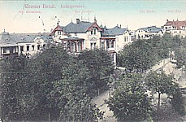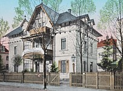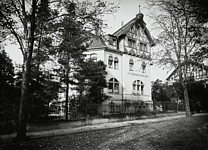

**_Fotos:_** _Blick in die frühere Ludwigstraße mit den Lahmann-Villen “Therese” (Mitte) und "Alke" (rechts)_

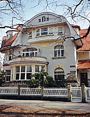Die nach 1880 ausgebaute Kurparkstraße ging aus dem sogenannten HG-Weg, einem alten Heideweg, hervor und hieß bis zur Eingemeindung 1921 Waldparkstraße. Als Waldpark wird der im Zusammenhang mit dem Kurbetrieb für Erholungszwecke gestaltete Teil der Dresdner Heide bezeichnet, der sich an den früheren [Kurpark](../../../nordost/page10246/rathauspark/) (Rathauspark) anschließt. Um Verwechslungen mit einer gleichnamigen Straße in Blasewitz zu vermeiden, erfolgte am 1. Juni 1926 die Umbenennung.

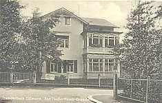Im Haus Nr. 2 wohnte bis zu seinem Tod 1925 Max Elb, Vorsitzender der Jüdischen Gemeinde von Dresden und des Verbandes der israelitischen Religionsgemeinschaften in Sachsen. Elb war Besitzer einer chemischen Fabrik und galt als einer der einflussreichsten Förderer liberalen jüdischen Lebens in der Stadt. Um 1940 befand sich hier das Fremdenheim von Martha Zillmann _(Foto rechts)_.

Typisch für die Frühzeit des Kurortes Weißer Hirsch ist das 1885/86 vom Architekten Ferdinand Schaeffer errichtete Landhaus "Waldesruhe" (Nr. 4) im Schweizerstil. Derartige Gebäude wurden einst als Sommeraufenthalt an wohlhabende Bürger vermietet. Schaeffer entwarf auch zahlreiche weitere Häuser am Weißen Hirsch und war einige Jahre als Gemeindevorstand tätig. Im Haus Kurparkstraße 8 _(Foto links)_ verbrachte der Vater des berühmten Tenors Richard Tauber seine letzten Lebensjahre.

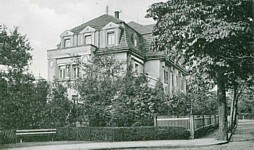Die Lehnertstraße erinnert an den Baumeister Theodor Lehnert (1828-1910), der zahlreiche Gebäude auf dem Weißen Hirsch entwarf. Lehnert war u. a. Schöpfer des alten Gasthofs Weißer Hirsch (1863) und des Fridabades (1867), Vorgänger des Lahmann-Sanatoriums. Von 1893 bis 1926 hieß diese Straße nach dem sächsischen König Albert (1828-1902) Albertstraße. Da es jedoch in Dresden und mehreren 1921 eingemeindeten Stadtteilen bereits gleichnamige Straßen gab, machte sich eine Umbenennung erforderlich. Dabei entschied man sich zu Ehren des sächsischen Generals Hermann von Broizem (1850-1918) für den Namen Broizemstraße. Broizem wirkte als Militärgeograph und war ab 1900 Generaladjutant König Alberts. Wegen des "militaristischen Bezugs" erfolgte am 1. Juli 1946 die Umbenennung in Lehnertstraße.

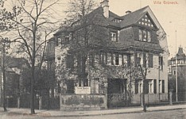Das Gebäude Lehnertstraße 1 entstand 1899 als Villa "Minna" (später Villa "Bertha") und befand sich im Besitz der Familie Lahmann. Ab 1939 wohnte hier der Chefarzt des Lahmann-Sanatoriums. Nach 1945 wurde die Villa durch sowjetische Offiziere genutzt und beherbergte zeitweise Probenräume des Blasorchesters der Deutschen Volkspolizei. 2008 erfolgte eine umfassende Sanierung.

In einer weiteren Villa (Lehnertstraße 4) befand sich seit 1953 eine Wochenkrippe. Das Gebäude war 1895 vom Baumeister Haase als Villa Mathilde errichtet und 1908 durch Max Herfurt umgebaut worden _(Foto rechts)_. Bis zum Zweiten Weltkrieg gehörte es zu den sogenannten "Lahmann-Villen", in denen Patienten des Sanatoriums untergebracht waren. Die Villen Lehnertstraße 6 (Villa Clara) und Nr. 8 _(Pension Neumann / Villa Grüneck - Foto links)_ dienten früher ebenfalls als Pensionen.

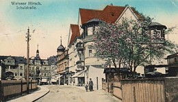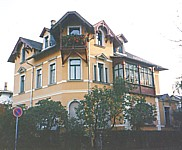Die Luboldtstraße wurde ab 19. März 1877 Schulstraße genannt, da sich hier seit 1876 das gemeindeeigene Schulhaus befand (Nr. 15). Unweit davon gab es ab 1887 eine "Kinderbewahranstalt", die zwei Jahre später einen durch Spenden finanzierten Neubau beziehen konnte (Nr. 18). Im Haus Nr. 24 _(Foto rechts)_ wurde 1903 das [Rathaus Weißer Hirsch](../../../nordost/page10246/) mit Standesamt und Sparkassenfiliale eingerichtet, bevor es 1911 in einen Neubau an der Bautzner Landstraße umzog. In einem Bebauungsplan von 1890 wurde der Abschnitt von der Bautzner Landstraße bis zum Lahmannring Schuhmachergasse genannt, der restliche Straßenteil Mittelweg. Allerdings wurden bei Namensgebungen wohl nie amtlich, so dass es bis zur Eingemeindung bei Schulstraße blieb. Zur Vermeidung von Verwechslungen erhielt die Straße am 1. Juni 1926 den Namen des Kommerzienrates Dr. phil. Rudolf August Luboldt (1831-1894). Luboldt war Mitbegründer der [Drogen-Appretur-Anstalt](../../../neustadt/leipziger_vorstadt/leipziger_strasse/arzneimittelwerk_dresden/) von Franz Ludwig Gehe, aus der später das Dresdner Arzneimittelwerk hervorging. Außerdem gehörte er viele Jahre dem Gemeinderat des Weißen Hirsch an.

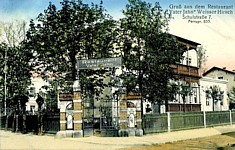Um 1880 entstanden auch hier verschiedene Villen und Landhäuser, von denen hier die Villen Nr. 2 (Villa Margot), Nr. 8 (Villa Sans Souci) und Nr. 15 (Villa Wettin) erwähnt werden sollen. Im 1910 erbauten Haus Nr. 10 befindet sich seit 1910 das Pfarrhaus der evangelischen Kirchgemeinde. Das Nachbarhaus Nr. 12 diente viele Jahre als Gaststätte, die ab 1903 zunächst "Rathskeller", ab 1912 "Restaurant Vater Jahn" genannt wurde _(Foto links)_. 2017 bezog das Brautmodengeschäft "Calesco Couture" die Räume.

Nr. 18 (Kindergarten): Die bis heute als Kita genutzte Einrichtung entstand 1887 auf Initiative eines eigens gegründeten Vereins zur Betreuung nicht schulpflichtiger Kinder. Hauptsächlich sollte so die Berufstätigkeit der zahlreichen weiblichen Arbeitskräfte für den Kurbetrieb gesichert werden. Der Besitzer des Gutes Ludwig Küntzelmann stellte dafür dem Verein ein Grundstück für den Bau einer Kinderbewahranstalt zur Verfügung. Ein Jahr später konnte der Kindergarten eröffnet werden. Als Schirmherrin fungierte die Frau des letzten sächsischen Königs Luise von Toscana. Betreiber blieb viele Jahre der Verein, dessen Vorsitz von 1909 bis 1916 der Obstbauexperte Arthur Pekrun hatte. Leiterin der auch Knippenbergheim genannten Kinderbewahranstalt war bis zu ihrem Tod 1929 Camilla Strick. Das Gebäude dient bis beute seinem Zweck und wird jetzt als Kita "Kinderspiel" genutzt.

Der Ludwig-Küntzelmann-Platz wurde im Zusammenhang mit dem Straßenausbau um 1880 an der Kreuzung Küntzelmannstraße / Lehnertstraße angelegt und zunächst nach dem deutschen Reichskanzler Bismarckplatz genannt. Bei der Umbenennung zahlreicher doppelter Straßennamen am 1. Juni 1926 erhielt er den Namen Küntzelmannplatz. 1932 änderte man diese Namensgebung mit Hinzufügung des Namens in Ludwig-Küntzelmann-Platz. Küntzelmann, früherer Besitzer des Gutes Weißer Hirsch, gilt als Gründer des Kur- und Villenvorortes.

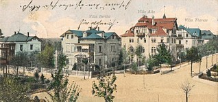

**_Foto:_** _Der frühere Bismarckplatz um 1910_

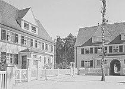Der Name Mönchsholz geht auf einen alten Flurnamen zurück, der 1420 im Zusammenhang mit dem Altendresdner Augustinerkloster entstand. Die Mönche hatten zu diesem Zeitpunkt einen Teil des Heidewaldes auf dem Gebiet des heutigen Stadtteils Weißer Hirsch vom Markgrafen von Meißen geschenkt bekommen, um hier Holz schlagen zu dürfen. Mit Auflösung des Klosters 1541 fiel die Fläche wieder an den Kurfürsten zurück. 1589 ist das Areal als "Münnicheholtz" in den Urkunden verzeichnet. Am 14. April 1927 erhielt die kleine Straße ihren Namen, die heute trotz ihrer Lage auf Bühlauer Flur meist zum Weißen Hirsch gerechnet wird.

In den 1920er Jahren entstanden am Mönchsholz zweigeschossige Doppelhäuser einer kleinen Siedlung. Die von Baumeister Paul Müller nach einem einheitlichen Konzept entworfenen Häuser wurden 1927 fertiggestellt und gehörten dem 1911 von Straßenbahnern gegründeten Spar- und Bauverein Bühlau & Umgebung. Bewohner waren meist kleine Angestellte, städtische Beamte und Handwerker, die ihre Wohnungen später käuflich erwerben konnten. Finanziert wurde das Bauvorhaben, um das es zuvor Diskussionen mit den Besitzern der angrenzenden Villengrundstücke gegeben haben, durch den Verkauf des geschlagenen Holzes an eine Sägemühle. 1993 wurde die gesamte Anlage unter Denkmalschutz gestellt und saniert _( **Foto:** Walter Möbius - SLUB/Fotothek)_.

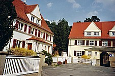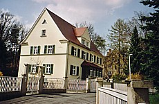

_Fotos: Wohnsiedlung Mönchsholz_

Die Neugersdorfer Straße wurde früher als Grase- bzw. Grenzweg bezeichnet, da hier die Flurgrenze zu Bühlau verlief. Nach der Eingemeindung hieß sie zunächst Danziger Straße, ab 1967 Neugersdorfer Straße.

Die Oskar-Zwintscher-Straße erhielt ihren Namen nach dem Porträt- und Landschaftsmaler Oskar Zwintscher (1870-1916). Zwintscher war ab 1903 an der Kunstakademie als Professor beschäftigt und liegt auf dem Loschwitzer Friedhof begraben. Zwischen 1945 und 1991 trug die Straße den Namen Hans-Schubert-Straße. Schubert lebte von 1905 bis 1947 und war während des Zweiten Weltkriegs im Strafbataillon 999 eingesetzt. Zwei Jahre nach Kriegsende verunglückte der Antifaschist in der Dresdner Heide.

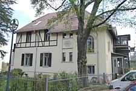

_Foto: Das Wohnhaus Oskar-Zwintscher-Straße 3_

Der kurze Röhrweg zweigt gegenüber der Luboldtstraße von der Bautzner Landstraße in Richtung Dresdner Heide ab und bildet den Zugang zum früheren Kurpark. 1880 wird er in den Gemeindeakten als Röhrweg erwähnt. Der Name erinnert an eine 1773 vom damaligen Besitzer des Gutes Weißer Hirsch Heinrich Roos angelegte Wasserleitung, die über eine hölzerne Röhrfahrt Wasser aus der Dresdner Heide in einen Rohrwassertrog leitete. Der Röhrweg ist in zahlreichen Stadtplänen verzeichnet, findet sich jedoch nicht im offiziellen Straßenverzeichnis.

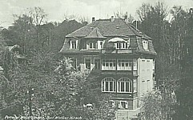Der Silberweg am Rathauspark verdankt seinen Namen der Wohltäterin Helene Silber, die der Gemeinde Weißer Hirsch 6.100 Mark zu gemeinnützigen Zwecken stiftete. Die Silber-Stiftung wurde am 1. April 1906 eingerichtet und bis zum Tod der Stifterin alljährlich um 1000 Mark aufgestockt. Erstmals ist die Straße im Adressbuch von 1914 verzeichnet. Helene Silber lebte viele Jahre in einem Haus an der Bautzner Landstraße, später auf der Hietzigstraße 2. Von den wenigen Gebäuden am Silberweg wurden die Häuser Nr. 1 _(Foto)_ und 2 früher als Pension genutzt. Beide waren Teil der "Logierhaus und Pension Villa Waldesruh". Haus Nr. 4 ist unter dem Namen "Villa Elisabeth" im Adressbuch verzeichnet.

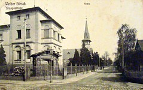Die Stangestraße erinnert seit 1903 an den Kaiserlich-Russischen Collegienrat Nicolaus Stange (1819-1902), der ab 1873 das Grundstück Bautzner Landstraße 17 besaß. Zuvor wurde die Straße wegen ihrer Lage im Ortszentrum seit dem 19. März 1877 Mittelstraße genannt. Stange war Förderer des Baus einer eigenen [evangelischen Kirche](../../../nordost/page10246/kirche_weisser_hirsch/) für den Ort, für deren Bau und Ausstattung er 10.000 Mark stiftete. Eine weitere Stiftung richtete er für die Unterstützung mittelloser Schüler mit Büchern und die alljährliche Prämierung der besten Schüler der Gemeinde ein.

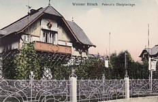Bis zu seinem Tod 1940 bewohnte der Unternehmer und Bankier Arthur Pekrun die Villa "Paulus" auf der Stangestraße 2 _(Foto rechts)_. Pekrun war Mitinhaber des Bankhauses Menz, Pekrun & Co. (Prager Straße 50) und wurde als [Obstbauexperte](../../../Nordost/Page10246/Strassen_Weisser_Hirsch/Plattleite/Pekrun/pekrun.html) bekannt. Der auf diesem Gebiet autodidaktisch Tätige verfasste um 1903 zwei Fachbücher über Zucht und Schnitt von Obstgehölzen, die über Jahrzehnte als Standardwerke dieses Fachgebietes verlegt wurden. Außerdem setzte er sich für den weiteren Ausbau der Kuranlagen am Weißen Hirsch ein und initiierte als Mitglied des Verschönerungsvereins Weißer Hirsch 1905 die Anlage des [Konzertplatzes](../../../nordost/page10246/rathauspark/). Weitere Gebäude dienten als private Sommerwohnungen bzw. Pensionen, so das Fremdenheim Zufriedenheit auf der Stangestraße 4.

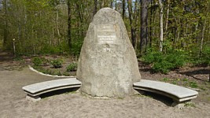Die Stechgrundstraße erhielt ihren Namen nach einer Flurbezeichnung. Der tief eingeschnittene Grund erstreckt sich nördlich des [Rathausparkes](../../../nordost/page10246/rathauspark/) und wird vom Mordgrundwasser durchflossen. Gespeist wird das Gewässer von mehreren Quellen, hauptsächlich der Schwesternquelle. 1641 ist im Stechgrund eine heute nicht mehr lokalisierbare Schneidemühle genannt. Ende des 19. Jahrhunderts ließ der Verschönerungsverein Weißer Hirsch/Oberloschwitz am Ende der Stechgrundstraße einen Monolith errichten. Mit zwei steinernen Ruhebänken war dieser Platz Teil der neuen Kuranlagen, die die Attraktivität des Ortes erhöhen sollten _(Foto)_.

Ursprünglich wurde die kurze Straße um 1901 Karlstraße genannt, wobei der Namensgeber unbekannt ist. Bereits vor dem Ersten Weltkrieg wechselte die Namensgebung in Lahmannstraße, da sich hier das Lahmann-Sanatorium und Heinrich Lahmanns [Villa "Heinrichshof"](../../../nordost/page10246/strassen_weisser_hirsch/lahmann-sanatorium/) befand (Nr. 1). Um Verwechslungen mit dem Lahmannring zu vermeiden, entschied man sich im Zusammenhang mit der Umbenennung zahlreicher Straßen am 1. Juni 1926 für den neuen Namen Zum Stechgrund. Zwei Jahre später, am 10. April 1928 erhielt die Stechgrundstraße ihren jetzigen Namen.

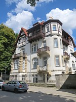Villa Emma: Bemerkenswertestes Gebäude an der Stechgrundstraße ist die 1903 entstandene Villa "Emma" unmittelbar neben dem Parkhotel (Nr. 2). Bauherr war der Hoftraiteur Friedrich Wilhelm Würffel, Besitzer des benachbarten Parkhotels, der sie nach seiner Frau Emma benannte. Ab 1906 diente die Villa als "Dependance" des Hotels, welches wenig später durch einen repräsentativen Neubau ersetzt wurde. Ab 1914 gehörte sie mit dem gesamten Komplex der Parkhotel Weißer Hirsch GmbH von Jaques Bettenhausen.

Nach dem Zweiten Weltkrieg wurde sie vorübergehend von der Roten Armee beschlagnahmt und erst 1951 wieder zurückgegeben. Später diente sie als Fremdenheim, nach 1990 dann als Gästehaus des Goethe- und des Max-Planck-Institutes. Zu den Gästen des Hauses gehörten u.a. die Stargeigerin Vanessa Mae, der Sänger Bob Dylan und der frühere Außenminister Joschka Fischer. 1993 wurde das historische Gebäude saniert und als Hotel wiedereröffnet. Im Erdgeschoss entstand das italienische "Ristorante Delizia". An der Fassade erinnert ein Fries mit Weinstock an den früher auch am Weißen Hirsch betriebenen Weinbau. Seit 2014 trägt das Hotel den Namen "Sax-Imperial".

Die Zeppelinstraße wurde nach dem Erfinder des Luftschiffs, Graf Zeppelin benannt. 1960 bezog man einige der Villen in das Forschungsinstitut Manfred von Ardennes ein. Zu diesen gehörte u.a. das 1912 für den Fabrikbesitzer Georg Meißner errichtete neobarocke Landhaus Nr. 7. Die Entwürfe stammen vom renommierten Dresdner Architektenbüro Lossow & Kühne. Die auf dem Grundstück befindliche Sternwarte entstand 1969 und bildet einen markanten Blickpunkt am Elbhang. Heute leben und arbeiten hier die Nachkommen des 1997 verstorbenen Physikers.

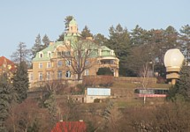Nr. 7: Die markant am Hang des Elbtals stehende schlossartige Villa entstand 1912 für den Fabrikbesitzer Georg Meißner. Architekt des Neobarockbaus war das bekannte Büro Lossow & Kühne. Georg Meißner hatte viele Jahre auf Sumatra gelebt und dort als Verwalter einer Tabakplantage gelebt. Zurückgekehrt nach Deutschland arbeitete er zuletzt als Liquidator der Titan- und Karang-Gesellschaft und besaß zudem eine Holz- und Pappenfabrik in Bad Berka. Seine reichhaltige Sammlung von völkerkundlichen Gegenständen, die er auf mehreren Expeditionen in Südostasien zusammengetragen hatte, befindet sich heute in den ethnografischen Museen in Berlin, Stuttgart, Wien, Petersburg und Dresden.

Nach seinem Tod erwarb 1920 der Fabrikbesitzer und Kommerzienrat Rudolf Naumann die Villa, verkaufte diese jedoch wenige Jahre später an das Ehepaar Richard und Lucia Lieberknecht. Lieberknecht war Inhaber einer Wirkmaschinenfabrik in Oberlungwitz und entwickelte die KALIO-Komplettmaschine, die es erlaubte, Strümpfe mit Ferse, Doppelrand und voll ausgeformt in einem Arbeitsgang zu wirken. Das kunstinteressierte Paar gehörte zu den Förderern des Malers Sascha Schneider und lernte über diesen auch die Witwe Karl Mays kennen, mit der das Paar bis zu ihrem Tod 1944 befreundet war und auch mehrere Reisen unternahm. Nach dem Zweiten Weltkrieg gehörte das Haus ab 1960 dem Wissenschaftler Manfred von Ardenne, der auf mehreren Grundstücken an der Zeppelinstraße und der Plattleite sein [Institut](../../../Nordost/Page10246/Strassen_Weisser_Hirsch/Plattleite/Ardenne-Institut/ardenne.html) einrichtete.

[Weißer Hirsch auf OpenStreetMap](https://www.openstreetmap.org/search?query=Dresden+Wei%C3%9Fer+Hirsch)

* * *

 \[ [Home](../../../index.html)\] \[ [Nord](../../../nord/)\] \[ [Nordwest](../../../nordwest/)\] \[ [Neustadt](../../../neustadt/)\] \[ [Nordost](../../../nordost/)\] \[ [West](../../../west/)\] \[ [Zentrum](../../../zentrum/)\] \[ [Südwest](../../../sudwest/)\] \[ [Süd](../../../sud/)\] \[ [Südost](../../../sudost/)\] \[ [Ost](../../../ost/)\] \[ [Register](../../../Register/register.html)\] \[ [Kontakt](../../../Kontakt/kontakt.html)\] \[ [Impressum](../../../impressum/)\]
