* * *

* * *

* * *

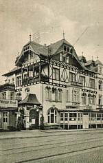

_Altes Kurhaus_

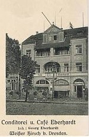

_Café Eberhard_

_(Bautzner Landstraße 9)_

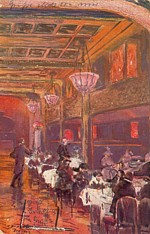

_Innenräume der "Teufelsdiele"_

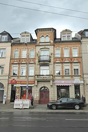

_Bautzner Landstraße 11_

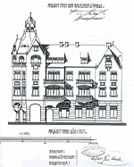

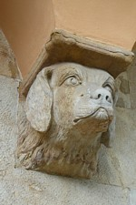

_Bauzeichnung vom Wohnhaus Bautzner Landstraße 15 und Plastik am Eingang Röhrweg_

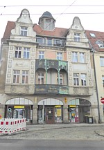

_Bautzner Landstraße 10_

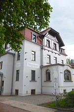

_Ehemaliges Gemeindeamt_

_(Bautzner Landstr. 17)_

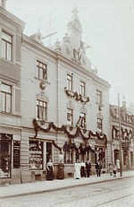

_Bautzner Landstraße 18_

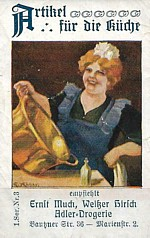

_Werbung der Adler-Drogerie_

_(Bautzner Landstr. 26)_

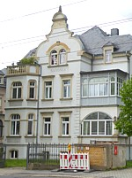

_Villa Saxonia_

_(Bautzner Landstr. 29)_

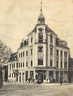

_Eckhaus zum Rißweg_

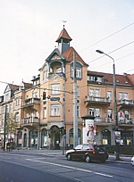Die heutige Bautzner Landstraße ist Teil eines alten Weges oberhalb des Elbtales, der über Briesnitz und die heutige Neustadt weiter nach Stolpen und Bautzen führte und deshalb auch als Stolpische Straße bzw. Alte Budissinsche Land- und Poststraße bezeichnet wurde. Fuhrleute und Händler benutzten diese Straße ebenso wie Angehörige des Dresdner Hofes, die über diesen Weg ihr Jagdrevier in der Dresdner Heide und später den fernen Warschauer Hof erreichten. Die stark befahrene Straße war noch gegen Ende des 18. Jahrhunderts weitgehend unbefestigt. Als besonders schwer zu überwinden galt der Anstieg oberhalb der Mordgrundbrücke, der deshalb mehrfach seine Streckenführung wechselte. Am seinem Ende lag der [Gasthof Weißer Hirsch](../../../../nordost/page10246/strassen_weisser_hirsch/bautzner_landstrasse/gutshaus_weisser_hirsch/), wenige Minuten entfernt die Lohschänke, Vorgängerin des [“Weißen Adlers”](../../../../nordost/page10246/strassen_weisser_hirsch/bautzner_landstrasse/weisser_adler/). Außerdem gab es hier ein Einnehmerhaus zur Erhebung des Straßenzolls.

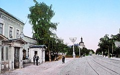1784 begann auf Befehl Friedrich August III. der Ausbau der alten Bautzner Landstraße zur Chaussee, welche noch im gleichen Jahr bis zum Weißen Hirsch und 1785 bis zur Ortsgrenze von Bühlau fertiggestellt war. Nach 1815 folgte der Abschnitt von Bühlau über Weißig bis zum Fischbacher Kreuz. In diesem Zusammenhang erneuerte man auch die Mordgrundbrücke, bevor diese 1826 durch eine neue Steinbrücke ersetzt werden konnte. Im 19. Jahrhundert wuchs der Verkehr auf dieser Strecke stark an. Vor allem die Entwicklung des Kurortes Weißer Hirsch machte neue Verkehrsmittel erforderlich. Bereits ab 1866 verkehrte ein Pferdeomnibus zwischen Waldschlößchen und Weißer Hirsch. Zwanzig Jahre später richtete ein privater Unternehmer eine Dampfomnibuslinie ein. Das Fahrzeug verfügte über 16 Sitzplätze und besaß am hinteren Ende einen Dampfkessel, der die Maschine antrieb. Wegen seines hohen Gewichts und des ohrenbetäubenden Lärms während der Fahrt musste dieser Omnibus jedoch bereits acht Tage später wieder außer Betrieb genommen werden.

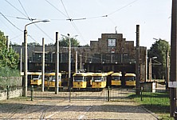Nachdem 1895 die Standseilbahn eröffnet worden war, verbesserten sich die Verkehrsbedingungen zum Weißen Hirsch erheblich. Im gleichen Jahr entstand eine weitere private Omnibuslinie zum Waldschlößchen. 1899 wurde diese durch die elektrische Straßenbahn ersetzt, wofür die Straße komplett erneuert und teilweise neu ausgebaut werden musste. Am 22. August 1899 fuhr erstmals ein Straßenbahnzug nach Bühlau. Im gleichen Jahr entstand der noch bis 2003 genutzte Straßenbahnhof _(Foto)_. Ursprünglich war sogar der Transport von Güterwagen über Weißig und Bühlau geplant, weshalb die Gleise eine dritte Schiene erhielten. Letztlich ging diese Schmalspurbahn jedoch nie in Betrieb. Lediglich die bestehende Straßenbahnstrecke wurde 1908 bis zum Endpunkt Weißig der 1952 stillgelegten [Hochlandbahn](../../../../nordost/schonfeld-weissig/weissig/hochlandbahn/) verlängert. Am 1. Juni 1926 erhielt die bisherige Bautzner Straße in den Gemarkungen Weißer Hirsch, Loschwitz und Bühlau offiziell ihren heutigen Namen und wurde dabei auch neu durchnummeriert.

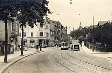Wegen des steilen Anstiegs am Hirschberg waren auf der Bautzner Landstraße spezielle Betriebsbedingungen erforderlich. So kamen hier besonders leistungsstarke Fahrzeuge zum Einsatz. Ab 1931 setzte die Dresdner Straßenbahn nach Bühlau die von Alfred Bockemühl entwickelten Großen Hechtwagen ein, die noch bis Anfang der 1970er Jahre das Straßenbild prägten _( **Foto:** Nähe Rißweg - SLUB / Fotothek)_. Eine weitere Besonderheit stellte der Güterverkehr der “Wäschewagen” dar, die ab 1901 die Wäsche Dresdner Bürgersfamilien zur Reinigung zum Weißen Hirsch und nach Bühlau brachten. Bis heute ist die Bautzner Landstraße eine der wichtigsten Dresdner Verkehrsadern im Norden der Stadt. Seit 2009 trägt auch der in Bühlau anschließende Straßenabschnitt über Weißig - Rossendorf den Namen Bautzner Landstraße (zuvor Dresdner bzw. [Bautzner Straße](../../../../nordost/schonfeld-weissig/weissig/strassen_weissig/)).

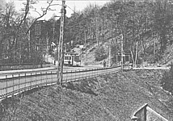 Mordgrundbrücke: Die Brücke über den Stechgrund wurde bereits 1420 erstmals erwähnt. Der Name des Tales hat nichts mit Mord zu tun, sondern wurde wahrscheinlich vom altdeutschen Wort für Grenze abgeleitet. 1587 erfolgte ein Neubau in Stein, der 1784 durch eine provisorische Holzbrücke ersetzt wurde. 1828 entstand die bis heute erhaltene Steinbrücke über das Tal. Für die Dresdner Straßenbahn befand sich bis 2001 eine Rangierstelle an der Mordgrundbrücke, die erst im Zuge des Ausbaus der Strecke für moderne Stadtbahnwagen aufgegeben wurde. Über einen Gleiswechsel, später ein Gleisdreieck, konnten hier Straßenbahnzüge wenden bzw. auf einem Auszugsgleis im Stechgrund abgestellt werden.

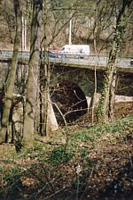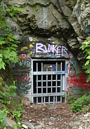Unweit der Mordgrundbrücke befindet sich ein aufgelassener Steinbruch, welcher während des Zweiten Weltkrieges zu einem Bunker für den Befehlshaber des SS-Oberabschnitts Elbe ausgebaut wurde. Nach dem Luftangriff vom 13. Februar 1945 befand sich hier die Dienststelle des Stabs des Höheren SS- und Polizeiführers, welcher mit der Bewältigung der Folgen des Angriffs beschäftigt war. Hier entstand auch der Abschlussbericht des Stabes, in dem detailliert die zerstörten Gebäude und Anlagen aufgelistet wurden. Der Eingang und die Reste der vermauerten Bunkeranlagen sind noch zu sehen _(Foto rechts)_.

In der Nähe der Mordgrundbrücke liegt die sogenannte [Napoleonschanze](../../../../nordost/dresdner_heide/), die bereits im Siebenjährigen Krieg 1758 von den Preußen aufgeschüttet wurde. 1813 diente sie als Beobachtungsposten der napoleonischen Armee vor der Schlacht bei Dresden. Damals ließ General Davonte das Bollwerk eigens zum Schutz der strategisch wichtigen Mordgrundbrücke wiederherstellen. Später wurde das Areal der Napoleonschanze in den Albertpark einbezogen.

[_Die Sage vom Mordgrund_](../../../../nordost/page10246/strassen_weisser_hirsch/bautzner_landstrasse/sage_vom_mordgrund/)

Weißer Hirsch:

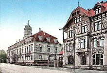Obwohl die Bebauung des Weißen Hirschs zunächst abseits der heutigen Bautzner Landstraße begann, entwickelte sich dieser Teil spätestens im 19. Jahrhundert zum Zentrum der Gutsgemeinde. Größtes Gebäude war das 1755/56 errichtete Gutshaus (heute Nr. 6) mit seinem Dachreiter, welches trotz mehrfacher Umbauten sein historisches Bild weitgehend bewahren konnte. Um dieses Gut siedelten sich Häusler an, die ihre bescheidenen Fachwerkhäuser an der Plattleite und der Südseite der Bautzner Straße errichteten. Bis in jüngste Vergangenheit blieben die Gebäude Bautzner Landstraße Nr. 16 (2016 abgetragen) und 30 erhalten, die zumindest im Kern noch auf diese Zeit zurückgehen.

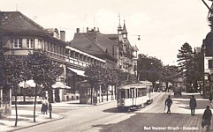Im 19. Jahrhundert wurden jedoch die meisten dieser Häuser zugunsten repräsentativer Villen und Pensionen abgebrochen. Gleichzeitig begann ab 1804 die Bebauung der Nordseite der Bautzner Landstraße. Gegenüber dem Gutshaus entstand aus einem 1863 gegründeten Gasthof das [Parkhotel](../../../../nordost/page10246/strassen_weisser_hirsch/bautzner_landstrasse/parkhotel/). In dessen Nachbarschaft wurden um 1900 an Stelle kleinerer Anwesen mehrstöckige Wohn- und Geschäftshäuser sowie 1907-11 das bis 2008 von der Sparkasse genutzte [Rathaus](../../../../nordost/page10246/) der Gemeinde errichtet (Nr. 17). Aus dem 1867 entstandenen Frida-Bad entwickelte sich nach Übernahme durch Heinrich Lahmann der ausgedehnte Komplex des [Lahmann-Sanatoriums](../../../../nordost/page10246/strassen_weisser_hirsch/lahmann-sanatorium/).

Nr. 4: Das Eckhaus an der Einmündung der Collenbuschstraße gehört, ebenso wie sein Pendant an der gegenüberliegenden Straßenseite (Collenbuschstraße 32) zu den ersten großstädtischen Bauten des Stadtteils. Bauherr war 1893 der Baumeister und Architekt Ferdinand Richard Schaeffer, Inhaber der Firma F. Richard Schaeffer & Sohn. Schaeffer entwarf zahlreiche Wohn- und Geschäftshäuser in seinem Heimatort und hatte sein Büro um 1910 im Haus Bautzner Landstraße 10.

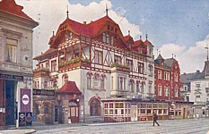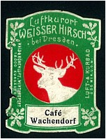Café Wachendorf: Die einst bekannte Konditorei an der Ecke zur Plattleite (Nr. 68) befand sich ab 1907 im Besitz von Alfred Heinrich Wachendorf. Zuvor wurde die Erdgeschossräume des 1895 fertig gestellten Hauses von der Bäckerei Jahn bzw. Johne genutzt. An diese erinnern noch die Initialen an der Fassade neben einem lateinischem Spruch, der übersetzt "Einige hassen mich, viele erfreuen sich an meiner Muße" bedeutet. Nach der Übernahme ließ Wachendorf für seine Gäste die Räumlichkeiten erweitern und eine verglaste Veranda anbauen. Die Gestaltung übernahm der Künstler Josef Goller. Vor allem die Patienten des gegenüberliegenden Lahmann-Sanatorium waren häufige Besucher des Cafés. Ab 1925 übernahm Alfred Wachendorf in den Sommermonaten auch die Bewirtschaftung des Konzertplatzes.

Nach 1945 musste der Cafébetrieb eingeschränkt werden. Die Veranda fiel 1953 einer Straßenverbreiterung zum Opfer. Trotzdem führten Wachendorfs Nachkommen das Geschäft noch bis 1986 weiter. Heute werden die ehemaligen Verkaufs- und Gasträume von verschiedenen Geschäften, u.a. seit 1948 vom Augenoptiker Glaser genutzt.

Nr. 5 (Koppelts Weinstuben): Das Eckhaus an der Stechgrundstraße wurde 1893 für Carl Koppelt erbaut, der im Erdgeschoss eine Weinstube einrichtete. Später wurde das Lokal als Weinrestaurant Kaiserkeller betrieben. 1907 erwarb das angrenzende [Lahmann-Sanatorium](../../../../nordost/page10246/strassen_weisser_hirsch/lahmann-sanatorium/) das Gebäude und ließ es für die Verwaltung des Kurbetriebes umbauen.

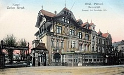Kurhaus Weißer Hirsch: Der Gebäudekomplex Bautzner Landstraße 6/6a war Ausgangspunkt der Entwicklung des Kurortes. Aus dem früheren [Gut Weißer Hirsch](../../../../nordost/page10246/strassen_weisser_hirsch/bautzner_landstrasse/gutshaus_weisser_hirsch/) ging Ende des 19. Jahrhunderts das Kurhaus mit Konzertsaal und Restaurant hervor. Dafür entstand 1884 das später oft als "Altes Kurhaus" bezeichnete Gebäude Bautzner Landstraße 6 im Landhausstil _(Foto)_. Mitte der 1930er Jahre erfolgte der Umbau des Saales zum Kino. Kurzzeitig gab es hier auch ein Spielcasino. Das nach 1945 nur noch als Wohnhaus dienende Gebäude wurde 1993 saniert und zum Stadtteilzentrum umgebaut.

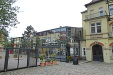Park-Lichtspiele: Das Kino im ehemaligen Kursaal wurde 1938 als letztes Dresdner Lichtspielhaus vor dem Zweiten Weltkrieg eingerichtet. Besitzer war Conrad Martini, ab 1943 Richard Meißner, die die Räume von der Kurhaus- und Parkhotel Weißer Hirsch GmbH gemietet hatten. Das mit moderner Kinotechnik und einer "Spezialfarborgel" zur Erzeugung von Lichteffekten ausgestattete Haus besaß 400 Plätze und blieb auch nach 1945 geöffnet. Wirtschaftliche Gründe und der schlechte Bauzustand des Gebäudes führten schließlich 1992 zur Schließung. Nach Umbau und Sanierung befindet sich hier heute ein Einkaufszentrum und das italienische Restaurant "Delizia" _(Foto)_.

Nr. 8 -10: Die beiden Stadthäuser bilden zusammen mit den Gebäuden Luboldtstraße 28 und 30 eine Gebäudegruppe und entstanden 1904/05 nach Entwürfen von Max Herfurt, der für zahlreiche Bauten am Weißen Hirsch verantwortlich war. Beide Häuser bekamen, dem Charakter des Kurortes entsprechend, eine aufwendige Fassadengestaltung mit Erkern und Ziergiebeln, einer kupferverkleideten Loggia und einem Dachreiter und gehören zu den interessantesten architektonischen Zeugnissen der Zeit kurz nach der Jahrhundertwende. Im Erdgeschoss gab es Geschäfte, u.a. eine Filiale des Waaren-Einkaufs-Vereins zu Görlitz und eine Haushaltwarenhandlung.

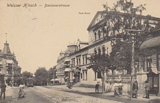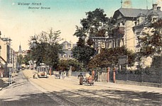

**_Fotos:_** _Die Bautzner Landstraße um 1900 - im linken Bild das alte Parkhotel_

Häusergruppe Nr. 9 - 15: Die ersten Gebäude gegenüber dem alten Gutshaus entstanden ab 1804, als man an dieser Stelle die Bebauung von 14 Grundstücken genehmigte. Allerdings wurde bis Mitte des 19. Jahrhunderts nur eingeschränkt von dieser Genehmigung Gebrauch gemacht, da bis 1836 lediglich sechs Parzellen bebaut waren.

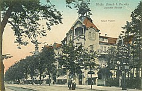 Um 1900 erwarben Investoren, unter ihnen der Baumeister Ferdinand Schaeffer, die Grundstücke und ließen die vorhandenen bescheidenen Wohnhäuser durch repräsentative Mehrfamilienhäuser ersetzten. Um die architektonische Gestaltung entbrannte ein heftiger Streit zwischen Architekt und Baubehörde, in dem sich Schaeffer jedoch schließlich durchsetzte. 1904/05 konnten die Gebäude, die zum Teil interessante Fassaden- und Treppenhausgestaltungen im Jugendstil besitzen, fertiggestellt werden. Die Erdgeschossräume beherbergten Ladenlokale und Gaststätten. Im Haus Nr. 15 befand sich bis zum Ersten Weltkrieg das Postamt Weißer Hirsch _(Foto)_. In den Treppenhäusern haben sich bis zur Gegenwart teilweise interessante Glasfenster mit Pflanzen- und Landschaftsdarstellungen erhalten.

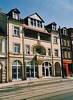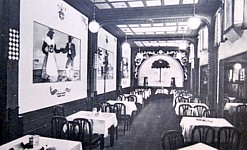Weihenstephan (Nr. 9): Die zunächst als Haushaltwarenhandlung und Färberei genutzten Räume im Erdgeschoss des 1904 fertiggestellten Hauses _(Foto links)_ beherbergten bis zum Ersten Weltkrieg das Café Eberhardt, zeitweise mit Hotelbetrieb. In den 1920er Jahren hatte hier die renommierte Privatbank Grieshammer & Söder ihren Sitz. Später befand sich in den Räumen das bekannte Vergnügungslokal "Teufelsdiele", wobei die Gasträume mit Malereien nach einem Entwurf von Josef Goller ausgestaltet waren. Nach dem Auszug übernahm ein neuer Besitzer die Gaststätte und benannten sie in "Weihenstephan" um. Inhaber war der aus Bayern stammende Oswald Danneberg, der neben den im typisch bayrischen Brauhausstil eingerichteten Lokal _(Foto rechts)_ auch einen großen Biergarten betrieb. Bis 1982 war das Lokal als Speisegaststätte geöffnet.

Nach 1990 gab es hier einen Möbelhandel. Zwischen 1998 und 2001 nutzte eine Filiale der Deutschen Bank die ehemaligen Gaststättenräume. Später befand sich dort ein Drogeriemarkt.

Nr. 11 (Bäckerei Faust): Im 1898 von Ferdinand Richard Schaeffer erbauten Nachbarhaus Nr. 11 gab es früher die Café-Konditorei Faust, eine der beliebtesten Konditoreien im Kurort mit großem Kaffeegarten. Inhaber war der Bäckermeister Paul Faust (1884-1939), der den 1868 gegründeten Betrieb von seinem Vater übernommen hatte. Bekannt wurde das Café vor allem durch seinen großzügig gestalteten und üppig bepflanzten Gästegarten im hinteren Teil des Grundstücks. Bis heute befindet sich die Bäckerei in Familienbesitz (seit 1951 Bäckerei und Konditorei George). Zeitweise gab es im Haus auch eine Verkaufsstelle von Pfunds Molkerei.

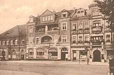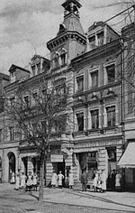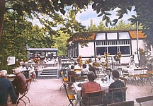

**_Fotos:_** _Blick auf die Häusergruppe Nr. 9 -11 mit der Konditorei Faust an der Bautzner Landstraße_

_\- Hauptgebäude mit Laden und Gästegarten_

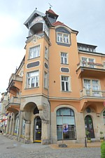Nr. 11b (Foto Wolf): Das ursprünglich als Filiale des Photohauses Martin Richter gegründete Traditionsgeschäft gehört seit 1939 der Familie Wolf. Firmengründer Herbert Wolf hatte im Stammhaus Richters auf der Viktoriastraße 6 im Stadtzentrum seine Ausbildung gemacht und dann die Filiale in Eigenregie übernommen. Schwerpunkt der Geschäftstätigkeit war der Verkauf von Fotoapparaten und Zubehör und die Entwicklung von Filmen. 1972 übernahm Sohn Steffen, 2015 Enkel Rico Wolf den Familienbetrieb.

Nr. 15: Den Abschluss der Gebäudegruppe zum heute nicht mehr amtlich benannten Röhrweg bildet das 1904 vollendete Wohn- und Geschäftshaus Nr. 15. Architekt und Inhaber war Ferdinand Richard Schaeffer, der die Fassade entgegen den Wünschen der Baubehörde aufwendig mit floralen und figürlichen Jugendstilelementen gestaltete. Über dem Eingang zum Röhrweg erinnert ein Bronzerelief und die Plastik eines Hundes an den Bauherren. Nutzer war zunächst bis 1914 die [Kaiserliche Reichspost](../../../../nordost/page10246/). Später befand sich hier ein Uhrengeschäft sowie bis 1961 die bekannte Eisenwarenhandlung Hermann Richter. Heute nutzt die Commerzbank die Räumlichkeiten _(Foto links)_.

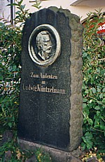Küntzelmann-Denkmal: Der Gedenkstein gegenüber des Eingangs zum Rathauspark erinnert an den Seifenfabrikanten und früheren Besitzers des Gutes Weißer Hirsch Ludwig Maximilian Küntzelmann. Dieser hatte 1872 das Gut erworben, die Grundstücke parzelliert und an Bauwillige verkauft und so den Grundstein für die Entwicklung des Kurortes Weißer Hirsch gelegt. Nach seinem Tod 1881 bildete sich ein Ausschuss zur Schaffung eines Gedenksteins, welcher am 15. Juli 1883 feierlich enthüllt wurde _(Foto)_. Schöpfer des Bronzereliefs war Reinhard Schnauder.

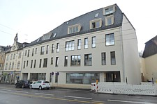Nr. 14/16: Der moderne Neubau auf diesem Grundstück entstand 2016 nach einem Entwurf des Architekten Jens Zander. Mit der ungewöhnlichen Fassaden- und Dachgestaltung soll ein Übergang zwischen zwei Gründerzeithäusern und einem kleinerem Haus aus der Frühzeit des Weißen Hirschs geschaffen werden. Im Neubau befinden sich sechs Wohnungen und Büroräume. Zwei weitere Bauten im hinteren Teil des Grundstücks ergänzen das Ensemble. Ursprünglich standen hier kleinere Häuser aus der Zeit um 1850, die vor dem Zweiten Weltkrieg u.a. eine Blumenhandlung, ein Tabakwarengeschäft und eine Fischhandlung beherbergten.

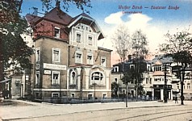Nr. 17: Das Gebäude entstand 1904 und war ab 1907 [Gemeindeamt](../../../../nordost/page10246/) des Weißen Hirschs. Außerdem befand sich hier der Sitz der örtlichen Sparkasse und der Kurverwaltung des Bads Weißer Hirsch. Nach der Eingemeindung war im Haus ab 1921 die Verwaltung des Stadtbezirkes 19, zu dem neben dem Weißen Hirsch auch Bühlau, Rochwitz und Wachwitz gehörten, untergebracht. Nach 1945 diente die Villa bis 2008 als Filiale der Dresdner Stadtsparkasse. Anschließend erfolgte eine umfassende Sanierung und der Umbau zum Ärztehaus.

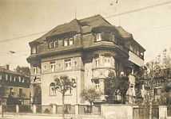Nr. 21 (Villa Wettin): Das Gebäude _(Foto)_ entstand um 1910 ebenfalls nach einem Entwurf von Max Herfurt für die Familie Großer. Die Glasfenster gestaltete Josef Goller. Ehregott Großer übernahm am 1. Januar 1896 das Amt des Gemeindevorstands auf dem Weißen Hirsch und führte dieses bis zu seiner Pensionierung 1912 aus. Nach 1990 befand sich in den Räumen der Villa das Restaurant "Amadeus".

Nr. 22: Das Mitte des 19. Jahrhunderts entstandene zweistöckige Wohnhaus (ehem. Bautzner Straße 31) gehörte bis zu seinem Abriss 2013 zu den wenigen noch erhaltenen Häusern aus der Frühzeit des Weißen Hirschs. Das Gebäude diente überwiegend Wohnzwecken, im Erdgeschoss befand sich vor 1945 ein Wäschegeschäft. Später nutzt noch bis Ende der 1980er Jahre der staatliche Rundfunk-Fernsehhandel RFT die Räume. Nach jahrelangem Leerstand wurde das Haus im November 2013 abgerissen. Künftig ist hier ein modernes Wohn- und Geschäftshaus geplant.

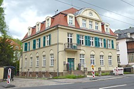Nr. 23: Das kurz vor dem Beginn des Ersten Weltkriegs errichtete Gebäude diente ab 1914 als [Postamt Weißer Hirsch](../../../../nordost/page10246/), nach der Eingemeindung des Ortes als Postamt Dresden Bad Weißer Hirsch bezeichnet. Heute wird es als Wohnhaus genutzt _(Foto)_.

Nr. 24: Das Haus entstand 1912/13 nach Plänen von Max Herfurt für den Bautechniker Max Müller. Bis heute erinnert die Signatur des Architekten an der Fassade daran. Im Erdgeschoss befand sich viele Jahre ein Blumenhandel. Später bezogen ein Maßatelier und ein Kosmetikstudio die Ladenräume des Erdgeschosses.

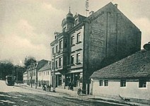Nr. 26: Das kurz nach 1900 entstandene Wohn- und Geschäftshaus war viele Jahre Domizil der Adler-Drogerie, die sich im Besitz von Ernst Much befand _(Foto)_. Much ließ über dem Eingang den Buchstaben "M" als Initiale anbringen. Zeitweise befanden sich im Haus auch ein Souvenirgeschäft und eine Filiale des Kurierdienstes "Grüne Radler". Heute werden die Räume von einem Schreibwarengeschäft genutzt.

Nr. 28: Das Anfang des 20. Jahrhunderts errichtete Wohn- und Geschäftshaus beherbergte früher einen Süßwarenladen und diente zu DDR-Zeiten als Lager der HO. 1990 mietete die Möbeltischlerin Maria Arlt die Räume im Erdgeschoss und richtete hier die Galerie Rahmen & Bild ein. Regelmäßig finden hier Galerieausstellungen von Malern und Grafikern statt.

Nr. 30: Das Mitte des 19. Jahrhunderts entstandene zweistöckige Wohn- und Geschäftshaus blieb als eines der letzten Gebäude des alten Hirschs erhalten. Im Erdgeschoss befinden sich zwei Ladenlokale, Ober- und Mansardgeschoss beherbergen Wohnungen.

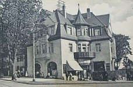Nr. 32: Auch dieses 1912 fertiggestellte Wohn- und Geschäftshaus an der Ecke Bautzner Landstraße / Steglichstraße _(Foto)_ wurde von Max Herfurt projektiert. Im Erdgeschoss befand sich zunächst die Konditorei Lippoldt mit angeschlossenem Weinausschank. Später übernahm August Bleicher die Räume und richtete hier das "Café Bleicher" ein. Zwischen 1963 und 1992 folgte die Konditorei Binneberg. Nach einer kompletten Sanierung des Hauses setzte bis 2020 das Gourmet-Restaurant "Bean & Beluga" die gastronomischen Traditionen fort. Neben dem Lokal gab es auch einen Feinkostladen sowie eine Kochschule.

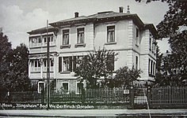Nr. 33: Das villenartige Gebäude entstand Ende des 19. Jahrhunderts und diente bis zum Zweiten Weltkrieg als Pension Illingsheim _(Foto)_. Inhaber waren die Geschwister Marie und Emma Pretzschel, die in den insgesamt sechs Zimmern Gäste des Weißen Hirschs, aber auch Langzeitbewohner unterbrachten. Nach 1945 diente das Haus als Gästehaus des Staatsschauspiels und wird heute als Wohnhaus genutzt. Im Zuge der Sanierung wurde 2008 der Haupteingang auf die Kurparkstraße 2b verlegt.

Nr. 34: Das unter Denkmalschutz stehende Haus wurde 1911 von Max Herfurt an Stelle eines Vorgängerbaus errichtet und ist als "Villa Klara" bezeichnet. Besitzer war der Schuhmachermeister Ernst Werner. 1913 befand sich hier die Dresdner Geschäftsstelle des "Vereins für neue Frauenkleidung und Frauenkultur". Im Erdgeschoss eröffnete Hermann Alfred Bösenberg kurze Zeit später eine Verkaufsstelle seiner Beleuchtungskörperfabrik [Kretzschmar, Bösenberg & Co.](../../../../Zentrum/Pirnaische_Vorstadt/Strassen_Pirnaische_Vorstadt/Kretschmar_Bosenberg/kretschmar_bosenberg.html) sowie sein Lampenmuseum. Zu sehen waren historische Lampen von der Antike bis zur Gegenwart, Kerzenhalter und andere Exponate rund um die Beleuchtung. 1934 wurde die Sammlung ins Stammhaus auf der Serrestraße 5/7 verlagert und dort 1945 zerstört. Heute dient die Villa als Büro und wird u.a. von der Mitteldeutschen Liegenschaftsverwaltung genutzt.

Villa Herzog (Nr. 41): Die 1896 errichtete Villa, um 1910 als "Villa Washington" bezeichnet, wurde vor 1945 als Fremdenpension und Mädchenpensionat genutzt. 1994 zog in das Haus das Feinschmeckerrestaurant "Villa Herzog" ein, welches zu den besten Lokalen Dresdens gehörte, im Frühjahr 2002 jedoch wieder geschlossen wurde. Heute befindet sich hier ein Hotel (Kurparkstraße 6a/8)

Nr. 43: Das wie die meisten Nachbarhäuser unter Denkmalschutz stehende Haus entstand um 1880 als schlichter, zeittypischer Villenbau mit Putzfassade und historisierenden Natursteinelementen.

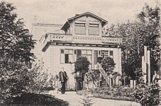Villa Oscarshamm (Nr. 44 / Degelestraße 1): Das ausgedehnte parkartige Grundstück wurde um 1880 parzelliert und mit Villen bebaut. Die als erstes Gebäude errichtete Villa Oscarshamm ( _Foto_) verdankt ihren Namen dem Besitzer Dr. phil Oscar Dolch, der ab 1877 1. Vorsitzender des Gebirgsvereins Sächsisch-Böhmische Schweiz war. Weitere Häuser entstanden erst nach der Jahrhundertwende, darunter die bis 1945 in Familienbesitz befindliche Villa Brandenstein. Besitzer war Dr. jur. Kurt Friedrich August Freiherr von Brandenstein (1870-1939), der nach seiner Hochzeit um 1910 das Grundstück von den Erben Dolchs erworben hatte. Brandenstein war als Finanzrat bei der Generaldirektion der Staatseisenbahnen tätig und wurde 1920 zum Geheimen Ministerialrat im sächsischen Finanzministerium ernannt. 1913 ließ er sich von Max Herfurt an Stelle der alten Villa Oscarshamm den noch heute erhaltenen Neubau (Degelestraße 1) errichten. Nach 1945 diente das Haus als Mädchenwohnheim.

Nr. 44 (Villa Weigang): Zu den nach der Parzellierung entstandenen Wohnhäusern gehört die heute mit der Nummer 44 bezeichnete Villa Weigang. Das um 1890 entstandene Haus erwarb 1916 der Unternehmer Rudolf Weigang, Inhaber einer Kunstdruckanstalt in Bautzen. Weigung und seine Frau Dorothea waren begeisterte Kunst- und Opernfreunde und nutzten es zunächst als Zweitwohnsitz bei ihren häufigen Besuchen in Dresden. 1930 verlegte das Paar seinen Hauptwohnsitz nach Dresden. Weigang ließ die Villa mit zahlreichen wertvollen Möbeln, Porzellan und Gemälden des 19. Jahrhunderts ausstatten, sammelte aber auch zeitgenössische Kunst. Zur Sammlung gehörten u.a. Bilder von Emil Nolde, Oskar Zwintscher, Robert Sterl und Gotthardt Kuehl, sowie Porzellan, Möbel und Kunsthandwerk.

Zum Kriegsende entschied sich die Familie zur Flucht aus Dresden. Da der für den Transport der Sammlung beschaffte Lkw jedoch nicht durch die Toreinfahrt passte, konnten nur wenige Gegenstände in ein kleineres Fahrzeug geladen werden. Nach dem Einmarsch der Roten Armee richtete man hier eine sowjetische Kommandantur ein. Die wertvolle Ausstattung der Villa kam 1948 zu großen Teilen in die Staatlichen Kunstsammlungen, wo sie u.a. in den Bestand der Gemäldegalerie Neue Meister, des Kunstgewerbemuseums und der Porzellansammlung aufgenommen wurden. Nach 1990 wurden die Kunstwerke per Restitution an die Erben zurückgegeben, die die wertvollsten Stücke 2016 an die Kunstsammlungen verkauften, so dass diese dauerhaft der Öffentlichkeit erhalten bleiben.

Nr. 46 (Villa Turmeck): In dem 1884 entstandenen und 1908 vom Architektenbüro Rose & Röhle für den Fabrikanten Joseph Werninghoff, Generaldirektor der Braunkohlenwerke und Brikettfabriken AG Welzow, umgestalteten Bau hatte ab 1943 der Kammersänger Arno Schellenberg (1903-1983) seinen Wohnsitz. Arno Schellenberg gehörte ab 1933 dem Ensemble der Dresdner Staatsoper an und war maßgeblich am Wiederaufbau des Musiklebens nach dem Zweiten Weltkrieg beteiligt. Seit 1938 befand sich das Haus im Besitz der Familie Behrens, deren Tochter Renate mit Schellenberg verheiratet war. Schwester Manja Behrens war viele Jahre beim Staatsschauspiel in Dresden engagiert. Teile der früheren Innenausstattung der Villa sind noch erhalten. 1909 hatten die Eigentümer hier den ersten elektrischen Personenaufzug in einem Privathaus in Dresden einbauen lassen. 2013/14 erfolgte eine umfassende Restaurierung des zuvor stark verfallenen Hauses.

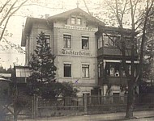Nr. 47: Das Gebäude entstand 1910 und wurde damals als "Villa Dorotheenhof" bezeichnet _(Foto)_. Vor dem Ersten Weltkrieg befand sich hier ein Töchterheim. Auch die Nachbarhäuser stammen aus der Zeit vor dem Ersten Weltkrieg, so die 1899 im Schweizerstil erbaute Mietvilla "San Remo" (Nr. 51) und das "Landhaus Apollo" (Nr. 53) von 1902.

Nr. 50 (Villa Degele): Das Haus befand sich im 19. Jahrhundert im Besitz des Kammersängers Eugen Degele (1834-1886), der das Grundstück nach seinem Tod testamentarisch der evangelischen Kirche vermachte. Degele gehörte 25 Jahre der Dresdner Hofoper an und wurde auch als Stifter der nach ihm benannten Degelequelle im Stechgrund bekannt.

Nr. 53 (Landhaus Apollo): Das um 1902 im altdeutschen Stil errichtete Gebäude, 1910 als Landhaus Apollo bezeichnet, wird seit 2005 vom Walderlebniskindergarten "Die Heidenörggele" genutzt. Die in freier Trägerschaft vom "Waldzauber e.V." betriebene Einrichtung bietet Kindern eine naturnahe Betreuung mit viel Bewegung im Freien an und nutzt dafür ein nahegelegenes Waldgrundstück in der Dresdner Heide. Als Nörggele werden in der Volksmythologie Naturgeister genannt, die in Wäldern und Gärten in knorrigen Wurzeln leben und als "Familienmitglieder" für ein Zusammenleben zwischen Mensch und Natur stehen.

Forsthaus Weißer Hirsch (Nr. 55): Das heute nur noch zu Wohnzwecken genutzte denkmalgeschützte Gebäude war einst Sitz des Revierförsters der Dresdner Heide für den Forstbezirk Weißer Hirsch. Der aus zwei Gebäudekomplexen bestehende Bau entstand um 1900 und besteht aus einem t-förmigen Hauptgebäude mit dem früheren Verwaltungsräumen und einem Seitentrakt mit den früheren Stallungen und Schuppen.

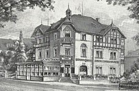Nr. 64: Das Eckhaus zur Straße "Am Weißen Adler" war einst Sitz des Café Thieme, einer von zahlreichen gastronomischen Enrichtungen am Weißen Hirsch, die von der Popularität des Kurortes und dessen zahlungskräftigen Gästen profitieren wollten. Heute nutzt die Schaubäckerei Scheinert die Räume. Weitere Gaststätten befanden sich vor dem Ersten Weltkrieg in der Nr. 72 ("Villa Sachsenburg"), nach einer Aufschrift an der Fassade auch als "Heidehaus" bezeichnet, und in der Nr. 78. Hier betrieb um 1900 Arthur Mosig seine "Conditorei und Café Mosig. Später befand sich das Lokal im Besitz des Bäckermeisters Hermann Fritzsche.

Nr. 72 (Sachsenburg): Das Gebäude an der Grenze zwischen der Gemeinde Weißer Hirsch und Oberloschwitz entstand Ende des 19. Jahrhunderts und beherbergte ab 1899 die Gaststätte Sachsenburg. Betreiber war zunächst der Gastwirt Gerhard Lemmen, später Otto Büttner. Wirtschaftlich scheint das Lokal jedoch keinen Erfolg gebracht zu haben, denn schon 1912 ist die "Sachsenburg" nicht mehr vorhanden. Heute dient das Haus als Wohnhaus und ist an der Fassade "Heidehaus" benannt.

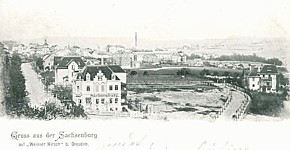

**_Foto:_** _Panoromablick um 1900 mit der "Sachsenburg"_

Bühlau:

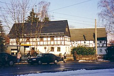Die ersten Häuser auf Bühlauer Flur entstanden spätestens im 16. Jahrhundert und bildeten eine kleine Häuslergemeinde, die als [Neubühlau](../../../../nordost/buhlau/) bezeichnet wurde. Im 19. Jahrhundert folgten zahlreiche Wohn- und Geschäftshäuser, aber auch öffentliche Gebäude für den aufstrebenden Dresdner Vorort. Hier befanden sich die meisten für die Versorgung des Ortes wichtigen Läden, Handwerksbetriebe und Gastwirtschaften, die nicht zuletzt vom Durchgangsverkehr auf der Bautzner Landstraße profitierten. Neben mehreren Geschäften für Molkereiprodukte und Lebensmittel gab es einen Spirituosenladen neben dem früheren Barbarossa-Sanatorium (Nr. 102), einen Böttcher- und einen Polstermeister, das Sattlerwarengeschäft Hölzel, die Fahrradhandlung Päperer (heute am Körnerplatz) und das Fuhrunternehmen John (Nr. 142), welches sich heute auf den Bau von Lastenanhängern spezialisiert hat. Im Wohnhaus Bautzner Landstraße 149 bestand ab 1910 die Wäscherei Däbritz, die nach 1945 geschlossen wurde. Zeitweise hatte in dem 1991 abgebrochenen Gebäude auch die Ortskrankenkasse ihren Sitz. Zu den noch erhaltenen ältesten Bauten von Bühlau gehören die unter Denkmalschutz stehenden Häuser Bautzner Landstraße 131 und 133 _(Foto)_ sowie das 1654 errichtete Wohnhaus Nr. 147.

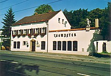Trompeter (Nr. 83): Das Gasthaus “Trompeter” entstand Ende des 19. Jahrhunderts auf dem Grundstück Bautzner Landstraße 83 und wurde am 16. Januar 1877 eröffnet. Zuvor befand sich an dieser Stelle, dem sogenannten “Leusehübel”, eine Poststation als Raststätte für Kutscher und Fuhrleute. Um 1870 wurde diese aufgegeben und zur Schankwirtschaft ausgebaut. Die Namensgebung soll vermutlich auf das einst übliche Trompetensignal bei Abfahrt der Postkutschen hinweisen. Besitzer des Lokals war bis 1907 Friedrich Hermann Hyronimus, danach jahrzehntelang die Familie Zschech. Zu den Gästen gehörte bis 1918 auch der sächsische Hof, welcher nach Jagden gern hier einkehrte.

1937 erfolgte ein grundlegender Umbau des Hauses. In diesem Zusammenhang wurde auch die Sandsteinplastik des Postkutschen-Trompeters am Dach des Seitengebäudes angebracht. Ein in Sgraffito-Technik geschaffenes Bild mit einem berittenen Trompeter ist an der Seitenfront des Hauses zu sehen. Das beliebte Restaurant gehörte seit den 1970er Jahren wechselnden Pächtern und wurde mehrfach renoviert und umgebaut. Die jüngste Renovierung erfolgte 2011 durch die jetzigen Besitzer, die Familie Rensner.

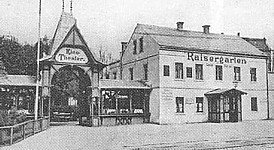Hubertusgarten (Nr. 89):  Die Gaststätte (ehem. Bautzner Straße 17, heute Bautzner Landstraße 89) wurde 1877 als “Deutsches Haus” gegründet. 1897 erwarb Karl August Weber das Lokal und nannte es fortan “Kaisergarten”. Beliebt war die Gastwirtschaft durch ihren großen Biergarten, welcher regelmäßig Schauplatz musikalischer Veranstaltungen war. 1902 ging das Lokal in den Besitz des Bühlauer Fleischermeisters Haake über, bevor es 1912 Luis Menzel kaufte. Nach dem Ersten Weltkrieg und einem erneuten Eigentümerwechsel änderte man den Namen in “Hubertusgarten” ab. Der Name erinnert an den Schutzpatron der Jäger, den heiligen Hubertus, der auch Namensgeber der Kirche am Weißen Hirsch und der benachbarten Hubertusapotheke ist. Zeitweise gehörten zur Gaststätte auch ein kleines Kino und eine Kegelbahn.

Bekannt wurde das Lokal durch sein großes Angebot an Wildgerichten und seine jagdtypische Ausstattung mit Trophäen und Waffen. 1952 übernahm die DDR-Handelsorganisation HO die Gaststätte, ohne am Konzept etwas grundlegend zu verändern. 1968 wurde sie offiziell zu einer Spezialitätengaststätte für Wildgerichte erklärt. Nach 1990 erhielten die Alteigentümer das Haus und verkauften es 1996 an neue Betreiber, welche eine umfassende Sanierung veranlassten. Bis heute wird der “Hubertusgarten” als Wildgaststätte genutzt. Bemerkenswert ist eine große Sammlung historischer Jagdwaffen und -trophäen sowie Kupferstiche rund um das Thema.

Nr. 90: In diesem Eckhaus zur Elisabethstraße befand sich einst das Café Süßemilch. Später wurden die Räumlichkeiten zeitweise als Weinstube genutzt.

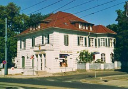Hubertusapotheke (Nr. 93): Die Apotheke wurde 1906 im Haus Bautzner Landstraße 93 (Eckhaus zur Neubühlauer Straße) gegründet. 1914 ließ der Apotheker Adolf Warneck auf dem Nachbargrundstück ein neues Wohn- und Geschäftshaus für sein Unternehmen errichten (Nr. 91 _\- Foto_). 1936 verpachtete er sein Unternehmen an den Apotheker Fritz Schreiber. Die nach 1945 erweiterten Räume erhielten bei einer Sanierung im Jahr 1974 Bleiglasfenster des Künstlers Rudolf Kleemann, welche Szenen aus dem Apothekeralltag zeigten. Die Ausführung übernahm der Dresdner Kunstglaser Wolfgang Beutner. 1992 wurden diese Fenster entfernt und eingelagert. Eine Besonderheit der Hubertusapotheke war, das hier ab 1961 Infusions- und Laborlösungen für mehrere Dresdner Krankenhäuser und Polikliniken hergestellt wurden. Ab 1967 besaß die Apotheke zudem eine Außenstelle in Schönfeld.

Straßenbahnhof Bühlau: Der Bühlauer Straßenbahnhof entstand im Zusammenhang mit dem Ausbau der Bahnstrecke nach Bühlau an Stelle einer früheren Kiesgrube und wurde am 22. August 1899 eröffnet. Zunächst standen hier zwei Wagenhallen und eine Werkstatt zur Verfügung. 1925 folgte der Bau einer dritten Abstellhalle. Ab 1931 war der Straßenbahnhof Heimatdepot der “Großen Hechtwagen”. Nach deren Außerdienststellung waren hier noch bis 2003 Tatra-Straßenbahnen abgestellt. Die zuletzt leer stehenden Hallen wurden im Juni 2011 abgerissen.

An gleicher Stelle begann im März 2014 der Neubau einer Schwimmhalle. Ursprünglich war diese im Zusammenhang mit der Eingemeindung von Schönfeld-Weißig in Weißig vorgesehen, bevor man sich vor allem aus verkehrstechnischen Gründen für den Standort Bühlau entschied. Die Halle erhält ein 25-Meter-Sportschwimmbecken, ein Lehrschwimmbecken, ein Kinderbecken sowie Sauna und Sanitärräume. Die Eröffnung erfolgte am 8. Januar 2016. Bereits 2014 wurde zudem eine neue Kindertagesstätte eingeweiht.

Nr. 94: Im Wohnhaus Bautzner Landstraße 94 hat seit 1945 das traditionsreiche Farbengeschäft Elström sein Domizil. Das Unternehmen wurde 1921 von Franz Elström auf der Großen Zwingerstraße 22 in der Nähe des Postplatzes als Spezialhandlung für Farben, Lacke und Künstlerbedarf gegründet und nach Kriegszerstörung des Stammhauses nach Bühlau verlegt. 1954 übernahm Sohn Christian das Geschäft und erweiterte es. Nachkommen führen das Fachgeschäft für Farben und Malerbedarf bis heute weiter. 1994 wurde das Gebäude umfassend saniert.

Nr. 98/100: Diese beiden Wohn- und Geschäftshäuser mit Jugendstilfassaden wurden 1902/03 für Paul Bachmann errichtet. Die Bauleitung oblag Ernst Härtwig, der auch die Entwürfe für das Projekt lieferte. Interessant sind die bis heute erhalten gebliebenen Ausmalungen im Treppenhaus der beiden Häuser. Im Erdgeschoss gab es ursprünglich einen Buch- und Schreibwarenhandlung.

Hedrig-Greß-Heim: Das Heim auf der Bautzner Landstraße 108 wurde als Altersheim für Beamte im Ruhestand gegründet und am 1. Mai 1929 eröffnet. Initiator war der sächsische Regierungsrat Greß, der bereits 1901 einen “Verein für Sächsische Staatsbeamte” gegründet hatte. Für das neue Heim konnten auch die Räumlichkeiten des früheren [Sanatoriums](../../../../nordost/buhlau/strassen_buhlau/sanatorium_buhlau/) genutzt werden. Den Umbau des aus mehreren Einzelgebäuden bestehenden Komplexes übernahm der Architekt Ludwig Wirth.

1945 wurde die Einrichtung zunächst als Unterkunft für Flüchtlinge und Umsiedler genutzt. 1952 übernahm die Stadt Dresden das Hedrig-Greß-Heim und nutzte es fortan als Städtisches Altersheim. Da die Namensgebung nach den beiden früheren Vereinsvorständen Dr. Hedrich und Regierungsrat Greß zu DDR-Zeiten als unzeitgemäß empfunden wurde, erhielt das Altersheim 1972 den Namen des Arbeiterfunktionärs Otto
Buchwitz. Umfangreiche Sanierungsarbeiten erfolgten ab 1973 und nach 1990. Heute befindet es sich in Trägerschaft der städtischen Cultus gGmbH.

Nr. 109: Das um 1880 entstandene Gebäude wurde 1899 vom Gasthofsbesitzer Karl Oskar Unrasch, Inhaber des Kurhauses Bühlau, erworben. 1926 richtete dessen Sohn im Erdgeschoss eine Fleischerei ein, die bis in die Nachkriegszeit in Familienbesitz blieb. Später übernahm die HO den Laden, der nach 1990 wieder in Privatbesitz kam. 1996 wurde das Haus umfassend saniert.

Nr. 111: In diesem Gebäude, auch als “Villa Alpenrose” bezeichnet, lebte bis zu ihrem Tod 1933 Ida Beier, Witwe des früheren Bürgermeisters von Brand (heute Brand-Erbisdorf). Ida Beier besaß ein Schreibwarengeschäft am Weißen Hirsch und war die Mutter der “Giftmörderin” Grete Beier. Diese hatte 1906 ihren Verlobten mit Zyankali vergiftet und wurde nach einem aufsehenerregenden Prozeß als letzte Frau in Sachsen zum Tode verurteilt und hingerichtet.

Kraftwerk Bühlau (Nr. 112): Das gemeindeeigene Elektrizitätswerk wurde 1898 auf dem Grundstück Bautzner Landstraße 112 durch die Kölner Elektrizitäts - A.G. Helios errichtet und versorgte die Gebäude des Ortes mit Strom. Nach dem Anschluss Bühlaus nach Dresden wurde das Werk stillgelegt. Seit 1993 nutzt ein Supermarkt die Gebäude. 2011 erfolgten umfangreiche Umbauten und Erweiterungen, wobei die historische Bausubstanz des Kraftwerks größtenteils integriert wurde.

**_Foto:_** _Das Bühlauer Elektrizitätswerk auf einer Ansicht um ca. 1910_

Gasthaus “Zum Heiteren Blick” (Nr. 114): Die Gaststätte wurde 1894 an der Bautzner Landstraße 114 eröffnet und besaß in den Anfangsjahren sogar eine eigene Brauerei. Erster Besitzer war der Gastwirt Moritz Bräunig. Nach 1900 wurde das Gebäude mehrfach erweitert, u.a. um ein ab 1938 vom Schuhhaus Sander genutztes Ladenlokal. Im Hinterhof befand sich der Werkhof der Baufirma Illgen. Das zu den beliebtesten Schankwirtschaften des Ortes gehörende Lokal bestand bis in die Nachkriegsszeit und schloss erst Anfang der 1960er Jahre seine Pforten. Ab 1962 nutzten verschiedene Firmen das Gebäude, darunter eine Möbelhandlung und die 1936 gegründete Büroartikelhandlung Mildner. Trotz Bemühungen des Unternehmens gelang es jedoch nicht, das verfallene Gebäude zu rekonstruieren und als Firmensitz auszubauen. 1993 wurde der frühere "Heitere Blick" abgerissen und durch ein modernes Geschäftshaus ersetzt. Dieses musste wiederum 2010 einem Parkplatz des benachbarten Supermarktes weichen.

Nr. 129:
Das von den Bühlauern auch “Konsum”-Haus genannte Wohn- und Geschäftshaus entstand 1903 nach einem Entwurf des Dresdner Architekten William Huscher gegenüber der Einmündung der Grundstraße. Die Fassade ist im
oberen Teil mit Balkenfachwerk versehen und orientiert sich am seinerzeit beliebten Landhausstil, mit dem der Charakter Bühlaus als Sommerfrische und
Erholungsort unterstrichen werden sollte. Aufgrund seiner Nähe zum Bühlauer Rathaus war das Gebäude von Anfang an als markantes Stadtteilzentrum mit mehreren Ladenlokalen und repräsentativen Wohnungen konzipiert. Im
Erdgeschoss befand sich ab 1905 bis zur Schließung 2001 eine Konsum-Verkaufsstelle. Weitere Räume wurden u.a. als Tapezier- und Polstergeschäft, als Schuhmacherwerkstatt, Friseursalon und Uhrmacherwerkstatt genutzt.

Nach 1960 kam das Gebäude in staatlichen Besitz und wurde umgebaut. Dabei verschwanden zahlreiche Schmuckelemente und die Turmhauben der Ecktürmchen. Außerdem kam ein Flachbau zur Vergrößerung der
Verkaufsfläche des “Konsums” hinzu. Nach 1990 stand das Haus einige Jahre leer und war zeitweise sogar zum Abriss
freigegeben.  Seit 2007 steht das Wohn- und Geschäftshaus als Baudenkmal unter Schutz und wurde 2008/09 saniert.

Rathaus Bühlau:
Das Gebäude an der Bautzner Landstraße 130 entstand 1899 als Sitz der Gemeindeverwaltung nach Plänen des Loschwitzer Architekten Paul Winkler. Seit der Eingemeindung des Ortes 1921 dient es als städtisches
Verwaltungsgebäude und ist heute u. a. Sitz einer Zweigstelle der Stadtbibliothek. In den Erdgeschossräumen befand sich zeitweise die Gaststätte “Ratskeller Bühlau”.

**_Foto:_** _Die Bautzner Landstraße mit dem Bühlauer Rathaus im Jahr 1909_

Nr. 144:
Das unter Denkmalschutz stehende Mehrfamilienhaus wurde 1910-12 vom Architekten Max Herfurt für den Fleischermeister Hugo Müller im Jugendstil erbaut. An der Fassade erinnert ein Fries mit Inschriften an das Handwerk
des Bauherrn. Die Fleischerei blieb bis zur Schließung im Juni 2001 in Familienbesitz und wird heute als Partyservice
weitergeführt. Bemerkenswert ist die historische Ladenausstattung der Entstehungszeit. Zum Unternehmen gehörte früher
auch ein Schlachthaus sowie ein zur Gewinnung von Kühleis benötigter kleiner Teich am Kirchweg. Um 1930 existierten insgesamt acht Fleischereien in Bühlau und Quohren.

Schmiedeschänke:
Die Schmiedeschänke (Nr. 158) wurde 1880 vom Fleischermeister Otto Oelsner eröffnet. Das Lokal war wegen seiner deftigen Küche bei Bühlauern und Wochenendausflüglern beliebt und bestand noch bis in die
Nachkriegszeit. Später auch als Gasthaus “Zur Schmiede” bekannt, musste das baufällige Gebäude nach 1990 dem Bau einer Tankstelle weichen.

**_Foto:_** _Die Bühlauer Schmiedeschänke um 1900_

* * *

 \[ [Home](../../../../index.html)\] \[ [Nord](../../../../nord/)\] \[ [Nordwest](../../../../nordwest/)\] \[ [Neustadt](../../../../neustadt/)\] \[ [Nordost](../../../../nordost/)\] \[ [West](../../../../west/)\] \[ [Zentrum](../../../../zentrum/)\] \[ [Südwest](../../../../sudwest/)\] \[ [Süd](../../../../sud/)\] \[ [Südost](../../../../sudost/)\] \[ [Ost](../../../../ost/)\] \[ [Register](../../../../Register/register.html)\] \[ [Kontakt](../../../../Kontakt/kontakt.html)\] \[ [Impressum](../../../../impressum/)\]
