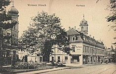
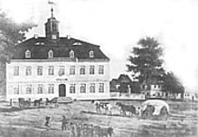
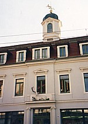
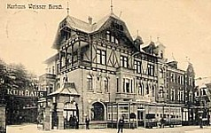
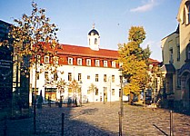

* * *

* * *

* * *

* * *

* * *

* * *

Die Gutswirtschaft Weißer Hirsch geht auf eine1686 vom kurfürstlichen
Kapellmeister Christoph Bernhardi errichtete Schänke zurück, die dieser “Zum Weißen Hirsch” nannte. Der Überlieferung  nach soll Kurfürst August im Jahr
1563 in der Nähe einen weißen Hirsch (Albino) erlegt haben. Der Name des Gasthofes ging schon bald auf die zugehörige Gutswirtschaft über, die aus dem
“Hirschgut” mit der eigentlichen Schänke an der heutigen Collenbuschstraße und verschiedenen Nebengebäuden, Feldern und Weinbergen bestand. Das Gut besaß mit kurfürstlicher Erlaubnis das Recht zum Ausschank von Wein und
Dresdner Bier, ferner zum Backen, Schlachten und Branntweinbrennen und entwickelte sich dadurch zu einer wichtigen Raststation an der Bautzner Landstraße. Um dieses Anwesen siedelten sich
einige Häusler an, die ab 1726 die kleine Gutsgemeinde Weißer Hirsch bildeten. Auch nach Gründung der Landgemeinde im Jahr 1839 blieb die Wirtschaft selbstständiges schriftsässiges Gut und wurde erst 1894 aufgelöst.

Mehrfach wechselten die Besitzer des Gutes, welches 1710 in eine Quarantänestation umgewandelt wurde. Anlass war der Ausbruch der Pest in
Polen, deren Verbreitung durch einen vierwöchigen Zwangsaufenthalt für alle nach Dresden reisenden Personen im “Weißen Hirsch” verhindert werden sollte. Trotz
des dadurch erworbenen schlechten Rufes blieb das Gasthaus auch später bedeutende Raststätte an der viel befahrenen Straße. 1723 kam der Weiße Hirsch
in den Besitz der Gräfin Agnes von Manteuffel, die die Gutswirtschaft durch Ankäufe von Weinbergsgrundstücken deutlich erweiterte. Durch Verfügung August
des Starken erhielt das Anwesen am 13. Februar 1726 die Kanzleischriftsässigkeit verliehen und bildete fortan eine selbstständige Gutswirtschaft mit eigener Gerichtsbarkeit. Zu den Privilegien der adligen
Besitzerin gehörte auch, hier Bier aus ihrer eigenen Gutsbrauerei in Gönnsdorf ausschenken zu dürfen, obwohl der
“Weiße Hirsch” noch im Bereich der Dresdner Biermeile lag. Dennoch ging die Gutswirtschaft 1754 in Konkurs und musste verkauft werden. Erwerber war der sächsische Oberlandweinmeister Heinrich Roos.

Bereits zwei Jahre später ließ Roos einen neuen Gasthof unmittelbar an der Straße errichten.
Das einstöckige Gebäude wurde im Stil eines Herrenhauses erbaut und erhielt über dem Haupteingang die Plastik eines liegenden weißen Hirsches _(Foto rechts)_. Auch im Inneren
wurde das Haus repräsentativ ausgestattet und bot seinen Gästen allen Komfort. Dieser Bau ist im Kern bis heute erhalten geblieben und Teil des Gebäudes Bautzner Landstraße 6. Zur
Versorgung des Anwesens ließ Roos eine Wasserleitung aus der Dresdner Heide bis an sein Grundstück legen, die über 100 Jahre lang den gesamten Ort versorgte. 1790 erwarb der damalige Besitzer des [“Weißen Adlers”](../../../../../nordost/page10246/strassen_weisser_hirsch/bautzner_landstrasse/weisser_adler/) Gottfried Fischer auch den “Weißen Hirsch” und
begann mit der Bebauung des dazwischen liegenden Grundstücksstreifens entlang der Bautzner Landstraße. Der alte Gasthof fiel 1799 einem Brand zum Opfer.

Durch Erbschaft wechselten die Besitzverhältnisse erneut. 1809 übernahm Carl August Preißler das Gut, zunächst als Pächter. Als Gastgeber ließ er am 23. April 1813 den preußischen König Friedrich
Wilhelm III. im Herrenhaus übernachten, der sich hier mit Zar Alexander traf. Später waren in den Gutsgebäuden
wiederholt Offiziere und Soldaten einquartiert, was zu Schäden am Inventar und zu einer zeitweisen Einstellung des
Herbergsbetriebs führte. Nachdem das Gutshaus wiederhergerichtet worden war, diente es weiterhin als Raststätte für Fuhrleute, gelegentlich aber auch als Jagdaufenthalt des sächsischen Königs und seines Hofstaates.

Preißlers Sohn gelang es, 1829 die Gutswirtschaft zu erwerben und weiter auszubauen. Nachdem der Ort zur
Sommerfrische geworden war, investierte er vorrangig in die Gastwirtschaft und veranlasste seinen Pächter Gneuß 1863 zum Bau eines neuen Gasthofes auf dem Grundstück des heutigen [Parkhotels](../../../../../nordost/page10246/strassen_weisser_hirsch/bautzner_landstrasse/parkhotel/). Dieser übernahm den werbewirksamen
Namen “Weißer Hirsch” und wurde vom Architekten Theodor Lehnert entworfen. In der Folgezeit war der “Weiße Hirsch” Schauplatz verschiedener Festlichkeiten und Konzerte, die neue Besucher anlocken sollten.

1872 erwarb der wohlhabende Seifenfabrikant Ludwig Küntzelmann das Gut
und ließ es in Parzellen aufteilen. Diese wurden zur Bebauung mit Villen, Fremdenheimen und Pensionen weiterveräußert. Das Herrenhaus von 1756 ließ Küntzelmann durch den Dresdner Baumeister Nieß zum Kurhaus umbauen und
machte es zum Mittelpunkt des aufstrebenden “klimatischen Kurortes Weißer Hirsch”. Im Garten des Anwesens entstand ein Badehaus, welches von der
bereits vorhandenen Wasserleitung aus der Dresdner Heide gespeist wurde. Im Seitenflügel wurden Fremdenzimmer zur Unterbringung der Kurgäste eingerichtet. Außerdem bestand in einem weiteren Anbau ein Casino. Hinzu
kam ein Gartensalon für Kurkonzerte und Tanzvergnügungen, eine “Milcherei” für den Verkauf von frischer Milch und
der “Tattersall”, in dem die Kurgäste Reitstunden nehmen konnten. Nach Küntzelmanns Tod 1881 und dem Verkauf des Kurhauses entstand auf dem Nachbargrundstück das sogenannte “Neue Kurhaus” mit Restaurant _(historisches Foto)_.

Auch nach der Jahrhundertwende blieb der “Weiße Hirsch”, seit 1896 im Besitz von Paul Adolf Baltruszatis, Kurhotel und wurde
ab 1905 von einer Hotelbetriebsgesellschaft bewirtschaftet. In den Zwanziger Jahren geriet diese Firma in
wirtschaftliche Schwierigkeiten, was zur Zwangsversteigerung führte. Um mehr Gäste anzulocken, erfolgte im Saal des
Kurhauses 1938 die Einrichtung eines Kinos mit 400 Plätzen, welches unter dem Namen “Parklichtspiele” bis 1992 bestand. Die ehemalige Reithalle ließ man um 1930 durch die “Weiße-Hirsch-Garagen” für die zunehmende Zahl
motorisierter Besucher ersetzen.

Nach Einstellung des Kurbetriebes 1945 diente das Gebäude an der Bautzner Landstraße 6/6a als Wohnhaus. Im Erdgeschoss existierten verschiedene
Geschäfte. Trotz fehlender Werterhaltung und dem Abriss des markanten Dachreiters 1973 blieb das Kurhaus Weißer Hirsch im Wesentlichen in seiner alten
Form erhalten. Ende der 90er Jahre wurde der Gesamtkomplex mit dem früheren Kino zum Stadtteilzentrum umgebaut. U.a. entstand eine Einkaufspassage mit
mehreren Läden und der Gaststätte “Hirschgarten”. Das Kurhaus erhielt dabei sein ursprüngliches Äußeres und den Dachreiter zurück _(Foto)_. Heute befinden sich hier
Wohnungen und Arztpraxen. Eine interessante architektonische Lösung fand sich mit der wellenartigen Glasfassade zum begrünten Innenhof. Die Entwürfe für dieses Gebäude stammen von Frank Zitzelsberger.

* * *

 \[ [Home](../../../../../index.html)\] \[ [Nord](../../../../../nord/)\] \[ [Nordwest](../../../../../nordwest/)\] \[ [Neustadt](../../../../../neustadt/)\]
 \[ [Nordost](../../../../../nordost/)\] \[ [West](../../../../../west/)\] \[ [Zentrum](../../../../../zentrum/)\] \[ [Südwest](../../../../../sudwest/)\]
 \[ [Süd](../../../../../sud/)\] \[ [Südost](../../../../../sudost/)\] \[ [Ost](../../../../../ost/)\] \[ [Register](../../../../../Register/register.html)\] \[ [Kontakt](../../../../../Kontakt/kontakt.html)\] \[ [Impressum](../../../../../impressum/)\]
