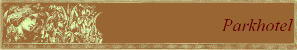
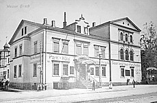
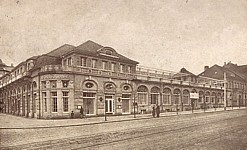
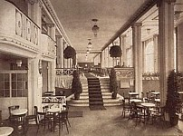
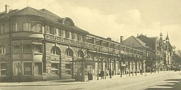
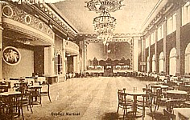
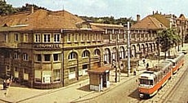
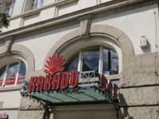

* * *

* * *

* * *

* * *

* * *

* * *

Vorgänger des Parkhotels war ein 1863 gegenüber dem Kurhaus entstandener neuer Gasthof, der den traditionsreichen Namen “Weißer Hirsch” übernahm und vom Pächter Ferdinand Gneuß bewirtschaftet wurde. Dieser war zuvor vom Besitzer des Gutes Weißer Hirsch zur Eröffnung ermutigt worden, da man sich so einen größeren Zustrom von Sommergästen erhoffte. Das Gebäude wurde von Theodor Lehnert entworfen und stieß wegen seiner architektonischen Gestaltung zunächst auf heftige Kritik. Um den neuen Gasthof entwickelten sich verschiedene Vergnügungseinrichtungen wie ein Hippodrom und ein Festplatz für verschiedene Veranstaltungen, aus dem später der heutige Kurpark hervorging. Ab 1883 befand sich dieser Gasthof im Besitz von Wilhelm Würffel. Da das Haus nach der Jahrhundertwende nicht mehr den Anforderungen genügten, wurde es um 1910 abgerissen.

1911/12 erfolgte an gleicher Stelle ein kompletter Neubau, der nach seiner Fertigstellung als “Parkhotel- Esplanada” bezeichnet wurde. Der moderne Bau erhielt neben Restaurants und Bar einen großen Saal sowie Gästezimmer im Obergeschoss. Eigentümer war die Weißer Hirsch Exploitierungsgesellschaft m.b.H. mit Sitz in Berlin, die jedoch noch vor Fertigstellung des Gebäudes Konkurs anmelden musste. Die Baupläne konnten deshalb nicht vollständig umgesetzt werden, so dass das neue Hotel 1914 in vereinfachter Form seiner Zweckbestimmung übergeben wurde. 1919 übernahm die Kurhaus- und Parkhotel GmbH Weißer Hirsch unter Leitung der Familie Bettenhausen den gesamten Komplex und führte ihn bis 1945 als Hotel und Gaststätte weiter. Regelmäßig fanden im Parkhotel Konzerte, Bälle und Theateraufführungen statt.

_**Fotos:** Historische Bilder des Parkhotels - links ein Blick ins Restaurant, rechts der große Kursaal_

1945 nutzte kurzzeitig die Rote Armee das Parkhotel, gab es jedoch 1949 wieder an die früheren Besitzer zurück. Damit konnte auch der Hotelbetrieb fortgeführt werden, bevor dieser 1971 von der HO übernommen wurde. Die privaten Eigentümer mussten 1974 ihre letzten Anteile an den Staat abtreten. Bereits 1960 war die ebenfalls beschlagnahmte Villa “Emma” an der Stechgrundstraße zum Fremdenheim ausgebaut worden. Das Parkhotel Weißer Hirsch bestand bis 1990 als Hotel und Gaststätte und war zu DDR-Zeiten durch seine Tanzveranstaltungen und die 1952 eröffnete “Kakadu-Bar” eines des der bekanntesten Vergnügungslokale der Stadt. Nach komplizierten Rechtsstreitigkeiten erhielten die Alteigentümer das Gebäude 1992 zurück.

Die nach erfolgter Sanierung geplante Wiederaufnahme des Hotelbetriebes scheiterte jedoch. Stattdessen wurden die Räume als Ladenlokal an ein Antiquitätengeschäft vermietet. Außerdem finden im Saal gelegentlich öffentliche Veranstaltungen wie der “Hutball” statt. 2001 wurde mit der Rekonstruktion des Ballsaales nach historischem Vorbild begonnen. Zwei Jahre später war das “Parkhotel” mit der Kakadu-Bar Drehort für den Spielfilm “Der Rote Kakadu”, der sich mit dem Alltag Dresdner Jugendlicher kurz vor dem Mauerbau 1961 befasst. In diesem Zusammenhang
entschloss sich ein Dresdner Gastronom zur Reaktivierung der traditionsreichen Tanzbar, die nach historischen Vorbild eingerichtet und am 17. Februar 2006 eröffnet wurde. Seit 2008 gibt es im Parkhotel den “Blauen Salon”, den “Roten Salon” und die “Ming Bar” als Partylocation und Ort für Tanzveranstaltungen sowie das “Kaffeehaus Marlia”. 2016 wurde das Parkhotel verkauft, ein Umbau ist geplant.
