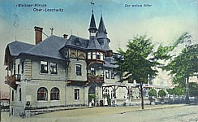
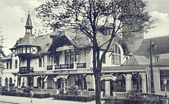
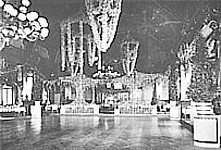
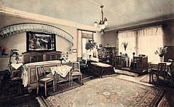
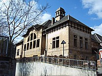

* * *

Ausgangspunkt der Entstehung des “Weißen Adlers” war ein um 1680 vom
Förster Gräfe errichtetes Wohnhaus an der Landstraße nach Bautzen. Nach Gräfes Tod erwarb der Besitzer der Bühlauer [Lohmühle](../../../../../nordost/loschwitz/strassen_loschwitz/grundstrasse/) das Grundstück und
richtete hier 1685 eine Schankwirtschaft ein. Diese wurde Lohschänke genannt und bildete den Mittelpunkt einer kleinen Siedlung. Da das Wirtshaus als Konkurrenz zum nur 20 Minuten entfernten “Weißen Hirsch” gesehen
wurde, ließ dessen Besitzer 1700 die Raststätte schließen und in ein Bauerngut umwandeln.

Schon wenige Jahre später erhielt das Anwesen jedoch erneut die Schankkonzession verliehen, die August der Starke
1722 bestätigte und 1728 auch auf alle Nachkommen der Inhaber ausdehnte. Die Schänke war zu dieser Zeit beliebte
Ausspanne für Angehörige des Hofes bei Reisen nach Polen oder bei Jagdgesellschaften. Nachdem 1733 ein größerer Neubau entstanden war, bekam die Gastwirtschaft den Namen “Zum Weißen Adler”. Grund war vermutlich die
Darstellung eines solchen Adlers im Wappen Polens, welches durch August den Starken mit Sachsen durch eine Personalunion verbunden war.

1790 erwarb der Besitzer des ”Weißen Adlers” Gottfried Fischer die benachbarte Schänke am Weißen Hirsch. Gleichzeitig begann die Bebauung des Geländes an der Bautzner Landstraße, wodurch beide “Ortsteile” zu einer Gemeinde zusammenwuchsen. Der “Weiße Adler” blieb als Gaststätte auch weiterhin bestehen und nahm durch den zunehmenden Gästestrom zum Weißen Hirsch weiteren Aufschwung. Das mehrfach erweiterte Gebäude wurde am 30. Juni 1873 bei einem Großbrand fast völlig vernichtet. Die Katastrophe war Anlass zur Bildung einer freiwilligen Feuerwehr für die Orte Loschwitz und Weißer Hirsch, deren erster Hauptmann der Bauunternehmer Theodor Lehnert wurde.

Bereits wenige Jahre später entstand unmittelbar an der Straße nach einem Entwurf von Wilhelm Richter ein großzügiger
Neubau im altdeutschen Fachwerkstil. Das Gebäude erhielt neben einem Aussichtsturm mehrere Restaurationsräume
und Fremdenzimmer, einen Saal für 800 Personen, Billardzimmer, Kegelbahn und einen Gästegarten. Später folgte noch
ein Pferdestall. Das Etablissement galt um die Jahrhundertwende als eines der vornehmsten und besten Tanzlokale der
Dresdner Umgebung und wurde von Adligen, Offizieren und wohlhabenden Dresdner Bürgern gern besucht. Selbst König Friedrich August III. war hier regelmäßig zu Gast.

**_Fotos:_** _Der große Ballsaal des “Weißen Adlers” (links) und das “Fürstenzimmer” (rechts)_

_in den Zwanziger Jahren_

Nach dem Ersten Weltkrieg verschlechterte sich die Geschäftssituation jedoch, so
dass der Besitzer Alexander Koritzsch 1932 wegen finanzieller Probleme den Freitod wählte. Der Weiße Adler wurde daraufhin versteigert und noch bis 1940 als
Tanzlokal bewirtschaftet. 1946-1950 lebte der Gaststättenbetrieb noch einmal kurz auf, als der frühere Geschäftsführer der kriegszerstörten Regina-Bar das
Vergnügungslokal übernahm. Anschließend dienten die Räumlichkeiten Wohnzwecken sowie als Lager und Produktionsstätte der DDR-Werbeagentur DEWAG und des VEB Herrenmode, nach 1990 noch kurzzeitig als Schuhhandel.

1996 begann mit dem Abriss einiger Nebengebäude die Sanierung des mittlerweile verfallenen Gebäudekomplexes _(Foto)_
. In diesem Zusammenhang entstand auf dem Nachbargrundstück zunächst eine kleine Anlage für betreutes Wohnen. Nach längeren Verzögerungen wird seit 2011 nun auch das denkmalgeschützte Hauptgebäude umgebaut. Hier sollen 32 altersgerechte Wohnungen eingerichtet werden. Außerdem sind einige Praxen und gewerbliche Einrichtungen  geplant.

* * *

 \[ [Home](../../../../../index.html)\] \[ [Nord](../../../../../nord/)\] \[ [Nordwest](../../../../../nordwest/)\] \[ [Neustadt](../../../../../neustadt/)\]
 \[ [Nordost](../../../../../nordost/)\] \[ [West](../../../../../west/)\] \[ [Zentrum](../../../../../zentrum/)\] \[ [Südwest](../../../../../sudwest/)\]
 \[ [Süd](../../../../../sud/)\] \[ [Südost](../../../../../sudost/)\] \[ [Ost](../../../../../ost/)\] \[ [Register](../../../../../Register/register.html)\] \[ [Kontakt](../../../../../Kontakt/kontakt.html)\] \[ [Impressum](../../../../../impressum/)\]
