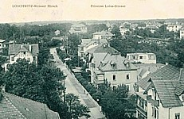
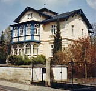
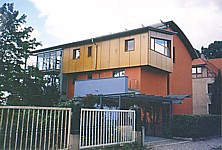
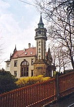

* * *

* * *

* * *

Die Bergbahnstraße wurde 1895 als Zufahrtsstraße zur Bergstation der [Standseilbahn](../../../../nordost/page10246/standseilbahn/) angelegt und bis 1925 Prinzeß-Luisa-Straße genannt. Gleichzeitig entstand der Johannesweg als Verbindung zum Rißweg. Zwei Jahre zuvor hatten die Besitzer der anliegenden Grundstücke um den Ausbau gebeten und sich die Genehmigung der Gemahlin des Kronprinzen Friedrich August III. für die Namensgebung geholt. Die sächsische Kronprinzessin Luise war zugleich auch Namenspatronin des zeitgleich errichteten Ausflugslokals [“Luisenhof”](../../../../nordost/page10246/strassen_weisser_hirsch/luisenhof/). Zeitgleich entstanden hier verschiedene Villen und Landhäuser, von denen neben der Villa "San Remo" (Nr. 12) u.a. auch die Häuser Nr. 2 (Villa Edelweiß), Nr. 6 (Villa Eichenhof) und Nr. 7 (Villa Siegfried) erwähnenswert sind. Am 1. Juni 1926 erfolgte die Umbenennung in Bergbahnstraße.

Einzelne Gebäude:

Nr. 1: Ältestes Gebäude ist das um 1879 im neoklassizistischen Stil errichtete Landhaus Bergbahnstraße 1. Ursprünglich wurde dieses als “Villa Dora” bzw. “Villa Maria” bezeichnet und befand sich zeitweise im Besitz von Maria Rink, die der Legende nach eine uneheliche Tochter des letzten sächsischen Königs war. 1981 erwarb der Opernsänger Gunther Emmerlich das Haus und ließ es denkmalgerecht sanieren. An der Außenmauer findet man eine kuriose Inschrift mit den Worten: _“Hier geschah im Jahre 1875 absolut nichts.”_

**_Fotos:_** _Alt und neu auf der Bergbahnstraße: links das Landhaus Nr. 1, rechts der moderne Neubau Nr. 2b_

Nr. 2b: Neben den historischen Gebäuden aus der Entstehungszeit des Kurbades ist auch der moderne Neubau Bergbahnstraße 2b architektonisch interessant. An Stelle eines Vorgängerbaus aus den Zwanziger Jahren wurde dieses Haus 1995 von Werner Kaplan als eigenes Wohnhaus errichtet. Das von der Straßenseite sehr kompakte und fast fensterlose Wohnhaus ist mit Holzaufbauten, mehreren Wintergärten, Balkons und Glaswänden gegliedert und besitzt auf der Hangseite eine terrassenartige Gartenanlage.

Nr. 11: Das 1896 vom Architektenbüro Reuter und Fischer entworfene Gebäude war einst als "Bismarckhöhe" bzw. "Villa Bismarck" bekannt. Vor dem Ersten Weltkrieg finden sich auch die Bezeichnungen Villa "Anna Emma" bzw. Villa "Luisa" in den Adressbüchern. 2009 wurde sie umfassend saniert.

Villa “San Remo” (Nr. 12): Die Villa mit ihrem markanten Aussichtsturm _(Foto)_ entstand 1890/94, angeblich für die damalige Kronprinzessin Luise von Toscana, was jedoch nicht belegbar ist. Entworfen wurde sie von Franz Berghold. Besitzerin war um 1900 Sophie Louise Pätz. Ab 1907 gehörte sie dem Kaufmann Hermann Harzer. Später erwarb sie der Großharthauer Schuhfabrikant Kurt Vogel, der das Haus 1938 an die Familie Noble weiterveräußerte.

Charles Noble (eigentlich Karl Spanknöbel) besaß die amerikanische Staatsangehörigkeit und war ab 1938 Inhaber der [Dresdner Kamerawerke](../../../../ost/niedersedlitz/strassen_niedersedlitz/) in Niedersedlitz. Der Legende nach soll er 1945 vom Turm der Villa aus mit Lichtsignalen den Angriff auf Dresden gesteuert haben. Dieser völlig haltlose Vorwurf diente später als Anlass für die Enteignung der Familie, die erst 1991 ihr Eigentum zurückerhielt. Zu DDR-Zeiten war im Gebäude ein Gästehaus des Rates der Stadt und die HO-Rechenzentrale untergebracht. 2004 wurde das historische Gebäude verkauft und im Anschluss saniert.

* * *

 \[ [Home](../../../../index.html)\] \[ [Nord](../../../../nord/)\] \[ [Nordwest](../../../../nordwest/)\] \[ [Neustadt](../../../../neustadt/)\] \[ [Nordost](../../../../nordost/)\] \[ [West](../../../../west/)\] \[ [Zentrum](../../../../zentrum/)\] \[ [Südwest](../../../../sudwest/)\] \[ [Süd](../../../../sud/)\] \[ [Südost](../../../../sudost/)\] \[ [Ost](../../../../ost/)\] \[ [Register](../../../../Register/register.html)\] \[ [Kontakt](../../../../Kontakt/kontakt.html)\] \[ [Impressum](../../../../impressum/)\]
