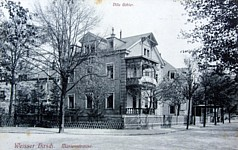
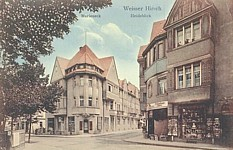
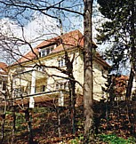
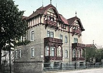
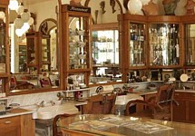
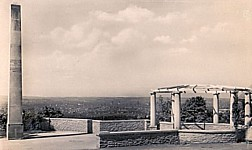
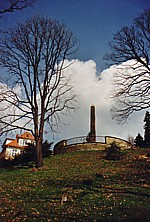

* * *

_Collenbuschstraße 21_

_(Villa Dependenz)_

_Collenbuschstraße 24_

_(Villa Frieda)_

_Collenbuschstraße 28_

_mit Relieftafel_

_"Der alte Hirsch_

_Blombergblick um 1937_

_(Foto: Walter Hahn - SLUB/Fotothek)_

Die heutige Collenbuschstraße wurde ursprünglich nach einer früheren Flurbezeichnung Rother Thorweg genannt. Um 1880 erhielt sie offiziell den Namen Marienstraße, wobei für die Namensgebung Prinzessin Maria Anna Leopoldine von Bayern, Gemahlin König Friedrich August II. von Sachsen, Pate stand. Erstmals ist sie im Adressbuch von 1883 erwähnt. Um Verwechslungen mit einer gleichnamigen Straße in der Innenstadt zu vermeiden, erfolgte am 1. Juni 1926 nach dem Kommerzienrat und Zigarettenfabrikanten Friedrich Adolph Collenbusch (1841-1921) die Umbenennung in Collenbuschstraße. Am Eckgrundstück Collenbuschstraße 21 erinnert eine Inschrift an das frühere [Gut Weißer Hirsch](../../../../nordost/page10246/strassen_weisser_hirsch/bautzner_landstrasse/gutshaus_weisser_hirsch/). Das erste Gebäude entstand 1686 und war Ausgangspunkt der Besiedlung des Stadtteils. Die nach Verlegung des Schankgutes an die Bautzner Landstraße als "Alter Hirsch" bezeichnete Wirtschaft brannte 1799 ab und wurde nicht wieder aufgebaut. Der Name ging später auf das gesamte Viertel über und wurde zeitweise auch als Straßenbezeichnung für einen Abschnitt des heutigen Lahmannrings verwendet

Nach Verabschiedung eines Bebauungsplanes 1874 für das Areal zwischen [Bautzner Landstraße](../../../../nordost/page10246/strassen_weisser_hirsch/bautzner_landstrasse/), [Plattleite](../../../../nordost/page10246/strassen_weisser_hirsch/plattleite/) und [Lahmannring](../../../../Nordost/Page10246/Strassen_Weisser_Hirsch/Lahmannring/lahmannring.html) entstanden hier verschiedene Villen und Pensionen. Zu den ältesten gehört das sogenannte Miethingsche Haus (Nr. 19), welches 1882 für den Dekorationsmaler August Eibig errichtet wurde. Weitere Villen wurden kurz vor bzw. nach der Jahrhundertwende erbaut. Erwähnenswert sind u.a. die vom Architekten Max Herfurt entworfenen Häuser Collenbuschstraße 16 und 30 sowie das Landhaus Kruse (Nr. 18), welches durch seinen markanten Säulenvorbau auffällt und 1905 von Rudolf Kolbe geplant wurde. Im früheren Haus Hohenzollern an der Einmündung zur Wolfshügelstraße lebte zeitweise der Schriftsteller Erhart Kästner. Auf dem heutigen Grundstück Nr. 20 befand sich um die Jahrhundertwende eine sogenannte "Luftkurhütte" für Patienten des nahegelegenen Lahmann-Sanatoriums.

Einzelne Gebäude:

Andersen-Nexö-Gedenkstätte (Nr. 4): Im Haus Collenbuschstraße 4 wohnte ab 1951 der Schriftsteller Martin Andersen-Nexö (1869-1954). Andersen-Nexö verfasste ab 1900 zahlreiche Romane und Erzählungen, von denen u. a. “Pelle der Eroberer” und “Ditte Menschenkind” international bekannt sind. Zwischen 1922 und 1930 lebte Andersen-Nexö am Bodensee. Der von den Nazis verfolgte und zeitweise sogar inhaftierte Schriftsteller besuchte 1949 das Kurbad in Bad Elster und siedelte wenig später auf Einladung des sächsischen Ministerpräsidenten Max Seydewitz nach Dresden über. Zunächst bewohnte er ein Gästehaus der Landesregierung, lebte ab 1951 in Radebeul und zog ein Jahr später in die Villa an der Collenbuschstraße _(Foto)_. Hier verfasste er auch seinen unvollendet gebliebenen letzten Roman “Jeanette”. 1953 wurde Martin Andersen-Nexö die Ehrenbürgerwürde der Stadt Dresden verliehen.

Die nach seinem Tod am 1. Juni 1954 weitgehend unverändert gebliebene Villa diente ab 1958 als Gedenkstätte (Eröffnung am 25. Juli). Während Arbeits- und Wohnräume im Originalzustand belassen wurden, entstand im Erdgeschoss ein Studien- und Vortragsraum. Nachdem die Erben des Dichters 1990 den Nachlass zurückforderten, musste das Haus 1991 geschlossen werden. Heute dient es Wohnzwecken. An Andersen-Nexö erinnert jedoch noch eine Gedenktafel am Eingang _(Foto links)_. Außerdem trägt eine Schule in Striesen seinen Namen. Dort gibt es auch ein Denkmal für den Dichter.

Nr. 7: Das Haus entworfen von Willy Tröger, war zeitweise Wohnsitz des DDR-Jugendschriftstellers Max Zimmering (1909-1973). Der aus Pirna stammende Autor gehörte ab 1928 dem Kommunistischen Jugendverband Deutschlands an und verfasste verschiedene Schriften für linke Arbeiterzeitungen. Nach Rückkehr aus dem Exil, wohin er vor den Nazis 1933 geflohen war, lebte er wieder in Dresden. Bekannt wurde Zimmering als Verfasser mehrerer Kinder- und Jugendbücher. 1969 wurde er mit dem Nationalpreis der DDR ausgezeichnet. Sein Grab befindet sich auf dem [Heidefriedhof](../../../../nordost/dresdner_heide/heidefriedhof/).

Später lebte hier der Dermatologe Prof. Dr. Heinz-Egon Kleine-Natrop (1917-1985). Der aus Westfalen stammende Arzt kam 1957 als Professor für Dermatologie nach Dresden und übernahm die Leitung der Hautklinik der [Medizinischen Akademie](../../../../zentrum/johannstadt/universitatsklinikum/). Zeitweise war er Prorektor und wurde zudem als Verfasser zahlreicher medizinhistorischer Schriften bekannt.

Preißlersches Weingut (Nr. 9): Das Anwesen war einst einer der größten Weinberge am Loschwitzer Elbhang. 1813 eroberte Napoleon dieses Gut und ließ es von seinen Soldaten plündern. Das Grundstück wurde später mit Villen überbaut, so dass heute nur noch an der Collenbuschstraße / Ecke Wolfshügelstraße Reste der Anlage zu sehen sind. Preißler war auch als Chronist tätig und legte eine Chronik zum Alltagsleben zu Beginn des 19. Jahrhundert an, von der eine Abschrift erhalten blieb.

Nr. 10 (Haus Krieger): Die Villa wurde 1934/1935 nach Plänen von Wilhelm Kreis für den Maschinenfabrikanten Dr. Franz Emil Krieger errichtet. Das unter Denkmalschutz stehende Haus gehört zu den wenigen architektonisch bedeutenden privaten Wohnhäusern in Dresden, die zwischen 1933 und 1945 gebaut wurden. Das Haus ist im traditionellen Stil mit ziegelgedecktem Walmdachm, Fledermausgauben und kunstschmiedeeisernen Gittern gestaltet, weist jedoch zugleich moderne Architekturelemente auf. 1936 wurde es als "beispielhaft" ausgezeichnet.

Nr. 11 (Villa Ulmenhof): Die vom renommierten Architektenbüro Schilling & Gräbner entworfene Villa diente vor 1945 als Wohnhaus des Arztes Prof. Dr. Heinrich Kraft, der von 1910-1918 als Chefarzt im Lahmann-Sanatorium tätig war. 1952 wurde hier eine Kinderkrippe eingerichtet. Heute ist das Haus Sitz der Firma Böhme & Behme Dentaltechnik GmbH _(Foto rechts)_.

Nr. 16 (Villa Sophie): Architekt der 1912/13 errichteten Mietvilla war Max Herfurt (1872-1932), der für zahlreiche Gebäude im Stadtteil verantwortlich zeichnete. Die Gestaltung erfolgte im zeittypischen Reformstil mit mehreren Erkern, Loggien und Balkonen und Zierfachwerk. Die Buntglasfenster im Treppenhaus stammen von Josef Goller _(Foto links)_.

Nr. 18: Fast zeitgleich wurde das Nachbarhaus errichtet, dessen Architekt Rudolf Kolbe war. Die Villa ist im neobarocken Stil mit Mansarddach und einer vorgelagerten halbrunden Terrasse gestaltet. Bewohner war der Mediziner Dr. Emil Kruse, der als Arzt am Lahmann-Sanatorium tätig war.

Nr. 19 (Miethingsches Haus): Zu den älteren Villen am Weißen Hirsch gehört das sogenannte Miethingsche Haus, welches 1882 für den Dekorationsmaler August Eibig entstand. Architekt war der ortsansässige Baumeister Richard Schaeffer. Eibig verkaufte das im Schweizerstil gestaltete Gebäude wenig später an die Familie Miething, die am Haus mehrfach Umbauten und Erweiterungen vornahmen, ohne jedoch den Kern der Villa grundlegend zu verändern.Ab 1984 nutzte die Diakonissenanstalt das zuvor als Pension dienende Gebäude als Schwesternwohnheim. Auf dem Grundstück haben sich bis heute Reste eines Bienenhauses sowie ein historischer Brunnen erhalten.

Nr. 21: Das 1905 von Conrad Materne errichtete Haus im Schweizerstil ist 1910 als Villa Dependenz im Adressbuch verzeichnet und diente wie viele Villen vor dem Zweiten Weltkrieg als Pension. Gestaltet ist das Haus im historisierenden Schweizerhausstil mit Holzbalkonen und Zierfachwerk. Nach seiner Sanierung wird es heute "Villa Marien" genannt.

Nr. 22 (Villa Hertha): Die 1897/98 von Richard Schaeffer an der Ecke zur Stangestraße errichtete Villa im Landhausstil gehörte einst zu den sogenannten "Lahmann-Villen", in denen Sanatoriumspatienten während ihres Aufenthalts am Weißen Hirsch untergebracht waren _(Foto)_. Wie die Nachbarhäuser bekam auch diese Villa mit Zierfachwerk und Dachgiebeln ein zeittypisches Aussehen.

Nr. 24 (Villa Frieda): Als "Künstlerdomizil" war einst die Villa Collenbuschstraße 24 bekannt. Das Haus gehörte vor dem Zweiten Weltkrieg dem Solotänzer Gino Neppach (1898-1953), der in den Dreißiger Jahren einige Räume an Sängerkolleginnen wie Martha Rohs und Marta Fuchs vermietete. Neppach war 1925 nach Dresden gekommen und gehörte bis 1944 dem Ensemble der Dresdner Staatsoper an. Im Kern stammt diese Villa aus der Frühzeit des Kurortes um 1883, wurde später jedoch durch den Architekten Max Herfurt modernisiert.

Nr. 25: Die um 1910 im Reformstil errichtete Villa Wilhelmine diente ebenfalls viele Jahre als Pension. Nach ihrer späteren Besitzerin Elisabeth Gäbler wurde sie auch Villa Gäbler genannt. Das Haus besitzt eine schlichte Putzfassade, Erker und Veranda und steht wie die meisten Häuser des Viertels unter Denkmalschutz.

Nr. 28: Das markante Eckhaus zum Lahmannring mit Ladengeschäften im Erdgeschoss wurde ebenfalls im sogenannten Reformstil kurz vor dem Ersten Weltkrieg erbaut. Es wird auch "Alter Hirsch" genannt, wobei der Name einst für das gesamte Viertel zwischen Collenbuschstraße, Lahmannring und Bautzner Landstraße gebräuchlich war, da sich hier die Keimzelle des Stadtteils befand.

Nr. 30: Das um 1910 erbaute Haus Marieneck, auch Haus Jurk genannt, ist Teil einer Wohnhausgruppe und wurde von Max Herfurt entworfen. Auch für dieses Gebäude wählte der Architekt den Reformstil mit Putzfassade, einem halbrunden Erker mit Türmchen und verschiedenen Gestaltungselementen. Seinen Namen "Marieneck" erhielt es nach dem früheren Namen der Collenbuschstraße.

Friseursalon Harand: Zu den traditionsreichsten Geschäften am Weißen Hirsch gehörte der 1910 entstandene Friseursalon Krause im Eckhaus zum Lahmannring (Collenbuschstraße 30). Berühmte Kunden des Salons waren u. a. Grete Weiser, Heinz Rühmann, die Königin von Griechenland, nach 1945 Generalfeldmarschall Paulus, Kammersänger Theo Adam und der Wissenschaftler Manfred von Ardenne. Ab 1947 befand sich das Geschäft im Besitz von Werner Harand, der hier bis ins hohe Alter die Kunden persönlich bediente. 1987 übernahm Friseurmeister Goldbach den Friseursalon, der wenige Jahre später für immer seine Türen schloss. Die historische Innenausstattung aus der Gründerzeit blieb bis zur Schließung fast originalgetreu erhalten und wurde 2000 in das Friseurmuseum nach Kottmarsdorf in der Oberlausitz verbracht _(Foto)_. Seit 2011/12 befindet sie sich im weltweit größten Friseurmuseum in Neu-Ulm. Die Räume am Weißen Hirsch werden heute von einem Sanitäts- und Orthopädiehaus genutzt.

Friedensblick: Am Ende der Collenbuschstraße bietet der “Friedensblick”, ein kleiner Rundplatz mit Steinbänken und einem Obelisken, einen schönen Blick ins Elbtal. Die Anlage entstand Anfang der Dreißiger Jahre auf Anregung und mit finanzieller Unterstützung des damaligen Reichswehrministers Werner von Blomberg, welcher mehrfach als Kurgast auf dem
Weißen Hirsch geweilt hatte. Ihm zu Ehren trug sie seit ihrer Übergabe 1932 bis zum Ende des Zweiten Weltkriegs den Namen Blombergblick _(Bild links)_.

Für den Bau wurde ein Weinbergsgrundstück mit Treppen und Wegen erschlossen. Am obersten Punkt entstand ein Rondell mit einer hölzernen Pergola und Bänken, ergänzt um eine Sonnenuhr und ein schmiedeeisernes Geländer mit dem Wappen des Ortes. Ein Obelisk erinnert an den 1854 in den Alpen tödlich verunglückten König Friedrich August II. _(Bild rechts)_. Ursprünglich befand sich die bereits 1855 von Joseph Herrmann geschaffene Säule im Garten der Villa Thorwald. Leider verschwanden im Winter 1946/47 die Pergola und alle hölzernen Gestaltungselemente zur Brennholzgewinnung. Erst 2010 konnte mit der Rekonstruktion des Aussichtspunktes begonnen werden. Mit Unterstützung des Verschönerungsvereins Weißer Hirsch wurde die Anlage unter Einbeziehung vorhandener Mauerteile und Säulen nach historischem Vorbild wiederhergestellt.

* * *

 \[ [Home](../../../../index.html)\] \[ [Nord](../../../../nord/)\] \[ [Nordwest](../../../../nordwest/)\] \[ [Neustadt](../../../../neustadt/)\] \[ [Nordost](../../../../nordost/)\] \[ [West](../../../../west/)\] \[ [Zentrum](../../../../zentrum/)\] \[ [Südwest](../../../../sudwest/)\] \[ [Süd](../../../../sud/)\] \[ [Südost](../../../../sudost/)\] \[ [Ost](../../../../ost/)\] \[ [Register](../../../../Register/register.html)\] \[ [Kontakt](../../../../Kontakt/kontakt.html)\] \[ [Impressum](../../../../impressum/)\]
